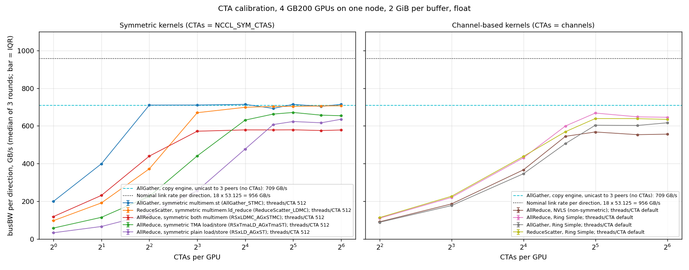
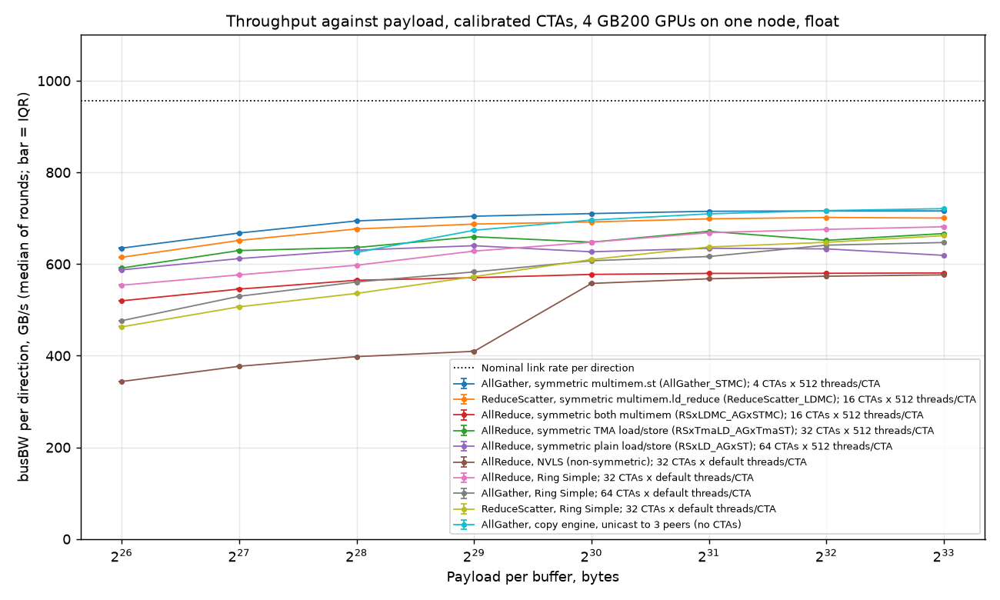
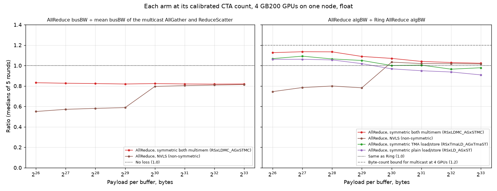
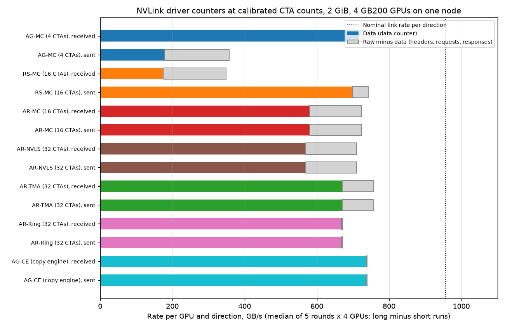

# Degradation check on GB200 (plan 01): status and log

**Status (2026-11-26): E1.1–E1.4 done. E1.1 and E1.2 interactively on `b3-11`; E1.3 and E1.4 as batch job 238369 on `b3-36`. Not yet done: the E1.3 repeat on a second node (plan `e1_3_repeat`) and the harness reproduction (E1.5, needs the `mm_mix` port).** Plan: [01_degradation_check.md](01_degradation_check.md). Series: [PLANS.md](../PLANS.md).

**Question:** on one GB200 node (4 GPUs), does NVLS AllReduce move less data per link direction than NVLS AllGather and NVLS ReduceScatter alone, by how much, and does each busy link direction then run at the same raw rate as in the other patterns?

**Answer (one node, one batch session; a second-node repeat is pending):** yes. With every kernel at its calibrated CTA count, the symmetric multicast AllReduce reaches 0.82 of the mean busBW of its two halves at every size from 64 MiB to 8 GiB (H100: 0.865), and only 2–13% more algBW than Ring AllReduce (13% at 64–256 MiB, 4% at 2 GiB, 2% at 8 GiB), against a byte-count bound of 20%. The link counters show why, for the most part: on each direction, the mix carries exactly the raw bytes that the two halves carry alone on that direction (1.062 + 0.500 = 1.562 raw bytes per payload byte, measured 1.562). The traffic each half puts on its low-data direction therefore lands on a full direction, and the multicast AllReduce spends 1.25 raw bytes per data byte, against 1.062 for each half and 1.005 for Ring. That explains about four fifths of the loss. The rest is a lower raw link rate: 724 GB/s per direction against 742–759 for the halves. So by the plan's strict rule this is case B (raw rate more than 2% lower), with the case-A mechanism dominant. Separately, no path fills the link: every pattern stops at 670–760 GB/s raw, 70–79% of the 956 GB/s nominal.

Raw run records stay in `results/<date>/.../raw/` on the shared home directory and are not in git; a rerun is needed elsewhere.

## Session log

| Date | Node (rack) | GPUs | What ran | Deviations | Results |
|---|---|---|---|---|---|
| 2026-11-26 | `b3-11-s1-dgx-03-c01` (rack 3), `beta_test` | 0–3 | NCCL build, nccl-tests build, one pilot (below) | Pilot only; no plan step run | `results/2026-11-26/pilot/` |
| 2026-11-26, 04:13–04:16 | same | 0–3 | First attempt at E1.1 + E1.2 | **Excluded**: AG-MC ran NCCL's copy-engine AllGather (see plan revision note); stopped after 9 runs | `results/2026-11-26/excluded_attempt1_b3-11/` (`EXCLUDED.txt`) |
| 2026-11-26, 04:18–04:40 | same | 0–3 | E1.1 (31 runs) and E1.2 (216 runs) with `common/scripts/run_in_container.sh` | E1.2 at `-n 30 -w 5` (plan: 50/10) | `results/2026-11-26/interactive_b3-11/` |
| 2026-11-26, 04:41 | same | 0–3 | E1.2 extension: AR-NVLS at 48 and 64 channels (6 runs, plan `e1_2b`) | Added because AR-NVLS still rose at 32, the largest planned value | `results/2026-11-26/interactive_b3-11_e1_2b/` |
| 2026-11-26, 04:42 | same | 0–3 | Batch-path smoke test (plan `smoke`, 4 runs, calibrated CTAs) | Pre-flight only, not a result | `results/2026-11-26/smoke_b3-11/` |
| 2026-11-26, 05:31–06:26 | `b3-36-s1-dgx-03-c17` (rack 3), batch job 238369 on `beta`, `standard` | 0–3 | E1.3 (565 runs) then E1.4 (70 runs), `common/jobs/plan01.sbatch` | Image pulled from `nvcr.io` (no `.sqsh` yet, about 1 minute). 10 AG-CE runs at 64 and 128 MiB excluded: below 256 MiB NCCL used a TMA AllGather kernel (`AllGather_TmaST`), not the copy engine. All other 625 runs `ok` | `results/2026-11-26/job_238369/`; tables `results/2026-11-26/tables_job_238369/`; figures `results/2026-11-26/figures_job_238369/` |

## Words used in this report

| Word | Meaning | Id in [00_common_setup.md](../00_common_setup.md) and the H100 setups |
|---|---|---|
| algBW | Buffer bytes ÷ time per call, nccl-tests out-of-place column | S1 |
| busBW | algBW × data bytes per payload byte on the busier direction (AllGather/ReduceScatter multicast 1; AllReduce multicast 1.25; AllReduce Ring, TMA, plain load/store 1.5; Ring AllGather/ReduceScatter and copy-engine AllGather 0.75) | S6 |
| Data counter, raw counter | `nvidia-smi nvlink -gt d` and `-gt r`, summed over 18 links per GPU and direction | B3 |
| Data (raw) bytes per payload byte | Counter bytes, long run minus short run, ÷ payload bytes of the extra calls | R8 (R9) |
| Raw link rate | Raw counter bytes ÷ time of the extra calls | R10 |
| Share of nominal | Raw link rate ÷ 956 GB/s (18 × 53.125 GB/s) | G2 |
| Calibrated CTA count | First CTA count after which two successive increases each add less than 1% busBW | — |

All runs: 4 GPUs (physical 0–3) of one node, one process (`-t 1 -g 4`), `float`, `sum`, NCCL 2.32.3 (`build-gb200`, `sm_100`), nccl-tests 2.22.0, clocks not locked. E1.1 and E1.2 on `b3-11-s1-dgx-03-c01`, E1.3 and E1.4 on `b3-36-s1-dgx-03-c17` (both rack 3). The calibrated CTA counts from `b3-11` were used unchanged on `b3-36`; E1.3 at 2 GiB reproduces the calibration values within 1% (for example AR-MC 579.6 against 578.9 GB/s busBW). Raw run records: `results/2026-11-26/*/raw/` (not in git). Tables: [`results/2026-11-26/tables/`](results/2026-11-26/tables/) (E1.1, E1.2) and [`results/2026-11-26/tables_job_238369/`](results/2026-11-26/tables_job_238369/) (E1.3, E1.4).

## Kernel selection, correctness and counters (E1.1)

### Motivation

Before any comparison: does each arm run the kernel it names, are results correct, and does the driver's data counter count what the byte model says? A wrong kernel or misread counter would look like a degradation or hide one.

### Setup

| Knob | Value |
|---|---|
| **Controlled independent variable** | **Arm**: AG-MC, AG-CE, RS-MC, AR-MC, AR-TMA, AR-LDST, AR-NVLS, AR-Ring, AG-Ring, RS-Ring, AR-Tuner (NCCL's own choice) |
| CTAs × threads/CTA | NCCL defaults, read from the log (table below) |
| Payload | 2 GiB per buffer |
| Runs | Correctness: `-c 1 -n 5 -w 2`. Counters: long `-n 200 -w 20` and short `-n 40 -w 20`, `-c 0`, back to back. 1 round |
| Plan | [`configs/plans/e1_1.json`](configs/plans/e1_1.json) |

### Method

As planned, plus one arm (AG-CE) and one environment setting (AG-MC raises `NCCL_SYM_CE_THRESHOLD`); see the revision note in the plan. The first attempt, where AG-MC silently ran the copy engine, is excluded and kept.

### Results

Every run launched its named kernel; all 11 correctness runs reported 0 wrong values.

| Arm | Launched (NCCL default) | algBW, GB/s |
|---|---|---|
| AG-MC | `AllGather_STMC`, 4 CTAs × 512 threads/CTA | 707.9 |
| AG-CE | copy engine | 937.5 |
| RS-MC | `ReduceScatter_LDMC`, 6 × 512 | 541.4 |
| AR-MC | `AllReduce_RSxLDMC_AGxSTMC`, 6 × 512 | 446.6 |
| AR-TMA | `AllReduce_RSxTmaLD_AGxTmaST`, 14 × 512 | 376.5 |
| AR-LDST | `AllReduce_RSxLD_AGxST`, 14 × 512 | 288.9 |
| AR-NVLS | NVLS Simple, 24 channels | 434.7 |
| AR-Ring | Ring Simple, 32 channels | 443.6 |
| AR-Tuner | Ring Simple, 32 channels (NCCL's choice) | 443.6 |
| AG-Ring | Ring Simple, 32 channels | 799.3 |
| RS-Ring | Ring Simple, 32 channels | 845.3 |

Link counters at NCCL defaults (one long/short pair; medians over the 4 GPUs, spread across GPUs below 0.5%):

| Arm (NCCL default CTAs) | Direction | Data bytes per payload byte | Raw bytes per payload byte | Raw bytes per data byte | Data rate, GB/s | Raw link rate, GB/s | Share of nominal |
|---|---|---|---|---|---|---|---|
| AG-MC | received | 1.000 | 1.062 | 1.062 | 710 | 754 | 0.79 |
| | sent | 0.250 | 0.500 | 2.000 | 177 | 355 | 0.37 |
| RS-MC | sent | 1.000 | 1.062 | 1.062 | 542 | 576 | 0.60 |
| | received | 0.250 | 0.500 | 2.000 | 136 | 271 | 0.28 |
| AR-MC | each | 1.250 | 1.562 | 1.250 | 560 | 700 | 0.73 |
| AR-NVLS | each | 1.251 | 1.564 | 1.250 | 546 | 682 | 0.71 |
| AR-Ring | each | 1.500 | 1.508 | 1.005 | 669 | 673 | 0.70 |
| AR-TMA | each | 1.500 | 1.695 | 1.130 | 562 | 634 | 0.66 |
| AR-LDST | each | 1.500 | 1.702 | 1.135 | 434 | 493 | 0.52 |
| AG-CE | each | 0.750 | 0.752 | 1.002 | 737 | 739 | 0.77 |
| AG-Ring | each | 0.750 | 0.754 | 1.005 | 615 | 618 | 0.65 |
| RS-Ring | each | 0.750 | 0.754 | 1.005 | 639 | 643 | 0.67 |

### Interpretation

- **The data counter is usable.** Data bytes per payload byte equal the byte model to 0.1% for every arm (1 and 0.25 for the multicast halves, 1.25 for multicast AllReduce, 1.5 for the load/store AllReduces, 0.75 for Ring AllGather/ReduceScatter).
- **The copy-engine AllGather is unicast.** It carries 0.75 data bytes per payload byte each way, like Ring, so its 945 GB/s algBW is 709 GB/s of data per direction (77% of nominal raw). It does not fill the link.
- **Raw bytes per data byte differ by path, already at default CTAs.** Ring and copy-engine traffic cost about 1.005; each multicast half 1.062 on its busy direction and 2.0 on its low-data direction; both multicast AllReduces 1.25 on both directions; the symmetric TMA and plain load/store AllReduces 1.13. On H100 the same quantities were 1.16 (Ring), 1.135 / 1.189 (halves), 1.34 (multicast AllReduce). These values are at NCCL default CTAs, not at the calibrated counts; the classification into the plan's cases waits for E1.4.

## CTA calibration (E1.2)

### Motivation

The pilot ran every arm at NCCL's default CTA count, 56–68% of nominal. A gap between arms could be only a difference in default CTA counts (AR-MC defaults to 6 CTAs). Every later comparison uses the count where more CTAs stop helping.

### Setup

| Knob | Value |
|---|---|
| **Controlled independent variable** | **CTAs per GPU** |
| Symmetric arms (AG-MC, RS-MC, AR-MC, AR-TMA, AR-LDST) | `NCCL_SYM_CTAS` = 1, 2, 4, 8, 16, 24, 32, 48, 64 (64 = NCCL's maximum); 512 threads/CTA (NCCL's choice, from the log) |
| Ring arms (AR-Ring, AG-Ring, RS-Ring) | `NCCL_MIN_NCHANNELS = NCCL_MAX_NCHANNELS` = 4, 8, 16, 24, 32, 48, 64; threads/CTA NCCL default (not logged) |
| AR-NVLS | `NCCL_NVLS_NCHANNELS` = 4, 8, 16, 24, 32, and in an extension 48, 64 |
| AG-CE | No CTA knob; 3 runs as reference |
| Fixed | 2 GiB, `-n 30 -w 5`, `-c 0` |
| Rounds | 3, all settings shuffled within each round |
| Plans | [`e1_2.json`](configs/plans/e1_2.json), [`e1_2b.json`](configs/plans/e1_2b.json) |

### Method

222 runs, all launched with the requested CTA count (checked in each log). Stopping rule fixed before the runs (above); applied by [`pick_calibration.py`](../../common/scripts/pick_calibration.py). AR-NVLS was extended to 48 and 64 channels because it still rose at 32.

### Results

busBW per direction, GB/s, median of 3 rounds (interquartile range at every point ≤ 3 GB/s):

| Arm | 1 | 2 | 4 | 8 | 16 | 24 | 32 | 48 | 64 | Calibrated CTA count | Rule |
|---|---|---|---|---|---|---|---|---|---|---|---|
| AG-MC | 200 | 399 | 710 | 711 | 714 | 693 | 714 | 704 | 714 | **4** | plateau |
| RS-MC | 98 | 192 | 373 | 670 | 699 | 703 | 703 | 706 | 707 | **16** | plateau |
| AR-MC | 119 | 232 | 440 | 572 | 579 | 579 | 579 | 576 | 578 | **16** | plateau |
| AR-TMA | 59 | 116 | 227 | 441 | 631 | 663 | 671 | 657 | 654 | **32** | plateau; 2% lower above 32 |
| AR-LDST | 34 | 67 | 132 | 257 | 478 | 607 | 623 | 617 | 635 | **64** | still +2% at 64 (NCCL maximum) |
| AR-NVLS | | | 92 | 187 | 367 | 545 | 568 | 554 | 556 | **32** | best; 2% lower above 32 |
| AR-Ring | | | 111 | 221 | 431 | 600 | 668 | 648 | 646 | **32** | plateau; 3% lower above 32 |
| AG-Ring | | | 89 | 178 | 347 | 506 | 604 | 602 | 617 | **64** | still +2% at 64 (NCCL maximum) |
| RS-Ring | | | 114 | 227 | 438 | 570 | 639 | 639 | 635 | **32** | plateau |
| AG-CE (no CTAs) | | | | | | | | | | — | 709 GB/s busBW (945 algBW) |

### Interpretation

- **Every arm reaches a ceiling well below nominal.** The best busBW of any arm is 714 GB/s (AG-MC), 75% of the 956 GB/s nominal. Even the copy engine stops at 709. On H100 every pattern ran within 5% of nominal. What limits all paths near 700 GB/s on GB200 is open (plan 02, E2.6).
- **The multicast AllReduce saturates early and low.** AR-MC is flat from 8–16 CTAs at 579 GB/s, while its two halves reach 714 (AG-MC) and 707 (RS-MC). AR-MC busBW ÷ mean of the halves' busBW = 578.9 ÷ mean(710.4, 698.7) = 0.822 at the calibrated counts, and 579.4 ÷ mean(714.3, 706.6) = 0.815 using each arm's best point (H100: 0.865). This is a calibration-run value at one size; E1.3 measures it with 5 rounds over sizes.
- **Ring AllReduce beats the multicast AllReduce in algBW.** At calibrated counts, Ring AllReduce busBW 668 = algBW 445 GB/s; AR-MC 579 = algBW 463 GB/s. So NVLS AllReduce gains only about 4% over Ring at 2 GiB on 4 GPUs, against a byte-count bound of 20%. The non-symmetric NVLS AllReduce (algBW 454 at 32 channels) gains 2%.
- **More CTAs can hurt.** AR-TMA, AR-NVLS and AR-Ring lose 2–3% above 32 CTAs (671 → 657, 568 → 554, 668 → 648 GB/s); AG-MC dips at 24 and 48. The calibrated count is the smallest count on the plateau, not the largest tested.
- **Two arms do not meet the stopping rule at NCCL's maximum of 64**: AG-Ring and AR-LDST still gain about 2% from 32 to 64. Their calibrated count is 64, marked "not saturated". They are references, not the arms under test.

## Throughput against payload size (E1.3)

### Motivation

The primary measurement: completed-collective throughput of NVLS AllReduce against its two halves and against Ring, over the sizes where real workloads use AllReduce, without any counter. The plan's expectation was a mixing ratio below 0.97 if the H100 degradation carries over, and a gain over Ring below the 1.20 byte-count bound.

### Setup

| Knob | Value |
|---|---|
| **Controlled independent variable** | **Arm × payload size** |
| Arms and CTAs × threads/CTA (calibrated, from E1.2) | AG-MC 4 × 512, RS-MC 16 × 512, AR-MC 16 × 512, AR-TMA 32 × 512, AR-LDST 64 × 512, AR-NVLS 32 channels, AR-Ring 32 channels, AG-Ring 64 channels, RS-Ring 32 channels (Ring and NVLS threads/CTA: NCCL default), AG-CE copy engine |
| Payload | 64 MiB – 8 GiB per buffer, powers of 2 |
| Also at NCCL defaults | All arms plus AR-Tuner (NCCL's own choice) at 256 MiB, 1 GiB, 4 GiB |
| Iterations | `-n 100 -w 20` below 1 GiB, `-n 50 -w 10` from 1 GiB, `-c 0` |
| Rounds | 5, all configurations shuffled within each round, one session |
| Plan | [`configs/plans/e1_3.json`](configs/plans/e1_3.json) |

### Method

As planned, in batch job 238369. The 10 AG-CE runs at 64 and 128 MiB are excluded (NCCL chose a TMA kernel there, not the copy engine), so AG-CE has points from 256 MiB only. The second-session repeat (step 5 of the plan) has not run yet, so the spread below is within one session only.

### Results

busBW per direction, GB/s, median of 5 rounds, calibrated CTA counts (interquartile range ≤ 3.1 GB/s everywhere, ≤ 1.4 GB/s for AG-MC, RS-MC and AR-MC):

| Arm (CTAs) | 64 MiB | 128 MiB | 256 MiB | 512 MiB | 1 GiB | 2 GiB | 4 GiB | 8 GiB |
|---|---|---|---|---|---|---|---|---|
| AG-MC (4 × 512) | 634.8 | 667.8 | 694.2 | 704.5 | 710.2 | 715.2 | 716.0 | 715.9 |
| RS-MC (16 × 512) | 614.8 | 651.6 | 676.7 | 687.3 | 692.0 | 698.8 | 701.7 | 700.5 |
| **AR-MC (16 × 512)** | **519.9** | **545.4** | **564.7** | **570.2** | **577.5** | **579.6** | **579.9** | **580.7** |
| AR-NVLS (32 channels) | 343.8 | 377.0 | 398.1 | 409.6 | 557.8 | 567.9 | 573.5 | 576.5 |
| AR-TMA (32 × 512) | 591.4 | 629.5 | 636.1 | 659.7 | 647.9 | 671.5 | 651.9 | 666.6 |
| AR-LDST (64 × 512) | 587.4 | 612.0 | 630.4 | 640.1 | 626.8 | 634.5 | 633.2 | 619.0 |
| AR-Ring (32 channels) | 553.9 | 576.5 | 597.5 | 628.4 | 647.7 | 668.5 | 675.7 | 681.4 |
| AG-Ring (64 channels) | 476.5 | 529.8 | 560.9 | 582.9 | 607.3 | 616.5 | 641.3 | 647.0 |
| RS-Ring (32 channels) | 463.0 | 506.8 | 536.0 | 572.6 | 610.0 | 637.3 | 647.5 | 662.0 |
| AG-CE (copy engine) | — | — | 625.4 | 673.8 | 696.1 | 709.6 | 716.8 | 720.9 |

Derived ratios (from the medians above; AllReduce algBW = busBW ÷ 1.25 for multicast and NVLS, ÷ 1.5 for TMA, plain load/store and Ring):

| Payload | AR-MC busBW ÷ mean(AG-MC, RS-MC) | AR-NVLS busBW ÷ same | AR-MC algBW ÷ Ring | AR-NVLS algBW ÷ Ring | AR-TMA algBW ÷ Ring |
|---|---|---|---|---|---|
| 64 MiB | 0.832 | 0.550 | 1.126 | 0.745 | 1.068 |
| 128 MiB | 0.827 | 0.571 | 1.135 | 0.785 | 1.092 |
| 256 MiB | 0.824 | 0.581 | 1.134 | 0.800 | 1.065 |
| 512 MiB | 0.819 | 0.589 | 1.089 | 0.782 | 1.050 |
| 1 GiB | 0.824 | 0.796 | 1.070 | 1.033 | 1.000 |
| 2 GiB | 0.820 | 0.803 | 1.040 | 1.019 | 1.005 |
| 4 GiB | 0.818 | 0.809 | 1.030 | 1.018 | 0.965 |
| 8 GiB | 0.820 | 0.814 | 1.023 | 1.015 | 0.978 |

At NCCL defaults (CTAs chosen by NCCL), NCCL's own choice for AllReduce was Ring, Simple, 32 channels at all three sizes tested, with algBW 397.1 (256 MiB), 432.0 (1 GiB) and 449.1 GB/s (4 GiB). The calibrated multicast AllReduce reached 451.7, 462.0 and 463.9 GB/s at the same sizes, 14%, 7% and 3% more. Default CTA counts cost the multicast halves most: RS-MC at its default 6 CTAs reached 542 GB/s busBW at 1 GiB against 692 at 16 CTAs. The full default table is in `tables_job_238369/configs.csv` (block `e1_3_default`).

### Interpretation

- **The degradation exists on GB200, and it does not depend on size.** The multicast AllReduce reaches 0.818–0.832 of the mean busBW of its halves at every size from 64 MiB to 8 GiB, with interquartile ranges near 1 GB/s. This is below the plan's 0.97 threshold and a little below H100's 0.865. One session on one node; the second-node repeat is pending.
- **The multicast AllReduce gains little over Ring.** Its algBW is 13% above Ring at 64–256 MiB, where Ring has not yet reached its own plateau, and only 2–4% above Ring from 2 GiB up, against the 20% byte-count bound.
- **The non-symmetric NVLS AllReduce is much slower below 1 GiB.** At 32 channels it reaches only 0.55–0.59 of the halves' mean (0.75–0.80 of Ring) up to 512 MiB, then jumps to the multicast-AllReduce level at 1 GiB. The cause (for example a chunk-size or protocol switch at 1 GiB) is not examined here.
- **The TMA and plain load/store AllReduces are about as fast as Ring** (0.97–1.09 of Ring algBW), as the byte model predicts for non-multicast AllReduce.
- **NCCL's tuner leaves throughput unused at this node size.** It picks Ring at 256 MiB – 4 GiB, while the multicast kernel at 16 CTAs would be 3–14% faster in algBW.

## Link-counter accounting (E1.4)

### Motivation

E1.3 says that data rate is lost. E1.4 asks where the link time goes: if the multicast AllReduce runs its busy directions at the same raw rate as its halves, the link time is spent on non-data bytes (the plan's case A, the H100 answer); if at a lower raw rate, part of the time is idle (case B).

### Setup

| Knob | Value |
|---|---|
| **Controlled independent variable** | **Arm**: AG-MC (4 × 512), RS-MC (16 × 512), AR-MC (16 × 512), AR-NVLS (32 channels), AR-TMA (32 × 512), AR-Ring (32 channels), AG-CE (copy engine) |
| Payload | 2 GiB |
| Counter runs | Long `-n 200 -w 20` and short `-n 40 -w 20`, `-c 0`, back to back; long minus short = 320 calls |
| Rounds | 5, arms shuffled, pairs back to back |
| Plan | [`configs/plans/e1_4.json`](configs/plans/e1_4.json) |

### Method

As planned, after E1.3 in the same batch job. 70 runs, all `ok`. Values are medians over 5 rounds × 4 GPUs; every GPU and round gave the same raw link rate within 1 GB/s.

### Results

| Arm (CTAs) | Direction | Data bytes per payload byte | Raw bytes per payload byte | Raw bytes per data byte | Data rate, GB/s | Raw link rate, GB/s | Share of nominal |
|---|---|---|---|---|---|---|---|
| AG-MC (4) | received (busy) | 1.000 | 1.062 | 1.062 | 714 | 759 | 0.794 |
| | sent (low-data) | 0.250 | 0.500 | 2.000 | 178 | 357 | 0.373 |
| RS-MC (16) | sent (busy) | 1.000 | 1.062 | 1.062 | 698 | 742 | 0.776 |
| | received (low-data) | 0.250 | 0.500 | 2.000 | 175 | 349 | 0.365 |
| **AR-MC (16)** | each | 1.250 | **1.562** | **1.250** | **580** | **724** | 0.757 |
| AR-NVLS (32) | each | 1.250 | 1.563 | 1.250 | 568 | 710 | 0.743 |
| AR-TMA (32) | each | 1.500 | 1.694 | 1.129 | 670 | 756 | 0.791 |
| AR-Ring (32) | each | 1.500 | 1.508 | 1.005 | 668 | 672 | 0.702 |
| AG-CE (copy engine) | each | 0.750 | 0.752 | 1.002 | 737 | 739 | 0.773 |

Split of the multicast AllReduce's data-rate loss against the mean of its halves (data rate = raw link rate ÷ raw bytes per data byte):

| Factor | Halves (mean) | AR-MC | Ratio |
|---|---|---|---|
| Raw bytes per data byte on the busy direction | 1.062 | 1.250 | 1.062 ÷ 1.250 = 0.850 |
| Raw link rate on the busy direction, GB/s | (759 + 742) ÷ 2 = 750.5 | 724 | 0.965 |
| Data rate, GB/s | (714 + 698) ÷ 2 = 706 | 580 | 0.821 = 0.850 × 0.965 |

### Interpretation

- **The data and raw counters add up exactly in the mix.** On each direction, AR-MC carries 1.562 raw bytes per payload byte = 1.062 (the busy direction of one half) + 0.500 (the low-data direction of the other half). On H100 the raw bytes of the mix were smaller than this sum; on GB200 nothing disappears.
- **Most of the loss is non-data bytes on a busy direction (the H100 mechanism).** Each half alone sends 0.25 data and 0.25 non-data bytes per payload byte on its low-data direction, where they cost nothing. In the mix both directions are busy, so these bytes take link time from data: 1.25 raw bytes per data byte against 1.062. This factor alone accounts for 0.850 of the 0.821.
- **The rest is a lower raw link rate.** AR-MC runs 724 GB/s raw per direction against 742–759 for its halves and 756 for the TMA AllReduce. By the plan's rule (more than 2% lower) this is case B; with the extra-bytes factor dominant, plan 02 should test both the packet explanation (E2.3–E2.5) and the limit before the link (E2.6).
- **What the non-data bytes are is not measured.** The raw counter does not split packet types; on H100 the profiler found read requests from the switch and write responses. On GB200 that split needs admin-only counters (plan 02, E2.2). Ring traffic costs only 1.005 raw bytes per data byte, and the copy engine 1.002, so the 1.062 of each multicast half is already multicast-specific.
- **No arm fills the link.** The highest raw link rate is 759 GB/s (79% of nominal). Ring stops at 672 raw with almost no overhead; the copy engine at 739. A common limit below the link applies to every path (plan 02, E2.6).

## Pilot (2026-11-26, not part of the plan)

**Purpose:** check that the new build runs, that NVLS multicast works on this node, and get rough numbers for the plan's expectations. One run per arm, no calibration, no rounds, no link counters, clocks not recorded. These numbers are not results of this series and must not be used as references.

**Setup:** nccl-tests 2.22.0, `-g 4 -n 50 -w 10`, 1 GiB, `float`, out-of-place, NCCL 2.32.3 from `build-gb200`, CTAs × threads/CTA: NCCL defaults (NVLS: 24 channels; not read for Ring). NVLS arms were selected with `NCCL_ALGO=NVLS` without buffer registration, so they ran NCCL's non-symmetric NVLS kernels, not the symmetric `*_STMC` / `*_LDMC` kernels of the plan. NCCL logged "NVLS multicast support is available on dev N, transport enabled, symmetric multimem enabled" for every GPU.

| Arm (NCCL defaults) | algBW, GB/s | Data bytes per payload byte, busier direction | busBW, GB/s | busBW ÷ 956 GB/s nominal |
|---|---|---|---|---|
| AllGather, `NCCL_ALGO=NVLS` | 592.5 | 1 | 592.5 | 0.62 |
| ReduceScatter, `NCCL_ALGO=NVLS` | 619.3 | 1 | 619.3 | 0.65 |
| AllReduce, `NCCL_ALGO=NVLS` | 429.4 | 1.25 | 536.7 | 0.56 |
| AllReduce, `NCCL_ALGO=RING` | 432.5 | 1.5 | 648.8 | 0.68 |
| AllGather, `NCCL_ALGO=RING` | 779.8 | 0.75 | 584.8 | 0.61 |
| ReduceScatter, `NCCL_ALGO=RING` | 811.9 | 0.75 | 608.9 | 0.64 |

busBW uses the per-direction factors of the [common setup](../00_common_setup.md#metrics-added-in-this-series), not the nccl-tests `busbw` column.

Derived from the table: NVLS AllReduce busBW ÷ mean(NVLS AllGather, NVLS ReduceScatter busBW) = 536.7 ÷ 605.9 = 0.886 (H100 at 4 GPUs: 0.865). NVLS AllReduce algBW ÷ Ring AllReduce algBW = 0.99 (H100 at 4 GPUs: 1.03–1.04).

NCCL's own choice for AllReduce with no `NCCL_ALGO` (`NCCL_DEBUG_SUBSYS=TUNING`): Ring, Simple at 512 MiB, 1 GiB and 2 GiB. algBW at defaults: 396.9 (256 MiB), 414.1 (512 MiB), 432.0 (1 GiB), 445.4 GB/s (2 GiB). Log: `results/2026-11-26/pilot/raw/all_reduce_default_256M_2G.log` (the other pilot runs printed to the terminal only and were not saved).

**What the pilot suggests for the plan (not findings):** a degradation of about the H100 size may exist, but every arm ran at only 56–68% of the nominal link rate, where on H100 every pattern ran within 5% of nominal. So the CTA calibration (E1.2) and the raw-link-rate check (E1.4) decide whether the H100 explanation (a full link carrying extra non-data bytes) can apply at all.
