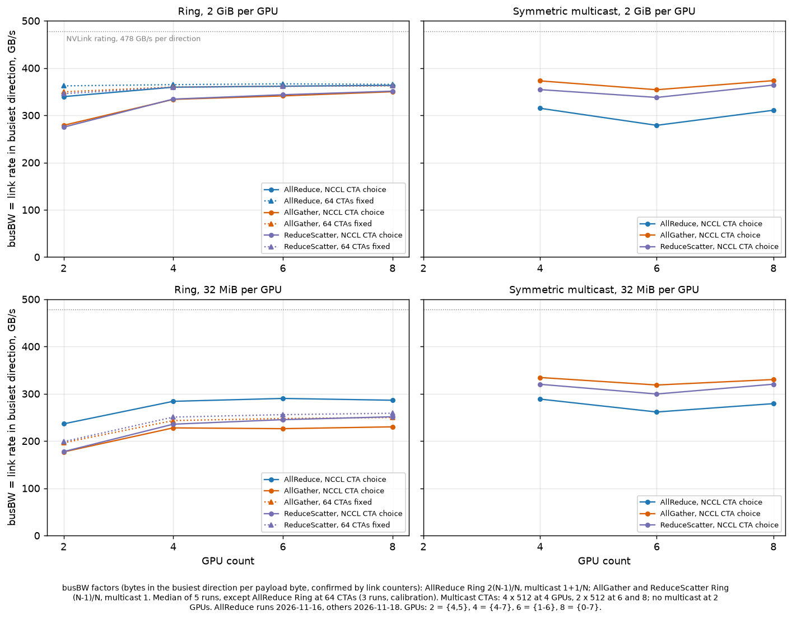
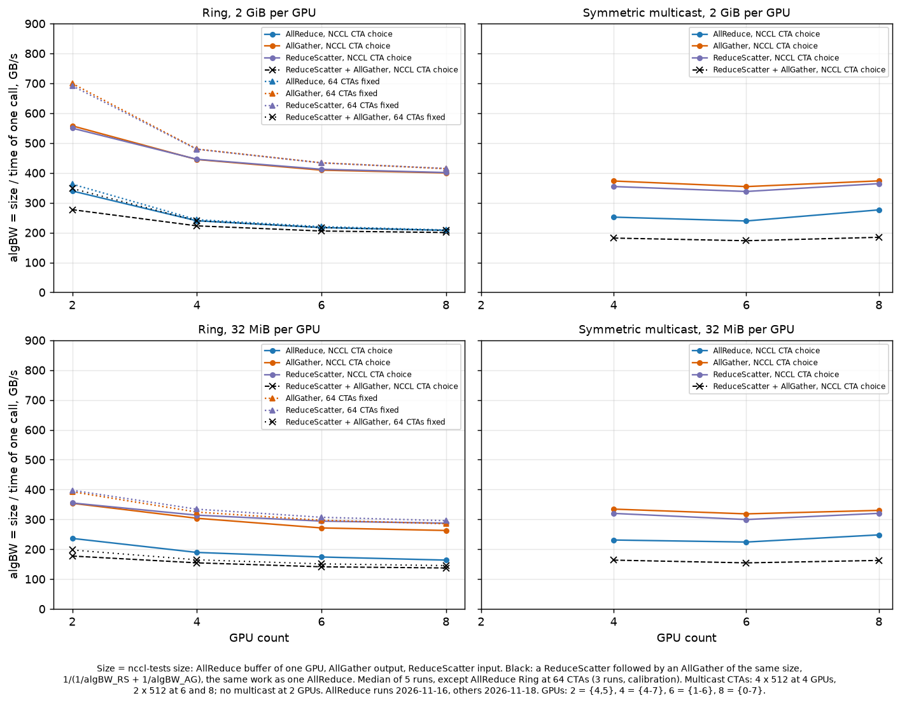
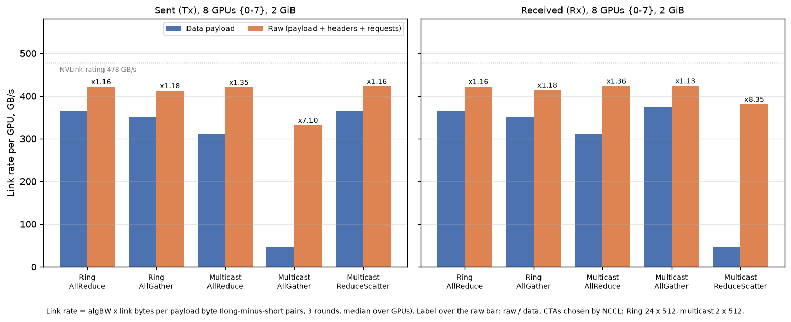
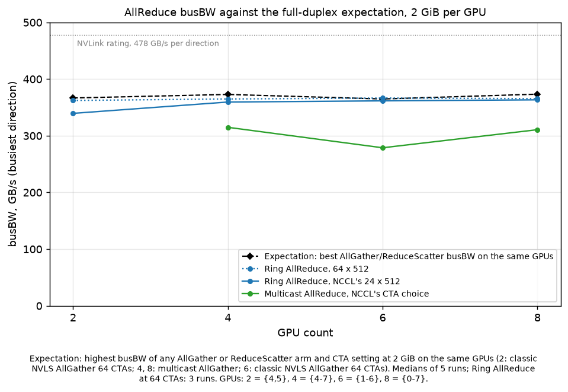

# busBW and algBW of AllReduce, AllGather and ReduceScatter with Ring and symmetric multicast

**Status (2026-11-18): analysis of recorded data, plus one new check (raw link counters, 30 runs on all 8 GPUs, 17:39–17:47 UTC, all valid).** Plan: [02_busbw_comparison.md](02_busbw_comparison.md). AllReduce data from the [AllReduce series](../../../allreduce/scalability/PLANS.md) (2026-11-16); AllGather and ReduceScatter data from [plan 01 of this series](../symmetric_multicast/README.md) (2026-11-18).

**Question:** with the same GPUs, payload sizes and CTA settings, how fast does each collective drive the NVLink link in its busiest direction (busBW), and how fast does it finish its work (algBW), when implemented by Ring and by symmetric multicast?

**Answer:** Ring drives the link at the same rate for all three collectives once it has enough CTAs: 346–367 GB/s at 2 GiB with 64 CTAs, at every GPU count. Symmetric multicast does not: at 2 GiB, AllGather (354–373 GB/s) and ReduceScatter (338–364 GB/s) reach about the Ring rate (−7% to +4%), but AllReduce reaches only 279–315 GB/s, 14–24% below Ring, although its kernel is a multicast ReduceScatter and a multicast AllGather fused. At 32 MiB multicast drives the link 17–37% faster than Ring with 64 CTAs for AllGather and ReduceScatter, because it needs few CTAs and no per-step waits; for AllReduce it is within −10% to +2% of Ring. All three multicast collectives dip at 6 GPUs. In rate (algBW), multicast wins AllReduce (1.04–1.33 times Ring at 2 GiB, 1.22–1.52 at 32 MiB) and loses AllGather and ReduceScatter at 2 GiB (0.74–0.90 of Ring with 64 CTAs). A multicast AllReduce is 1.38–1.53 times as fast as a multicast ReduceScatter followed by a multicast AllGather doing the same work, while for Ring the two take the same time (AllReduce 1.01–1.04 times the pair with 64 CTAs). busBW equals the link data rate measured with the counters. **Multicast AllReduce is below expectation:** NVLink is full duplex, so although AllReduce carries more bytes per payload byte in each direction (1 + 1/N against 1 for AllGather and ReduceScatter), each direction should run at the same rate, and busBW already divides out the extra bytes; multicast AllReduce should therefore reach the 354–373 GB/s of multicast AllGather and ReduceScatter (and Ring AllReduce reaches 365 GB/s with both directions full). It reaches 279–315 GB/s, 11–24% short. The raw link counters show where the link time goes: every pattern runs its busiest direction at 412–423 GB/s raw, but multicast AllReduce spends 1.35–1.36 raw bytes per data byte on it against 1.13–1.18 for all other patterns. The extra is protocol traffic (read requests and write responses) that its access pattern puts into directions already full of data; this is a shortfall of the multicast AllReduce path, not something the link requires. By the same full-duplex reasoning **Ring AllReduce is as expected at 2 GiB**: with 64 CTAs it reaches 0.98–1.00 of the best busBW of any AllGather or ReduceScatter setting on the same GPUs, with both directions full and only 1.16 raw bytes per data byte; at 32 MiB it is about 21% below its 2 GiB rate because of its per-step pipeline.

## Words used in this report

| Word | Meaning | Id in the [AllReduce series setup](../../../allreduce/scalability/00_common_setup.md#metric-registry) |
|---|---|---|
| Payload, size (S) | The nccl-tests size: AllReduce: buffer of one GPU; AllGather: output of one GPU; ReduceScatter: input of one GPU | |
| Rate (algBW) | S ÷ time of one call, out-of-place | S1 |
| Raw link bytes | Link bytes as `nvidia-smi nvlink -gt r` counts them: payload plus protocol traffic (packet headers, read requests, write responses). The data counter (`-gt d`) used everywhere else counts payload only | |
| ReduceScatter + AllGather | A ReduceScatter followed by an AllGather of the same size S: rate 1 ÷ (1/algBW of ReduceScatter + 1/algBW of AllGather). It does the work of one AllReduce of size S | |
| busBW | Rate × bytes one GPU moves in its busiest link direction per payload byte; that is, the link rate in the busiest direction | S6 |
| Link bytes per payload byte | Measured with the NVLink counters | S4 |
| NCCL's CTA choice | CTA count NCCL picks with no CTA setting: Ring 24 × 512; multicast 4 × 512 at 4 GPUs, 2 × 512 at 6 and 8 GPUs | |

## busBW in the busiest link direction

### Motivation

The usual nccl-tests `busbw` uses the Ring formula for every algorithm, so it cannot compare Ring with multicast, and its factor differs between collectives. Here busBW uses the bytes each arm really moves in its busiest direction, so it is the link rate and is comparable across collectives and arms. The AllReduce series found Ring at about 360 GB/s and multicast lower; plan 01 of this series found multicast AllGather and ReduceScatter at about the Ring rate.

### Setup

| Item | Value |
|---|---|
| **Compared** | **Collective: AllReduce, AllGather, ReduceScatter**, for each arm and GPU count |
| Arms, CTAs × threads/CTA | Ring at NCCL's choice (24 × 512) and at 64 × 512; symmetric multicast at NCCL's choice (`AllReduce_RSxLDMC_AGxSTMC`, `AllGather_STMC`, `ReduceScatter_LDMC`) |
| GPU counts and sets | 2 = {4,5}, 4 = {4–7}, 6 = {1–6}, 8 = {0–7}; multicast not available at 2 GPUs |
| Payload | 2 GiB and 32 MiB |
| Harness | nccl-tests, `-t 1 -g N`, `float`, sum, 5 warm-up and 20 timed calls, in-tree NCCL 2.32.3 |

busBW factors (bytes in the busiest direction per payload byte):

| Collective | Ring | Symmetric multicast | Measured with link counters |
|---|---|---|---|
| AllReduce | 2(N − 1)/N | 1 + 1/N (both directions) | AllReduce plan 04, all GPU counts, within 0.01% |
| AllGather | (N − 1)/N | 1 (received; 1/N sent) | Plan 01 of this series, 4 and 8 GPUs, exact |
| ReduceScatter | (N − 1)/N | 1 (sent; 1/N received) | Plan 01 of this series, 4 and 8 GPUs, exact |

### Method

No new runs. [`compare_busbw.py`](../../common/scripts/compare_busbw.py) reads the saved summaries and multiplies each median algBW by the factor above:

| Data | Source | Runs per point |
|---|---|---|
| AllReduce, 2 GiB, NCCL's choice | AllReduce plan 02 [`scaling_summary.csv`](../../../allreduce/scalability/gpu_count_scaling/results/2026-11-16/scaling_summary.csv) | 5 |
| AllReduce, 2 GiB, Ring 64 CTAs | AllReduce plan 01 [`calibration_summary.csv`](../../../allreduce/scalability/selection_calibration/results/2026-11-16/calibration_summary.csv) | 3 |
| AllReduce, 32 MiB | AllReduce plan 03 [`sweep_summary.csv`](../../../allreduce/scalability/payload_size/results/2026-11-16/sweep_summary.csv) | 5 |
| AllGather, ReduceScatter, 2 GiB | Plan 01 [`scaling_summary.csv`](../symmetric_multicast/results/2026-11-18/scaling_summary.csv) | 5 |
| AllGather, ReduceScatter, 32 MiB | Plan 01 [`payload_summary.csv`](../symmetric_multicast/results/2026-11-18/payload_summary.csv) | 5 |

Limits: AllReduce ran two days before AllGather and ReduceScatter. The AllReduce series found drift between sessions of the same day below 0.5%. Across days: the raw-counter check of 2026-11-18 measured AllReduce again at 8 GPUs, 2 GiB, NCCL's choice: multicast 276.3 and Ring 208.0 GB/s algBW, against 276.2 and 207.7 on 2026-11-16 (within 0.2%). There is no AllReduce Ring point at 64 CTAs and 32 MiB. At 6 GPUs, AllGather and ReduceScatter sizes are a few bytes below the power of two (nccl-tests rounds each piece to 16 B).

### Results

busBW in GB/s at **2 GiB** (algBW in brackets):

| Arm, CTAs × threads/CTA | Collective | 2 GPUs | 4 GPUs | 6 GPUs | 8 GPUs |
|---|---|---|---|---|---|
| Ring, 24 × 512 (NCCL) | AllReduce | 339.5 (339.5) | 359.5 (239.7) | 361.6 (217.0) | 363.4 (207.7) |
| | AllGather | 278.8 (557.6) | 333.7 (444.9) | 341.1 (409.4) | 349.9 (399.9) |
| | ReduceScatter | 274.9 (549.8) | 334.3 (445.7) | 343.5 (412.2) | 351.1 (401.3) |
| Ring, 64 × 512 | AllReduce (3 runs) | 362.3 (362.3) | 364.9 (243.3) | 366.6 (220.0) | 365.5 (208.9) |
| | AllGather | 349.7 (699.4) | 359.9 (479.8) | 361.5 (433.8) | 362.3 (414.1) |
| | ReduceScatter | 345.8 (691.6) | 359.5 (479.3) | 361.3 (433.6) | 362.9 (414.8) |
| Symmetric multicast (NCCL: 4, 2, 2 × 512) | AllReduce | n/a | 314.9 (251.9) | 278.8 (239.0) | 310.7 (276.2) |
| | AllGather | n/a | 372.9 (372.9) | 354.1 (354.1) | 373.4 (373.4) |
| | ReduceScatter | n/a | 354.4 (354.4) | 337.8 (337.8) | 364.0 (364.0) |

busBW in GB/s at **32 MiB** (algBW in brackets):

| Arm, CTAs × threads/CTA | Collective | 2 GPUs | 4 GPUs | 6 GPUs | 8 GPUs |
|---|---|---|---|---|---|
| Ring, 24 × 512 (NCCL) | AllReduce | 236.3 (236.3) | 284.0 (189.3) | 290.1 (174.1) | 286.3 (163.6) |
| | AllGather | 176.9 (353.9) | 227.8 (303.8) | 226.1 (271.4) | 230.0 (262.9) |
| | ReduceScatter | 177.5 (355.0) | 235.6 (314.2) | 245.2 (294.3) | 251.3 (287.2) |
| Ring, 64 × 512 | AllGather | 196.3 (392.6) | 243.3 (324.5) | 247.6 (297.2) | 249.8 (285.5) |
| | ReduceScatter | 198.7 (397.4) | 250.6 (334.1) | 255.8 (307.0) | 258.8 (295.7) |
| Symmetric multicast (NCCL: 4, 2, 2 × 512) | AllReduce | n/a | 288.7 (230.9) | 261.4 (224.1) | 279.1 (248.1) |
| | AllGather | n/a | 334.4 (334.4) | 318.5 (318.5) | 330.1 (330.1) |
| | ReduceScatter | n/a | 320.0 (320.0) | 299.5 (299.5) | 320.2 (320.2) |

All values with CTAs, threads and sources: [`busbw_comparison.csv`](results/2026-11-18/busbw_comparison.csv).

### Interpretation

- **Ring has one link rate for all three collectives.** With 64 CTAs it runs at 346–367 GB/s (72–77% of the rating) at 2 GiB, whatever the collective and GPU count. AllReduce is a ReduceScatter pass followed by an AllGather pass over the same ring, so this is expected. At NCCL's 24 CTAs, AllGather and ReduceScatter fall well short of that rate at 2 and 4 GPUs (275–334 GB/s), AllReduce much less (339.5 against 362.3 GB/s at 2 GPUs, the same at 4); why the same CTA count suffices for AllReduce was not investigated.
- **Multicast AllGather and ReduceScatter reach the Ring rate; multicast AllReduce does not.** At 2 GiB against Ring with 64 CTAs, multicast AllGather is 3–4% above at 4 and 8 GPUs and 2% below at 6; ReduceScatter is 1% below, 7% below and 0.3% above; multicast AllReduce is 14%, 24% and 15% below, at 4, 2 and 2 CTAs, where its CTA calibration was already flat. One difference is how the directions are loaded: multicast AllGather loads mainly the receive direction and ReduceScatter mainly the send direction (the other carries 1/N), while multicast AllReduce loads both at 1 + 1/N, and the switch does reductions and multicast copies at the same time. Ring AllReduce also loads both directions fully and still reaches 365 GB/s, so two busy directions alone do not explain the gap. This is below the full-duplex expectation; see "Expected busBW of multicast AllReduce" and "Raw link bytes".
- **At 32 MiB multicast drives the link fastest for AllGather and ReduceScatter** (300–334 GB/s against 243–259 for Ring with 64 CTAs, 17–37% more); for AllReduce it is within −10% (6 GPUs) to +2% of Ring at NCCL's choice (261–289 against 284–290). Multicast loses less of its 2 GiB link rate at 32 MiB (6–12%) than Ring (Ring AllGather at 64 CTAs: 31% at 8 GPUs), because a call has one start and end barrier and no per-step handoffs.
- **In rate (algBW) the byte factors decide the order.** For AllReduce, multicast needs fewer bytes than Ring, so at 8 GPUs its lower busBW still gives a 33% higher rate (276.2 against 207.7 GB/s). For AllGather and ReduceScatter it needs more, so at 2 GiB Ring with 64 CTAs leads in rate even where multicast's busBW is higher.
- **Every multicast collective dips at 6 GPUs** (AllReduce 278.8, AllGather 354.1, ReduceScatter 337.8 GB/s at 2 GiB, each below both 4 and 8 GPUs); Ring does not. The dip is common to the multicast path, not to one kernel.

## algBW and the AllReduce against ReduceScatter + AllGather

### Motivation

busBW says how well a collective uses the link; algBW says how fast it finishes. The two can order the arms differently because the arms move different bytes per payload byte. algBW values of different collectives are not directly comparable, because nccl-tests defines the size differently for each (see Words). An AllReduce of size S, however, does exactly the work of a ReduceScatter of size S followed by an AllGather of size S, so the two can be compared directly: this shows what fusing the two steps into one kernel gains for each arm.

### Setup

Same data, arms, GPU counts and payloads as the busBW section. The ReduceScatter + AllGather rate is computed from the two medians, not measured as one call.

### Method

[`compare_busbw.py`](../../common/scripts/compare_busbw.py) draws algBW per collective and the ReduceScatter + AllGather rate. The same limits apply as in the busBW section; in addition, the pair rate assumes no gap between the two calls.

### Results

algBW in GB/s at **2 GiB**:

| Arm, CTAs × threads/CTA | GPUs | AllReduce | AllGather | ReduceScatter | ReduceScatter + AllGather | AllReduce ÷ (ReduceScatter + AllGather) |
|---|---|---|---|---|---|---|
| Ring, 24 × 512 (NCCL) | 2 | 339.5 | 557.6 | 549.8 | 276.8 | 1.23 |
| | 4 | 239.7 | 444.9 | 445.7 | 222.7 | 1.08 |
| | 6 | 217.0 | 409.4 | 412.2 | 205.4 | 1.06 |
| | 8 | 207.7 | 399.9 | 401.3 | 200.3 | 1.04 |
| Ring, 64 × 512 | 2 | 362.3 (3 runs) | 699.4 | 691.6 | 347.8 | 1.04 |
| | 4 | 243.3 (3 runs) | 479.8 | 479.3 | 239.8 | 1.01 |
| | 6 | 220.0 (3 runs) | 433.8 | 433.6 | 216.8 | 1.01 |
| | 8 | 208.9 (3 runs) | 414.1 | 414.8 | 207.2 | 1.01 |
| Symmetric multicast (NCCL: 4, 2, 2 × 512) | 4 | 251.9 | 372.9 | 354.4 | 181.7 | 1.39 |
| | 6 | 239.0 | 354.2 | 337.8 | 172.9 | 1.38 |
| | 8 | 276.2 | 373.4 | 364.0 | 184.3 | 1.50 |

algBW in GB/s at **32 MiB**:

| Arm, CTAs × threads/CTA | GPUs | AllReduce | AllGather | ReduceScatter | ReduceScatter + AllGather | AllReduce ÷ (ReduceScatter + AllGather) |
|---|---|---|---|---|---|---|
| Ring, 24 × 512 (NCCL) | 2 | 236.3 | 353.9 | 355.0 | 177.2 | 1.33 |
| | 4 | 189.3 | 303.8 | 314.2 | 154.4 | 1.23 |
| | 6 | 174.1 | 271.4 | 294.3 | 141.2 | 1.23 |
| | 8 | 163.6 | 262.9 | 287.2 | 137.2 | 1.19 |
| Ring, 64 × 512 | 2 | not measured | 392.6 | 397.4 | 197.5 | |
| | 4 | not measured | 324.5 | 334.1 | 164.6 | |
| | 6 | not measured | 297.2 | 307.0 | 151.0 | |
| | 8 | not measured | 285.5 | 295.7 | 145.3 | |
| Symmetric multicast (NCCL: 4, 2, 2 × 512) | 4 | 230.9 | 334.4 | 320.0 | 163.5 | 1.41 |
| | 6 | 224.1 | 318.5 | 299.5 | 154.3 | 1.45 |
| | 8 | 248.1 | 330.1 | 320.3 | 162.6 | 1.53 |

Multicast ÷ Ring for each collective (Ring at 64 CTAs where measured, else NCCL's choice):

| Payload | GPUs | AllReduce (Ring at 64 CTAs at 2 GiB, NCCL's choice at 32 MiB) | AllGather (Ring 64) | ReduceScatter (Ring 64) |
|---|---|---|---|---|
| 2 GiB | 4 | 1.04 | 0.78 | 0.74 |
| 2 GiB | 6 | 1.09 | 0.82 | 0.78 |
| 2 GiB | 8 | 1.32 | 0.90 | 0.88 |
| 32 MiB | 4 | 1.22 | 1.03 | 0.96 |
| 32 MiB | 6 | 1.29 | 1.07 | 0.98 |
| 32 MiB | 8 | 1.52 | 1.16 | 1.08 |

All values: [`busbw_comparison.csv`](results/2026-11-18/busbw_comparison.csv).

### Interpretation

- **Multicast wins AllReduce in rate, increasingly with GPU count** (1.04, 1.09, 1.32 times Ring at 2 GiB on 4, 6, 8 GPUs), even though its busBW is lower: it needs (1 + 1/N) link bytes per payload byte where Ring needs 2(N − 1)/N.
- **Multicast loses AllGather and ReduceScatter at 2 GiB** (0.74–0.90 of Ring with 64 CTAs), because it needs 1 byte per payload byte where Ring needs (N − 1)/N, at about the same busBW. The loss shrinks with GPU count. At 32 MiB it is ahead for AllGather (1.03–1.16) and about even for ReduceScatter (0.96–1.08).
- **For Ring, AllReduce and ReduceScatter + AllGather take the same time** at 64 CTAs (ratio 1.01–1.04): Ring AllReduce is internally a ReduceScatter pass followed by an AllGather pass, moving the same bytes. At NCCL's 24 CTAs AllReduce is ahead (1.04–1.33), because NCCL's choice holds back ReduceScatter and AllGather more than AllReduce (busBW section).
- **For multicast, one fused AllReduce is 1.38–1.53 times as fast as the two separate calls.** Both do the same link bytes per direction: ReduceScatter sends 1 byte per payload byte while receiving 1/N, and AllGather the reverse, so each call leaves one direction nearly idle; the fused kernel sends and receives 1 + 1/N at the same time. The two calls together keep the busiest direction busy for 2 bytes per payload byte, the fused kernel for 1 + 1/N, so if all three ran the link at the same rate, fusion would gain 2/(1 + 1/N): 1.60 at 4 GPUs, 1.78 at 8. The measured gain (1.39, 1.50) is below that bound because the fused kernel runs the link slower (its busBW is 13–16% below that of the separate calls; see the next two sections for why). Fusion also saves one kernel and its two barriers, which matters more at 32 MiB (1.41–1.53) than at 2 GiB (1.38–1.50).
- **For training with sharded state**, where a ReduceScatter and an AllGather cannot be merged into one AllReduce (FSDP, ZeRO), multicast keeps only its small-payload advantage; at large per-call sizes Ring with enough CTAs is faster for each of the two.

## Expected busBW of multicast AllReduce

### Motivation

Multicast AllReduce carries more bytes per payload byte than multicast AllGather or ReduceScatter in each direction. The question is whether that justifies its lower busBW. The expectation comes from the link, not from the implementation: the implementation is what is being judged.

### Setup

The 8-GPU, 2 GiB results of the two sections above; the CTA calibrations of AllReduce plan 01 and of plan 01 of this series; the example kernels of AllReduce plan 06; NCCL's P2P transport code.

### Method

1. Expectation from the link alone. NVLink is full duplex: transmit and receive are separate physical paths. busBW is the data rate in the busiest single direction, so the bytes a pattern carries per payload byte are already divided out. A pattern that loads both directions therefore should reach the same busBW as a pattern that loads one, provided each direction can run at its full rate. Expected busBW of multicast AllReduce = the busBW the other patterns reach on the same GPUs: multicast AllGather (receive direction full), multicast ReduceScatter (send direction full), Ring AllReduce with 64 CTAs (both directions full). Expected algBW = expected busBW ÷ (1 + 1/N).
2. Check that busBW is the real link rate: busBW is algBW × the byte model; the counted rate is algBW × the bytes per payload byte measured by the data counter (long-minus-short pairs of the raw-counter check below, same runs). The two agree only if the byte model is right.
3. List the traffic pattern of each arm and check which possible causes of the shortfall the existing data excludes.

### Results

Expected against measured, 2 GiB (busBW in GB/s, medians of the earlier sections):

| GPUs | Multicast AllGather | Multicast ReduceScatter | Ring AllReduce, 64 CTAs | **Expected busBW** | **Measured busBW, multicast AllReduce** | Shortfall | Expected algBW (÷ (1 + 1/N)) | Measured algBW |
|---|---|---|---|---|---|---|---|---|
| 4 | 372.9 | 354.4 | 364.9 | 354–373 | 314.9 | 11–16% | 283–298 | 251.9 |
| 6 | 354.1 | 337.8 | 366.6 | 338–367 | 278.8 | 17–24% | 290–314 | 239.0 |
| 8 | 373.4 | 364.0 | 365.5 | 364–373 | 310.7 | 15–17% | 324–332 | 276.2 |

busBW from the byte model against the link data rate counted on the link, busiest direction, 8 GPUs, 2 GiB, NCCL's CTA choice (runs of the raw-counter check, 3 pairs):

| Pattern | algBW, GB/s | Bytes per payload byte: model | Bytes per payload byte: counted | busBW = algBW × model, GB/s | Counted link data rate = algBW × counted, GB/s |
|---|---|---|---|---|---|
| Ring AllReduce | 208.0 | 2(N − 1)/N = 1.750 | 1.7501 | 364.0 | 364.0 |
| Ring AllGather | 400.4 | (N − 1)/N = 0.875 | 0.875 | 350.4 | 350.4 |
| Multicast AllReduce | 276.3 | 1 + 1/N = 1.125 | 1.125 | 310.8 | 310.8 |
| Multicast AllGather (received) | 373.6 | 1 | 1.000 | 373.6 | 373.6 |
| Multicast ReduceScatter (sent) | 364.2 | 1 | 1.000 | 364.2 | 364.2 |

The same agreement holds at the other GPU counts (AllReduce plan 04: within 0.1% at 2–8 GPUs; plan 01 of this series: exact at 4 and 8 GPUs).

Traffic pattern and busiest-direction data rate, 8 GPUs, 2 GiB:

| Pattern | Directions carrying data | Remote reads | Data rate per direction, GB/s |
|---|---|---|---|
| Ring AllReduce, AllGather, ReduceScatter | Both, equally | None: on H100, NCCL's Ring writes into the next GPU's buffer (P2P read is the default only for A100, [paths.cc:444](../../../../../src/graph/paths.cc#L444); the logs say `P2P/direct pointer`) | 362–366 (64 CTAs) |
| Multicast AllGather (`multimem.st`) | Received | None | 373 |
| Multicast ReduceScatter (`multimem.ld_reduce`) | Sent | Yes; the requests arrive on the received direction, which carries only 1/N of data | 364 |
| One-shot example kernel (AllReduce plan 06) | Sent (N), received (1) | Yes | 364 (sent) |
| Multicast AllReduce, NCCL kernel | Both, 1 + 1/N each | Yes | 311 |
| Two-shot example kernel (AllReduce plan 06) | Both, 1 + 1/N each | Yes | 307 |

### Interpretation

- **Verdict: multicast AllReduce is below expectation, by 11–24%.** Carrying more bytes per payload byte in each direction makes each call longer (lower algBW), but on a full-duplex link it is no reason for a lower per-direction rate. Ring AllReduce shows that both directions can be full at the same time at about 365 GB/s.
- **busBW is the measured link rate.** The counted bytes per payload byte equal the model, so the shortfall is real link time, not an artefact of the busBW formula.
- **Excluded: too few CTAs.** Multicast AllReduce is flat from 2 to 64 CTAs (276.1 to 276.8 GB/s algBW at 8 GPUs).
- **Excluded: drift between days.** Measured again on 2026-11-17 (another program) and 2026-11-18 (raw-counter check): 273.9 and 276.3 GB/s algBW at 8 GPUs against 276.2 on 2026-11-16.
- **Excluded: memory.** Two bytes of memory traffic per payload byte at 276 GB/s is about 550 GB/s, a small part of the memory bandwidth.
- **Excluded: the link cannot run both directions at once.** Ring AllReduce does it at about 365 GB/s each way.
- **Not excluded: the implementation's access pattern.** The two-shot example kernel (AllReduce plan 06) reaches the same 307 GB/s, which excludes details specific to NCCL's kernel (unroll, piece order, barriers), but it uses the same pattern: 16-byte `multimem.ld_reduce` followed by 16-byte `multimem.st`, with remote reads and remote writes in both directions at once. Multicast AllReduce is the only measured pattern with remote reads and full data in both directions.
- **Not excluded: how the switch handles that mix.** The data cannot separate the access pattern from the switch's handling of it.
- **Next:** the raw link counters (next section) show where the link time goes.

## Raw link bytes

### Motivation

If protocol traffic explains the gap, multicast AllReduce should reach the same raw link rate as the other patterns, with more raw bytes per data byte. If instead the switch cannot reduce and copy at full rate at the same time, its raw rate would also be lower.

### Setup

| Knob | Value |
|---|---|
| **Controlled independent variable** | **Pattern: Ring AllReduce, Ring AllGather, multicast AllReduce, multicast AllGather, multicast ReduceScatter** |
| GPUs | 8 = {0–7} |
| Payload, CTAs × threads/CTA | 2 GiB; NCCL's choice: Ring 24 × 512, multicast 2 × 512 |
| Runs | Long (200 calls) and short (20 calls) pairs, 3 rounds; config [`configs/raw_n8.json`](configs/raw_n8.json) |
| Counters | `nvidia-smi nvlink -gt d` (data) and `-gt r` (raw) before and after every run |

### Method

The run snapshots of [`run_allreduce.py`](../../common/scripts/run_allreduce.py) now also record the raw counters (added 2026-11-18; earlier records have none). [`link_bytes.py`](../../common/scripts/link_bytes.py) `--counter data` and `--counter raw` give bytes per payload byte from the same runs (long minus short, the plan 04 method), and [`raw_vs_data.py`](../../common/scripts/raw_vs_data.py) combines them. Allocation: all 8 GPUs for this check, given by the user; GPUs idle before, free after 17:47 UTC.

### Results

| Pattern | Direction | Data bytes per payload byte | Raw bytes per payload byte | Raw ÷ data | Data rate, GB/s | Raw rate, GB/s | Raw ÷ 478 GB/s |
|---|---|---|---|---|---|---|---|
| Ring AllReduce | Sent | 1.750 | 2.026 | 1.16 | 364.0 | 421.3 | 0.88 |
| | Received | 1.750 | 2.028 | 1.16 | 364.0 | 421.8 | 0.88 |
| Ring AllGather | Sent | 0.875 | 1.028 | 1.18 | 350.4 | 411.7 | 0.86 |
| | Received | 0.875 | 1.032 | 1.18 | 350.4 | 413.1 | 0.86 |
| **Multicast AllReduce** | Sent | 1.125 | 1.519 | **1.35** | 310.8 | **419.7** | 0.88 |
| | Received | 1.125 | 1.530 | **1.36** | 310.8 | **422.8** | 0.88 |
| Multicast AllGather | Sent | 0.125 | 0.887 | 7.10 | 46.7 | 331.5 | 0.69 |
| | Received | 1.000 | 1.133 | 1.13 | 373.6 | 423.2 | 0.89 |
| Multicast ReduceScatter | Sent | 1.000 | 1.159 | 1.16 | 364.2 | 422.2 | 0.88 |
| | Received | 0.125 | 1.044 | 8.35 | 45.5 | 380.2 | 0.80 |

Median over GPUs and the 3 pairs; the data bytes match the earlier link-byte measurements. Values: [`raw_vs_data.csv`](results/2026-11-18/raw_vs_data.csv), per round [`link_data.csv`](results/2026-11-18/link_data.csv), [`link_raw.csv`](results/2026-11-18/link_raw.csv).

### Interpretation

- **Every pattern stops at the same raw link rate.** The busiest direction runs at 412–423 GB/s raw (86–88% of the rating) for Ring and multicast, AllReduce, AllGather and ReduceScatter alike, multicast AllReduce included (420–423). So the switch reduces and copies at full link rate at the same time; the alternative of a switch-internal limit is not supported.
- **The lost link time is protocol traffic.** Multicast AllReduce spends 1.35–1.36 raw bytes per data byte, against 1.13–1.18 for every other pattern. At the common raw rate this leaves 421 ÷ 1.355 = 311 GB/s for data, against 421 ÷ 1.16 = 363 for Ring: the protocol traffic occupies the link time that the expectation assigns to data. This shows where the time goes; it does not make the shortfall reasonable.
- **Where the protocol traffic comes from:** the idle directions show it. Multicast ReduceScatter receives only 0.125 data bytes per payload byte but 1.044 raw: the read requests for the data the GPU serves. Multicast AllGather sends 0.125 data bytes but 0.887 raw: responses to the multicast stores it receives. In ReduceScatter and AllGather this traffic uses the direction that carries little data. In AllReduce both directions carry data, so the requests and responses compete with it. They do not add up in full (separately they would be about 0.9 and 0.75 bytes per payload byte, while multicast AllReduce shows about 0.4 extra per direction), so packets appear to be shared or combined in a way the counters do not show.
- **The earlier "75–78% of the rating" refers to data bytes.** In raw bytes the busiest direction runs at 86–88% of the rating for every pattern; what limits the remaining 12% was not measured.
- **Verdict unchanged: multicast AllReduce underperforms.** All other patterns, including Ring AllReduce with both directions full, need 1.13–1.18 raw bytes per data byte. Multicast AllReduce's extra protocol traffic comes from its own pattern: per-16-byte remote reads and remote writes whose requests and responses land in directions already full of data. It still wins over Ring in rate because it needs far fewer data bytes, but it gives away 11–24% of the busBW the link allows.
- **What would test the access-pattern suspicion:** the two-shot example kernel with a different access granularity (8-byte or wider multicast accesses change the number of requests per byte) or with its read and write phases separated in time; if the raw ÷ data ratio and busBW move with the pattern, the implementation's pattern is the cause.
- **Not explained:** the dip of all multicast collectives at 6 GPUs (not measured with raw counters; only 8 GPUs were run).

## Expected busBW of Ring AllReduce

### Motivation

The same full-duplex reasoning applies to Ring AllReduce: it sends 2(N − 1)/N bytes per payload byte to the next GPU and receives as many from the previous one, so both directions are full. Its busBW should equal the per-direction rate the link reaches with one direction full.

### Setup

| Item | Value |
|---|---|
| **Compared** | **Ring AllReduce busBW against the expectation**, per GPU count |
| Ring AllReduce | 2 GiB; NCCL's choice (24 × 512, 5 runs, AllReduce plan 02) and 64 × 512 (3 runs, AllReduce plan 01 calibration) |
| Expectation | Highest busBW of any AllGather or ReduceScatter arm and CTA setting at 2 GiB on the same GPUs (plan 01 of this series): this is the per-direction rate the link reaches on those GPUs |
| Protocol traffic | Raw-counter check, 8 GPUs |

### Method

No new runs. [`compare_busbw.py`](../../common/scripts/compare_busbw.py) picks the reference per GPU count and draws the figure; the raw ÷ data ratios come from the raw-counter section.

### Results

busBW in GB/s at 2 GiB:

| GPUs | Expectation: best AllGather/ReduceScatter setting | Ring AllReduce, 64 × 512 | ÷ expectation | Ring AllReduce, NCCL's 24 × 512 | ÷ expectation |
|---|---|---|---|---|---|
| 2 | 366.7 (classic NVLS AllGather, 64 CTAs) | 362.3 | 0.99 | 339.5 | 0.93 |
| 4 | 372.9 (multicast AllGather) | 364.9 | 0.98 | 359.5 | 0.96 |
| 6 | 364.9 (classic NVLS AllGather, 64 CTAs) | 366.6 | 1.00 | 361.6 | 0.99 |
| 8 | 373.4 (multicast AllGather) | 365.5 | 0.98 | 363.4 | 0.97 |

Protocol traffic at 8 GPUs, busiest direction (raw-counter section):

| Pattern | Remote operations in the data-full directions | Raw ÷ data | Raw rate, GB/s |
|---|---|---|---|
| Multicast AllGather (received direction) | Writes; their responses leave on the idle direction | 1.13 | 423.2 |
| Ring AllReduce (both directions) | Writes in both directions; responses share data-full directions | 1.16 | 421.3 sent, 421.8 received |
| Multicast AllReduce (both directions) | Reads and writes in both directions | 1.35–1.36 | 419.7 sent, 422.8 received |

### Interpretation

- **Ring AllReduce is as expected at 2 GiB.** With 64 CTAs it reaches 0.98–1.00 of the best per-direction rate on the same GPUs, with both directions full at the same time, and runs both directions at the common raw rate (421 GB/s at 8 GPUs).
- **Writes in both directions cost little.** Ring AllReduce needs 1.16 raw bytes per data byte, 3% more than a write stream in one direction (1.13): write responses that share a busy direction are nearly free. Multicast AllReduce, which adds remote reads, needs about 20% more (1.35–1.36). This points at the read requests of multicast AllReduce as the expensive part (expected-busBW section).
- **NCCL's default CTA count costs Ring AllReduce 7% at 2 GPUs** (0.93 of the expectation) and 1–4% at 4–8 GPUs. At 2 GPUs the calibration was still rising at 64 CTAs, NCCL's limit.
- **At 32 MiB Ring AllReduce is not at the link rate:** 284–290 GB/s busBW at 4–8 GPUs, about 21% below its 2 GiB rate, while the link expectation does not depend on size. Ring's design costs this: 2(N − 1) steps per call, each with a flag handoff to the neighbour, plus pipeline fill and drain. Multicast AllReduce loses 6–12% at the same size.
- **Relative to this machine, not to the rating.** Ring AllReduce uses 76% of the 478 GB/s rating for data and 88% in raw bytes; no pattern exceeds about 423 GB/s raw. Whether the remaining 12% can be reached, or is framing that the raw counter does not count, was not measured.

