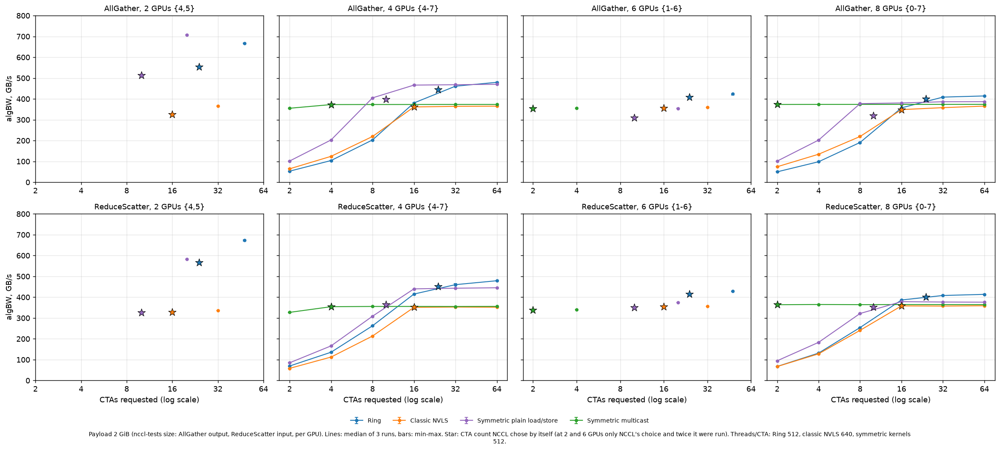
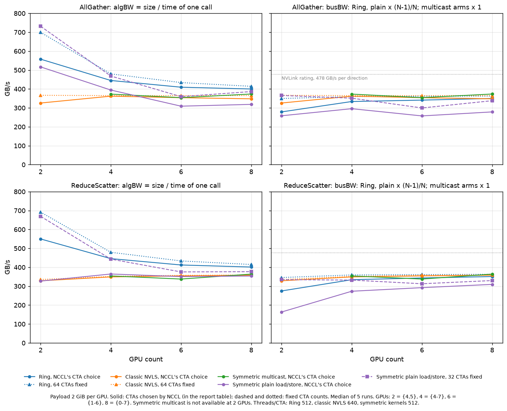
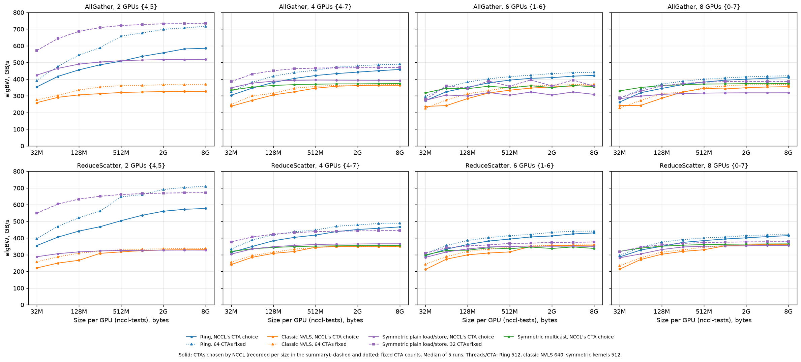
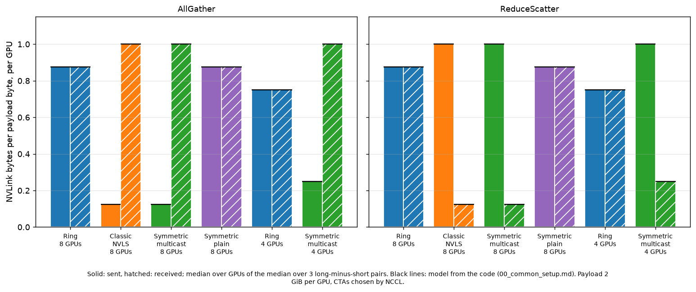

# AllGather and ReduceScatter with symmetric multicast, 2 to 8 GPUs (plan 01)

**Status (2026-11-18): run on 2026-11-18 between 02:16 and 06:05 UTC on all 8 GPUs (allocation: all 8 GPUs for 5 hours from 02:13 UTC). 1,062 runs, 0 rejected, 0 wrong values.** Plan: [01_symmetric_multicast.md](01_symmetric_multicast.md). Series setup: [00_common_setup.md](../00_common_setup.md).

**Question:** for AllGather and ReduceScatter, how does the rate of each implementation change from 2 to 8 GPUs and from 32 MiB to 8 GiB, and does symmetric multicast keep the advantages it showed for AllReduce (full rate with few CTAs, high rate at 32 MiB)?

**Answer:** it keeps the few-CTA property (full rate from 2–4 CTAs, where Ring needs 64 and plain load/store 16–32) and it is the fastest arm at 32 MiB on 6 and 8 GPUs (AllGather on 8 GPUs: 330.1 GB/s against 288.5 for the next arm). From 128 MiB on, Ring with 64 CTAs is faster at 4–8 GPUs, by close to N/(N − 1): at 2 GiB on 8 GPUs, multicast reaches 0.90 (AllGather) and 0.88 (ReduceScatter) of Ring with 64 CTAs, on 4 GPUs 0.78 and 0.74. The link counters show why: for these two collectives the GPU's own piece also goes through the switch, so multicast moves 1.000 byte per payload byte in its busiest direction against (N − 1)/N for Ring, and both arms run that direction at about the same 360–375 GB/s (75–78% of the link rating). Unlike AllReduce, multicast saves no link bytes here, only instructions. NCCL's own CTA choice is far from the best for plain load/store (0.56–0.87 of its best) and for Ring at 2 and 4 GPUs (0.83–0.94).

## Words used in this report

| Word | Meaning | Id in [AllReduce series setup](../../../allreduce/scalability/00_common_setup.md#metric-registry) |
|---|---|---|
| Arm | One implementation: Ring, classic NVLS (`NCCL_ALGO=NVLS`), symmetric multicast (`AllGather_STMC`, `ReduceScatter_LDMC`), symmetric plain load/store (`AllGather_ST`, `ReduceScatter_LD`) | |
| Size, payload (S) | The nccl-tests size: the whole buffer of one GPU (AllGather output, ReduceScatter input) | |
| Rate (algBW) | S ÷ time of one call, as nccl-tests prints it, out-of-place | S1 |
| busBW | Rate × bytes in the busiest link direction per payload byte: (N − 1)/N for Ring and plain, 1 for multicast and classic NVLS | S6 |
| What NCCL ran | Algorithm or kernel and CTAs × threads/CTA from the NCCL log | S3 |
| Link bytes per payload byte | NVLink bytes one GPU sends (Tx) or receives (Rx) per payload byte | S4 |
| Share of link rating | Link rate in the busiest direction ÷ 478 GB/s | S5 |
| Wrong values | nccl-tests `#wrong`, both passes | A11 |
| NCCL's choice | The CTA count NCCL picks with no CTA setting; "64 CTAs fixed" and "32 CTAs fixed" are settings added after calibration | |

## Harness

| Item | Setting |
|---|---|
| Program | nccl-tests `all_gather_perf`, `reduce_scatter_perf` (`/root/nccl-tests/build`), `-t 1 -g N`, `float`, sum, 5 warm-up and 20 timed calls, 1 check, `-R 0` (Ring, NVLS) or `-R 2` (symmetric) |
| NCCL | In-tree 2.32.3 |
| Runner | [`run_allreduce.py`](../../common/scripts/run_allreduce.py), extended on 2026-11-18 with a `collective` per cell; the extension reproduces every recorded AllReduce summary of the AllReduce series unchanged (280 recorded runs re-parsed; calibration, scaling, payload and link-byte CSVs rebuilt byte for byte) |
| Configs | [`configs/`](configs/), made by [`make_configs_agrs.py`](../../common/scripts/make_configs_agrs.py); chains [`run_agrs_chain.sh`](../../common/scripts/run_agrs_chain.sh), [`run_agrs_all.sh`](../../common/scripts/run_agrs_all.sh), [`run_agrs_fixed.sh`](../../common/scripts/run_agrs_fixed.sh) |
| Analysis | [`summarize.py`](../../common/scripts/summarize.py), [`link_bytes.py`](../../common/scripts/link_bytes.py), [`make_figures_agrs.py`](../../common/scripts/make_figures_agrs.py) |
| GPU sets | 2 = {4,5}, 4 = {4–7}, 6 = {1–6}, 8 = {0–7} |

Raw logs and snapshots are in `results/2026-11-18/raw/` (local, not in git). JSONL records, summary CSVs and figures are in git.

## Selection check

All 30 cells (2 collectives × 4 arms × 4 GPU counts, less multicast at 2 GPUs) ran the intended algorithm or kernel with 0 wrong values. NCCL's CTA choice is the same at every GPU count and size: Ring 24 × 512, classic NVLS 16 × 640, plain load/store 10 × 512, multicast 4 × 512 at 4 GPUs and 2 × 512 at 6 and 8 GPUs. Classic NVLS also runs at 2 GPUs, as for AllReduce. Summary: [`selection_summary.csv`](results/2026-11-18/selection_summary.csv).

## CTA calibration

### Motivation

For AllReduce, multicast needed 2–4 CTAs and the other arms 16–24, and NCCL under-provisioned plain load/store. The same needs checking here before comparing rates.

### Setup

| Knob | Value |
|---|---|
| **Controlled independent variable** | **CTAs: NCCL's choice, 2, 4, 8, 16, 32, 64** |
| Curves | Every cell at 4 and 8 GPUs; at 2 and 6 GPUs only NCCL's choice and twice it |
| Payload | 2 GiB |
| Rounds | 3, cells rotated |

### Method

As planned. 8 GPUs 02:17–02:53, 6 GPUs 03:34–03:41, 4 GPUs 04:05–04:26, 2 GPUs 04:47–04:50 UTC. 420 runs.

### Results

NCCL's choice against the best measured value, 2 GiB (median of 3 runs, GB/s):

| Collective | GPUs | Ring 24 × 512 → best | NVLS 16 × 640 → best | Multicast → best | Plain 10 × 512 → best |
|---|---|---|---|---|---|
| AllGather | 2 | 553.7 → 666.5 at 48 (0.83) | 324.8 → 365.7 at 32 (0.89) | n/a | 513.3 → 706.6 at 20 (0.73) |
| AllGather | 4 | 444.5 → 479.7 at 64 (0.93) | 362.4 → 365.1 at 64 (0.99) | 372.9 (4 CTAs) → 373.6 at 64 (1.00) | 397.6 → 470.2 at 64 (0.85) |
| AllGather | 6 | 409.2 → 425.2 at 48 (0.96) | 355.5 → 360.4 at 32 (0.99) | 354.1 (2) → 355.8 at 4 (1.00) | 308.7 → 354.4 at 20 (0.87) |
| AllGather | 8 | 400.3 → 414.3 at 64 (0.97) | 348.0 → 365.4 at 64 (0.95) | 373.3 (2) → 373.9 at 64 (1.00) | 318.9 → 386.8 at 64 (0.82) |
| ReduceScatter | 2 | 567.4 → 673.1 at 48 (0.84) | 328.7 → 335.4 at 32 (0.98) | n/a | 326.8 → 581.9 at 20 (0.56) |
| ReduceScatter | 4 | 450.9 → 479.1 at 64 (0.94) | 351.4 → 352.8 at 32 (1.00) | 354.3 (4) → 355.8 at 64 (1.00) | 364.0 → 445.3 at 64 (0.82) |
| ReduceScatter | 6 | 414.9 → 429.3 at 48 (0.97) | 354.1 → 355.9 at 32 (1.00) | 337.7 (2) → 341.0 at 4 (0.99) | 350.7 → 374.6 at 20 (0.94) |
| ReduceScatter | 8 | 401.2 → 413.6 at 64 (0.97) | 358.1 → 359.0 at 64 (1.00) | 364.0 (2) → 364.9 at 4 (1.00) | 353.3 → 378.6 at 16 (0.93) |

At 2 and 6 GPUs "best" is the better of the two points measured, not the top of a curve. All values: [`calibration_summary.csv`](results/2026-11-18/calibration_summary.csv).

### Interpretation

- **Multicast is flat from 2–4 CTAs** at every GPU count, as for AllReduce. The other arms need 16 (NVLS), 16–32 (plain) or 64 and more (Ring).
- **The Ring calibration is incomplete.** At 4 GPUs Ring still gains 4% from 32 to 64 CTAs, and at 8 GPUs 1.4%; 64 is NCCL's limit. At 2 GPUs 48 CTAs give 20% more than NCCL's 24.
- **NCCL's choice is far from the best for plain load/store** (0.56–0.87, except ReduceScatter at 6 and 8 GPUs, 0.93–0.94), and below 0.95 for Ring at 2 and 4 GPUs and for classic NVLS AllGather at 2 GPUs. Following the plan's rule (below 0.95 in any cell), fixed settings were added to the scaling and payload steps: plain load/store at 32 CTAs (within 0.5% of its best at 8 GPUs), Ring and classic NVLS at 64 CTAs (NCCL's limit). Curves at NCCL's choice still show what a default NCCL user gets.

## GPU-count scaling at 2 GiB

### Motivation

If every arm were limited only by its busiest link direction, Ring and plain algBW would fall as 1/((N − 1)/N) from 2 to 8 GPUs and multicast would stay flat; Ring would then lead multicast by N/(N − 1).

### Setup

| Knob | Value |
|---|---|
| **Controlled independent variable** | **GPU count: 2, 4, 6, 8** |
| Curves | Collective × arm × CTA setting: NCCL's choice for all arms; plain load/store 32 CTAs fixed; Ring and classic NVLS 64 CTAs fixed |
| Payload | 2 GiB |
| Rounds | 5, cells rotated |

### Method

NCCL's-choice cells ran 02:53–04:51 UTC (8, 6, 4, 2 GPUs). The 32-CTA plain cells were added at 03:07 and ran inside the same chain; the 64-CTA Ring and NVLS cells ran afterwards, 05:36–06:02. Deviation: the reverse GPU-count repeat was not run (as in the AllReduce series). 270 runs.

### Results

algBW in GB/s, median of 5 runs (min–max in brackets); busBW after the slash:

| Collective, arm, CTAs × threads/CTA | 2 GPUs | 4 GPUs | 6 GPUs | 8 GPUs |
|---|---|---|---|---|
| AllGather, Ring, 24 × 512 (NCCL) | 557.6 (550.1–560.1) / 278.8 | 444.9 (441.6–448.4) / 333.7 | 409.4 (408.9–410.6) / 341.1 | 399.9 (399.4–400.6) / 349.9 |
| AllGather, Ring, 64 × 512 | 699.4 (698.2–699.9) / 349.7 | 479.8 (479.6–481.7) / 359.9 | 433.8 (433.4–434.5) / 361.5 | 414.1 (412.9–414.6) / 362.3 |
| AllGather, classic NVLS, 16 × 640 (NCCL) | 325.7 (324.7–327.5) / 325.7 | 362.1 (361.5–362.9) / 362.1 | 354.0 (352.8–357.4) / 354.0 | 348.0 (345.7–349.5) / 348.0 |
| AllGather, classic NVLS, 64 × 640 | 366.7 (366.0–367.1) / 366.7 | 365.0 (364.8–365.3) / 365.0 | 364.9 (364.7–365.2) / 364.9 | 365.3 (364.4–365.8) / 365.3 |
| AllGather, multicast (NCCL: 4, 2, 2 × 512) | n/a | 372.9 (372.8–373.0) / 372.9 | 354.2 (354.0–354.3) / 354.2 | 373.4 (373.3–373.5) / 373.4 |
| AllGather, plain, 10 × 512 (NCCL) | 516.7 (516.2–516.7) / 258.4 | 394.4 (392.9–396.8) / 295.8 | 309.1 (308.2–309.7) / 257.6 | 318.6 (318.4–319.3) / 278.8 |
| AllGather, plain, 32 × 512 | 731.5 (731.2–732.0) / 365.7 | 468.5 (468.1–469.1) / 351.4 | 359.5 (359.3–360.1) / 299.6 | 386.3 (385.8–386.7) / 338.0 |
| ReduceScatter, Ring, 24 × 512 (NCCL) | 549.8 (545.0–561.6) / 274.9 | 445.7 (445.5–454.1) / 334.3 | 412.2 (411.9–414.1) / 343.5 | 401.3 (400.3–403.3) / 351.1 |
| ReduceScatter, Ring, 64 × 512 | 691.6 (689.7–692.3) / 345.8 | 479.3 (479.1–480.0) / 359.5 | 433.6 (432.0–434.0) / 361.3 | 414.8 (413.7–414.8) / 362.9 |
| ReduceScatter, classic NVLS, 16 × 640 (NCCL) | 328.6 (327.6–329.4) / 328.6 | 349.2 (348.8–351.3) / 349.2 | 354.5 (353.6–355.9) / 354.5 | 358.3 (357.8–358.5) / 358.3 |
| ReduceScatter, classic NVLS, 64 × 640 | 335.4 (335.3–335.5) / 335.4 | 351.8 (351.5–352.0) / 351.8 | 357.4 (357.2–357.6) / 357.4 | 359.1 (358.9–359.4) / 359.1 |
| ReduceScatter, multicast (NCCL: 4, 2, 2 × 512) | n/a | 354.4 (354.3–354.5) / 354.4 | 337.8 (337.7–338.0) / 337.8 | 364.0 (363.9–364.1) / 364.0 |
| ReduceScatter, plain, 10 × 512 (NCCL) | 327.1 (326.6–327.4) / 163.5 | 364.5 (364.1–364.9) / 273.4 | 350.8 (350.6–350.8) / 292.3 | 353.9 (353.3–355.1) / 309.7 |
| ReduceScatter, plain, 32 × 512 | 669.3 (668.9–669.7) / 334.7 | 443.1 (442.9–443.5) / 332.3 | 375.5 (374.6–375.7) / 312.9 | 376.9 (376.5–377.0) / 329.8 |

All values: [`scaling_summary.csv`](results/2026-11-18/scaling_summary.csv).

Multicast against Ring at 64 CTAs, 2 GiB:

| Collective | GPUs | Multicast ÷ Ring 64 | (N − 1)/N | Busiest-direction rate, multicast / Ring 64, GB/s |
|---|---|---|---|---|
| AllGather | 4 | 0.777 | 0.750 | 372.9 / 359.9 |
| AllGather | 8 | 0.902 | 0.875 | 373.4 / 362.3 |
| ReduceScatter | 4 | 0.739 | 0.750 | 354.4 / 359.5 |
| ReduceScatter | 8 | 0.878 | 0.875 | 364.0 / 362.9 |

### Interpretation

- **At large payloads the order is set by link bytes.** Ring and multicast run their busiest link direction at about the same rate (355–375 GB/s), so their rate ratio is close to (N − 1)/N, the ratio of their busiest-direction bytes. Ring leads at every GPU count from 4 on; its lead shrinks as N grows (Ring 64 ÷ multicast: 1.29–1.35 at 4 GPUs, 1.11–1.14 at 8).
- **Classic NVLS at 64 CTAs matches multicast** in rate at 4 and 8 GPUs (multicast ÷ NVLS 64: 1.007–1.022), as both move the same link bytes; at 6 GPUs multicast is 3–5% lower (its dip, below). NCCL's default 16 CTAs costs classic NVLS AllGather 11% at 2 GPUs and up to 5% elsewhere.
- **Multicast dips at 6 GPUs again** (AllGather 354.2 against 372.9 and 373.4 at 4 and 8; ReduceScatter 337.8 against 354.4 and 364.0), as the multicast AllReduce kernel did in plan 02 of the AllReduce series. Classic NVLS does not dip.
- **Ring and plain follow the link model**: busBW is nearly constant from 4 to 8 GPUs at the 64- and 32-CTA settings (Ring 360–363 GB/s), so their algBW falls as 1/((N − 1)/N).
- **At 2 GPUs the busiest direction carries only half the payload** for Ring and plain, so their rates (up to 731.5 GB/s) are not comparable with the other GPU counts; there is no multicast arm at 2 GPUs.
- **The common ceiling is about 360–375 GB/s per direction**, 75–78% of the 478 GB/s rating, for every arm that is not limited by CTAs, in sending (Ring, ReduceScatter multicast) and in receiving (AllGather multicast). It is the same per-direction ceiling found for AllReduce Ring and the one-shot example kernel in the AllReduce series.

## Payload size

### Motivation

FSDP- and ZeRO-style AllGather and ReduceScatter calls are per layer: often tens to hundreds of MiB. Multicast's few-CTA, one-step kernels should have their advantage there.

### Setup

| Knob | Value |
|---|---|
| **Controlled independent variable** | **Size S: 32 MiB to 8 GiB, factor 2** (one run steps through all) |
| Comparison | Each collective and GPU count separately |
| CTA settings | As the scaling step |
| Rounds | 5 |

### Method

As planned, with the added fixed CTA settings. nccl-tests rounds each GPU's piece to a multiple of 16 B, so at 6 GPUs the sizes are a little below the powers of two; tables use the nearest power of two. 270 runs.

### Results

algBW at 32 MiB, GB/s (median of 5), fastest three settings:

| Collective | GPUs | First | Second | Third |
|---|---|---|---|---|
| AllGather | 4 | Plain 32 CTAs 385.1 | Plain (NCCL) 347.9 | Multicast 334.4 |
| AllGather | 6 | **Multicast 318.5** | Ring 64 CTAs 297.1 | Plain 32 CTAs 278.8 |
| AllGather | 8 | **Multicast 330.1** | Plain 32 CTAs 288.5 | Ring 64 CTAs 285.5 |
| ReduceScatter | 4 | Plain 32 CTAs 376.8 | Ring 64 CTAs 334.1 | Multicast 320.0 |
| ReduceScatter | 6 | Plain 32 CTAs 309.6 | Ring 64 CTAs 307.0 | Multicast 299.5 |
| ReduceScatter | 8 | **Multicast 320.2** | Plain 32 CTAs 318.6 | Ring 64 CTAs 295.7 |

Smallest size that reaches 95% of the arm's 8 GiB rate (NCCL's CTA choice):

| Collective | GPUs | Ring | Classic NVLS | Multicast | Plain |
|---|---|---|---|---|---|
| AllGather | 4 | 2 GiB | 512 MiB | 128 MiB | 64 MiB |
| AllGather | 8 | 1 GiB | 512 MiB | 128 MiB | 128 MiB |
| ReduceScatter | 4 | 2 GiB | 512 MiB | 128 MiB | 128 MiB |
| ReduceScatter | 8 | 1 GiB | 1 GiB | 128 MiB | 256 MiB |

All sizes and GPU counts: [`payload_summary.csv`](results/2026-11-18/payload_summary.csv).

### Interpretation

- **Multicast leads only at small sizes and many GPUs**: at 32 MiB on 8 GPUs by 14% (AllGather) and 0.5% (ReduceScatter), and for AllGather on 6 GPUs by 7%. From 128 MiB on, Ring with 64 CTAs is first at 4–8 GPUs.
- **Multicast reaches its full rate early** (95% from 64–128 MiB), Ring late (512 MiB–2 GiB), because Ring's per-step pipeline needs a large payload to fill.
- **Plain load/store with 32 CTAs is the best choice at 4 GPUs for 32–128 MiB**, ahead of multicast; at NCCL's 10 CTAs it loses most of that.
- **Classic NVLS is the slowest arm at most sizes**, and at 32 MiB on 8 GPUs it reaches only 0.67–0.73 of multicast; its copies through NCCL's buffer and its per-step flags cost most at small sizes, as for AllReduce.

## Link bytes per payload byte

### Motivation

The common setup predicts that for these collectives multicast moves S in its busiest direction, against (N − 1)/N × S for Ring, because the GPU's own piece crosses the switch.

### Setup

| Knob | Value |
|---|---|
| **Controlled independent variable** | **Arm**: all four at 8 GPUs; Ring and multicast at 4 GPUs |
| Collective | AllGather, ReduceScatter |
| Payload, CTAs | 2 GiB, NCCL's choice |
| Runs | Long (200 calls) minus short (20 calls), 3 pairs per cell |

### Method

AllReduce plan 04 method: NVLink counters before and after each run, (long − short) ÷ (2 passes × 180 calls × S), per GPU and direction. 8 GPUs 03:22–03:33, 4 GPUs 04:43–04:47 UTC. 72 runs.

### Results

| Collective | GPUs | Arm | Sent | Received | Model sent / received | Share of rating, busiest direction |
|---|---|---|---|---|---|---|
| AllGather | 8 | Ring | 0.875 | 0.875 | 0.875 / 0.875 | 0.733 |
| AllGather | 8 | Classic NVLS | 0.127 | 1.000 | 0.125 / 1 | 0.731 |
| AllGather | 8 | Multicast | 0.125 | 1.000 | 0.125 / 1 | 0.782 |
| AllGather | 8 | Plain | 0.875 | 0.875 | 0.875 / 0.875 | 0.583 |
| AllGather | 4 | Ring | 0.750 | 0.750 | 0.75 / 0.75 | 0.691 |
| AllGather | 4 | Multicast | 0.250 | 1.000 | 0.25 / 1 | 0.780 |
| ReduceScatter | 8 | Ring | 0.875 | 0.875 | 0.875 / 0.875 | 0.734 |
| ReduceScatter | 8 | Classic NVLS | 1.001 | 0.125 | 1 / 0.125 | 0.750 |
| ReduceScatter | 8 | Multicast | 1.000 | 0.125 | 1 / 0.125 | 0.762 |
| ReduceScatter | 8 | Plain | 0.875 | 0.875 | 0.875 / 0.875 | 0.650 |
| ReduceScatter | 4 | Ring | 0.750 | 0.750 | 0.75 / 0.75 | 0.702 |
| ReduceScatter | 4 | Multicast | 1.000 | 0.250 | 1 / 0.25 | 0.742 |

Median over GPUs; all three pairs agree to the fourth decimal. Values: [`link_bytes.csv`](results/2026-11-18/link_bytes.csv).

### Interpretation

- **The model holds exactly.** The own piece crosses the switch: an AllGather multicast store reaches the issuing GPU over NVLink, and a ReduceScatter `ld_reduce` reads the issuing GPU's own input over NVLink.
- **Multicast is the arm closest to the link limit** (0.74–0.78 of the rating), so its lower rate at large sizes is not a lack of CTAs: it moves more bytes through a direction that runs as fast as Ring's.
- **Classic NVLS moves the same link bytes as multicast** (within 0.1%); its staging copies stay on the GPU.

## Device state

In all 1,062 runs' before/after snapshots no other process was on the GPUs, and the only clock-event reasons recorded were none (0x0) and "GPU idle" (0x1, read while no kernel ran). Snapshots are not continuous.

## Session log

All times UTC, 2026-11-18. Allocation: all 8 GPUs for 5 hours from 02:13, given by the user.

| Time | GPUs | What ran | Runs | Notes |
|---|---|---|---|---|
| 02:13 | 4–7 | Format probe (64 MiB, one run per collective and arm type; not used) | 4 | |
| 02:16–02:53 | 0–7 | Selection, calibration | 8 + 168 | |
| 02:53–03:05 | 0–7 | Scaling, payload (first 14 runs) | 40 + 14 | The chain was a child of the Claude Code session in VS Code and stopped when that session ended; the run in progress was lost and redone |
| 03:07–04:59 | all sets | Rest, restarted in tmux (`run_agrs_all.sh`): 32-CTA plain cells added; 8-GPU payload and link; 6, 4, 2 GPUs selection, calibration, scaling, payload; 4-GPU link | 666 | Completed runs skipped on restart |
| 05:36–06:05 | all sets | 64-CTA Ring and classic NVLS cells, scaling and payload (`run_agrs_fixed.sh`) | 160 | Added after the 4-, 6- and 2-GPU calibration |

GPU work ended at 06:05; the GPUs were free after that. Chain logs: `results/2026-11-18/chain_n8.log`, `chain_all.log`, `chain_fixed.log` (local).
