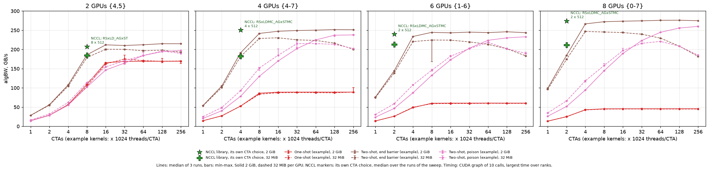
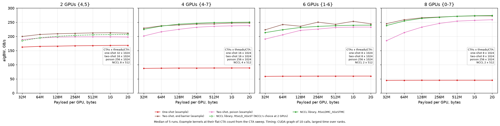
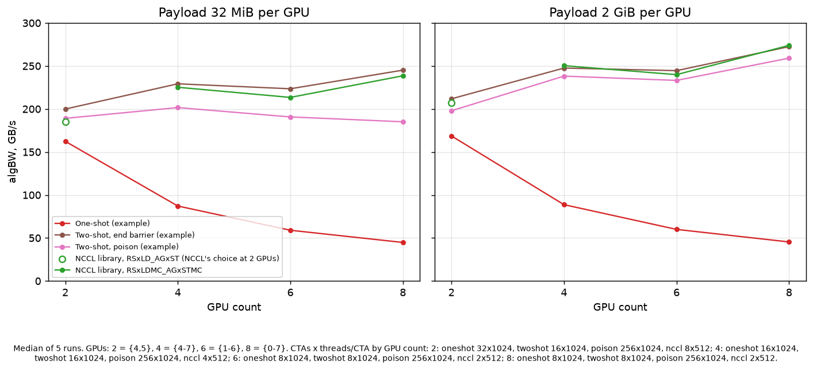
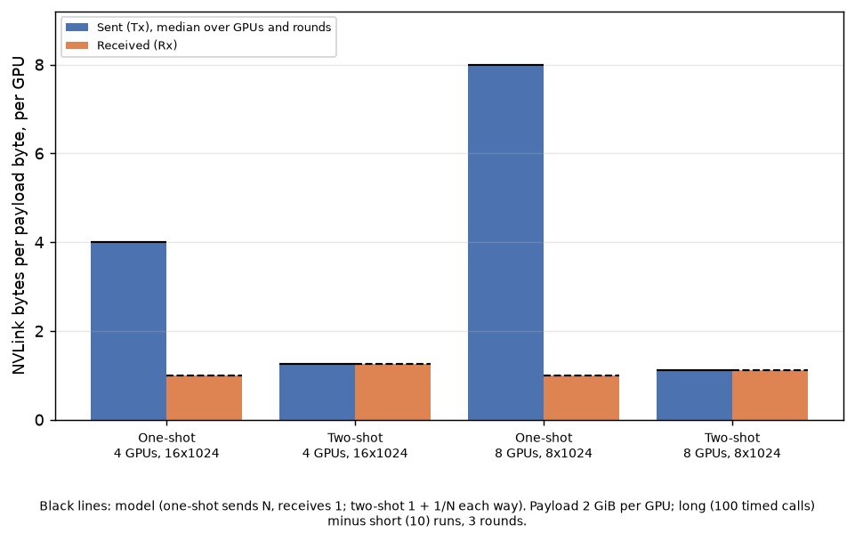

# NCCL's example multicast AllReduce kernels at large payloads (plan 06)

**Status (2026-11-18): run on 2026-11-17 between 23:14 and 23:57 UTC on all 8 GPUs (allocation: all 8 GPUs for 3 hours from 23:12 UTC). 196 runs, 0 rejected, 0 wrong elements.** Plan: [06_custom_mc_kernels.md](06_custom_mc_kernels.md).

**Question:** at 2 to 8 GPUs and payloads of 32 MiB to 2 GiB per GPU, how fast are the three example kernels of [`contrib/custom_algos/allreduce`](../../../../../contrib/custom_algos/allreduce/README.md) against NCCL's library kernel, and what limits each one?

**Answer:** the two-shot kernel with an end barrier is as fast as NCCL's library kernel `AllReduce_RSxLDMC_AGxSTMC`: within 1.2% at 2 GiB on 4 and 8 GPUs and 2% faster at 6 GPUs. It needs exactly 4 times as many CTAs (8 × 1024 threads/CTA against 2 × 512 at 6 and 8 GPUs, 16 against 4 at 4 GPUs), which matches its 4 times smaller amount of data in flight per CTA. The one-shot kernel is limited by the link: each GPU sends N bytes per payload byte (measured 4.00 at 4 GPUs and 8.00 at 8 GPUs), so its rate falls as 1/N, from 168.7 GB/s at 2 GPUs to 45.4 GB/s at 8 GPUs. The data each GPU sends per second, 337–363 GB/s, is the same as Ring's busBW in plan 02 (340–363 GB/s). The two-shot kernel with poison values is 4–7% slower than the end-barrier kernel at 2 GiB and 5–25% slower at 32 MiB, and it is still gaining at 256 CTAs, near the limit of CTAs that can run at once. Multicast also works at 2 GPUs through the device API, where NCCL's library does not use it.

## Words used in this report

| Word | Meaning | Id in [00_common_setup.md](../00_common_setup.md) |
|---|---|---|
| Kernel | One AllReduce implementation under comparison (this plan's "arm") | |
| One-shot | Example kernel: every GPU does `multimem.ld_reduce` over the whole buffer and stores the sum in its own output | |
| Two-shot, end barrier | Example kernel: each GPU does `ld_reduce` on its 1/N of the buffer and `multimem.st` of the sum to all GPUs, then a barrier across GPUs | |
| Two-shot, poison | Same as two-shot, but no barrier: each GPU waits until every output element has stopped holding a marker value (the "poison") | |
| NCCL library | `ncclAllReduce` inside the same program, on the same buffers, forced to `AllReduce_RSxLDMC_AGxSTMC` at 4–8 GPUs | |
| Rate (algBW) | Payload bytes per GPU ÷ time of one call, GB/s | S1 |
| busBW | Rate × bytes each GPU sends per payload byte | S6 |
| Link bytes per payload byte | NVLink bytes one GPU sends or receives for one payload byte | S4 |
| Share of link rating | Link rate ÷ 478 GB/s | S5 |
| Wrong elements | Output elements not equal to N (input is 1.0 on every GPU) | A11 |
| CTA calibration | Rate against CTA count; "flat from" = first CTA count after which two successive doublings each gain less than 1% | |

## Harness

The example program is its own harness. It was built from an unchanged copy of the kernel files and a patched copy of `main.cu` ([`build_custom_mc.sh`](../../common/scripts/build_custom_mc.sh), [`patch_custom_mc.py`](../../common/scripts/patch_custom_mc.py)); `contrib/` was not edited.

| Item | Setting |
|---|---|
| Software | NCCL 2.32.3 (in-tree `build/lib`), CUDA 13.0 (nvcc V13.0.88, `-O3`, `sm_90`), Open MPI 4.1.6 |
| Process layout | `mpirun -np N`, one process per GPU; GPU sets as in the series: 2 = {4,5}, 4 = {4–7}, 6 = {1–6}, 8 = {0–7} |
| Timing | Per kernel and size: 5 warm-up calls, then one CUDA graph of 10 calls (poison: 12, a multiple of 3), timed with events; the largest time over ranks counts. A 128 MiB memset clears the L2 cache before each kernel's warm-up |
| Threads/CTA | Example kernels 1024 (fixed in their source). NCCL: its own choice, read from its log |
| Additions to `main.cu` | Size limit 2 GiB (upstream 128 MiB); result check at every measured size (output zeroed before, every element must equal N); `CUSTOM_MC_KERNELS` to run only some kernels; `CUSTOM_MC_TIMED_ITERS` for link-byte runs; one `RESULT` line per kernel, size and CTA count |
| Runner | [`run_custom_mc.py`](../../common/scripts/run_custom_mc.py): GPU locks, idle check, before/after snapshots (clocks, power, processes, NVLink counters), validity check. A run is valid if it exits with 0, the built-in test has no FAIL, the result check finds 0 wrong elements, and NCCL's log names the forced kernel |
| Analysis | [`summarize_custom_mc.py`](../../common/scripts/summarize_custom_mc.py), [`link_bytes_custom_mc.py`](../../common/scripts/link_bytes_custom_mc.py), [`make_figures_custom_mc.py`](../../common/scripts/make_figures_custom_mc.py); session files in [`configs/`](configs/) made by [`make_configs_custom_mc.py`](../../common/scripts/make_configs_custom_mc.py) |

Raw logs and snapshots are in `results/2026-11-17/raw/`, kept locally and not in git; the summaries (`summary.csv`, `link_summary.csv`), JSONL records and figures are in git.

### Cross-harness check

The NCCL column of this program against nccl-tests in plans 02 and 03, same GPU set, same kernel and CTA count:

| GPUs | NCCL kernel, CTAs × threads/CTA | 2 GiB here | 2 GiB nccl-tests | 32 MiB here | 32 MiB nccl-tests |
|---|---|---|---|---|---|
| 2 | `RSxLD_AGxST` (plain load/store, NCCL's choice), 8 × 512 | 207.3 | 207.3 (plan 02) | 185.1 | 188.8 |
| 4 | `RSxLDMC_AGxSTMC`, 4 × 512 | 250.4 | 251.9 | 225.2 | 230.9 |
| 6 | `RSxLDMC_AGxSTMC`, 2 × 512 | 239.9 | 239.0 | 213.5 | 224.1 |
| 8 | `RSxLDMC_AGxSTMC`, 2 × 512 | 273.9 | 276.2 | 238.6 | 248.1 |

algBW in GB/s. At 2 GiB the two harnesses agree within 0.9%. At 32 MiB this program measures NCCL 2–5% lower than nccl-tests (different timing: cache clear, CUDA graph, largest time over ranks). Comparisons below are made inside this program; numbers from plans 01–04 are not mixed in.

## CTA calibration

### Motivation

The two-shot example kernels keep one 16-byte `ld_reduce` in flight per thread, 16 KiB per 1024-thread CTA. NCCL's library kernel keeps eight per thread, 64 KiB per 512-thread CTA. If the CTA count a kernel needs is set by the bytes it keeps in flight, the two-shot kernels need 4 times NCCL's CTA count. The one-shot kernel sends N bytes per payload byte, so it should reach the link limit at a low rate.

### Setup

| Knob | Value |
|---|---|
| **Controlled independent variable** | **CTAs: 1, 2, 4, 8, 16, 32, 64, 128, 256** × 1024 threads/CTA (example kernels; all three share the CTA count of a run) |
| Curve | GPU count 2, 4, 6, 8 (one panel each) |
| Sizes | 32 MiB to 2 GiB per GPU in each run; 32 MiB and 2 GiB shown |
| NCCL column | Same runs, its own CTA choice |
| Rounds | 3, CTA counts in rotated order |
| Configs | `configs/cta_n<N>.json`; at 8 GPUs `cta_n8.json` (1–128) and `cta_n8_ext256.json` (256) |

### Method

GPU counts in the order 8, 6, 4, 2. Deviation: at 8 GPUs the sweep first ended at 128 CTAs; the poison kernel was still rising, so 256 was added (3 more rounds, 7 minutes later) and the other GPU counts ran 1–256 from the start. 256 CTAs of 1024 threads is close to the 264 that can be resident on 132 SMs; more were not run because both example kernels wait for other GPUs inside the kernel, and CTAs that cannot start could block that wait.

### Results

At 2 GiB per GPU (example kernels: median of 3 runs; NCCL: median of the 27 runs of the sweep):

| GPUs | Two-shot, end barrier: flat from | Its algBW there | NCCL library: CTAs × threads/CTA (kernel) | NCCL algBW | One-shot: flat from | Its algBW there | Poison: algBW at 128 → 256 CTAs |
|---|---|---|---|---|---|---|---|
| 2 | 16 × 1024 | 212.0 | 8 × 512 (plain load/store) | 207.6 | 32 × 1024 | 168.8 | 194.4 → 197.4 (+1.5%) |
| 4 | 16 × 1024 | 247.4 | 4 × 512 (multicast) | 250.3 | 16 × 1024 | 88.9 | 237.1 → 237.8 (+0.3%) |
| 6 | 8 × 1024 | 244.5 | 2 × 512 (multicast) | 239.8 | 8 × 1024 | 60.0 | 230.2 → 233.1 (+1.3%) |
| 8 | 8 × 1024 | 272.2 | 2 × 512 (multicast) | 273.8 | 8 × 1024 | 45.5 | 255.8 → 260.1 (+1.7%) |

Full curves: [`results/2026-11-17/summary.csv`](results/2026-11-17/summary.csv) (rows with `step` = `cta`).

### Interpretation

- **The two-shot kernel needs exactly 4 times NCCL's CTA count at 4, 6 and 8 GPUs**: 16 against 4, 8 against 2, 8 against 2. That is 8 times as many threads, but the same amount of data in flight per GPU: at 4 GPUs 16 CTAs × 16 KiB = 256 KiB against 4 CTAs × 64 KiB = 256 KiB; at 6 and 8 GPUs 128 KiB against 128 KiB. Both kernels stop gaining at the same amount of data in flight; the thread count does not decide. This supports the explanation of NCCL's low CTA count in the [walkthrough](../../../../../notes/nvls_allreduce_walkthrough.html): not the multicast instructions themselves, but how much each thread keeps in flight.
- **The one-shot kernel flattens early and low**, from 8–32 CTAs, at a rate that falls with N. The link-byte section shows why.
- **The poison kernel's calibration is incomplete.** At 2, 6 and 8 GPUs it still gains 1.3–1.7% from 128 to 256 CTAs, which is the practical limit; at 4 GPUs the last step gains 0.3%, but the step before gained 5.5%, so the 1% rule is not met either. Its curve rises much more slowly than the end-barrier kernel's.
- **At 32 MiB, more CTAs make the two-shot kernels slower** (8 GPUs: 246.8 GB/s at 4 CTAs, 182 at 256). Each CTA does its own barrier or poll across GPUs, so the fixed cost per call grows with the CTA count; at 2 GiB this cost is small against the call time.

## Payload and GPU count

### Motivation

Plans 02 and 03 measured NCCL's kernels against GPU count and payload. This puts the example kernels on the same axes, each at the CTA count where it stopped gaining.

### Setup

| Knob | Value |
|---|---|
| **Controlled independent variable** | **Kernel: one-shot, two-shot end barrier, two-shot poison, NCCL library** |
| Second variable, each value a separate comparison | GPU count 2, 4, 6, 8; payload 32 MiB to 2 GiB per GPU, factor 2, in one run |
| CTAs × threads/CTA | One-shot: 32, 16, 8, 8 × 1024 at 2, 4, 6, 8 GPUs; two-shot end barrier: 16, 16, 8, 8 × 1024; poison: 256 × 1024 (largest measured, still rising); NCCL: its own choice (table above) |
| Run | One run per kernel: that kernel and the NCCL column (`CUSTOM_MC_KERNELS=<kernel>,nccl`) |
| Rounds | 5, kernels in rotated order |
| Configs | `configs/flat_n<N>.json` |

### Method

The flat CTA counts were taken automatically from the calibration ([`run_custom_mc_chain.sh`](../../common/scripts/run_custom_mc_chain.sh)). Deviation: each run starts at 16 MiB and that size is discarded, because in the calibration the NCCL column was sometimes slow at the first size of a run (as low as 67 GB/s at 32 MiB against a median of 212). Even so, NCCL's 32 MiB values here have a wide range (8 GPUs: 151.7–243.4 GB/s); medians are used. The NCCL column runs in all three runs of a round, so it has 15 values per size. Two-shot sizes are rounded down to a multiple of N lines by the program (at 6 GPUs, 2 GiB − 32 B); the rate uses the rounded size.

### Results

algBW in GB/s, median of 5 runs (NCCL: 15), min–max in brackets:

| GPUs | Payload | One-shot | Two-shot, end barrier | Two-shot, poison | NCCL library | Two-shot ÷ NCCL |
|---|---|---|---|---|---|---|
| 2 | 32 MiB | 162.4 (162.2–165.1) | 199.9 (199.2–201.2) | 189.1 (188.8–190.2) | 185.1 (163.3–194.2), plain load/store | 1.080 |
| 2 | 2 GiB | 168.7 (168.6–168.7) | 211.8 (211.7–212.1) | 197.9 (197.6–199.9) | 207.3 (206.8–208.4), plain load/store | 1.022 |
| 4 | 32 MiB | 87.2 (86.2–89.3) | 229.3 (228.2–230.0) | 201.6 (201.5–202.4) | 225.2 (187.6–231.9) | 1.018 |
| 4 | 2 GiB | 88.8 (88.7–88.8) | 247.6 (247.2–247.8) | 238.2 (237.3–238.7) | 250.4 (249.9–250.8) | 0.989 |
| 6 | 32 MiB | 59.0 (58.3–59.2) | 223.5 (222.2–224.8) | 190.8 (187.8–198.3) | 213.5 (197.6–218.7) | 1.047 |
| 6 | 2 GiB | 60.0 (60.0–60.1) | 244.6 (244.5–244.6) | 233.2 (233.0–233.6) | 239.9 (239.5–240.1) | 1.019 |
| 8 | 32 MiB | 44.8 (44.6–44.9) | 245.1 (244.8–247.0) | 185.1 (184.5–185.4) | 238.6 (151.7–243.4) | 1.027 |
| 8 | 2 GiB | 45.4 (45.4–45.5) | 272.5 (272.1–272.6) | 259.1 (258.9–259.3) | 273.9 (273.0–274.9) | 0.995 |

All sizes: [`results/2026-11-17/summary.csv`](results/2026-11-17/summary.csv) (rows with `step` = `flat`).

### Interpretation

- **The two-shot end-barrier kernel matches NCCL's library kernel at large payloads** (ratio 0.989–1.019 at 2 GiB, 4–8 GPUs). A short kernel with one load in flight per thread reaches the same rate as the library kernel, given 4 times the CTAs.
- **At 32 MiB it is 2–5% faster than NCCL inside this program.** It has one barrier per call where NCCL's kernel has two. This does not hold against nccl-tests: there, NCCL measured 230.9, 224.1 and 248.1 GB/s at 4, 6 and 8 GPUs, equal to or above the example kernel here (229.3, 223.5, 245.1). The difference is within the 2–5% gap between the two harnesses, so a real advantage is not shown.
- **One-shot is limited by link bytes, not by instructions.** Its rate falls as 1/N (168.7, 88.8, 60.0, 45.4 GB/s), and is flat over payload size: at 32 MiB it is already at its large-payload rate.
- **The poison kernel is the slowest two-shot variant at every size and GPU count**, by 4–7% at 2 GiB and by 5–25% at 32 MiB (the gap grows with N). Every GPU reads its whole output buffer to check the poison values and writes the markers back for a later call; that is extra memory traffic and per-element waiting that the end-barrier kernel does not have. Its advantage, no barrier, shows only in small-message latency (the upstream README measures 1 MB and below), not at these sizes.
- **At 6 GPUs the two-shot kernel depends on the payload in a zigzag** (64 MiB 242.2, 128 MiB 236.0, 256 MiB 250.4, 512 MiB 242.9, 1 GiB 253.5, 2 GiB 244.6 GB/s); every round shows the same pattern within 0.5%. Sizes 2^26, 2^28 and 2^30 bytes are fast, 2^27, 2^29 and 2^31 slow. Each GPU's part is one contiguous sixth of the buffer, so where the parts start in memory changes with the size; the cause was not investigated. NCCL's library kernel, which deals 4 KiB pieces to the GPUs in turn, has a smooth curve at 6 GPUs but is lower than the example kernel at every size from 32 MiB.
- **Multicast works at 2 GPUs through the device API.** NCCL's library turns its multicast kernels off at 2 GPUs. There the two-shot example kernel (211.8 GB/s at 2 GiB) is 2% faster than NCCL's choice (plain load/store, 207.3 GB/s), but far below Ring (339.5 GB/s in plan 02): with 2 GPUs, multicast sends 1.5 bytes per payload byte and Ring 1.

## Link bytes per payload byte

### Motivation

The one-shot model says each GPU sends N bytes per payload byte, because every GPU's `ld_reduce` reads every GPU's whole buffer. If the switch combined identical reads from different GPUs, it would send less.

### Setup

| Knob | Value |
|---|---|
| **Controlled independent variable** | **Kernel: one-shot, two-shot end barrier** (one kernel per run) |
| GPU count | 4 {4–7}, 8 {0–7} |
| Payload, CTAs × threads/CTA | 2 GiB per GPU; one-shot 16 × 1024 (4 GPUs), 8 × 1024 (8 GPUs); two-shot the same |
| Runs | Long (100 timed calls) and short (10) runs, 3 pairs per cell |
| Configs | `configs/link_n<N>.json` |

### Method

Plan 04 method: NVLink byte counters of every GPU before and after each run; the long run minus the short run of the same round leaves 90 calls, so start-up, the built-in test, warm-up and the result check cancel ([`link_bytes_custom_mc.py`](../../common/scripts/link_bytes_custom_mc.py)).

### Results

| GPUs | Kernel, CTAs × threads/CTA | Sent per payload byte (min–max over GPUs and pairs) | Received | Model sent / received | algBW, GB/s | Sent link rate, GB/s | Share of 478 GB/s |
|---|---|---|---|---|---|---|---|
| 4 | One-shot, 16 × 1024 | 4.000 (4.000–4.000) | 1.000 | 4 / 1 | 89.0 | 356.0 | 0.745 |
| 4 | Two-shot, 16 × 1024 | 1.250 (1.250–1.250) | 1.250 | 1.25 / 1.25 | 247.5 | 309.4 | 0.647 |
| 8 | One-shot, 8 × 1024 | 8.000 (8.000–8.000) | 1.000 | 8 / 1 | 45.6 | 364.5 | 0.762 |
| 8 | Two-shot, 8 × 1024 | 1.125 (1.125–1.125) | 1.125 | 1.125 / 1.125 | 272.4 | 306.5 | 0.641 |

Values: [`results/2026-11-17/link_summary.csv`](results/2026-11-17/link_summary.csv).

### Interpretation

- **The switch does not combine identical reads.** One-shot sends exactly N bytes per payload byte: each GPU answers every GPU's `ld_reduce` for the whole buffer.
- **One-shot runs at the same sending rate as Ring.** One-shot sends 356–365 GB/s per GPU (from the measured factors; at 2 and 6 GPUs, N × algBW gives 337 and 360 GB/s). Ring's busBW in plan 02, which is also bytes sent per GPU per second, is 340–363 GB/s at the same GPU counts. Two very different kernels stop at the same 75–76% of the link rating, so this looks like a limit of sending on the link, not of either kernel.
- **Two-shot moves 1 + 1/N bytes each way**, like NCCL's library kernel in plan 04, at 64–65% of the rating.

## Device state

In all 392 before/after snapshots no other process was on the GPUs, and the only clock-event reasons recorded were none (0x0) and "GPU idle" (0x1, read while no kernel ran). Snapshots are not continuous.

## Session log

All times UTC, 2026-11-17. Allocation: all 8 GPUs for 3 hours from 23:12, given by the user.

| Time | GPUs | What ran | Runs | Records |
|---|---|---|---|---|
| 23:13 | 4–7 | Smoke test (not used in results) | 1 | `smoke.jsonl` |
| 23:14 | 0–7 | Check | 1 | `check.jsonl` |
| 23:15–23:23 | 0–7 | CTA sweep 1–128, then 256 added | 27 | `cta.jsonl` |
| 23:23–23:30 | 0–7 | Payload runs, link pairs | 15 + 12 | `flat.jsonl`, `link.jsonl` |
| 23:31–23:41 | 1–6 | Check, CTA sweep; the chain stopped at the flat-count step (two-shot sizes at 6 GPUs are not exactly 2 GiB; fixed by keying rows by the requested size) and was resumed at 23:38 | 1 + 27 + 15 | |
| 23:41–23:51 | 4–7 | Check, CTA sweep, payload runs, link pairs | 1 + 27 + 15 + 12 | |
| 23:51–23:57 | 4, 5 | Check, CTA sweep, payload runs | 1 + 27 + 15 | |

GPU work ended at 23:57; the GPUs were free after that. Chain logs: `results/2026-11-17/cta_n8.log`, `chain_n6_n4_n2.log`, `chain_n6_n4_n2_resume.log` (local).
