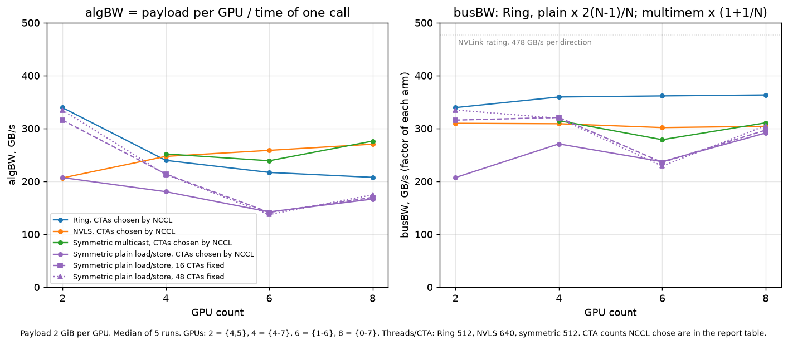
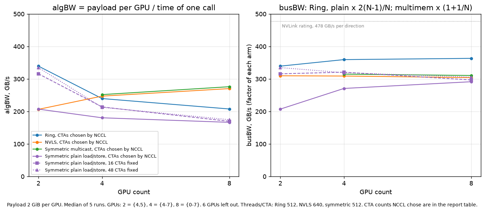

# GPU-count scaling at a large payload (plan 02)

**Status (2026-11-16): done.** Plan: [02_gpu_count_scaling.md](02_gpu_count_scaling.md). Series index: [PLANS.md](../PLANS.md). CTA settings come from the [calibration report](../selection_calibration/README.md).

## Question and answer

**Question:** when the number of GPUs in one AllReduce grows from 2 to 8, how do algBW and busBW of each implementation change?

**Answer:** NVLS gains algBW with every added pair of GPUs and Ring loses it, so the order of the arms flips; symmetric multicast also gains from 4 to 8 GPUs but dips at 6. At 2 GPUs Ring is fastest (339.5 GB/s against 206.5 for NVLS). At 4 GPUs the multimem arms and Ring are within 6%. At 8 GPUs NVLS (270.3 GB/s) and symmetric multicast (276.2 GB/s) are 30–33% faster than Ring (207.7 GB/s). Ring and NVLS keep a nearly constant busBW (Ring 340–363 GB/s, NVLS 302–310 GB/s), so their algBW changes follow their byte factors. The two symmetric kernels do not: both drop at 6 GPUs, and at 6 GPUs their algBW depends on which GPUs are used (up to 6.7% for multicast and 14% for plain load/store). The uneven split of 2 GiB into 6 parts is not the cause.

## Words used in this report

| Word in this report | Meaning | Id in [00_common_setup.md](../00_common_setup.md) |
|---|---|---|
| Arm | One AllReduce implementation: Ring, NVLS, symmetric multicast, symmetric plain load/store | |
| algBW | Payload bytes per GPU ÷ mean time of one call, GB/s | S1 |
| busBW | algBW × 2(N − 1)/N for Ring and plain load/store, × (1 + 1/N) for NVLS and symmetric multicast | S6 |
| Scaling ratio | algBW at N GPUs ÷ algBW of the same arm and CTA setting at its smallest GPU count | S2 |
| What NCCL ran | Algorithm or kernel, protocol, CTA count from the NCCL log | S3 |
| Device state | Clocks, power, temperature, other processes before and after each run | B2 |

## Scaling with the GPU count

### Motivation

LLM training spreads the same gradient AllReduce over more GPUs. Time alone mixes two effects: how much data each GPU must move (which depends on the algorithm and N) and how fast it moves it. busBW with each arm's own factor separates them. The plan expected, from byte counts alone, that busBW stays the same over N for an arm limited only by the link; algBW would then fall with N for Ring and plain load/store (× 1.00, 0.67, 0.60, 0.57) and rise a little for the multimem arms.

### Setup

| Setting | Value |
|---|---|
| **Controlled independent variable** | **GPU count: 2, 4, 6, 8** |
| GPU sets | 2 = {4,5}; 4 = {4,5,6,7}; 6 = {1,2,3,4,5,6}; 8 = {0,…,7} |
| Arms and CTAs × threads/CTA | Ring: NCCL's choice, 24 × 512. NVLS: NCCL's choice, 16 × 640. Symmetric multicast: NCCL's choice, 4 × 512 at 4 GPUs and 2 × 512 at 6 and 8 GPUs. Plain load/store: three curves, NCCL's choice (8 × 512), 16 × 512 fixed, 48 × 512 fixed |
| Fixed | 2 GiB per GPU, `float` sum, 5 warm-up and 20 timed calls |
| Rounds | 5 per cell; arms rotated inside each round |
| Configs | [`configs/scaling_n{2,4,6,8}.json`](configs/) |

### Method

1. 8 GPUs ran first (07:11–07:17 UTC), then 6 (07:54–07:59), 4 (08:31–08:35) and 2 GPUs (08:57–08:59). 115 runs, 0 rejected.
2. **Deviation:** the plan said "both CTA settings from plan 01: NCCL's choice and the smallest flat CTA count". For Ring, NVLS and symmetric multicast, NCCL's choice is within 4% of the highest calibration value at every GPU count, so one curve is shown. For plain load/store the flat CTA count differs by GPU count (24, 16, 8, 16), so instead of a different count at each N the same two fixed counts (16 and 48) were run at every N, which keeps each curve matched.
3. **Deviation:** the plan asked for GPU counts in blocks, repeated in reverse order. Because the user asked for 8-GPU runs first, the order was 8, 6, 4, 2 and the reverse repeat was not run. Drift between sessions is small: the same cell (same arm, GPU set, CTA setting, 2 GiB) measured in the calibration, scaling, control, follow-up and link-byte sessions differs by at most 0.5% (for example, Ring at 6 GPUs: 217.1, 216.9, 217.1, 217.2, 217.0). The payload-sweep runs are not used for this check: their buffers are sized for 8 GiB, and at 2 GiB the symmetric kernels differ from the fixed-size runs by up to 3% (see the [payload report](../payload_size/README.md)).

### Results

The same figure without 6 GPUs (added 2026-11-17 on request; same data, the 6-GPU points are only left out, so the lines join 4 and 8 GPUs directly):

algBW and busBW in GB/s, median of 5 runs (min–max of algBW in brackets):

| Arm, CTAs × threads/CTA | 2 GPUs | 4 GPUs | 6 GPUs | 8 GPUs |
|---|---|---|---|---|
| Ring, 24 × 512 (NCCL's choice) | 339.5 (338.8–340.2) / 339.5 | 239.7 (239.0–239.9) / 359.6 | 217.0 (216.6–217.2) / 361.6 | 207.7 (207.6–208.0) / 363.4 |
| NVLS, 16 × 640 (NCCL's choice) | 206.5 (206.4–206.7) / 309.8 | 247.2 (246.9–247.4) / 309.0 | 258.6 (258.4–258.7) / 301.7 | 270.3 (270.3–270.6) / 304.1 |
| Symmetric multicast, NCCL's choice | not available | 251.9 (251.8–252.1) / 314.9, 4 × 512 | 239.0 (238.9–239.0) / 278.8, 2 × 512 | 276.2 (276.1–276.3) / 310.7, 2 × 512 |
| Plain load/store, 8 × 512 (NCCL's choice) | 207.3 (207.0–208.1) / 207.3 | 180.6 (180.5–180.6) / 270.8 | 142.4 (142.2–142.5) / 237.3 | 166.6 (166.4–166.6) / 291.5 |
| Plain load/store, 16 × 512 fixed | 315.9 (315.5–316.1) / 315.9 | 213.9 (213.9–214.0) / 320.9 | 141.5 (141.3–141.6) / 235.8 | 169.7 (169.5–169.7) / 296.9 |
| Plain load/store, 48 × 512 fixed | 334.9 (334.7–335.8) / 334.9 | 212.9 (211.6–213.1) / 319.3 | 137.4 (137.4–138.1) / 229.0 | 174.7 (174.3–174.9) / 305.6 |

Scaling ratio of algBW against the byte-count expectation (an arm limited only by the link would follow the expectation):

| Arm | Reference | 4 GPUs | 6 GPUs | 8 GPUs | Expectation at 4 / 6 / 8 GPUs |
|---|---|---|---|---|---|
| Ring, 24 × 512 | 2 GPUs | 0.706 | 0.639 | 0.612 | 0.667 / 0.600 / 0.571 |
| Plain load/store, 16 × 512 | 2 GPUs | 0.677 | 0.448 | 0.537 | 0.667 / 0.600 / 0.571 |
| Plain load/store, 48 × 512 | 2 GPUs | 0.636 | 0.410 | 0.522 | 0.667 / 0.600 / 0.571 |
| NVLS, 16 × 640 | 2 GPUs | 1.197 | 1.252 | 1.309 | 1.200 / 1.286 / 1.333 |
| Symmetric multicast | 4 GPUs | 1 | 0.949 | 1.096 | 1 / 1.071 / 1.111 |

Device state: in all 872 before/after snapshots of the series, no other process was on the GPUs, and the only clock-event reason recorded was "GPU idle" (0x1, read while no kernel ran), so no power or thermal limit was seen at the snapshot times. Snapshots are not continuous.

### Interpretation

- **The order of the arms depends on the GPU count.** Ring leads at 2 GPUs, the arms are within 6% at 4 GPUs, and the multimem arms lead at 6 and 8 GPUs: by 19% (NVLS) and 10% (symmetric multicast, GPUs 1–6) at 6 GPUs, and by 30% (NVLS) and 33% (symmetric multicast) at 8 GPUs.
- **Ring and NVLS scale as their byte factors predict.** busBW changes by 7% for Ring (339.5 to 363.4 GB/s) and by less than 3% for NVLS across 2–8 GPUs. Ring scales slightly better than predicted, because its 2-GPU busBW is the lowest of its four points; at 2 GPUs the Ring calibration was still rising at NCCL's 64-CTA limit ([calibration](../selection_calibration/README.md)), so its 2-GPU reference may be held back by the CTA count.
- **NVLS at 2 GPUs is slow, as its factor predicts.** With 2 GPUs, each NVLS payload byte costs 1.5 link bytes per direction against 1.0 for Ring, which matches the measured algBW ratio (206.5 ÷ 339.5 = 0.61; 309.8 and 339.5 GB/s busBW).
- **The symmetric kernels do not scale smoothly.** Both drop at 6 GPUs; plain load/store at 6 GPUs (141.5 GB/s at 16 CTAs) is even slower than at 8 GPUs (169.7 GB/s). The GPU-set section below shows this is not a property of the 6-GPU set alone.
- **busBW of NVLS and Ring is below the link rating at every GPU count** (at most 363 of 478 GB/s). The link-byte report shows the byte factors are exact, so this is a real link rate, but it does not identify what limits it.

## Control: which GPUs

### Motivation

6- and 8-GPU sets use both CPU sockets; the main 2- and 4-GPU sets use only socket 1. If the GPU set changes algBW, a change between GPU counts could be a set effect. The plan expected all sets of the same size within 2%.

### Setup

| Setting | Value |
|---|---|
| **Controlled independent variable** | **GPU set at a fixed GPU count**: 2 GPUs: {4,5}, {0,1}, {3,4}; 4 GPUs: {4–7}, {0–3}, {2–5}; 6 GPUs: {1–6}, {0–5} |
| Fixed | Each arm at NCCL's CTA choice (same counts as above); 2 GiB per GPU |
| Rounds | 3 |
| Configs | [`configs/control_n{2,4,6}.json`](configs/) |

### Method

Ran after the other experiments of the same GPU count: 6 GPUs 08:12–08:16, 4 GPUs 08:45–08:49, 2 GPUs 09:05–09:07 UTC. 87 runs, 0 rejected.

### Results

algBW in GB/s, median of 3 runs, NCCL's CTA choice:

| GPUs | Arm | Set A | Set B | Set C | Largest difference |
|---|---|---|---|---|---|
| 2 | Ring | {4,5}: 340.8 | {0,1}: 338.8 | {3,4}: 340.7 | 0.6% |
| 2 | NVLS | {4,5}: 206.8 | {0,1}: 207.7 | {3,4}: 207.7 | 0.5% |
| 2 | Plain load/store | {4,5}: 207.2 | {0,1}: 207.5 | {3,4}: 207.0 | 0.2% |
| 4 | Ring | {4–7}: 240.1 | {0–3}: 239.9 | {2–5}: 240.3 | 0.2% |
| 4 | NVLS | {4–7}: 246.9 | {0–3}: 248.0 | {2–5}: 249.0 | 0.8% |
| 4 | Symmetric multicast | {4–7}: 251.8 | {0–3}: 251.0 | {2–5}: 252.6 | 0.6% |
| 4 | Plain load/store | {4–7}: 180.6 | {0–3}: 179.8 | {2–5}: 180.3 | 0.4% |
| 6 | Ring | {1–6}: 217.1 | {0–5}: 217.2 | | 0.0% |
| 6 | NVLS | {1–6}: 258.8 | {0–5}: 258.2 | | 0.2% |
| 6 | Symmetric multicast | {1–6}: 239.0 | {0–5}: 255.1 | | **6.7%** |
| 6 | Plain load/store | {1–6}: 142.3 | {0–5}: 133.5 | | **6.6%** |

### Interpretation

- **At 2 and 4 GPUs the GPU set does not matter** (at most 0.8%), including sets that span both sockets ({3,4}, {2–5}). The CPU socket is not a factor for these arms at this payload.
- **At 6 GPUs the set matters for the two symmetric kernels only**, and in opposite directions: {0–5} is faster for multicast and slower for plain load/store. This was not expected and led to the follow-up below.

## Follow-up: GPU set or uneven split at 6 GPUs

### Motivation

Added on 2026-11-16 after the control results (plan note dated the same day). Two explanations for the 6-GPU behaviour of the symmetric kernels were open: (1) 2 GiB is not divisible by 6, so ranks get slightly unequal shares, while 2, 4 and 8 GPUs split it evenly; (2) something about which GPUs form the set. The uneven split cannot explain a difference between two sets of the same size, but it could explain the 6-GPU drop itself.

### Setup

| Setting | Value |
|---|---|
| **Controlled independent variables** | **GPU set: {0–5}, {1–6}, {2–7}, {0,1,2,5,6,7}** and **payload: 2 GiB (2,147,483,648 B) or 2 GiB − 128 B (2,147,483,520 B = 6 × 357,913,920 B, a whole number of 16-byte units per rank)** |
| Arms, CTAs × threads/CTA | Ring 24 × 512, NVLS 16 × 640, symmetric multicast 2 × 512 (NCCL's choice); plain load/store 16 × 512 fixed |
| Rounds | 3 |
| Config | [`configs/followup_n6_split.json`](configs/followup_n6_split.json) |

### Method

09:08–09:25 UTC, 96 runs, 0 rejected. Run after all other experiments, so it is not part of the planned order.

### Results

algBW in GB/s at 2 GiB, median of 3 runs; the last column is the change from 2 GiB to 2 GiB − 128 B, largest over the four sets:

| Arm | {0–5} | {1–6} | {2–7} | {0,1,2,5,6,7} | Spread over sets | Change with even split |
|---|---|---|---|---|---|---|
| Ring, 24 × 512 | 217.2 | 217.2 | 216.9 | 217.3 | 0.2% | ≤ 0.2% |
| NVLS, 16 × 640 | 258.4 | 258.5 | 259.1 | 258.7 | 0.3% | ≤ 0.2% |
| Symmetric multicast, 2 × 512 | 255.1 | 239.0 | 243.6 | 242.4 | 6.7% | ≤ 0.05% |
| Plain load/store, 16 × 512 | 133.0 | 141.6 | 151.9 | 140.2 | 14.2% | ≤ 0.9% |

All values: [`results/2026-11-16/followup_n6_split_summary.csv`](results/2026-11-16/followup_n6_split_summary.csv).

### Interpretation

- **The uneven split is not the cause.** An even split changes algBW by at most 0.9% for any arm and set.
- **The GPU set changes the symmetric kernels at 6 GPUs and not Ring or NVLS.** Sets of six GPUs that look alike (all span both sockets) differ by up to 6.7% (multicast) and 14% (plain load/store), and the order of the sets differs between the two kernels.
- **Even the best 6-GPU set does not remove the 6-GPU drop of plain load/store** (151.9 GB/s at 6 GPUs against 169.7 at 8 GPUs, both 16 × 512).
- **The cause is not known.** Candidates that these runs cannot separate: how the symmetric kernels divide work among CTAs and peers when the rank count is not a power of two; the order in which ranks visit peers, which depends on the rank-to-GPU mapping; and the NVLink port or switch path between particular GPUs, which Ring and NVLS might hide because they spread traffic differently. Per-GPU timing inside the kernel or per-link counters (`nvidia-smi nvlink` per link, already in the raw snapshots) are the next measurements to separate them.

## Session log

| UTC time, 2026-11-16 | GPUs | What ran | Deviations | Where |
|---|---|---|---|---|
| 07:11–07:17 | 0–7 | 8-GPU scaling, 30 runs | Order 8, 6, 4, 2 instead of blocks with a reverse repeat | `results/2026-11-16/scaling.jsonl` |
| 07:54–07:59, 08:31–08:35, 08:57–08:59 | 1–6, 4–7, 4–5 | 6-, 4-, 2-GPU scaling, 85 runs | Same | same file |
| 08:12–08:16, 08:45–08:49, 09:05–09:07 | 6-, 4-, 2-GPU sets above | GPU-set control, 87 runs | None | `results/2026-11-16/control.jsonl` |
| 09:08–09:25 | four 6-GPU sets | Follow-up, 96 runs | Added after the control results | `results/2026-11-16/followup_n6_split.jsonl` |

Raw NCCL logs, program output and before/after snapshots are in the local `results/2026-11-16/raw/` directory, which is not in git; reproducing them needs that directory or a rerun.
