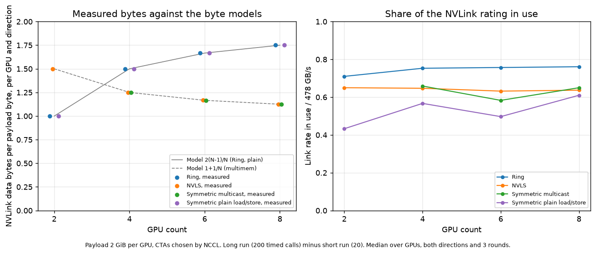

# Link bytes per payload byte (plan 04)

**Status (2026-11-16): done.** Plan: [04_link_bytes.md](04_link_bytes.md). Series index: [PLANS.md](../PLANS.md).

## Question and answer

**Question:** how many bytes does each GPU send and receive on NVLink for one payload byte, at 2, 4, 6 and 8 GPUs, and how close is each AllReduce implementation to the link rating?

**Answer:** the measured bytes match the byte models to within 0.1% in all 15 cells, on every GPU and in both directions: 2(N − 1)/N for Ring and plain load/store, (1 + 1/N) for NVLS and symmetric multicast. So busBW computed with each arm's own factor is the real link rate per direction. No arm reaches the link rating of 478 GB/s per direction: Ring uses 71–76% of it, NVLS 63–65%, symmetric multicast 58–66%, and plain load/store at NCCL's CTA choice 43–61%.

## Words used in this report

| Word in this report | Meaning | Id in [00_common_setup.md](../00_common_setup.md) |
|---|---|---|
| Arm | One AllReduce implementation: Ring, NVLS, symmetric multicast, symmetric plain load/store | |
| algBW | Payload bytes per GPU ÷ mean time of one call, GB/s | S1 |
| Link bytes per payload byte | NVLink data bytes one GPU sends (or receives) per payload byte of one call | S4 |
| Share of the link rating | algBW × link bytes per payload byte ÷ 478 GB/s | S5 |
| Link counters | `nvidia-smi nvlink -gt d`: data KiB per link and direction, read before and after each run | B3 |
| Byte model | 2(N − 1)/N for Ring and plain load/store, (1 + 1/N) for the multimem arms; the busBW factors | S6 |

## Link byte counters around many calls

### Motivation

busBW is computed from a byte model, not measured. If an arm moved more bytes than its model (for example, protocol overhead or extra copies), busBW would understate the link load and the arms would not be comparable. This is the first observation of the series beyond algBW.

### Setup

| Setting | Value |
|---|---|
| **Controlled independent variable** | **GPU count: 2, 4, 6, 8**, for each arm |
| GPU sets | 2 = {4,5}; 4 = {4,5,6,7}; 6 = {1,2,3,4,5,6}; 8 = {0,…,7} |
| Arms, CTAs × threads/CTA | NCCL's choice: Ring 24 × 512, NVLS 16 × 640, symmetric multicast 4 × 512 (4 GPUs) or 2 × 512 (6, 8 GPUs), plain load/store 8 × 512 |
| Run pair | A long run with 200 timed calls and a short run with 20, same settings; 5 warm-up calls and 1 check in both |
| Payload | 2 GiB per GPU |
| Rounds | 3 pairs per cell |
| Configs | [`configs/pairs_n{2,4,6,8}.json`](configs/) |
| Analysis | [`link_bytes.py`](../../common/scripts/link_bytes.py) |

### Method

1. 8 GPUs 07:18–07:23, 6 GPUs 08:00–08:04, 4 GPUs 08:35–08:39, 2 GPUs 08:59–09:02 UTC. 90 runs, 0 rejected.
2. For each GPU, the counters of its 18 links are summed per direction, before and after each run.
3. nccl-tests runs the timed calls once out-of-place and once in-place, and adds warm-up and check calls, which are the same in both runs of a pair. So link bytes per payload byte = (bytes of long run − bytes of short run) ÷ (2 × 180 × 2 GiB). Setup, warm-up and check traffic cancel.
4. The counters cover the whole GPU, so traffic of other users would be counted too. No other process was on the GPUs in any snapshot.

### Results

Link bytes per payload byte (median over GPUs, both directions and 3 pairs; min–max over all of these in brackets), and share of the 478 GB/s rating:

| GPUs | Ring | NVLS | Symmetric multicast | Plain load/store | Model: Ring, plain | Model: multimem |
|---|---|---|---|---|---|---|
| 2 | 1.0000 (1.0000–1.0000), 0.71 | 1.5002 (1.5002–1.5003), 0.65 | not available | 1.0000 (1.0000–1.0000), 0.43 | 1.0000 | 1.5000 |
| 4 | 1.5000 (1.5000–1.5000), 0.75 | 1.2503 (1.2503–1.2504), 0.65 | 1.2500 (1.2500–1.2500), 0.66 | 1.5000 (1.5000–1.5000), 0.57 | 1.5000 | 1.2500 |
| 6 | 1.6667 (1.6667–1.6667), 0.76 | 1.1675 (1.1668–1.1679), 0.63 | 1.1667 (1.1667–1.1667), 0.58 | 1.6667 (1.6667–1.6667), 0.50 | 1.6667 | 1.1667 |
| 8 | 1.7501 (1.7501–1.7501), 0.76 | 1.1253 (1.1253–1.1253), 0.64 | 1.1250 (1.1250–1.1250), 0.65 | 1.7500 (1.7500–1.7500), 0.61 | 1.7500 | 1.1250 |

All rows per GPU-count, round and direction: [`results/2026-11-16/link_bytes.csv`](results/2026-11-16/link_bytes.csv). Transmit and receive agree within 0.001 link bytes per payload byte.

### Interpretation

- **The byte models are exact on this machine.** Every arm moves exactly the bytes its busBW factor assumes, on every GPU. NVLS moves 0.02–0.07% more than its model, which is consistent with small control traffic (for example, synchronization flags); the symmetric kernels and Ring show no extra bytes at this precision.
- **The counters count the multicast copy that returns to the issuing GPU.** The (1 + 1/N) model includes each GPU's own share coming back from the switch, and the measured values include it, as the 4-GPU work had found ([4-GPU setup](../../../../h100x4/nvls/observation/00_common_setup.md)). This now holds at 2, 6 and 8 GPUs too.
- **No arm is limited by the link rating alone.** The highest share is 0.76 (Ring at 6 and 8 GPUs). The multimem arms stop at 0.58–0.66 of the rating at every GPU count. What limits them is not identified by these counters: candidates are the NVSwitch multicast and reduction service, request generation in the kernels, and the link's real data rate being below its rating. The rating itself (18 × 26.562 GB/s) has not been checked against a measured maximum on this machine.
- **The plain load/store share is low partly because of NCCL's CTA choice.** These runs used NCCL's 8 CTAs, which the calibration shows is far below the best setting at 2 and 4 GPUs. At 2 GPUs and 32 CTAs, plain load/store reaches 342 GB/s of algBW, which is 0.72 of the rating with its factor of 1.0.

## Session log

| UTC time, 2026-11-16 | GPUs | What ran | Deviations | Where |
|---|---|---|---|---|
| 07:18–07:23 | 0–7 | 8-GPU pairs, 24 runs | The plan's method (one 200-call run with all calls counted) was replaced before running by the long-minus-short pair | `results/2026-11-16/pairs.jsonl` |
| 08:00–08:04, 08:35–08:39, 08:59–09:02 | 1–6, 4–7, 4–5 | 6-, 4-, 2-GPU pairs, 66 runs | None | same file |

Raw snapshots with the per-link counters are in the local `results/2026-11-16/raw/` directory, which is not in git; reproducing them needs that directory or a rerun.
