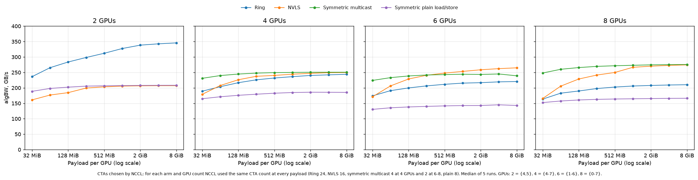
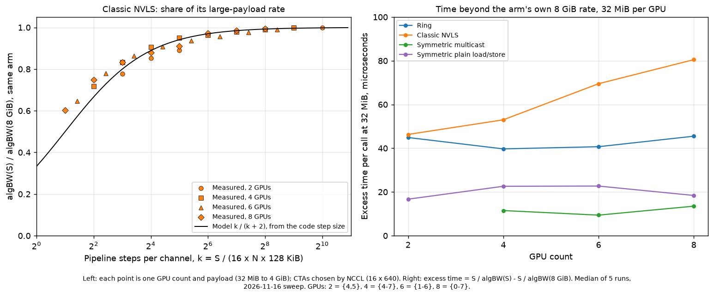

# Payload size at each GPU count (plan 03)

**Status (2026-11-16): done. Answer and interpretation corrected on 2026-11-18** (an earlier version concluded "NVLS needs a large payload" from each arm's own 32 MiB ÷ 8 GiB ratio; see the note under Interpretation). Plan: [03_payload_size.md](03_payload_size.md). Series index: [PLANS.md](../PLANS.md).

## Question and answer

**Question:** from which payload does each AllReduce implementation reach its large-payload algBW, and does the order of the implementations change with payload?

**Answer:** GPU count, more than payload, decides whether the multimem arms beat Ring. Against Ring at the same payload, both NVLS and symmetric multicast gain as the GPU count grows: at 8 GiB NVLS goes from 0.60 of Ring at 2 GPUs to 1.31 at 8 GPUs, and symmetric multicast from 1.03 at 4 GPUs to 1.31 at 8. Payload is a second condition for classic NVLS only: at 32 MiB it is no faster than Ring at any GPU count (0.68–1.01 of Ring), and its lead appears from 128 MiB at 6 and 8 GPUs. Symmetric multicast leads Ring at every payload from 4 GPUs on, most at small payloads (8 GPUs: 1.52 times Ring at 32 MiB, 1.31 at 8 GiB). Ring itself is the most payload-sensitive arm at 2 GPUs (still rising at 8 GiB, 95% only at 2 GiB). The symmetric kernels reach 95% of their 8 GiB algBW from 64–256 MiB; Ring from 512 MiB (2 GiB at 2 GPUs); NVLS from 256 MiB at 2 and 4 GPUs and 1 GiB at 6 and 8 GPUs, because its large-payload algBW rises with the GPU count while its 32 MiB algBW does not.

## Words used in this report

| Word in this report | Meaning | Id in [00_common_setup.md](../00_common_setup.md) |
|---|---|---|
| Arm | One AllReduce implementation: Ring, NVLS, symmetric multicast, symmetric plain load/store | |
| algBW | Payload bytes per GPU ÷ mean time of one call, GB/s | S1 |
| What NCCL ran | Algorithm or kernel, protocol, CTA count from the NCCL log | S3 |
| 95% payload | Smallest payload at which algBW reaches 95% of the same arm's algBW at 8 GiB | |
| Ratio to Ring | An arm's algBW ÷ Ring's algBW at the same GPU count and payload, in the same sweep | |

## Payload sweep

### Motivation

LLM work produces AllReduce calls of many sizes: gradient buckets of about 25 MiB (PyTorch DDP default), tensor-parallel activations of about 128 MiB, and whole-gradient calls of several GiB. A ranking found at 2 GiB may not hold at smaller payloads.

### Setup

| Setting | Value |
|---|---|
| **Controlled independent variable** | **Payload per GPU: 32, 64, 128, 256, 512 MiB, 1, 2, 4, 8 GiB** (one run steps through all, factor 2) |
| Fixed per panel | GPU count and set: 2 = {4,5}; 4 = {4,5,6,7}; 6 = {1,2,3,4,5,6}; 8 = {0,…,7} |
| Arms, CTAs × threads/CTA | NCCL's choice. For each arm and GPU count NCCL used one CTA count at every payload: Ring 24 × 512, NVLS 16 × 640, symmetric multicast 4 × 512 (4 GPUs) or 2 × 512 (6, 8 GPUs), plain load/store 8 × 512 |
| Calls | 5 warm-up, 20 timed, 1 check, at each payload |
| Rounds | 5 |
| Configs | [`configs/sweep_n{2,4,6,8}.json`](configs/) |

### Method

1. 8 GPUs 07:24–07:33, 6 GPUs 08:04–08:12, 4 GPUs 08:39–08:44, 2 GPUs 09:02–09:04 UTC. 75 runs, 0 rejected.
2. The CTA count was read from the NCCL log of each run: only one value appears per run, so it did not change with payload.
3. **Limit found after the runs:** each sweep run allocates buffers for 8 GiB and uses part of them for smaller payloads. At 2 GiB, the symmetric kernels in the sweep differ from the separate 2 GiB runs of the scaling experiment by up to 3% (plain load/store at 4 GPUs: 185.9 here against 180.6 GB/s; symmetric multicast at 6 GPUs: 243.4 against 239.0 GB/s). Ring and NVLS differ by at most 0.4%. Compare payloads within this sweep, and use the [scaling report](../gpu_count_scaling/README.md) for 2 GiB values. Why buffer size matters for the symmetric kernels was not investigated.

### Results

algBW in GB/s, median of 5 runs, at selected payloads; 95% payload in the last column:

| GPUs | Arm | 32 MiB | 128 MiB | 512 MiB | 2 GiB | 8 GiB | 32 MiB ÷ 8 GiB | 95% payload |
|---|---|---|---|---|---|---|---|---|
| 2 | Ring | 236.3 | 283.8 | 312.0 | 338.4 | 345.7 | 0.68 | 2 GiB |
| 2 | NVLS | 161.0 | 184.5 | 203.4 | 206.6 | 207.1 | 0.78 | 256 MiB |
| 2 | Plain load/store | 188.8 | 202.3 | 206.6 | 207.9 | 208.4 | 0.91 | 64 MiB |
| 4 | Ring | 189.3 | 216.7 | 231.9 | 240.2 | 244.0 | 0.78 | 512 MiB |
| 4 | NVLS | 179.0 | 226.3 | 240.3 | 247.0 | 249.6 | 0.72 | 256 MiB |
| 4 | Symmetric multicast | 230.9 | 244.7 | 249.4 | 250.5 | 250.7 | 0.92 | 64 MiB |
| 4 | Plain load/store | 164.8 | 175.9 | 182.7 | 185.9 | 185.4 | 0.89 | 256 MiB |
| 6 | Ring | 174.1 | 199.8 | 211.5 | 216.8 | 220.6 | 0.79 | 512 MiB |
| 6 | NVLS | 171.1 | 228.7 | 247.9 | 258.6 | 264.9 | 0.65 | 1 GiB |
| 6 | Symmetric multicast | 224.1 | 238.6 | 242.9 | 243.4 | 239.0 | 0.94 | 64 MiB |
| 6 | Plain load/store | 130.3 | 138.2 | 141.6 | 142.8 | 142.9 | 0.91 | 128 MiB |
| 8 | Ring | 163.6 | 189.8 | 202.6 | 207.8 | 210.2 | 0.78 | 512 MiB |
| 8 | NVLS | 165.5 | 228.7 | 249.9 | 270.3 | 274.4 | 0.60 | 1 GiB |
| 8 | Symmetric multicast | 248.1 | 265.8 | 271.7 | 274.5 | 275.7 | 0.90 | 128 MiB |
| 8 | Plain load/store | 152.4 | 160.8 | 163.9 | 165.4 | 166.2 | 0.92 | 128 MiB |

Ratio to Ring (arm's algBW ÷ Ring's algBW, same GPU count and payload, from the same sweep; symmetric multicast is not available at 2 GPUs):

| Arm ÷ Ring | Payload | 2 GPUs | 4 GPUs | 6 GPUs | 8 GPUs |
|---|---|---|---|---|---|
| NVLS ÷ Ring | 32 MiB | 0.68 | 0.95 | 0.98 | 1.01 |
| | 128 MiB | 0.65 | 1.04 | 1.14 | 1.20 |
| | 512 MiB | 0.65 | 1.04 | 1.17 | 1.23 |
| | 2 GiB | 0.61 | 1.03 | 1.19 | 1.30 |
| | 8 GiB | 0.60 | 1.02 | 1.20 | 1.31 |
| Symmetric multicast ÷ Ring | 32 MiB | — | 1.22 | 1.29 | 1.52 |
| | 128 MiB | — | 1.13 | 1.19 | 1.40 |
| | 512 MiB | — | 1.08 | 1.15 | 1.34 |
| | 2 GiB | — | 1.04 | 1.12 | 1.32 |
| | 8 GiB | — | 1.03 | 1.08 | 1.31 |

The largest min–max spread of any point is 5.6 GB/s (Ring, 2 GPUs). All payloads: [`results/2026-11-16/sweep_summary.csv`](results/2026-11-16/sweep_summary.csv).

### Interpretation

- **GPU count decides first.** At every payload from 128 MiB on, both multimem arms gain on Ring as the GPU count grows (NVLS ÷ Ring at 8 GiB: 0.60, 1.02, 1.20, 1.31 at 2, 4, 6, 8 GPUs). This follows the bytes each GPU moves per payload byte: 2(N − 1)/N for Ring, growing with N, and 1 + 1/N for multimem, shrinking with N. At 2 GPUs NVLS loses to Ring at every payload.
- **Payload is a second condition, for classic NVLS only.** At 32 MiB NVLS is no faster than Ring at any GPU count (0.68–1.01; 8 GPUs: 165.5 against 163.6 GB/s). At 6 and 8 GPUs its lead appears from 128 MiB (1.14, 1.20) and grows to 1.20–1.31 at 8 GiB.
- **Symmetric multicast needs only GPU count.** It leads Ring at every payload from 4 GPUs on, and its lead is largest at small payloads (8 GPUs: 1.52 at 32 MiB, 1.31 at 8 GiB). At 32 MiB it is 29–50% ahead of NVLS.
- **Why NVLS's 95% payload grows with the GPU count:** see the mechanism section below. Its pipeline step is N × 128 KiB per channel, so at a given payload it has fewer steps the more GPUs there are.
- **Ring is the most payload-sensitive arm at 2 GPUs:** 0.68 of its 8 GiB algBW at 32 MiB, 95% only at 2 GiB, and still rising at 8 GiB. At 4–8 GPUs it keeps 0.78–0.79 at 32 MiB and reaches 95% at 512 MiB. Both its 32 MiB and its 8 GiB algBW fall with the GPU count (236 → 164 and 346 → 210 GB/s), as its bytes per payload byte grow.
- **Correction (2026-11-18).** An earlier version said "NVLS needs a large payload", from each arm's own 32 MiB ÷ 8 GiB ratio. That ratio is lower for NVLS than for Ring only at 6 and 8 GPUs (0.65, 0.60 against 0.79, 0.78); at 2 GPUs it is higher (0.78 against 0.68). It also mixes payload with GPU count, because NVLS's 8 GiB rate rises with N. The ratio to Ring above separates the two.
- **Symmetric multicast at 6 GPUs falls from 4 GiB to 8 GiB** (245.0 to 239.0 GB/s). It is the only arm whose curve falls at the largest payloads. Together with the buffer-size effect above and the GPU-set effect in the scaling report, this points to a placement or address effect in the symmetric kernels at 6 GPUs; it is not explained.
- **The symmetric kernels need the buffer to be registered** (`-R 2`, symmetric registration). In a real training framework that is a setup cost and a memory-management constraint that these measurements do not include.

## Mechanisms: why Ring wins at 2 GPUs, and why classic NVLS needs larger payloads than symmetric multicast

### Motivation

The sections above say **what** happens. This section explains **why**, from the bytes each implementation moves and from how classic NVLS splits a call into steps, and checks each explanation against measurements that did not go into it.

### Setup

| Item | Value |
|---|---|
| Data | This sweep (2026-11-16); 2 GiB values of the [scaling report](../gpu_count_scaling/README.md); the two-shot example multicast kernel at 2 GPUs from the [example-kernel report](../custom_mc_kernels/README.md) (another program; its NCCL column agreed with nccl-tests within 0.9% at 2 GiB) |
| Code | Classic NVLS step size: `loopCount = nvls->nHeads * chunkSize` ([all_reduce.h:414](../../../../../src/device/all_reduce.h#L414)); `nHeads` = N on one node ([connect.cc:261](../../../../../src/graph/connect.cc#L261)); `chunkSize` = `NCCL_NVLS_CHUNKSIZE`, 128 KiB by default (logged `NVLS tuning: nChannels 16 chunkSize 131072`) |
| Script | [`payload_mechanisms.py`](../../common/scripts/payload_mechanisms.py): excess time per call and the NVLS step model, from the saved summary only; output [`payload_mechanisms.csv`](results/2026-11-16/payload_mechanisms.csv) |

### Method

1. **Bytes per payload byte**, per GPU and direction, from the algorithms (confirmed by link counters in the [link-byte report](../link_bytes/README.md)): Ring 2(N − 1)/N, multimem 1 + 1/N.
2. **Excess time per call** at payload S: S ÷ algBW(S) − S ÷ algBW(8 GiB), the time beyond what the arm's own large-payload rate needs for S bytes.
3. **Classic NVLS steps per channel**: each of 16 channels moves S/16 in steps of N × 128 KiB, so k = S ÷ (16 × N × 128 KiB). Each step goes through three warp teams in turn: scatter (copy into NCCL's buffer), reduce (`multimem.ld_reduce` + `multimem.st`, after every GPU's scatter of that step), gather (copy out). A three-stage pipeline with k steps takes about k + 2 step times, so the expected share of the large-payload rate is k ÷ (k + 2). The model takes only the step size from the code and has no fitted parameter; the measured ratio algBW(S) ÷ algBW(8 GiB) is compared with it.

### Results

Bytes per payload byte, each direction, and the share spent on the GPU's own data:

| GPUs | Ring 2(N − 1)/N | Multimem 1 + 1/N | Of which the GPU's own slice through the switch (1/N) | Multimem ÷ Ring bytes |
|---|---|---|---|---|
| 2 | 1.00 | 1.50 | 0.50 (33% of its bytes) | 1.50 |
| 4 | 1.50 | 1.25 | 0.25 (20%) | 0.83 |
| 6 | 1.67 | 1.17 | 0.17 (14%) | 0.70 |
| 8 | 1.75 | 1.13 | 0.13 (11%) | 0.64 |

At 2 GPUs, 2 GiB (algBW, GB/s): Ring 339.5 (24 CTAs) and 362.3 (64 CTAs); classic NVLS 206.5; two-shot example multicast kernel 211.8. If both ran each link direction at the same rate, multimem would reach Ring's rate × 1.00 ÷ 1.50 = 0.67 of Ring. Measured: classic NVLS 0.61 and the example kernel 0.62 of Ring at 24 CTAs (0.57 and 0.58 of Ring at 64 CTAs).

Classic NVLS, measured share of its 8 GiB rate against the step model (selected points; all points in the figure and the CSV):

| GPUs | Payload | Steps per channel k | Model k ÷ (k + 2) | Measured algBW(S) ÷ algBW(8 GiB) |
|---|---|---|---|---|
| 2 | 32 MiB | 8 | 0.80 | 0.78 |
| 4 | 32 MiB | 4 | 0.67 | 0.72 |
| 6 | 32 MiB | 2.7 | 0.57 | 0.65 |
| 8 | 32 MiB | 2 | 0.50 | 0.60 |
| 8 | 128 MiB | 8 | 0.80 | 0.83 |
| 8 | 512 MiB | 32 | 0.94 | 0.91 |

Excess time per call at 32 MiB, microseconds:

| Arm | 2 GPUs | 4 GPUs | 6 GPUs | 8 GPUs |
|---|---|---|---|---|
| Ring, 24 × 512 | 45 | 40 | 41 | 46 |
| Classic NVLS, 16 × 640 | 46 | 53 | 69 | 80 |
| Symmetric multicast (4, 2, 2 × 512) | — | 11 | 9 | 14 |
| Symmetric plain load/store, 8 × 512 | 17 | 23 | 23 | 18 |

### Interpretation

**Why Ring beats multicast at 2 GPUs**

- **Multicast moves 1.5 times Ring's bytes at 2 GPUs.** Every multimem operation includes the issuing GPU itself: `ld_reduce` also reads the GPU's own slice through the switch, and `multimem.st` also writes the GPU's own copy back through it. That is 1/N of a payload byte in each direction, a third of all multimem link bytes at N = 2. Ring sends each byte only to the other GPU, 2(N − 1)/N = 1.
- **The byte counts cross at N = 3** (2(N − 1)/N = 1 + 1/N): below 3 GPUs Ring needs fewer bytes, above 3 multimem does, increasingly so (0.64 of Ring's bytes at 8 GPUs). This is the GPU-count effect of the sections above, and the reason NCCL turns its symmetric multicast kernels off at 2 GPUs ([sym_kernels.cc:195](../../../../../src/sym_kernels.cc#L195)).
- **Measured is a little below the byte expectation** (0.57–0.62 of Ring against 0.67), by about the multimem AllReduce link-rate shortfall found at 4–8 GPUs (11–24% below the full-duplex expectation; see the [busBW comparison](../../../allgather_reducescatter/scalability/busbw_comparison/README.md#expected-busbw-of-multicast-allreduce)): classic NVLS runs each direction at 206.5 × 1.5 = 310 GB/s, Ring at 340–362.

**Why classic NVLS needs larger payloads than symmetric multicast**

- **Classic NVLS spends 46–80 µs per call beyond its large-payload rate, symmetric multicast 9–14 µs.** At 32 MiB, where the arm's large-payload rate would need 122–162 µs per call, this decides the ratio: 0.60–0.78 of the large-payload rate for NVLS, 0.90–0.94 for symmetric multicast.
- **The cause in classic NVLS is its pipeline of steps.** Each channel moves its share in steps of N × 128 KiB through three teams (scatter, reduce, gather), and the reduce of a step waits until every GPU has scattered it. A pipeline of k steps through 3 stages needs about k + 2 step times: the first steps fill it and the last drain it. At 32 MiB per GPU each channel has only 2 MiB, so k = 16/N: 8 steps at 2 GPUs, 2 at 8 GPUs, where fill and drain take as long as the steps themselves.
- **The step model matches the measurements across GPU counts and payloads.** Plotted against steps per channel, the measured shares of all four GPU counts fall on one curve close to k ÷ (k + 2) (figure, left), although the model takes nothing from the measurements. It is a little pessimistic at few steps (0.60 measured against 0.50 at k = 2), as if the stages overlapped partly.
- **This is also why NVLS's payload sensitivity grows with the GPU count:** the step grows with N (N × 128 KiB), so the same payload gives fewer steps per channel, and its excess time rises from 46 µs at 2 GPUs to 80 µs at 8.
- **Symmetric multicast has no pipeline.** Each warp issues `ld_reduce` then `multimem.st` on the user's buffers directly; a call has one barrier across GPUs at its start and one at its end, and no per-step waits. Its excess time is a fixed 9–14 µs at every GPU count.
- **Ring also pipelines, but its excess stays at 40–46 µs at every GPU count.** It runs 2(N − 1) steps per call with a flag handoff to its neighbour at each; why its excess does not grow with N, as classic NVLS's does, was not analysed. Its payload sensitivity (0.68–0.79 of its 8 GiB rate at 32 MiB) comes from this roughly constant excess.
- **Not tested:** a direct check would change the step count without changing anything else: a smaller `NCCL_NVLS_CHUNKSIZE` (more steps per channel) or fewer NVLS channels (`NCCL_NVLS_NCHANNELS`, more bytes per channel) should raise classic NVLS's share at 32 MiB if fill and drain dominate, and lower it if a fixed cost per step dominates.

## Session log

| UTC time, 2026-11-16 | GPUs | What ran | Deviations | Where |
|---|---|---|---|---|
| 07:24–07:33 | 0–7 | 8-GPU sweep, 20 runs | None. The plan file lists all 9 payloads; the short summary in PLANS.md had listed 5 of them | `results/2026-11-16/sweep.jsonl` |
| 08:04–08:12, 08:39–08:44, 09:02–09:04 | 1–6, 4–7, 4–5 | 6-, 4-, 2-GPU sweeps, 55 runs | None | same file |

Raw NCCL logs and program output are in the local `results/2026-11-16/raw/` directory, which is not in git; reproducing them needs that directory or a rerun.
