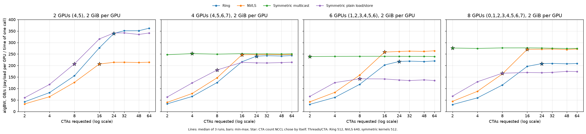

# Selection check and CTA calibration (plan 01)

**Status (2026-11-16): done for all 15 cells.** Plan: [01_selection_calibration.md](01_selection_calibration.md). Series index: [PLANS.md](../PLANS.md).

## Question and answer

**Question:** does each AllReduce implementation run what we asked at 2, 4, 6 and 8 GPUs, and from how many CTAs does it stop getting faster?

**Answer:** yes, every one of the 15 cells ran the intended code with 0 wrong values; NCCL also runs NVLS with 2 GPUs. NCCL's own CTA choice is on or near the flat part for Ring, NVLS and symmetric multicast at every GPU count (within 3.5%, and within 1% at 4 to 8 GPUs). It is far from the flat part for plain load/store at 2 GPUs (207 GB/s at NCCL's 8 CTAs against 342 GB/s at 24–32 CTAs) and at 4 GPUs (181 against 214 GB/s). Ring at 2 GPUs still gains 3.1% at 64 CTAs, which is NCCL's upper limit, so that calibration stays incomplete.

## Words used in this report

| Word in this report | Meaning | Id in [00_common_setup.md](../00_common_setup.md) |
|---|---|---|
| Arm | One AllReduce implementation: Ring, NVLS, symmetric multicast, symmetric plain load/store | |
| algBW | Payload bytes per GPU ÷ mean time of one call, GB/s | S1 |
| busBW | algBW × 2(N − 1)/N for Ring and plain load/store, × (1 + 1/N) for NVLS and symmetric multicast | S6 |
| What NCCL ran | Algorithm or kernel, protocol, CTA count from the NCCL log | S3 |
| Wrong values | nccl-tests check result | A11 |
| Flat part | CTA counts from the first one after which two successive increases each gain less than 1% in median algBW | |

## Selection check

### Motivation

NCCL can fall back to another algorithm or kernel without an error. Every later comparison needs proof that each run used the intended code.

### Setup

| Setting | Value |
|---|---|
| **Controlled independent variable** | **Cell: arm × GPU count** |
| GPU sets | 2 GPUs = {4,5}; 4 GPUs = {4,5,6,7}; 6 GPUs = {1,2,3,4,5,6}; 8 GPUs = {0,…,7} |
| Payload | 2 GiB per GPU, `float` sum |
| Command | `all_reduce_perf -t 1 -g N -b 2G -e 2G -n 20 -w 5 -c 1 -R <0 or 2>`, in-tree NCCL 2.32.3 (nccl-tests 2.21.1 prints `nccl-library=23203`) |
| Selection | Ring: `NCCL_ALGO=Ring NCCL_PROTO=Simple`; NVLS: `NCCL_ALGO=NVLS NCCL_PROTO=Simple`; symmetric: `NCCL_SYM_KERNEL=allreduce:<kernel>` with `-R 2` |

### Method

Every counted run of the series is checked in the runner [`run_allreduce.py`](../../common/scripts/run_allreduce.py): a run counts only if every algorithm line in the NCCL log names the intended algorithm and protocol (or every kernel line names the forced kernel, and no algorithm line appears), the program exits with 0, and both passes report 0 wrong values. The first 8-GPU smoke test (4 runs, kept in `results/2026-11-16/smoke.jsonl`) failed this check for Ring and NVLS only because the log writes `RING/SIMPLE` in capitals; the check was made case-blind before any counted run.

### Results

| Arm | Code that ran (from the log) | GPU counts run | Threads/CTA |
|---|---|---|---|
| Ring | `RING/SIMPLE` | 2, 4, 6, 8 | 512 (from the code: `NCCL_SIMPLE_MAX_NTHREADS`; the log does not print it) |
| NVLS | `NVLS/SIMPLE` | 2, 4, 6, 8 | 640 (from the code: `NCCL_MAX_NTHREADS` for NVLS; the log does not print it) |
| Symmetric multicast | `AllReduce_RSxLDMC_AGxSTMC` | 4, 6, 8 | 512 (log) |
| Symmetric plain load/store | `AllReduce_RSxLD_AGxST` | 2, 4, 6, 8 | 512 (log) |

All 868 counted runs of the series (calibration 405, scaling 115, GPU-set control 87, 6-GPU follow-up 96, link bytes 90, payload 75) passed the check.

### Interpretation

- **Every cell ran what it was asked to run.** NVLS ran with 2 GPUs, which the plan had left open.
- **The thread counts of Ring and NVLS come from the source, not from a measurement.** They are the defaults for the Simple protocol; no `NCCL_NTHREADS` was set.

## CTA calibration

### Motivation

NCCL picks the CTA count from its own model. If two arms get different CTA counts, a gap in algBW could come from the CTA count, not from the arm. The plan expected each curve to rise and then become flat.

### Setup

| Setting | Value |
|---|---|
| **Controlled independent variable** | **CTAs requested: NCCL's own choice, 2, 4, 8, 16, 24, 32, 48, 64** |
| Fixed within a curve | Arm, GPU count, GPU set, 2 GiB per GPU, threads/CTA as above |
| CTA knob | Ring: `NCCL_MIN_CTAS` = `NCCL_MAX_CTAS`; NVLS: `NCCL_NVLS_NCHANNELS`; symmetric: `NCCL_SYM_CTAS` |
| Rounds | 3; the cell order is rotated by one between rounds |
| Configs | [`configs/calibration_n{2,4,6,8}.json`](configs/) |

### Method

1. 8 GPUs ran first (06:29–06:53 UTC), then 6 GPUs (07:35–07:54), 4 GPUs (08:16–08:31) and 2 GPUs (08:50–08:57). The other experiments of each GPU count ran between these sessions. 405 runs, 0 rejected.
2. In every run, NCCL used exactly the requested CTA count.
3. The stop rule was fixed in the plan before the runs.

### Results

| GPUs | Arm | CTAs × threads/CTA NCCL chose | algBW at NCCL's choice, GB/s | Flat from (CTAs) | Highest algBW measured, GB/s (CTAs) | NCCL's choice ÷ highest |
|---|---|---|---|---|---|---|
| 2 | Ring | 24 × 512 | 339.2 | not reached | 362.3 (64) | 0.94 |
| 2 | NVLS | 16 × 640 | 206.5 | 24 | 214.4 (64) | 0.96 |
| 2 | Plain load/store | 8 × 512 | 207.1 | 24 | 341.9 (32) | 0.61 |
| 4 | Ring | 24 × 512 | 240.1 | 24 | 243.3 (64) | 0.99 |
| 4 | NVLS | 16 × 640 | 247.0 | 16 | 248.5 (32) | 0.99 |
| 4 | Symmetric multicast | 4 × 512 | 251.9 | 4 | 251.8 (4) | 1.00 |
| 4 | Plain load/store | 8 × 512 | 180.5 | 16 | 214.3 (64) | 0.84 |
| 6 | Ring | 24 × 512 | 217.1 | 24 | 220.0 (64) | 0.99 |
| 6 | NVLS | 16 × 640 | 258.8 | 24 | 264.0 (64) | 0.98 |
| 6 | Symmetric multicast | 2 × 512 | 238.9 | 2 | 240.1 (16) | 1.00 |
| 6 | Plain load/store | 8 × 512 | 142.4 | 8 | 142.3 (8) | 1.00 |
| 8 | Ring | 24 × 512 | 207.7 | 24 | 209.2 (32) | 0.99 |
| 8 | NVLS | 16 × 640 | 270.5 | 16 | 272.0 (64) | 0.99 |
| 8 | Symmetric multicast | 2 × 512 | 276.2 | 2 | 276.8 (16) | 1.00 |
| 8 | Plain load/store | 8 × 512 | 166.5 | 16 | 174.5 (48) | 0.95 |

Median of 3 runs. The spread (min to max) of each point is below 1% except at a few low-CTA points; all values are in [`results/2026-11-16/calibration_summary.csv`](results/2026-11-16/calibration_summary.csv).

### Interpretation

- **Symmetric multicast needs only 2 to 4 CTAs.** Its curve is flat from the smallest CTA count at every GPU count. The other arms need 16 to 24 CTAs to reach their flat part.
- **NCCL under-provisions plain load/store at 2 and 4 GPUs.** NCCL's choice of 8 CTAs gives 0.61 and 0.84 of the highest algBW. Any scaling curve of plain load/store at NCCL's choice therefore shows NCCL's CTA model, not the kernel. The scaling experiment adds fixed 16- and 48-CTA curves for this reason.
- **The Ring calibration at 2 GPUs is incomplete.** It still gains 3.1% from 48 to 64 CTAs, and 64 is NCCL's limit (`MAXCHANNELS`), so it cannot be extended with this knob.
- **Plain load/store at 6 and 8 GPUs is not monotonic.** At 6 GPUs it drops after 16 CTAs (142 to 135 GB/s); at 8 GPUs it rises again at 48 CTAs. The cause was not investigated.
- **A flat algBW curve does not show a link limit.** The link-byte experiment ([report](../link_bytes/README.md)) shows that no arm uses more than 76% of the link rating.

## Session log

| UTC time, 2026-11-16 | GPUs | What ran | Deviations | Where |
|---|---|---|---|---|
| 06:26–06:28 | 0–7 | Smoke test, 1 run per arm at 8 GPUs | Case check failed for Ring and NVLS; fixed; not counted | `results/2026-11-16/smoke.jsonl` |
| 06:29–06:53 | 0–7 | 8-GPU calibration, 108 runs | None. The GPUs then sat idle until 07:11 because the waiting script did not notice the end of the session | `results/2026-11-16/calibration.jsonl` |
| 07:35–07:54, 08:16–08:31, 08:50–08:57 | 1–6, then 4–7, then 4–5 | 6-, 4-, 2-GPU calibration, 297 runs | A first start at 07:34 failed before any GPU work (wrong script path) and was restarted | same file |

Raw NCCL logs, program output and before/after snapshots are in the local `results/2026-11-16/raw/` directory, which is not in git; reproducing them needs that directory or a rerun.
