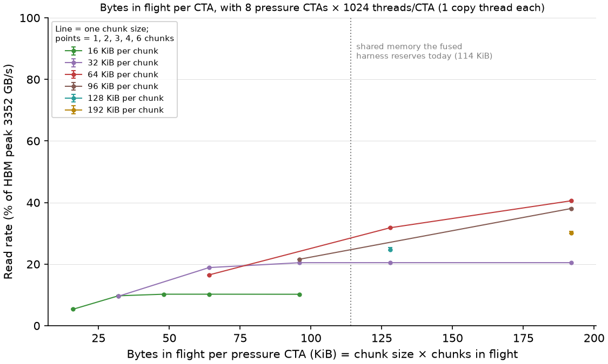
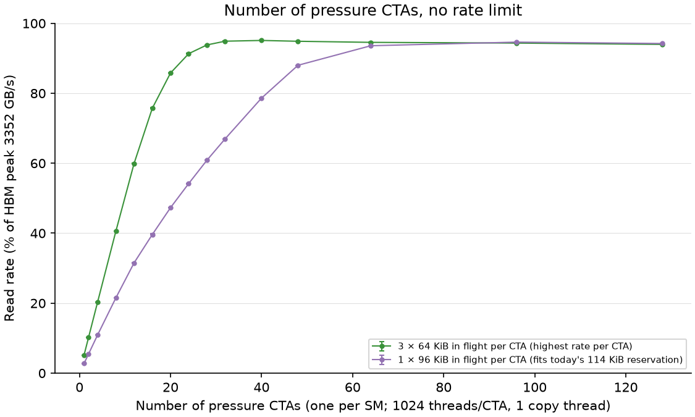
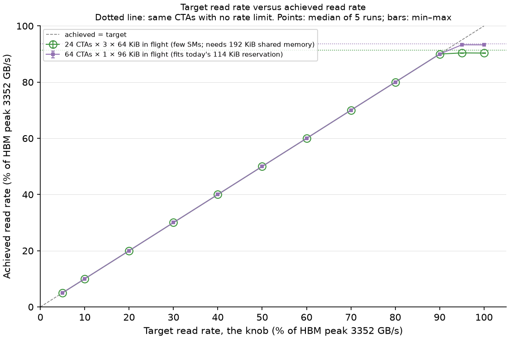

# HBM read rate of the memory co-runner

**Question.** Can one kernel role read HBM at a rate we choose, from near zero to near the HBM peak, while using few SMs and fitting the fused-kernel design?

**Answer.** Yes. The role uses the Hopper bulk-copy unit, started by one thread per CTA. Its knob is a **target read rate**. From 5% to 90% of the HBM peak, the achieved rate equals the target within **±0.02 percentage points**, in every one of five runs. Above the ceiling of a given CTA count, the rate stops at that ceiling. With no rate limit, the highest rate is **95.1% of peak (3188 GB/s)**. **24 CTAs reach 91.3% of peak** when each CTA keeps 3 × 64 KiB in flight (192 KiB of shared memory per CTA). With the shared memory the thread-store fused harness reserves today (114 KiB per CTA), the best setting needs **64 CTAs for 93.6% of peak**. All rates count the bytes the program asked for; they are not counted HBM traffic.

[Plan](01_hbm_read_rate.md) · [Harness and how to fuse the role](../../common/README.md) · [Kernel header](../../common/include/hbm_read_pressure.cuh) · [Configs](configs/) · [Results](results/2026-10-28/)

| Word used in this report | Meaning |
|---|---|
| Pressure CTA | A CTA that runs the memory role. One CTA per SM. |
| Chunk | The bytes one bulk copy moves from global memory to shared memory |
| Bytes in flight per CTA | Chunk size × chunks in flight: copies started but not yet finished |
| Read rate | Chunks read by all pressure CTAs × chunk size ÷ time from the first CTA start to the last CTA end. In GB/s (10^9 bytes/s) |
| % of peak | Read rate ÷ 3352 GB/s. The peak is 2 × 2619 MHz × 5120 bits ÷ 8, from the device's memory clock and bus width |
| Target read rate | The knob: total bytes per second the pressure CTAs may read |
| Run | One program invocation: 2 warm-up windows, then 5 measured windows of 20 ms. The median of the 5 windows is the run's value |

This series has no metric ids of its own yet. The thread-store registry in [00_common_setup.md](../../../../h100x2/thread_store/observation/00_common_setup.md) calls the read rate "achieved co-runner work" (A9), the active interval A8, and SM placement A10.

## Why this experiment

Earlier source-memory tests used plain 16-byte loads. To get near the HBM peak they needed about 128 SMs × 1024 threads. That leaves almost no SMs for communication, so strong memory traffic and a strong communication reference could not run together. Those tests also set the traffic level by changing CTA count and threads per CTA. That changes two things at once: the SMs the role holds and the traffic it makes.

This role is built to change one thing only. CTA count and bytes in flight are chosen once. Then the target read rate sets the traffic level.

## How the role works

| Part | What it does |
|---|---|
| Copy thread (thread 0) | Starts bulk copies (`cp.async.bulk`, global → shared memory) of one chunk each, and keeps several in flight. When one arrives (`mbarrier` wait), it reads one word to check the data and starts the next chunk. The data is not otherwise used. |
| Stop-watch thread (thread 32) | Waits for the global stop flag, then sets a flag in shared memory for the copy thread |
| Rate limit | Chunk k of a CTA may start only at `start + k × interval`, with `interval = chunk bytes × pressure CTAs ÷ target rate`. A late chunk starts at once. |
| Buffer | 1 GiB, filled with the byte 0x01, split into one slice per pressure CTA. Each CTA reads its slice in order and repeats. 1 GiB is about 20 times the 50 MiB L2. |
| Launch | Same shape as the fused thread-store kernel: cooperative launch, one CTA per SM (shared-memory reservation and an occupancy check), recorded SM IDs must all differ, one control CTA that times the window and sets the stop flag |

## Setup

| Knob | Role | Value |
|---|---|---|
| GPU | Constant | Physical GPU 6, H100 80GB HBM3, 132 SMs, 50 MiB L2 |
| Threads per CTA | Constant | 1024 (2 work: the copy thread and the stop-watch thread) |
| Shared memory per CTA | Constant per setting | At least 116,736 bytes (as in the fused harness); more when the chunks need it |
| Program | Constant | One build for all stages; hashes in `results/2026-10-28/build_provenance.json`; 38 registers, no spills |
| Runs | Constant | 5 runs per setting, in rotated order; 365 runs in total |
| **Stage 1: bytes in flight per CTA** | **Independent variable** | **Chunk 16, 32, 64, 96, 128, 192 KiB × chunks in flight 1, 2, 3, 4, 6** (total ≤ 224 KiB); 8 pressure CTAs; no rate limit |
| **Stage 2: number of pressure CTAs** | **Independent variable** | **1, 2, 4, 8, 12, 16, 20, 24, 28, 32, 40, 48, 64, 96, 128**; two per-CTA settings from stage 1; no rate limit |
| **Stage 3: target read rate** | **Independent variable (the knob)** | **5, 10, 20, 30, 40, 50, 60, 70, 80, 90, 95, 100% of peak**, plus no limit; two settings from stage 2 |

Config files are in [configs/](configs/): `chunks_*`, `ctas_*`, `rate_*`. The choices between stages, with reasons, are in [selection.json](results/2026-10-28/selection.json).

## Method

Each stage ran sequentially on GPU 6 with `run_hbm_read_rate.py`. Before each run the wrapper took a lock on the GPU (the same lock as the thread-store runs), checked that the GPU was idle, and saved device snapshots and sampled telemetry. No runs overlapped (checked from host time stamps). In every window, every pressure CTA read at least one chunk, every checksum matched, and all CTAs ran on different SMs. The sampled memory clock was 2619 MHz in every sample. The GPU timer step measured in every run was 32–64 ns.

Selection rules, written in the [plan](01_hbm_read_rate.md) before the runs:

1. From stage 1, take (a) the per-CTA setting with the highest rate and (b) the highest-rate setting that fits 114 KiB, the reservation of the fused harness today.
2. From stage 2, take for each setting the smallest CTA count that reaches at least 95% of that setting's highest rate.

**Two problems found and fixed before the recorded runs.** Exploratory runs (not kept in the results) first gave only about 28 GB/s per SM.

| Problem | Fix |
|---|---|
| The copy thread read the global stop flag with a system-wide "acquire" load after every chunk. Each such load waits a full memory round trip, about 0.5 µs, so the SM could start only about one chunk at a time. | A second warp watches the global flag and writes a copy in shared memory. |
| Small chunks are slow (see stage 1) | Use chunks of 64 KiB or more, with at least 2 in flight |

Two other possible causes were tested and ruled out: the shared-memory ordering fence before each new copy (the rate did not change without it), and the sleeping barrier wait (a busy-wait was slower).

## Stage 1: bytes in flight per CTA

All rows: 8 pressure CTAs × 1024 threads/CTA, no rate limit. Rate: median of 5 runs, with min–max.

| Chunks in flight × chunk size | Bytes in flight per CTA | Read rate GB/s (min–max) | % of peak | Per CTA GB/s |
|---|---|---|---|---|
| 1 × 16 KiB | 16 KiB | 179.4 (179–179) | 5.4 | 22.4 |
| 2 × 16 KiB | 32 KiB | 325.8 (326–326) | 9.7 | 40.7 |
| 6 × 16 KiB | 96 KiB | 342.3 (342–343) | 10.2 | 42.8 |
| 1 × 32 KiB | 32 KiB | 320.8 (321–321) | 9.6 | 40.1 |
| 3 × 32 KiB | 96 KiB | 685.9 (686–686) | 20.5 | 85.7 |
| 6 × 32 KiB | 192 KiB | 686.2 (685–686) | 20.5 | 85.8 |
| 1 × 64 KiB | 64 KiB | 553.0 (552–553) | 16.5 | 69.1 |
| 2 × 64 KiB | 128 KiB | 1066.6 (1066–1067) | 31.8 | 133.3 |
| **3 × 64 KiB** | **192 KiB** | **1360.4 (1359–1361)** | **40.6** | **170.0** |
| **1 × 96 KiB** | **96 KiB** | **723.9 (721–724)** | **21.6** | **90.5** |
| 2 × 96 KiB | 192 KiB | 1276.4 (1276–1282) | 38.1 | 159.6 |
| 1 × 128 KiB | 128 KiB | 828.1 (820–851) | 24.7 | 103.5 |
| 1 × 192 KiB | 192 KiB | 1007.0 (1003–1027) | 30.0 | 125.9 |

The full table, including 3 and 4 × 16 KiB and 2 and 4 × 32 KiB, is in `bytes_in_flight.csv`.

**What this shows**

- **The chunk size limits the rate per CTA more than the total bytes in flight do.** With 16 KiB chunks a CTA never passes about 43 GB/s. With 32 KiB chunks it never passes about 86 GB/s. Adding more chunks of the same size beyond 2–3 adds nothing.
- **About one chunk finishes every 0.4–0.6 µs per SM, almost independent of its size**, and about two copies overlap. This is a measured pattern. The reason inside the copy unit is not known from these data.
- **Selected:** 3 × 64 KiB (highest rate, needs 192 KiB of shared memory) and 1 × 96 KiB (highest rate that fits 114 KiB). The next best that fits, 3 × 32 KiB, is 5% lower.

## Stage 2: number of pressure CTAs

Rate: median of 5 runs. "Slowest ÷ fastest CTA" is the lowest value over all windows of the 5 runs.

| Pressure CTAs × bytes in flight per CTA | Read rate GB/s | % of peak | % of this setting's best | Slowest ÷ fastest CTA |
|---|---|---|---|---|
| 8 × (3 × 64 KiB) | 1360.1 | 40.6 | 42.7 | 0.998 |
| 16 × (3 × 64 KiB) | 2538.0 | 75.7 | 79.6 | 0.983 |
| 20 × (3 × 64 KiB) | 2876.1 | 85.8 | 90.2 | 0.989 |
| **24 × (3 × 64 KiB)** | **3061.8** | **91.3** | **96.0** | 0.980 |
| 28 × (3 × 64 KiB) | 3145.2 | 93.8 | 98.6 | 0.990 |
| 32 × (3 × 64 KiB) | 3181.0 | 94.9 | 99.8 | 0.950 |
| 40 × (3 × 64 KiB) | 3188.3 | 95.1 | 100.0 | 0.775 |
| 48 × (3 × 64 KiB) | 3180.3 | 94.9 | 99.7 | 0.651 |
| 128 × (3 × 64 KiB) | 3150.6 | 94.0 | 98.8 | 0.663 |
| 32 × (1 × 96 KiB) | 2245.4 | 67.0 | 70.8 | 0.979 |
| 48 × (1 × 96 KiB) | 2950.1 | 88.0 | 93.0 | 0.987 |
| **64 × (1 × 96 KiB)** | **3137.6** | **93.6** | **98.9** | 0.986 |
| 96 × (1 × 96 KiB) | 3172.2 | 94.6 | 100.0 | 0.873 |
| 128 × (1 × 96 KiB) | 3158.8 | 94.2 | 99.6 | 0.739 |

All 30 settings are in `pressure_ctas.csv`. Run-to-run spread (max − min of the 5 runs) is at most 0.32% of the rate for 3 × 64 KiB. For 1 × 96 KiB it is at most 0.86%, except 1.82% at 1 CTA (90–92 GB/s).

**What this shows**

- **The rate stops rising at about 95% of peak.** With 3 × 64 KiB in flight, going from 32 to 40 to 48 CTAs changes the rate by +0.2% and then −0.25%. This meets the stopping rule (less than 1% over two increases). More CTAs never go past 95.1%.
- **Few SMs are enough.** 24 CTAs reach 91.3% of peak. 28 CTAs reach 93.8%.
- **Above about 32 CTAs, CTAs no longer get equal shares.** The slowest CTA gets as little as half the rate of the fastest. This is expected when the memory system, not the CTAs, sets the total rate.
- **Selected:** 24 CTAs × (3 × 64 KiB) and 64 CTAs × (1 × 96 KiB), by the 95% rule.
- **Limit of this evidence:** 95% of the peak computed from clock and bus width is a measured program ceiling. It is not proof that HBM is fully busy, because no hardware counter counted the bytes.

## Stage 3: the target read rate knob

Achieved rate: median of 5 runs, with min–max. Error: achieved minus target, in percentage points.

| Target (% of peak) | 24 CTAs × (3 × 64 KiB): achieved % (min–max) | Error | 64 CTAs × (1 × 96 KiB): achieved % (min–max) | Error |
|---|---|---|---|---|
| 5 | 5.0 (5.0–5.0) | +0.01 | 5.0 (5.0–5.0) | +0.02 |
| 10 | 10.0 (10.0–10.0) | −0.01 | 10.0 (10.0–10.0) | +0.00 |
| 20 | 20.0 (20.0–20.0) | −0.01 | 20.0 (20.0–20.0) | −0.01 |
| 30 | 30.0 (30.0–30.0) | +0.01 | 30.0 (30.0–30.0) | +0.01 |
| 40 | 40.0 (40.0–40.0) | +0.00 | 40.0 (40.0–40.0) | +0.00 |
| 50 | 50.0 (50.0–50.0) | −0.01 | 50.0 (50.0–50.0) | −0.00 |
| 60 | 60.0 (60.0–60.0) | −0.01 | 60.0 (60.0–60.0) | −0.01 |
| 70 | 70.0 (70.0–70.0) | +0.01 | 70.0 (70.0–70.0) | +0.01 |
| 80 | 80.0 (80.0–80.0) | +0.00 | 80.0 (80.0–80.0) | −0.00 |
| 90 | 90.0 (90.0–90.0) | −0.01 | 90.0 (90.0–90.0) | −0.02 |
| 95 | 90.4 (90.3–90.4) | −4.60 | 93.3 (93.2–93.3) | −1.72 |
| 100 | 90.3 (90.3–90.4) | −9.66 | 93.3 (93.3–93.3) | −6.73 |
| No limit | 91.3 (91.3–91.4) | — | 93.6 (93.6–93.6) | — |

**What this shows**

- **The knob is exact below the ceiling.** From 5% to 90% of peak, achieved equals target within ±0.02 percentage points, for both settings. CTAs share the rate equally (slowest ÷ fastest CTA ≥ 0.999).
- **Above the ceiling the rate stops, it does not overshoot.** The ceiling depends on CTA count and bytes in flight, as in stage 2.
- **The rate limit costs about 1 percentage point at the top.** With a target above the ceiling, 24 CTAs reach 90.3%, against 91.3% with no limit; 64 CTAs reach 93.3% against 93.6%. Use "no limit" when the strongest traffic is wanted.
- **CTA count and bytes in flight stay the same while the knob changes.** So in a contention experiment the only thing that changes between pressure levels is the traffic, not the SMs the role holds.

## What this means for the fused source-memory experiment

| Option | Pressure CTAs | Shared memory per CTA | Highest read rate | Change needed in the thread-store harness |
|---|---|---|---|---|
| 24 CTAs × (3 × 64 KiB) | 24 | 192 KiB | 91.3% of peak | Raise the shared-memory reservation for all CTAs from 114 KiB to about 193 KiB. This also gives the communication CTAs less L1 cache, so their reference must be measured again. |
| 64 CTAs × (1 × 96 KiB) | 64 | fits 114 KiB | 93.6% of peak | None for shared memory |

With 24 pressure CTAs, the communication can use up to 132 − 24 = 108 CTAs. The calibrated plateau reference, 128 × 512, does not fit. A 64- or 96-CTA communication setting would, and its own reference must be measured in the same build.

**Limits of this calibration**

- **Requested bytes, not counted HBM bytes.** The buffer is about 20 times L2 and is read in order, so most chunks must come from HBM. But no hardware counter confirmed this. A single-GPU Nsight Compute check of DRAM read bytes is the next validation step. It was not run here.
- **Measured alone.** Under contention, the achieved rate may fall below the target. That gap is itself a useful observation; the contention experiment must record achieved and target rates side by side.
- **Reads only.** The role does not write. A write or read/write role would need its own calibration.
- **One GPU (GPU 6), unchanged clocks.** Other H100s and other clock states were not tested.

## Session log

| Date | GPU | What ran | Deviations | Evidence |
|---|---|---|---|---|
| 2026-10-28 | Physical GPU 6, idle before each run | Stage 1: 85 runs; stage 2: 150 runs; stage 3: 130 runs. All checksums, SM-placement checks and timing checks passed; no runs overlapped. | Exploratory runs before stage 1 found two slow parts of the first design (fixed, described in Method); those runs are not kept. The first launch of stage 2 failed to start (wrong working folder) and ran nothing; it was restarted. | Raw JSON, logs, snapshots and telemetry are local only, under ignored `results/2026-10-28/raw/`. Reproducing a table needs those files or a rerun. Summaries (`*.csv`, `analysis_summary.json`), figures, `selection.json` and `build_provenance.json` are versioned. |
