# Data-store congestion on the issuing GPU

**Status (2026-10-30): all sub-experiments E7.0–E7.6 done.**

[Plan](07_data_store_congest.md) · [Common setup and metric ids](../00_common_setup.md) · [Related plan 04 and its results](../shared_resources/README.md) · [Harness](../../common/README.md#store-congestion-harness-plan-07) · [Run configurations](configs/)

**Question.** When some SMs of the source GPU store data to the peer GPU over NVLink while other SMs store data to local memory, do the two store flows slow each other down, and does it matter whether they share a GPC?

**Answer.** **No.** Local stores on other SMs of the source GPU do not slow the copy in practice, and sharing GPCs does not make it worse. A copy of 16 CTAs × 512 threads/CTA (about 368 GB/s over NVLink) changed by −0.38% to +0.35% per run while 64 writer CTAs stored 670 to 3155 GB/s (20–94% of HBM peak) into local memory, whether the copy and the writer used **separate GPCs** (−0.08% to −0.27%), **shared every GPC** (+0.03% to +0.24%), or the writer **filled four GPCs** next to 8 of the 16 copy CTAs (−0.01% to +0.20%). These changes are about one interquartile range of the copy's own run-to-run variation. Local **reads** at the same rates (TMA bulk reads) and local **TMA bulk stores** (up to 3251 GB/s) gave the same result (−0.31% to +0.04%). The writer was not slowed by the copy either, except by 1.7% when it was packed into GPCs at their store limit. The calibration steps behind this: the SM-to-GPC map (124 of 132 SMs placed in 8 GPCs of 8, 16 and 18 SMs; the same on GPUs 0, 1, 4 and 5); the store-only copy reaches its plateau of about 371 GB/s with 16 CTAs, because one copy SM sends at most about 35 GB/s of 4-byte stores; the thread-store writer saturates HBM writes at about 3277 GB/s (98% of peak) with 64 SMs; a GPC full of writers carries only about 700–800 GB/s of stores, about twice what the copy needs. A planned copy knob, "stores in flight per thread", turned out to control only the stores per loop step, never helped, and was removed.

| Word used in this report | Metric id ([common setup](../00_common_setup.md)) |
|---|---|
| Copy throughput: payload bytes ÷ time from first copy CTA start to the acknowledgement | A1 |
| Issue-loop time, ordering interval, acknowledgement wait (per copy CTA, medians) | A3, A4, A6 |
| Writer active interval and coverage of the copy window | A8 |
| Achieved write rate (or read rate of the TMA read co-runner): 64 KiB blocks or chunks ÷ co-runner active time | A9 |
| Copy change: median copy throughput with the co-runner active ÷ with it idle, in the same run, minus 1 | A1 (paired) |
| Role and physical SM of each CTA | A10 |
| Full destination check after every transfer; writer region check after every launch | A11 |
| SM-to-GPC map | A12 |

## Words and setup shared by all sections

| Item | Setting |
|---|---|
| GPUs | Source → destination: **4 → 5** (2026-10-29) and **0 → 1** (2026-10-30). All four GPUs have the identical SM-to-GPC map (E7.0); at the user's request the two pairs are treated as the same hardware. Each raw record names its pair |
| Copy | Store-only: each copy thread computes a value from the element index and stores it (4 bytes) into the destination GPU through the NCCL LSA peer pointer. No source loads. One store per thread per loop step. Payload 2048 MiB, CTA-local stride, each CTA's part aligned to 128 bytes. Completion: all writing threads fence, each CTA publishes "done", the destination acknowledges |
| Writer | CTAs on the source GPU store 16-byte values into a local 1 GiB buffer, 64 KiB blocks, each CTA in its own slice. Optional rate limit: block *k* of a CTA may start only at start + *k* × interval |
| Placement | One CTA per SM (cooperative launch, 132 CTAs). The host chooses each CTA's role by its SM: **spread** = one SM per GPC in turn; **packed** = all SMs of the largest GPC first. Other SMs hold idle CTAs. The 8 unmapped SMs are used only when a setting needs more than 124 role CTAs |
| Repeats | Copy: 3 warm-ups + 12 measured transfers per run, run value = median of the 12. Writer: 2 warm-ups + 5 windows of 20 ms, run value = median of the 5. Settings in rotated order. 5 runs per setting until 2026-10-30, 3 after (user's request); tables give the run count |
| Not controlled | Clocks and power unchanged (device snapshots before and after every run). Machine shared with other users; GPUs were idle when each run started (checked under a per-device lock) |
| Not collected | Profiler passes (Tier B timeline, Tier C counters) were not run for E7.0–E7.2. Writer rates are logical store bytes, not measured DRAM bytes |

## SM-to-GPC map

### Motivation

The later tests put copy CTAs and writer CTAs in the same GPC or in different GPCs, so we need to know which SMs share a GPC. CUDA has no instruction that tells a CTA its GPC; a CTA can only read its SM ID.

### Setup

GPUs 4, 5 (2026-10-29) and 0, 1 (2026-10-30), one GPU at a time. Program `common/bin/gpc_probe`. Thread-block clusters of 2, 4, 8 and 16 CTAs; shared memory per CTA above half an SM, so each SM runs at most one CTA. 20 launches per cluster size, each launch 8 waves of the maximum number of clusters that fit at once; each CTA stays a random time (10–90 µs) and does not wait for its cluster.

### Method

CUDA runs all CTAs of a cluster inside one GPC. Each CTA records its cluster number and its SM ID. Two SMs that ever ran CTAs of the same cluster are put in the same group (union-find). Clusters of 2 always landed on SM pairs 2t, 2t+1 (one TPC), so they do not link TPCs; an SM that never ran a CTA of a cluster with 4 or more CTAs is marked unmapped. GPC numbers follow each group's smallest SM ID.

### Results

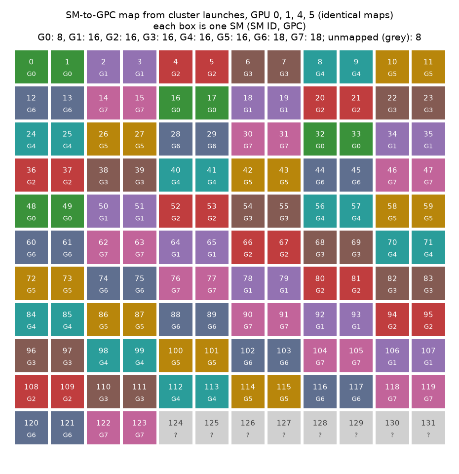

*Each box is one SM (SM ID and GPC). Grey: unmapped. All four GPUs give the same map.*

| GPC | SMs | SM IDs |
|---|---|---|
| G0 | 8 | 0, 1, 16, 17, 32, 33, 48, 49 |
| G1 | 16 | 2, 3, 18, 19, 34, 35, 50, 51, 64, 65, 78, 79, 92, 93, 106, 107 |
| G2 | 16 | 4, 5, 20, 21, 36, 37, 52, 53, 66, 67, 80, 81, 94, 95, 108, 109 |
| G3 | 16 | 6, 7, 22, 23, 38, 39, 54, 55, 68, 69, 82, 83, 96, 97, 110, 111 |
| G4 | 16 | 8, 9, 24, 25, 40, 41, 56, 57, 70, 71, 84, 85, 98, 99, 112, 113 |
| G5 | 16 | 10, 11, 26, 27, 42, 43, 58, 59, 72, 73, 86, 87, 100, 101, 114, 115 |
| G6 | 18 | 12, 13, 28, 29, 44, 45, 60, 61, 74, 75, 88, 89, 102, 103, 116, 117, 120, 121 |
| G7 | 18 | 14, 15, 30, 31, 46, 47, 62, 63, 76, 77, 90, 91, 104, 105, 118, 119, 122, 123 |
| unmapped | 8 | 124–131 |

| Cluster size | Clusters that fit at once (CUDA occupancy query) | SMs used | CTAs that ran on SMs 124–131 |
|---|---|---|---|
| 2 | 66 | 132 | about as many as on other SMs |
| 4 | 30 | 120 | 0 |
| 8 | 15 | 120 | 0 |
| 16 | 7 | 112 | 0 |

### Interpretation

- **The map is a clean round-robin.** TPC *t* (SMs 2t, 2t+1) goes to GPC *t* mod 8 for SMs 0–119; SMs 120–123 add one TPC each to G6 and G7.
- **SMs 124–131 cannot be placed.** The GPU never runs a CTA of a cluster of 4 or more on them, also not with random CTA lifetimes. The occupancy counts above fit exactly a layout where these 8 SMs are left out of larger clusters, so this is how the CUDA runtime treats them, not chance. Which GPC they belong to is unknown (one guess: G0, which would then have 16). They are labelled unmapped; copy + writer must stay ≤ 124 CTAs when placement matters.

## Store-only copy alone

### Motivation

The copy is the communication under test, so it needs a reference: the setting where more issuing CTAs or threads no longer raise throughput. The plan expected a plateau near the plan-04 value (about 370 GB/s), possibly with fewer threads, because this copy does no source loads. The copy must also leave SMs for the writer: with one CTA per SM, copy CTAs + writer CTAs ≤ 124 mapped SMs.

### Setup

| Knob | Role | Values |
|---|---|---|
| **Copy CTAs × threads/CTA** | **Independent variable** | **Plan grid:** CTAs 16, 32, 48, 64, 96, 128 at 512 and 1024 threads/CTA; threads/CTA 256, 512, 768, 1024 at 64 and 128 CTAs. **Added floor grid:** CTAs 1, 2, 4, 8, 16 × threads/CTA 128, 256, 512, 1024 |
| **Placement** | **Independent variable (second step)** | **Spread** over all 8 GPCs vs **packed** into the fewest GPCs, at 16 × 512, 16 × 256 and 32 × 512 |
| Copy loop | Constant | One 4-byte peer store per thread per loop step |
| Writer | Constant | Absent (all other SMs hold idle CTAs) |
| Payload, stride, completion | Constant | 2048 MiB, CTA-local, fence + publish + acknowledgement |

Configs: [configs/copy_alone/](configs/copy_alone/), named `copy_c<CTAs>_t<threads/CTA>_<placement>_R<run>.cfg`.

### Method

1. All results in this section come from the final harness build (2026-10-30, GPUs 0 → 1, 3 runs per setting).
2. Stopping rule, as in plan 04: a setting is on the plateau when its median is within 1% of the plateau value (median of all settings with 32 or more CTAs).
3. Placement: packed and spread runs of the same settings, same build.
4. **Earlier measurements, not joined with these.** The first E7.1 runs (2026-10-29/30, GPUs 4 → 5 and 0 → 1, 3–5 runs) used a build with a fourth knob, "stores per loop step" (1, 2, 4, 8). It was removed (see [Removed knob](#removed-knob-stores-per-loop-step)), which changed the compiled copy loop, so the copy grid was remeasured. The earlier build reached the same plateau and the same 16-CTA knee; its per-SM rates below the plateau differ (table below).
5. A first plan-grid attempt lost about 30% at 48 and 96 CTAs because copy parts were not 128-byte aligned; it was fixed and rerun. The old records are kept under `results/2026-10-29/rejected/misaligned_copy_parts/`.

### Results

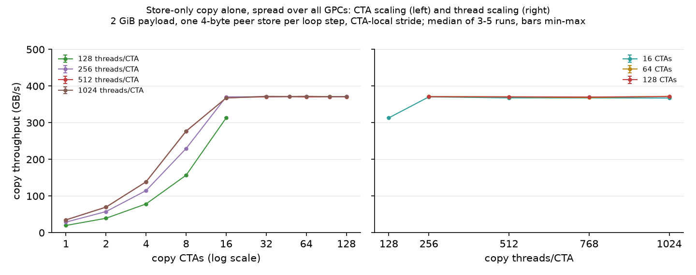

*Store-only copy alone, spread over all GPCs, 2048 MiB, one 4-byte store per loop step. Left: CTA scaling at fixed threads/CTA (log x). Right: thread scaling at 16, 64 and 128 CTAs. Points: median of 3 runs; bars: min–max (smaller than the marker). Lines join only points of the same threads/CTA (left) or CTA count (right).*

Copy throughput in GB/s (median of 3 runs; — = not measured). Rows: copy CTAs; columns: threads/CTA.

| Copy CTAs | 128 threads/CTA | 256 threads/CTA | 512 threads/CTA | 768 threads/CTA | 1024 threads/CTA |
|---|---|---|---|---|---|
| 1 | 19.6 | 28.8 | 34.9 | — | 34.8 |
| 2 | 39.3 | 57.5 | 69.8 | — | 69.5 |
| 4 | 78.4 | 114.9 | 138.7 | — | 138.8 |
| 8 | 156.8 | 229.6 | 276.6 | — | 277.4 |
| 16 | 313.2 | **370.5** | **367.8** | — | 367.4 |
| 32 | — | — | 370.7 | — | 372.0 |
| 48 | — | — | 371.1 | — | 371.6 |
| 64 | — | 371.3 | 370.3 | 368.6 | 372.1 |
| 96 | — | — | 370.9 | — | 371.2 |
| 128 | — | 371.1 | 370.8 | 370.2 | 371.4 |

Plateau (median of all settings with 32 or more CTAs): **371.1 GB/s**; within 1%: ≥ 367.4 GB/s.

Time phases near the plateau (medians over CTAs and runs; phases do not add up to the transfer time):

| Copy CTAs × threads/CTA | Runs | Copy throughput GB/s (min–max) | Transfer µs | Issue loop µs | Ordering µs | Acknowledgement wait µs |
|---|---|---|---|---|---|---|
| 8 × 1024 | 3 | 277.4 (277.4–277.5) | 7742 | 7721 | 4.1 | 14.7 |
| 16 × 128 | 3 | 313.2 (313.2–313.3) | 6856 | 6834 | 4.1 | 15.7 |
| 16 × 256 | 3 | 370.5 (370.1–370.6) | 5796 | 5720 | 4.9 | 69.3 |
| **16 × 512** | 3 | **367.8 (367.7–368.1)** | 5839 | 5779 | 5.6 | 52.0 |
| 16 × 1024 | 3 | 367.4 (367.4–367.7) | 5845 | 5792 | 6.1 | 43.9 |
| 32 × 512 | 3 | 370.7 (370.5–371.4) | 5793 | 5743 | 7.0 | 37.4 |
| 64 × 512 | 3 | 370.3 (370.0–370.5) | 5799 | 5042 | 8.7 | 746.0 |
| 128 × 512 | 3 | 370.8 (370.7–370.9) | 5792 | 5527 | 10.4 | 254.6 |
| 128 × 1024 | 3 | 371.4 (371.4–371.6) | 5782 | 5509 | 10.4 | 258.2 |

Spread versus packed placement:

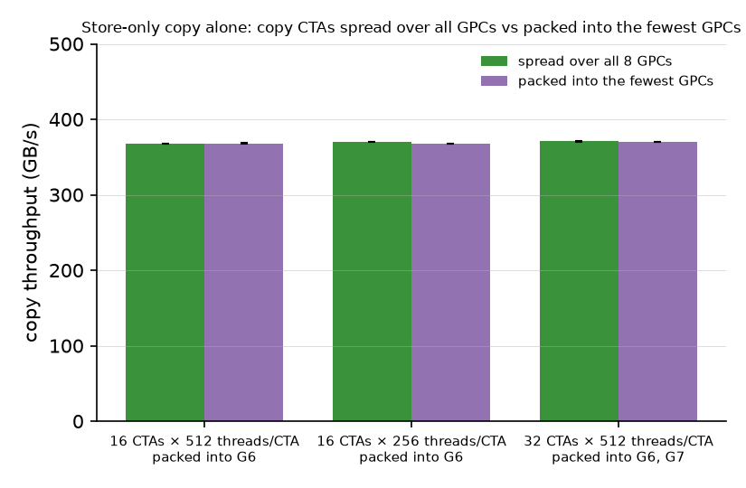

*Bars: median of 3 runs; whiskers: min–max. Packed GPCs named under each pair.*

| Copy CTAs × threads/CTA | Placement | GPCs used | Runs | Copy throughput GB/s (min–max) | Issue loop µs | Acknowledgement wait µs |
|---|---|---|---|---|---|---|
| 16 × 512 | spread | all 8 | 3 | 367.8 (367.7–368.1) | 5779 | 52.0 |
| 16 × 512 | packed | G6 | 3 | 368.2 (368.0–368.3) | 5809 | 16.1 |
| 16 × 256 | spread | all 8 | 3 | 370.5 (370.1–370.6) | 5720 | 69.3 |
| 16 × 256 | packed | G6 | 3 | 367.6 (367.5–367.6) | 5806 | 24.7 |
| 32 × 512 | spread | all 8 | 3 | 370.7 (370.5–371.4) | 5743 | 37.4 |
| 32 × 512 | packed | G6, G7 | 3 | 370.4 (370.3–370.6) | 5763 | 22.7 |

Full tables: [copy_sweep_summary.csv](results/2026-10-29/copy_sweep_summary.csv), [copy_plateau_summary.csv](results/2026-10-29/copy_plateau_summary.csv), [copy_placement_summary.csv](results/2026-10-29/copy_placement_summary.csv).

### Interpretation

- **The plateau is about 371 GB/s, the same as the plan-04 copy with loads.** Every setting with 32 or more CTAs lies between 368.6 and 372.1 GB/s. Removing the source loads did not raise the ceiling; it lowered the cost of reaching it: plan 04 needed 128 CTAs × 512 threads/CTA with 8 loads in flight per thread.
- **The CTA count, not the thread count, decides whether the copy reaches the plateau.** Below 16 CTAs, throughput grows in proportion to the CTA count: one copy SM sends at most about 35 GB/s of 4-byte peer stores, reached at 512 threads/CTA; 1024 threads/CTA add nothing. 8 CTAs stop at 277 GB/s with any thread count. 16 CTAs is the fewest that reach the plateau.
- **The per-SM limit depends on the compiled loop, not only on the hardware.** The earlier build ran the same source loop as the same 22 instructions per store in a different order: 37.7 GB/s per SM at 1024 threads/CTA (8% more), but only 14.2 GB/s at 128 threads/CTA (28% less than now). What limits one SM (instruction issue, waiting between dependent instructions, or the store path) was not measured; an Nsight Compute pass at 1 CTA would show it. The plateau and the 16-CTA knee were the same in both builds.
- **Where the time goes changes, the total does not.** At 16–32 CTAs the issue loop lasts almost the whole transfer and the acknowledgement wait is short (15–70 µs). At 64 CTAs the issue loop ends about 750 µs earlier and the copy CTAs then wait about 750 µs for the acknowledgement. More CTAs let the stores leave the SMs earlier and queue further along the path; the time to deliver 2 GiB stays the same. The issue-loop time alone is therefore not a measure of copy progress.
- **Packing the copy into one GPC costs at most 0.8%.** 16 × 512 packed into G6 gives 368.2 GB/s against 367.8 spread (+0.1%); 16 × 256 loses 0.8%; 32 × 512 in two GPCs loses 0.1%. One GPC can carry the full copy.
- **Selected copy reference: 16 CTAs × 512 threads/CTA (367.8 GB/s spread, 368.2 GB/s packed into G6).** It uses the fewest SMs on the plateau (0.9% below the plateau value), which leaves 108 mapped SMs for the writer. 512 rather than 256 threads/CTA was chosen for headroom: at 256 threads/CTA, 16 SMs can send at most about 460 GB/s (16 × 28.8), 24% above what the link delivers; at 512 threads/CTA, about 560 GB/s (16 × 34.9), 51% above. With more headroom, a slowdown of the copy SMs under pressure is less likely to show as lower copy throughput, so a copy slowdown points to the shared path, not to the copy's own SMs. Threads/CTA costs the writer nothing: the writer is limited by SMs, not by threads. 32 × 512 (370.7 GB/s; G6 and G7 when packed) is a second reference with more supply if needed.

### Removed knob: stores per loop step

The first build had a knob `copy_batch` = N (1, 2, 4, 8), first called "stores in flight per thread". Each copy thread wrote N stores per loop step, at the same addresses and in the same order for every N. A store does not wait for a reply, so N could not change how many stores are in flight; it only changed the instruction sequence. The compiler kept one bounds-check branch per store, so N > 1 added about 7 instructions per store (22 → 29). The knob was removed on 2026-10-30 at the user's request.

Copy throughput in GB/s with the earlier build (spread, median of 3–5 runs):

| Copy CTAs × threads/CTA | 1 store per step | 2 | 4 | 8 |
|---|---|---|---|---|
| 1 × 128 | 14.2 | 8.8 | 9.4 | 9.8 |
| 1 × 1024 | 37.7 | 30.1 | 31.0 | 32.0 |
| 16 × 256 | 369.5 | 249.3 | 271.4 | 286.2 |
| 16 × 512 | 368.8 | 335.1 | 364.1 | 364.4 |
| 16 × 1024 | 366.9 | 364.7 | 365.0 | 365.8 |
| 128 × 1024 | 369.8 | 370.6 | 370.5 | 370.3 |

Over all 136 earlier settings, N > 1 never raised throughput by more than 0.3% and lowered it by up to 41% (2 CTAs × 512 threads/CTA, N = 2). All rows: [copy_loop_step_summary.csv](results/2026-10-29/copy_loop_step_summary.csv).

## Writer alone

### Motivation

The pressure must be known before it is applied: how fast the writer can store to local HBM, how many SMs it needs, whether the rate limit gives the requested rate, and whether packing the writer into few GPCs lowers its ceiling (the plan's hypothesis of a limit at each GPC's connection into the crossbar).

### Setup

| Knob | Role | Values |
|---|---|---|
| **Writer CTAs × threads/CTA** | **Independent variable (step 1)** | **CTAs 4, 8, 16, 24, 32, 48, 64, 96, 128 at 1024 threads/CTA; threads/CTA 256, 512, 1024 at 32 and 64 CTAs**; no rate limit; spread |
| **Target write rate** | **Independent variable (step 2)** | **670, 1341, 2011, 2682 GB/s (20, 40, 60, 80% of the 3352 GB/s HBM peak) and no limit**, at 64 CTAs × 1024 threads/CTA |
| **Placement** | **Independent variable (step 3)** | **Spread** over all 8 GPCs vs **packed** into G6, G7, G1, G2 (18 + 18 + 16 + 12 SMs), same rates |
| Copy | Constant | Off. One copy-role CTA (on SM 0, G0) only times the 20 ms windows; all other SMs hold idle CTAs |

Configs: [configs/writer_alone/](configs/writer_alone/), named `writer_w<CTAs>_t<threads/CTA>_<rate>_<placement>_R<run>.cfg`.

### Method

Step 1 on GPUs 4 → 5 (5 runs). Steps 2 and 3 on GPUs 0 → 1 (3 runs; the no-limit spread point reuses step 1). These runs used the build that still had the copy knob; the writer code was not changed. One run each with the final build gave 794 GB/s (16 CTAs, −1.1%), 3158 GB/s (64 CTAs spread, −1.1%), 2811 GB/s (64 packed, no limit, −0.3%) and 2656 GB/s (64 packed, 80% target, −0.2%), so the writer results stand; E7.3 measures its own writer-alone controls. The selection rule was set before step 2: the fewest writer CTAs at 1024 threads/CTA within 95% of the no-limit ceiling (as in the plan-04 read calibration). The write rate counts logical store bytes over the writer's active interval; all writer CTAs covered the whole measured window in every run.

### Results

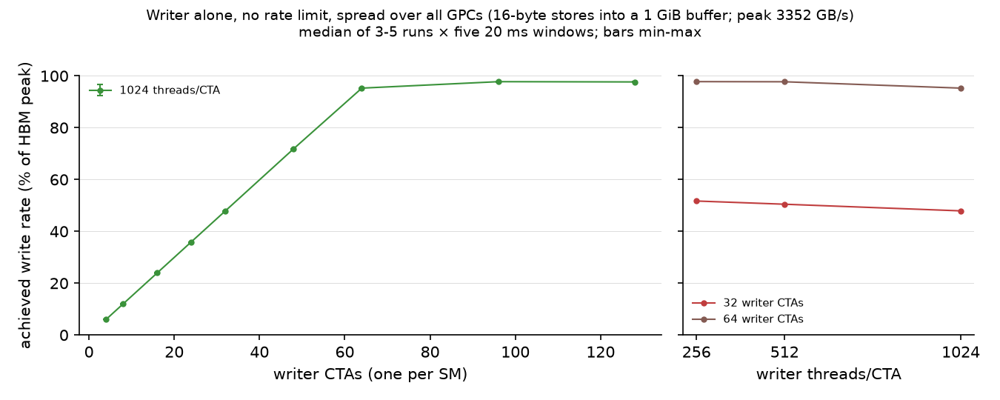

*Writer alone, no limit, spread. Left: writer CTAs at 1024 threads/CTA. Right: threads/CTA at 32 and 64 CTAs. Median of 5 runs; bars min–max (smaller than the marker).*

| Writer CTAs × threads/CTA | Runs | Write rate GB/s (min–max) | % of HBM peak | Per CTA GB/s | Slowest ÷ fastest CTA |
|---|---|---|---|---|---|
| 4 × 1024 | 5 | 201 (199–201) | 6.0 | 50.2 | 1.00 |
| 8 × 1024 | 5 | 401 (398–401) | 12.0 | 50.2 | 1.00 |
| 16 × 1024 | 5 | 803 (797–803) | 24.0 | 50.2 | 1.00 |
| 24 × 1024 | 5 | 1204 (1195–1204) | 35.9 | 50.2 | 1.00 |
| 32 × 256 | 5 | 1733 (1719–1734) | 51.7 | 54.2 | 0.99 |
| 32 × 512 | 5 | 1692 (1679–1692) | 50.5 | 52.9 | 1.00 |
| 32 × 1024 | 5 | 1606 (1594–1606) | 47.9 | 50.2 | 1.00 |
| 48 × 1024 | 5 | 2409 (2391–2409) | 71.9 | 50.2 | 1.00 |
| 64 × 256 | 5 | 3278 (3259–3278) | 97.8 | 51.2 | 0.85 |
| 64 × 512 | 5 | 3276 (3271–3279) | 97.7 | 51.2 | 0.92 |
| **64 × 1024** | 5 | **3194 (3172–3194)** | **95.3** | 49.9 | 0.99 |
| 96 × 1024 | 5 | 3277 (3267–3279) | 97.8 | 34.1 | 0.52 |
| 128 × 1024 | 5 | 3274 (3272–3276) | 97.7 | 25.6 | 0.56 |

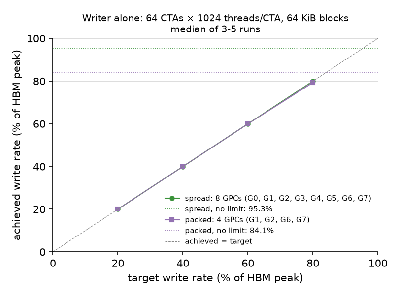

*64 writer CTAs × 1024 threads/CTA. Points: median of 3 runs; dotted lines: no limit; dashed: achieved = target.*

| Placement | GPCs | Target GB/s (% of peak) | Runs | Achieved GB/s (min–max) | % of peak | Achieved ÷ target | Slowest ÷ fastest CTA |
|---|---|---|---|---|---|---|---|
| spread | all 8 | 670 (20%) | 3 | 670 (670–670) | 20.0 | 100.00% | 1.00 |
| spread | all 8 | 1341 (40%) | 3 | 1341 (1341–1341) | 40.0 | 100.00% | 1.00 |
| spread | all 8 | 2011 (60%) | 3 | 2011 (2011–2011) | 60.0 | 100.00% | 1.00 |
| spread | all 8 | 2682 (80%) | 3 | 2682 (2682–2682) | 80.0 | 100.00% | 1.00 |
| spread | all 8 | no limit | 5 | 3194 (3172–3194) | 95.3 | — | 0.99 |
| packed | G1, G2, G6, G7 | 670 (20%) | 3 | 670 (670–670) | 20.0 | 100.00% | 1.00 |
| packed | G1, G2, G6, G7 | 1341 (40%) | 3 | 1341 (1341–1341) | 40.0 | 100.00% | 1.00 |
| packed | G1, G2, G6, G7 | 2011 (60%) | 3 | 2011 (2011–2011) | 60.0 | 100.00% | 1.00 |
| packed | G1, G2, G6, G7 | 2682 (80%) | 3 | 2660 (2658–2660) | 79.3 | 99.17% | 0.97 |
| packed | G1, G2, G6, G7 | no limit | 3 | 2819 (2818–2822) | 84.1 | — | 0.80 |

Write rate per GPC (sum of per-CTA rates, median over windows and runs), no limit:

| Writer setting | GPC: SMs used → GB/s (GB/s per SM) |
|---|---|
| 64 × 1024, packed | G1: 16 → 686 (42.9) · G2: 12 → 601 (50.1) · G6: 18 → 810 (45.0) · G7: 18 → 724 (40.2) |
| 64 × 1024, spread | G0: 7 → 351 (50.1) · G1: 9 → 449 (49.9) · G2–G7: 8 each → 399 (49.9) |
| 128 × 1024, spread | G0: 7 → 239 (34.1) · G1–G5: 16 each → 408–410 (25.5) · G6, G7: 18 each → 410, 408 (22.8) · unmapped: 5 → 171 (34.1) |

Full tables: [writer_sweep_summary.csv](results/2026-10-29/writer_sweep_summary.csv), [writer_rate_summary.csv](results/2026-10-29/writer_rate_summary.csv).

### Interpretation

- **One writer SM stores about 50 GB/s, and HBM writes saturate at about 3277 GB/s (98% of peak).** The rate grows in proportion to the CTA count up to 48 CTAs and flattens from 64. This is close to peak for writes; it is a logical store rate, and a DRAM counter check (ncu, counters are open on this machine) has not been done.
- **Selected writer setting: 64 CTAs × 1024 threads/CTA.** It is the fewest CTAs at 1024 threads/CTA within 95% of the ceiling (3194 GB/s; 48 CTAs give only 72%). Its CTAs run at equal rates (slowest ÷ fastest 0.99). 64 + 16 copy CTAs = 80 ≤ 124 mapped SMs.
- **The rate limit gives exactly the requested rate** at 20–80% of peak when spread (within 0.01%), with all CTAs equal.
- **Packed writers reach a lower ceiling: 2819 GB/s (84%) against 3194 GB/s (95%) spread, with the same 64 CTAs.** Inside a full GPC, each SM drops from 50 to 40–45 GB/s, while the 12 SMs used in G2 keep 50 GB/s. A full GPC delivers about 690–810 GB/s of stores. This supports the plan's hypothesis of a limit at each GPC's connection, although the GPCs do not share one exact cap, and the packed writer falls 0.8% short of the 80% target. The copy needs about 370 GB/s, about half of one GPC's limit, which agrees with the small cost of packing the copy.
- **At saturation, HBM write bandwidth is shared per GPC, not per SM.** With 128 writer CTAs, every full GPC gets about 409 GB/s whether it has 16 or 18 writer SMs. This is a hint about how the crossbar arbitrates and matters for E7.3, where the copy's GPC competes with the writer's GPCs.

## Selected settings for the tests with a co-runner

| Role | Setting | Alone |
|---|---|---|
| Copy | 16 CTAs × 512 threads/CTA, 2048 MiB | 367.8 GB/s spread, 368.2 GB/s packed into G6 |
| Thread-store writer | 64 CTAs × 1024 threads/CTA; rate levels 670, 1341, 2011, 2682 GB/s (20–80% of HBM peak) and no limit | exact rates at 20–80%; no limit 3194 GB/s spread over 8 GPCs |
| TMA read co-runner (E7.5) | 48 CTAs × 3 × 64 KiB in flight, 196,864 bytes of shared memory | targets met within 0.01% (this section) |
| TMA store writer (E7.6) | 64 CTAs × 1 × 64 KiB in flight | calibrated below |

Stored in [results/2026-10-29/selection.json](results/2026-10-29/selection.json).

## Shared method for the tests with a co-runner

- **Pairs inside one run.** Every run alternates transfers with the co-runner idle and transfers with it active: 3 warm-ups, then 6 idle and 6 active transfers. Odd rounds start idle, even rounds start active. The idle co-runner CTAs are started and wait on the same SMs, so the two halves differ only in the co-runner's traffic. The run's **copy change** is median(active) ÷ median(idle) − 1. Tables give the median of the per-run changes over 3 runs, with min and max.
- **Reference variability.** The interquartile range (IQR) of all idle transfers of one placement or co-runner (15 runs × 6 transfers). "Change ÷ idle IQR" is the change of the median in GB/s divided by that IQR. Transfers are nested in runs, so this is a guide to size, not a test.
- **Opening and closing references.** One run with idle co-runners at the start and end of each test checks for drift.
- **Co-runner side.** The co-runner's rate during the copy (active transfers) is compared with the same co-runner alone on the same SMs. In the alone runs, the copy CTAs are present but idle, and one copy CTA times windows equal to the co-runner's measured active time in the matching mixed run.
- **Order.** At each level, the variants being compared run back to back in one round, and the order is rotated between rounds. All runs: GPUs 0 → 1, 2026-10-30.
- **Checks.** Every copy transfer is fully checked at the destination. Every writer launch is checked: thread stores word by word, TMA stores word by word for the chunks written, TMA reads by a checksum. Every co-runner CTA must cover the whole copy window.

## Local writes next to the copy: separate, shared and crowded GPCs

### Motivation

This is the main test (E7.3 and E7.4 in the [plan](07_data_store_congest.md)). A fused kernel may write its results to local memory while other SMs push data to the peer GPU. Both flows leave the SMs as stores and pass through the GPC's connection into the crossbar; then the local stores go to L2 and HBM and the peer stores go to the NVLink unit. The plan expected little or no slowdown when copy and writer use different GPCs, unless a part after the GPC is shared, and a larger slowdown when they share GPCs, if the GPC's connection is a bottleneck. E7.2 showed that a GPC full of writers is already limited to about 700–800 GB/s of stores.

### Setup

| Knob | Role | Values |
|---|---|---|
| **Writer target rate** | **Independent variable** | **Idle (reference half), 670, 1341, 2011, 2682 GB/s, no limit** |
| **Placement** | **Independent variable** | **separate** (E7.3): copy packed into G6 (16 of 18 SMs), writer spread over the other 7 GPCs (8–10 SMs each). **shared** (E7.4): copy spread over all 8 GPCs (2 SMs each), writer spread over all 8 GPCs (6–9 SMs each). **crowded** (E7.4b): copy spread (2 SMs per GPC), writer packed: G6 16, G7 16, G1 14, G2 14, G3 4 SMs |
| Copy | Constant | 16 CTAs × 512 threads/CTA, 2048 MiB, one 4-byte store per loop step |
| Writer | Constant | 64 CTAs × 1024 threads/CTA, 16-byte stores, `bin/store_congest` |
| Runs | Constant | 3 per placement and level; the three placements run back to back at each level |

Configs: [configs/contention/](configs/contention/) (`mixed_<placement>_<level>_R<run>`, `writer_<placement>_<level>_R<run>` for the writer alone, `reference_<placement>_{open,close}`, `probe_separate_unlimited_d{0,1}_R<run>`).

### Method

As in the shared method. In E7.4 the plan asks for "the same proportion in each GPC": spreading both roles gives about 2 copy and 8 writer SMs per GPC. E7.4b, "one GPC fully used by writers plus a few copy CTAs", was realized as four full writer GPCs, each with 2 copy CTAs, so the per-CTA times of 10 copy CTAs next to writers can be compared with 6 copy CTAs in GPCs without writers. Probe cost: 3 more runs at no limit (separate) with and without the per-CTA phase timers (`detailed` 1 and 0).

### Results

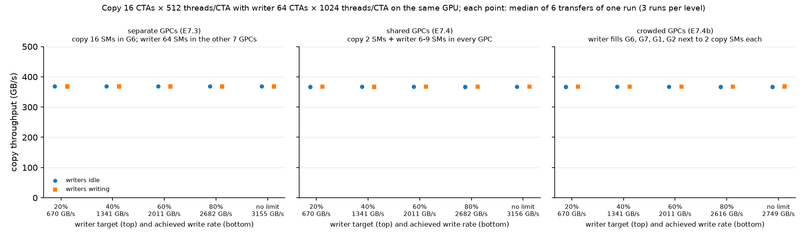

*Each point is the median of 6 transfers of one run; blue: writers idle, orange: writers writing, in the same run. 3 runs per level. Under each level: the write rate achieved during the copy.*

| Placement | Writer target | Achieved write rate GB/s | Runs | Copy, writers idle GB/s | Copy, writers writing GB/s | Change (min to max) | Change ÷ idle IQR |
|---|---|---|---|---|---|---|---|
| separate | 20% | 670 | 3 | 368.7 | 367.7 | -0.23% (-0.30 to -0.05) | -0.99 |
| separate | 40% | 1341 | 3 | 368.7 | 368.2 | -0.16% (-0.23 to -0.12) | -0.57 |
| separate | 60% | 2011 | 3 | 368.9 | 367.9 | -0.27% (-0.38 to -0.16) | -0.97 |
| separate | 80% | 2682 | 3 | 368.5 | 368.0 | -0.13% (-0.21 to -0.11) | -0.49 |
| separate | no limit | 3155 | 3 | 368.8 | 368.1 | -0.08% (-0.23 to -0.06) | -0.75 |
| shared | 20% | 670 | 3 | 367.2 | 367.3 | +0.03% (+0.02 to +0.20) | +0.14 |
| shared | 40% | 1341 | 3 | 367.0 | 367.3 | +0.11% (-0.13 to +0.30) | +0.40 |
| shared | 60% | 2011 | 3 | 366.9 | 367.5 | +0.14% (+0.13 to +0.35) | +0.87 |
| shared | 80% | 2682 | 3 | 367.0 | 367.6 | +0.24% (+0.16 to +0.29) | +0.84 |
| shared | no limit | 3156 | 3 | 367.1 | 367.6 | +0.12% (+0.02 to +0.21) | +0.65 |
| crowded | 20% | 670 | 3 | 366.8 | 367.6 | +0.19% (+0.02 to +0.25) | +0.92 |
| crowded | 40% | 1341 | 3 | 366.9 | 367.3 | +0.10% (+0.01 to +0.25) | +0.44 |
| crowded | 60% | 2011 | 3 | 367.2 | 367.1 | -0.01% (-0.11 to +0.08) | -0.07 |
| crowded | 80% | 2616 | 3 | 367.3 | 367.4 | +0.15% (-0.10 to +0.27) | +0.20 |
| crowded | no limit | 2749 | 3 | 367.1 | 367.5 | +0.20% (+0.06 to +0.27) | +0.44 |

Idle-transfer IQR: separate 1.02 GB/s, shared 0.70 GB/s, crowded 0.79 GB/s. Opening and closing references (writers idle in all transfers): separate 368.1 and 368.3 GB/s, shared 367.9 and 367.8 GB/s, crowded 367.7 and 367.8 GB/s.

Copy time phases (medians over CTAs and transfers, then over runs):

| Placement | Writer target | Issue loop µs, idle → writing | Ordering µs | Acknowledgement wait µs |
|---|---|---|---|---|
| separate | 20% | 5802 → 5811 | 5.8 → 6.0 | 19 → 18 |
| separate | 40% | 5799 → 5806 | 5.6 → 5.9 | 17 → 17 |
| separate | 60% | 5796 → 5814 | 5.9 → 5.8 | 17 → 18 |
| separate | 80% | 5800 → 5811 | 5.9 → 5.8 | 20 → 18 |
| separate | no limit | 5799 → 5807 | 5.8 → 5.8 | 17 → 17 |
| shared | 20% | 5793 → 5791 | 5.8 → 5.3 | 49 → 53 |
| shared | 40% | 5796 → 5783 | 5.7 → 5.5 | 48 → 53 |
| shared | 60% | 5795 → 5782 | 5.4 → 5.8 | 51 → 50 |
| shared | 80% | 5798 → 5781 | 5.8 → 5.7 | 52 → 53 |
| shared | no limit | 5793 → 5783 | 5.7 → 5.9 | 50 → 50 |
| crowded | 20% | 5799 → 5784 | 5.6 → 5.5 | 50 → 53 |
| crowded | 40% | 5794 → 5776 | 5.9 → 5.6 | 49 → 63 |
| crowded | 60% | 5791 → 5780 | 5.5 → 5.5 | 48 → 62 |
| crowded | 80% | 5793 → 5766 | 5.9 → 5.9 | 51 → 69 |
| crowded | no limit | 5794 → 5761 | 5.4 → 6.2 | 46 → 70 |

Copy CTAs in the crowded placement, by whether their GPC holds writer CTAs (medians over CTAs, transfers and runs):

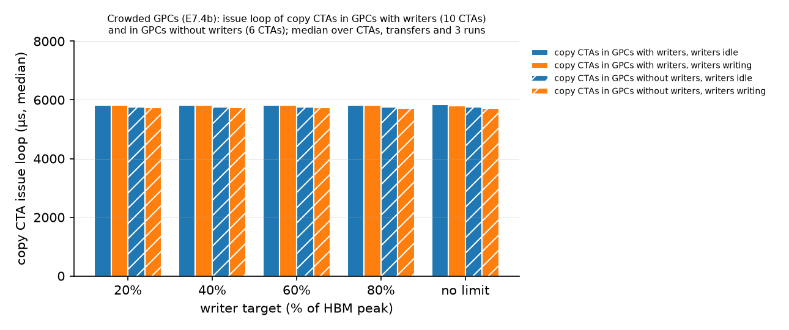

| Writer target | Copy CTAs | CTAs | Issue loop µs, writers idle | Writers writing | Change |
|---|---|---|---|---|---|
| 20% | in GPCs with writers | 10 | 5832 | 5816 | -0.27% |
| 20% | in GPCs without writers | 6 | 5756 | 5739 | -0.30% |
| 40% | in GPCs with writers | 10 | 5831 | 5818 | -0.23% |
| 40% | in GPCs without writers | 6 | 5755 | 5736 | -0.33% |
| 60% | in GPCs with writers | 10 | 5829 | 5821 | -0.14% |
| 60% | in GPCs without writers | 6 | 5754 | 5740 | -0.25% |
| 80% | in GPCs with writers | 10 | 5829 | 5813 | -0.27% |
| 80% | in GPCs without writers | 6 | 5754 | 5728 | -0.46% |
| no limit | in GPCs with writers | 10 | 5833 | 5809 | -0.41% |
| no limit | in GPCs without writers | 6 | 5755 | 5722 | -0.57% |

Writer rate during the copy against the writer alone on the same SMs:

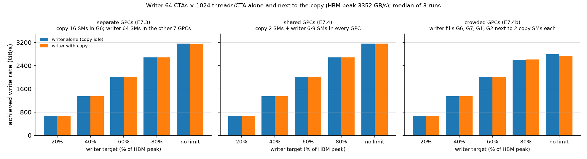

| Placement | Writer target | Writer alone GB/s | Writer with copy GB/s | Change |
|---|---|---|---|---|
| separate | 20% | 670 | 670 | -0.00% |
| separate | 40% | 1341 | 1341 | -0.00% |
| separate | 60% | 2011 | 2011 | -0.00% |
| separate | 80% | 2682 | 2682 | -0.00% |
| separate | no limit | 3157 | 3155 | -0.06% |
| shared | 20% | 670 | 670 | -0.00% |
| shared | 40% | 1341 | 1341 | -0.00% |
| shared | 60% | 2011 | 2011 | -0.00% |
| shared | 80% | 2682 | 2682 | -0.00% |
| shared | no limit | 3156 | 3156 | -0.02% |
| crowded | 20% | 670 | 670 | -0.00% |
| crowded | 40% | 1341 | 1341 | -0.00% |
| crowded | 60% | 2011 | 2011 | -0.00% |
| crowded | 80% | 2599 | 2616 | +0.68% |
| crowded | no limit | 2796 | 2749 | -1.66% |

Probe cost (separate, no limit, 3 runs each): with the phase timers, copy changes of −0.04%, +0.11%, −0.12%; without them, −0.32%, −0.09%, −0.18%. Copy with idle writers: 368.4–368.6 GB/s with timers, 368.8–369.2 GB/s without.

Full tables: [contention_summary.csv](results/2026-10-29/contention_summary.csv), [contention_references.csv](results/2026-10-29/contention_references.csv), [contention_crowded_cta.csv](results/2026-10-29/contention_crowded_cta.csv), [contention_probe_cost.csv](results/2026-10-29/contention_probe_cost.csv).

### Interpretation

- **Local writes do not slow the copy in practice, at any rate or placement.** Every per-run change lies between −0.38% and +0.35%, within about one idle IQR. This holds up to 3155 GB/s of local writes (94% of HBM peak) next to the 368 GB/s copy, so about 3.5 TB/s of stores leave the SMs at once.
- **Separate GPCs give a consistent but tiny slowdown; shared GPCs do not hurt more.** All 15 separate runs are negative (−0.05% to −0.38%), and the copy's issue loop grows by 7–18 µs out of 5800 µs. Shared and crowded GPCs give changes around zero or slightly positive (−0.13% to +0.35%). The plan's hypothesis that sharing a GPC's connection would slow the copy more is not supported at these settings. Why sharing gives a slightly positive change is not known; it is about one IQR.
- **No local effect inside crowded GPCs.** Copy CTAs next to full writer GPCs and copy CTAs in GPCs without writers both shorten their issue loop by 0.1–0.6% when the writers write. (The 75 µs difference between the two groups exists with idle writers too, so it comes from SM position, not from writes.) The acknowledgement wait in crowded runs grows from about 50 to about 70 µs at 80% and no limit; that is 0.3% of the transfer and does not change throughput.
- **The writer is not slowed either,** except in the crowded placement at no limit (−1.7%), where the packed writers are at the per-GPC limit found in E7.2 and share those GPCs with 8 copy CTAs. In the crowded placement the writer also cannot reach the 80% target (2599–2616 GB/s), as in E7.2.
- **The probe does not change the result.** Without the per-CTA timers, the copy's change is within the same range.
- **What this does not show.** The copy is a 4-byte-store copy with spare issue capacity on its own SMs (E7.1). A copy that is limited by its own SMs, uses wider stores, or uses many more CTAs could react differently.

## Direction contrast: local reads instead of local writes

### Motivation

E7.5 in the plan. If a shared part on the store direction caused the separate-GPC slowdown, local reads at the same byte rate should slow the copy less. It also connects to plan 04, where reads on separate source SMs lowered a copy **with source loads** by up to a few percent.

### Setup

| Knob | Role | Values |
|---|---|---|
| **Traffic direction** | **Independent variable** | **Local writes** (thread-store writer, 64 CTAs × 1024 threads/CTA, E7.3 targets including no limit) vs **local reads** (TMA bulk reads, 48 CTAs × 3 × 64 KiB in flight) |
| **Rate level** | **Independent variable** | **Reads: targets equal to the write rates E7.3 achieved: 670, 1341, 2011, 2682, 3155 GB/s.** Writes: 670, 1341, 2011, 2682 GB/s, no limit |
| Placement | Constant | Separate: copy packed into G6; co-runner spread over the other 7 GPCs |
| Copy | Constant | 16 CTAs × 512 threads/CTA, 2048 MiB |
| Binaries and shared memory | Constant within a kind | Writes: `bin/store_congest`, default shared memory. Reads: `bin/store_congest_tma`, 196,864 bytes of shared memory for every CTA, so the reads have their own idle reference |
| Runs | Constant | 3 per kind and level; writes and reads back to back at each level |

Configs: [configs/direction/](configs/direction/).

### Method

As in the shared method. The reader uses 48 CTAs at every level, because plan 04 found that 24 reader CTAs stop at about 91% of peak and the top level here is 94%. Each reader CTA uses thread 0 to start the bulk copies and thread 32 to watch the stop flag. The write runs repeat the E7.3 separate setting in the same session.

### Results

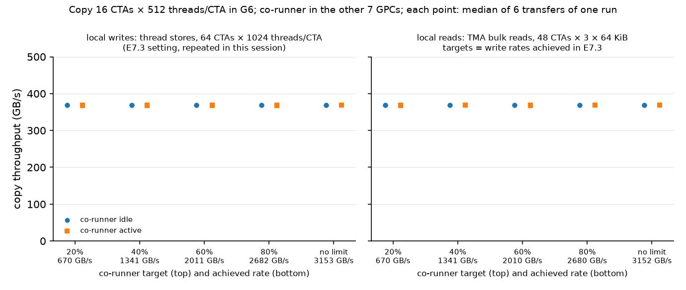

*Each point: median of 6 transfers of one run; blue: co-runner idle, orange: co-runner active. Under each level: the co-runner's achieved rate during the copy.*

| Co-runner | Level | Target GB/s | Achieved GB/s | Runs | Copy, co-runner idle GB/s | Copy, co-runner active GB/s | Change (min to max) | Change ÷ idle IQR | Issue loop µs, idle → active | Co-runner alone GB/s | Co-runner change |
|---|---|---|---|---|---|---|---|---|---|---|---|
| local writes (thread stores) | 20% | 670 | 670 | 3 | 368.7 | 368.2 | -0.18% (-0.22 to -0.11) | -0.62 | 5796 → 5808 | — | — |
| local writes (thread stores) | 40% | 1341 | 1341 | 3 | 368.8 | 368.2 | -0.24% (-0.30 to +0.01) | -0.68 | 5796 → 5807 | — | — |
| local writes (thread stores) | 60% | 2011 | 2011 | 3 | 368.9 | 368.4 | -0.06% (-0.32 to +0.04) | -0.65 | 5795 → 5807 | — | — |
| local writes (thread stores) | 80% | 2682 | 2682 | 3 | 368.9 | 368.1 | -0.20% (-0.26 to -0.12) | -0.93 | 5796 → 5811 | — | — |
| local writes (thread stores) | no limit | no limit | 3153 | 3 | 368.3 | 368.4 | +0.04% (-0.11 to +0.07) | +0.16 | 5802 → 5803 | — | — |
| local reads (TMA) | 20% | 670 | 670 | 3 | 369.0 | 368.4 | -0.18% (-0.33 to -0.04) | -0.69 | 5793 → 5809 | 670 | +0.00% |
| local reads (TMA) | 40% | 1341 | 1341 | 3 | 368.8 | 368.8 | +0.02% (-0.22 to +0.08) | -0.01 | 5800 → 5796 | 1341 | -0.00% |
| local reads (TMA) | 60% | 2011 | 2010 | 3 | 369.0 | 368.4 | -0.13% (-0.15 to -0.05) | -0.59 | 5795 → 5802 | 2010 | -0.01% |
| local reads (TMA) | 80% | 2682 | 2680 | 3 | 368.9 | 369.0 | +0.02% (-0.09 to +0.09) | +0.07 | 5800 → 5796 | 2681 | -0.00% |
| local reads (TMA) | no limit | 3155 | 3152 | 3 | 368.8 | 368.8 | +0.04% (-0.07 to +0.05) | -0.03 | 5799 → 5799 | 3152 | -0.00% |

Idle-transfer IQR: writes 0.86 GB/s, reads 0.94 GB/s. References with idle readers: 367.9 GB/s (open) and 368.4 GB/s (close). Full table: [direction_summary.csv](results/2026-10-29/direction_summary.csv).

### Interpretation

- **Reads also leave the copy unchanged:** −0.18% to +0.04% (per-run range −0.33% to +0.09%), against −0.24% to +0.04% for writes in the same session. Writes are slightly more often negative, but the ranges overlap and the top levels are equal (+0.04% each).
- **The plan's expected difference between directions cannot be shown,** because neither direction has a measurable effect at these rates.
- **The reader is not slowed by the copy** (within 0.01% of its rate alone).
- **Link to plan 04.** At the same read rates, the store-only copy is not affected, while plan 04's copy with source loads slowed by up to a few percent. This supports plan 04's reading that its copy competed with reads mainly through its own source loads.
- **Repeat.** The write runs of this session agree with E7.3 separate (−0.06% to −0.24% against −0.08% to −0.27%).

## Writer mechanism: TMA bulk stores instead of thread stores

### Motivation

E7.6 in the plan. A fused kernel on Hopper may write its output with TMA bulk stores (shared memory → global memory). They reach high write rates with one issuing thread per CTA and go through a different request path from the SM. If only the byte rate matters, the copy should react the same way as to thread stores.

### Calibration of the TMA store writer alone

| Knob | Role | Values |
|---|---|---|
| **TMA writer CTAs** | **Independent variable** | **4, 8, 16, 24, 32, 48, 64** |
| **Chunks in flight per CTA** | **Independent variable** | **1, 2, 4** (64 KiB each) |
| **Target rate** | **Independent variable (selected setting)** | **20, 40, 60, 80% of HBM peak, no limit** |
| Copy | Constant | Off (copy CTA 0 times five 20 ms windows) |
| Placement | Constant | Spread over all 8 GPCs; default shared memory |

Each TMA writer CTA fills one 64 KiB block of shared memory with a launch-specific word once, then thread 0 stores it again and again with `cp.async.bulk.global.shared::cta` into its slice of the 1 GiB buffer and waits until at most (chunks in flight − 1) earlier chunks are still being written (`cp.async.bulk.wait_group`). The end time is taken after all writes have completed. After each launch, every word of the chunks written is checked.

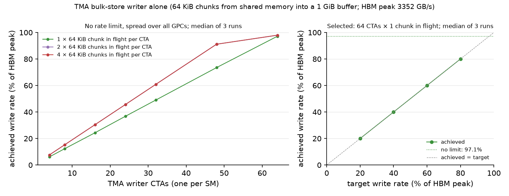

*Left: no rate limit; the 2- and 4-chunk lines lie on top of each other. Right: selected setting. Median of 3 runs.*

Write rate in GB/s (median of 3 runs; % of HBM peak); "CTAs 0.60" marks a slowest ÷ fastest CTA ratio below 0.95:

| TMA writer CTAs | 1 chunk in flight GB/s (% of peak) | 2 chunks | 4 chunks |
|---|---|---|---|
| 4 | 205 (6.1%) | 255 (7.6%) | 255 (7.6%) |
| 8 | 411 (12.3%) | 510 (15.2%) | 510 (15.2%) |
| 16 | 815 (24.3%) | 1020 (30.4%) | 1020 (30.4%) |
| 24 | 1232 (36.8%) | 1530 (45.6%) | 1530 (45.6%) |
| 32 | 1643 (49.0%) | 2039 (60.8%) | 2039 (60.8%) |
| 48 | 2464 (73.5%) | 3056 (91.2%) | 3055 (91.1%) |
| 64 | 3257 (97.1%) | 3283 (97.9%), CTAs 0.60 | 3285 (98.0%), CTAs 0.60 |

Selected setting, **64 CTAs × 1 chunk in flight**: achieved 670, 1341, 2011, 2682 GB/s at the 20–80% targets (within 0.03%) and 3257 GB/s (97.1%) with no limit. Rule as for the thread-store writer: the fewest CTAs within 95% of the ceiling (about 3285 GB/s); 1 chunk in flight keeps the CTAs even (0.98) and gives the same CTA count as the thread-store writer. Tables: [tma_writer_sweep_summary.csv](results/2026-10-29/tma_writer_sweep_summary.csv), [tma_writer_rate_summary.csv](results/2026-10-29/tma_writer_rate_summary.csv).

- **One TMA store CTA writes about 51 GB/s with 1 chunk in flight and 63.7 GB/s with 2 or more** — more than a thread-store CTA (50 GB/s) with only one issuing thread. More than 2 chunks do not help, so one CTA's bulk stores are limited at about 64 GB/s.
- **The ceiling is the same HBM write ceiling** as with thread stores (about 3285 GB/s, 98% of peak).

### Setup of the contrast

| Knob | Role | Values |
|---|---|---|
| **Writer mechanism** | **Independent variable** | **Thread stores** (64 CTAs × 1024 threads/CTA, `bin/store_congest`) vs **TMA bulk stores** (64 CTAs × 1 chunk, `bin/store_congest_tma`) |
| **Writer target rate** | **Independent variable** | **670, 1341, 2011, 2682 GB/s, no limit** (both writers) |
| Placement | Constant | Separate: copy packed into G6; writer spread over the other 7 GPCs |
| Copy, runs | Constant | 16 CTAs × 512 threads/CTA; 3 runs per mechanism and level, back to back at each level |

Configs: [configs/mechanism/](configs/mechanism/).

### Results

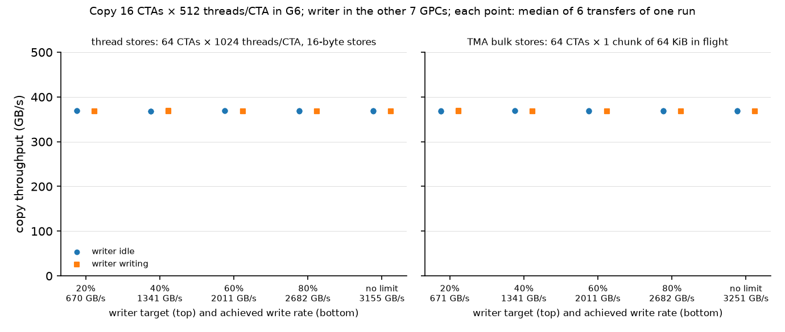

*Each point: median of 6 transfers of one run; blue: writer idle, orange: writer writing. Under each level: the achieved write rate during the copy.*

| Co-runner | Level | Target GB/s | Achieved GB/s | Runs | Copy, co-runner idle GB/s | Copy, co-runner active GB/s | Change (min to max) | Change ÷ idle IQR | Issue loop µs, idle → active | Co-runner alone GB/s | Co-runner change |
|---|---|---|---|---|---|---|---|---|---|---|---|
| thread stores | 20% | 670 | 670 | 3 | 368.9 | 368.3 | -0.18% (-0.25 to -0.07) | -0.66 | 5796 → 5808 | — | — |
| thread stores | 40% | 1341 | 1341 | 3 | 368.5 | 368.4 | -0.04% (-0.07 to +0.17) | -0.07 | 5805 → 5804 | — | — |
| thread stores | 60% | 2011 | 2011 | 3 | 368.8 | 368.3 | -0.12% (-0.14 to -0.10) | -0.48 | 5798 → 5802 | — | — |
| thread stores | 80% | 2682 | 2682 | 3 | 368.9 | 368.2 | -0.16% (-0.38 to -0.04) | -0.66 | 5796 → 5807 | — | — |
| thread stores | no limit | no limit | 3155 | 3 | 368.8 | 368.5 | -0.05% (-0.29 to -0.02) | -0.28 | 5797 → 5803 | — | — |
| TMA bulk stores | 20% | 670 | 671 | 3 | 368.5 | 368.1 | -0.13% (-0.38 to +0.09) | -0.42 | 5803 → 5812 | 671 | -0.00% |
| TMA bulk stores | 40% | 1341 | 1341 | 3 | 369.1 | 367.9 | -0.31% (-0.45 to -0.18) | -1.03 | 5796 → 5809 | 1341 | -0.00% |
| TMA bulk stores | 60% | 2011 | 2011 | 3 | 368.8 | 368.4 | -0.12% (-0.25 to -0.02) | -0.32 | 5801 → 5804 | 2011 | -0.00% |
| TMA bulk stores | 80% | 2682 | 2682 | 3 | 368.9 | 368.5 | -0.12% (-0.20 to -0.05) | -0.39 | 5795 → 5807 | 2682 | -0.00% |
| TMA bulk stores | no limit | no limit | 3251 | 3 | 369.3 | 368.3 | -0.17% (-0.30 to -0.09) | -0.83 | 5793 → 5805 | 3252 | -0.04% |

Idle-transfer IQR: thread stores 1.00 GB/s, TMA stores 1.12 GB/s. References with idle TMA writers: 368.0 GB/s (open and close). Full table: [mechanism_summary.csv](results/2026-10-29/mechanism_summary.csv).

### Interpretation

- **TMA bulk stores do not slow the copy either:** −0.12% to −0.31% (per-run range −0.45% to +0.09%), including 3251 GB/s with no limit (97% of peak). Thread stores in the same session: −0.04% to −0.18%.
- **The mechanism does not matter at these rates.** The TMA changes are slightly more negative at 40% (−0.31%, about one IQR), but the ranges overlap with thread stores, and there is no trend with rate.
- **The TMA writer is not slowed by the copy** (within 0.04% of its rate alone).

## Deviations from the plan

1. **GPUs:** 4 → 5 and 0 → 1 instead of one pair from 0, 1, 6, 7 (user's allocation). All four GPUs have the same GPC map; the user asked to treat both pairs as the same.
2. **Unmapped SMs 124–131:** placement uses 124 mapped SMs; 128-CTA settings also use 4 unmapped SMs.
3. **Copy floor grid added** (1–16 CTAs, 128–1024 threads/CTA), because the plan grid was flat from its first point.
4. **3 runs per setting instead of 5** from 2026-10-30 (user's request). All copy results come from 3-run settings.
5. **"Stores in flight per thread" removed** from the copy (user's request, 2026-10-30): it could only set the stores per loop step. The copy grid was remeasured with the build without it; see [Removed knob](#removed-knob-stores-per-loop-step).
6. **Writer-alone runs use one copy-role CTA as the window timer;** the copy itself is off. In the tests with a co-runner, the alone runs keep all copy CTAs present but idle, so the co-runner uses the same SMs.
7. **E7.3–E7.6: 3 runs per level instead of 5** (user's request); each run holds 6 + 6 paired transfers.
8. **E7.4 and E7.4b placements** were realized as "both roles spread over all GPCs" and "writer packed into four GPCs next to 2 copy CTAs each" (details in that section).
9. **E7.5 reader: 48 CTAs at every level** instead of 24, so that one reader setting reaches the top level (3155 GB/s).
10. **E7.5 and E7.6 use a second build,** `bin/store_congest_tma` (same source with the TMA co-runners compiled in); `bin/store_congest` was checked to keep the instructions of the E7.1–E7.4 build.
11. **No profiler passes** (Tier B timeline, Tier C counters) were run; write and read rates are logical bytes, not counted DRAM bytes.

## Session log

| Date (UTC) | GPUs | What ran | Records |
|---|---|---|---|
| 2026-10-29 | 4, 5 | Harness built. E7.0 probe (20 launches per cluster size). Copy plan grid, first attempt rejected (misaligned parts), rerun after the fix (64 settings × 5). Writer CTA/thread grid (13 settings × 5) | `results/2026-10-29/{gpc_map,copy_alone,writer_alone}/raw/`, `session_sweeps.log` |
| 2026-10-29/30 | 4, 5 | Copy floor grid rounds 1–2 and part of 3 (stopped when the user moved the work) | `session_floor.log` |
| 2026-10-30 | 0, 1 | E7.0 probe on GPUs 0, 1 (same map). Host-only rebuild to allow GPUs 0, 1; device code checked identical (SASS). Rest of the floor grid (stopped after round 3 at the user's request); writer rate, spread and packed; copy spread vs packed | `session_gpu0_1.log`, `session_copy_placement.log`, `build_provenance.json` |
| 2026-10-30 | 0, 1 | `copy_batch` removed from the harness. Check runs (copy 16 × 512, 8 × 1024, 1 × 1024; writer 16 and 64 CTAs, spread and packed). Copy plan grid, floor grid and placement remeasured with the final build (34 settings + 3 packed, 3 runs each) | `refactor_check/raw/`, `session_no_knob.log`, `build_provenance.json` |
| 2026-10-30 | 0, 1 | E7.3/E7.4/E7.4b: smoke runs, then 3 placements × 5 levels × 3 runs with matched writer-alone runs, references and probe-cost runs (first start stopped on a message bug after one reference run; the record was kept) | `contention/raw/`, `contention_smoke/raw/`, `session_contention.log` |
| 2026-10-30 | 0, 1 | `bin/store_congest_tma` built (TMA read and store co-runners); smoke runs. E7.5: writes and reads × 5 levels × 3 runs with reader-alone runs and references. E7.6: TMA writer calibration (7 CTA counts × 3 chunk depths × 3 runs, then rate levels), then thread vs TMA stores × 5 levels × 3 runs with TMA-alone runs and references | `tma_smoke/raw/`, `direction/raw/`, `tma_writer_alone/raw/`, `mechanism/raw/`, `session_e75.log`, `session_e76.log` |

Raw run records, device snapshots and logs are kept only in the local `results/2026-10-29/` directory (ignored by git); without them, rerun the phases. Reproduce: `make` in `common/`, then `python3 scripts/run_gpc_map.py --gpus S,D`, `build_gpc_map.py`, and `run_store_congest.py PHASE --gpus S,D` for `copy_sweep`, `copy_floor`, `writer_sweep`, `writer_rate`, `writer_placement`, `copy_placement`, `contention`, `read_contrast`, `tma_writer_sweep`, `tma_writer_rate`, `tma_store_contrast` (choices between phases in `selection.json`); then `analyze_store_congest.py` and `analyze_store_contention.py` with the plotting Python.
