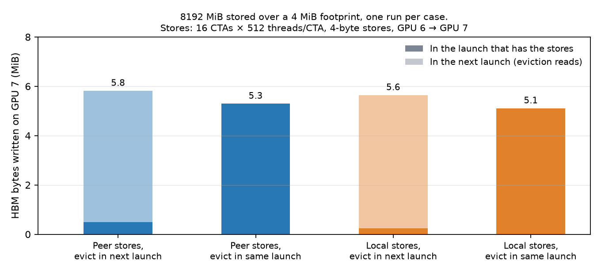
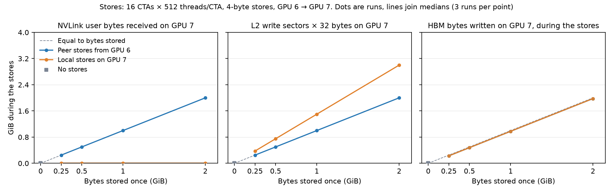
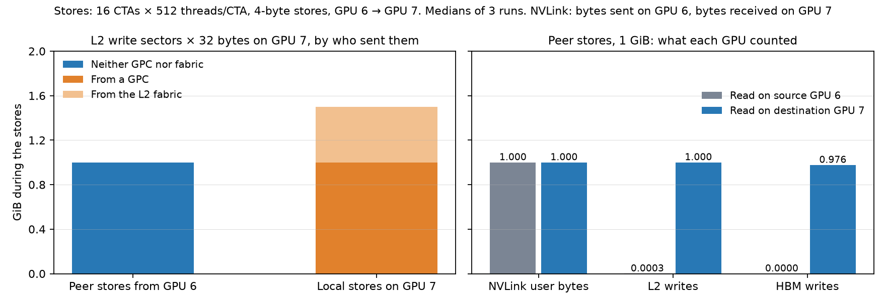
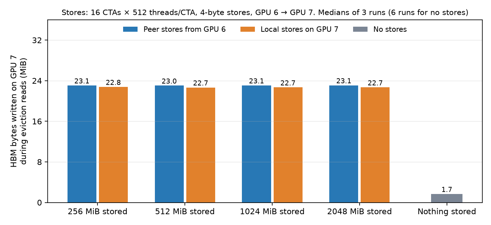

# Path of incoming peer stores through the destination's L2

**Status (2026-10-31): the counter sanity checks and the test of bytes stored once are done and reported here. Scope was cut by request: the other sub-experiments are not reported. See [Work stopped](#work-stopped).**

[Plan](08_peer_store_l2_path.md) · [Common setup and metric ids](../00_common_setup.md) · [Harness](../../common/README.md#peer-store-path-harness-plan-08) · [Data path diagram](https://claude.ai/artifact/PHd8x6SQX19eMbBwZsR4HA) · **New to this? Start with [How the experiment works](#how-the-experiment-works)**

**Question.** When a thread on the source GPU stores to the destination GPU's memory through an NCCL LSA pointer over NVLink, does the data pass through the destination GPU's L2 cache on its way to HBM?

**Answer.** **Yes, for this setup.** With 16 CTAs × 512 threads/CTA storing 4-byte values from GPU 6 to GPU 7, every byte received over NVLink was counted once as an L2 write on GPU 7: the fitted slope is 1.0002 over 256 to 2048 MiB. The L2 also keeps the data. When 8192 MiB was stored over a 4 MiB footprint, GPU 7 received all 8192 MiB, but HBM got 0.5 MiB during the stores and about 3.5 MiB when other data later pushed the footprint out of L2. Peer stores do not show up on the source GPU's L2 or HBM (under 0.3 MiB of L2 writes per 1024 MiB stored). This fits a write-back L2, the same behaviour local stores show on GPU 7. Copy throughput cannot show this path. Two limits matter: the repeated-footprint evidence is one run per case, and whether incoming stores push other data out of L2 was not tested.

| Word used in this report | Metric id ([common setup](../00_common_setup.md)) |
|---|---|
| Copy throughput: stored bytes divided by the acknowledged transfer time, decimal GB/s | A1 |
| Store loop time | A3 |
| Wrong values: words that differ from the last value stored, checked after all measured phases | A11 |
| HBM bytes written or read on the destination | C2 |
| HBM bytes written on the source | C1 |
| L2 write sectors (× 32 bytes) and their sender, on either GPU | C3 |
| Profiler method, passes and settings | C8 |
| NVLink user bytes sent and received | C9 |

Other words:

| Word | Meaning |
|---|---|
| Peer store | A store by a thread on GPU 6 through the pointer from `ncclGetLsaPointer`. The memory is `ncclMemAlloc` device memory on GPU 7 |
| Local store | A store by a thread on GPU 7 to the same memory, with the same pattern. It is the reference for normal L2 use |
| Footprint | The number of different bytes a run stores to. Stores repeat over this range until the total is reached |
| Eviction reads | 64 CTAs on GPU 7 read a separate 256 MiB buffer, about 5 × the 50 MiB L2. This pushes L2 contents out without adding any store |
| Phase | One named kernel launch. A transfer runs: clean (eviction reads), quiet 5 ms, stores, quiet 5 ms, eviction reads, check |

Possible paths the plan set out to separate:

| Model | What happens at the destination | Fits these results? |
|---|---|---|
| Write-back | The store enters L2 and stays. HBM is written when the line is pushed out | **Yes** |
| Write-through | The store accesses L2 and also goes to HBM at once | No: HBM stayed near zero while 8192 MiB arrived |
| Bypass | The store goes to HBM with no L2 access | No: L2 write sectors follow the bytes, and HBM stayed near zero |

## How the experiment works

This section needs no knowledge of hardware counters. It follows one real run from the command to the final number.

### The idea: count the data at three points

A **hardware counter** is a tally built into the GPU. Think of it as a turnstile: each time data passes a certain point, the tally goes up. Software cannot see inside the GPU's memory path, but it can read these tallies.

We send a known amount of data from GPU 6 to GPU 7, then read the tally at three points on GPU 7:

```text
        GPU 6                                      GPU 7
 ┌───────────────────┐                ┌───────────────────────────────────────────┐
 │ threads run the   │                │    (A)            (B)              (C)    │
 │ stores, 16 CTAs × │ ── NVLink ───▶ │  NVLink ──?──▶  L2 cache ──?──▶    HBM    │
 │ 512 threads/CTA   │                │  receive                                  │
 └───────────────────┘                └───────────────────────────────────────────┘
                                         tally A         tally B         tally C
```

Each possible path gives a different set of tallies, so the tallies tell the paths apart:

| Possible path | What happens | Tally B (L2) | Tally C (HBM) during the stores |
|---|---|---|---|
| Bypass | Data goes straight to HBM | Stays near zero | Every byte |
| Write-through | Data goes through L2 and on to HBM at once | Every byte | Every byte |
| Write-back | Data stops in L2. HBM gets it later, when L2 needs the space | Every byte | Only what L2 has no room to keep |

### The two tests

| Test | What the threads do | Why this test | Which question it answers |
|---|---|---|---|
| **Store once** | Store 1024 MiB, each byte once (also 256, 512 and 2048 MiB). This is more than the 50 MiB L2 can hold | L2 cannot hide the data, so all three paths send it to HBM. Only tally B differs | Does the data enter L2? |
| **Store repeatedly** | Store over the same 4 MiB 2048 times, 8192 MiB in total. All 4 MiB fits in L2 | Think of writing on a whiteboard 2048 times and photographing it only at the end. If L2 keeps the data, new stores just replace the old values there, and HBM sees almost nothing | Does L2 keep the data? |

What each path predicts for the store-repeatedly test, and what we measured, in MiB:

| | Tally A: NVLink | Tally B: L2 | Tally C: HBM during stores |
|---|---|---|---|
| Bypass predicts | 8192 | About 0 | 8192 |
| Write-through predicts | 8192 | 8192 | 8192 |
| Write-back predicts | 8192 | 8192 | About 0 |
| **Measured** | **8192.0** | **8194.5** | **0.5** |

Two reference cases show how to read these tallies:

| Reference case | What runs | What it tells us |
|---|---|---|
| Local stores | The same stores, but run by threads on GPU 7 itself | What normal L2 use looks like on this GPU |
| No stores | Only one small waiting kernel on GPU 7 | How much the tallies move when no data is sent |

### One transfer, step by step

The program runs on both GPUs. One transfer is a fixed series of short kernels, called phases. **Each phase is its own kernel launch, because the profiler gives one set of tallies per launch.** That is how we can tell which tally change belongs to which step.

```text
time ─────────────────────────────────────────────────────────────────────────▶
GPU 7:  fill   │ clean │ quiet │ receiver waits  │ quiet │ eviction │ check
        poison │ reads │ 5 ms  │ (phaseMain)     │ 5 ms  │ reads    │ reads
GPU 6:                         │ STORES          │
                               │ (phaseMain)     │
Counted?  no   │  yes  │  yes  │      yes        │  yes  │   yes    │  yes
```

| Step | Kernel name | What it does | Why |
|---|---|---|---|
| Fill poison | None (copy engine) | Fills the target memory with `0xff` | A later check can then spot data that never arrived |
| Clean reads | `phaseClean` | 64 CTAs on GPU 7 read an unrelated 256 MiB buffer | The buffer is 5 × the size of L2, so reading it pushes old data out and L2 starts in a known state |
| Quiet | `phaseQuiet` | One thread waits 5 ms | HBM writes should settle before the stores start |
| Stores | `phaseMain` | GPU 7's receiver starts and sends "ready". Only then do GPU 6's threads start storing. When they finish, they send "done" flags, and the receiver sends an acknowledgement | The receiver runs on GPU 7 for the whole transfer, so tallies on GPU 7 cover every store |
| Quiet | `phaseQuiet` | One thread waits 5 ms | Shows whether L2 writes its data to HBM by itself after a short wait |
| Eviction reads | `phaseEvict` | The same reads as the clean step | Pushes data out of L2. HBM writes in this step are data that L2 was still holding |
| Check | `phaseCheck` | Reads the target memory and compares each word with the value expected | Shows the data is correct. Runs last, so it cannot disturb the steps above |

Local stores use the same sequence, but GPU 7's own threads run the stores in `phaseMain`.

### The commands

**Step 1: build the program.**

```bash
cd experiments/h100x2/thread_store/common
make bin/peer_store_path
```

**Step 2: describe the run in a config file.** `run_peer_store_path.py` writes this file. This one is `configs/enter/peer_f1024.cfg`:

| Line | Meaning |
|---|---|
| `store_source=1` | Who stores: 1 is GPU 6 (peer), 2 is GPU 7 (local), 0 is nobody |
| `footprint_mib=1024` | How many different bytes are stored to |
| `passes=1` | How many times to store over them. The store-repeatedly test uses `footprint_mib=4` and `passes=2048` |
| `writer_ctas=16`, `writer_threads=512` | 16 CTAs × 512 threads/CTA run the stores |
| `warmup=2`, `iterations=3` | Run 5 transfers. Discard the first 2. Keep the last 3 |

**Step 3: run the program under the profiler.** `ncu` is NVIDIA's command-line profiler. `run_peer_store_path.py` runs this command once for each run:

```bash
/usr/local/cuda/bin/ncu \
  --replay-mode application --clock-control none --cache-control none \
  --devices 7 \
  --metrics dram__bytes_write.sum,nvlrx__bytes_packet_request_data_user.sum,lts__t_sectors_op_write.sum,... \
  --csv --log-file raw/peer_f1024_R1.ncu.csv \
  bin/peer_store_path configs/enter/peer_f1024.cfg raw/peer_f1024_R1.json --gpus 6,7 --profiled-rank 1
```

File paths are shortened here. The `...` stands for the rest of the 23 counters, listed in `METRICS` in [run_peer_store_path.py](../../common/scripts/run_peer_store_path.py).

| Part of the command | What it does |
|---|---|
| `--devices 7` | Read tallies on GPU 7 only. To read GPU 6, we use `--devices 6` and `--profiled-rank 0` |
| `--metrics ...` | Which tallies to read |
| `--replay-mode application` | The GPU cannot read all 23 tallies at the same time. So `ncu` runs the whole program several times and reads some tallies each time. Here that is **6 times per run**. It then joins the results by launch |
| `--clock-control none` | Leave the GPU clocks as they are |
| `--cache-control none` | **Do not let the profiler flush the caches.** The caches are what we are measuring |
| `--csv --log-file ...` | Save the tallies in a table |
| `bin/peer_store_path ...` | The program being measured, with its config file and output file. `--gpus 6,7` means GPU 6 is the source and GPU 7 is the destination |

**Step 4: turn the tables into results.**

```bash
python3 scripts/peer_store_counters.py ../observation/peer_store_l2_path/results/2026-10-31/enter/counters-destination/raw peer_f1024
python3 scripts/analyze_peer_store_path.py ../observation/peer_store_l2_path/results/2026-10-31
```

The first command prints one line per phase. The second writes the summary file and the figures.

### The counters, in plain words

A counter's name has three parts. For `lts__t_sectors_op_write.sum`:

| Part | Meaning |
|---|---|
| `lts__` | Where the tally is: LTS is the L2 cache, which is split into many slices |
| `t_sectors_op_write` | What it counts: sectors handled by L2 for write operations |
| `.sum` | Add the tallies of all slices into one number for the whole GPU |

A **sector** is a 32-byte block, the unit L2 counts in. Bytes = sectors × 32. So 1 GiB is 33,554,432 sectors.

| Counter | `ncu`'s own description | In plain words | How we use it |
|---|---|---|---|
| `nvlrx__bytes_packet_request_data_user.sum` | Bytes of NVLRX request user data, at 16B granularity | **Tally A.** Data bytes arriving over NVLink | Shows how much data reached GPU 7 |
| `nvltx__bytes_packet_request_data_user.sum` | Bytes of NVLTX request user data, at 16B granularity | Data bytes leaving over NVLink | The same check on GPU 6 |
| `lts__t_sectors_op_write.sum` | LTS sectors for writes | **Tally B.** Blocks written into L2 | The main evidence that data enters L2 |
| `dram__bytes_write.sum` | Bytes written to DRAM | **Tally C.** Bytes written to HBM | Shows when data reaches HBM |
| `dram__bytes_read.sum` | Bytes read from DRAM | Bytes read from HBM | Shows that the eviction reads really read 256 MiB |
| `lts__t_sectors_srcnode_gpc.sum` | LTS sectors from node GPC | L2 blocks sent by this GPU's own threads, reads and writes | Separates local stores from peer stores |
| `lts__t_sectors_srcunit_ltcfabric_op_write.sum` | LTS sectors from LTC Fabric for writes | L2 write blocks that came through the L2's internal network. This is our reading of the name, not NVIDIA's text | Local stores have these, peer stores do not. What this means physically is not known |
| `lts__t_sectors_aperture_peer_op_write.sum` | LTS sectors accessing peer memory for writes | L2 write blocks going to another GPU's memory | Read on GPU 6: would show stores passing through GPU 6's L2 |
| `lts__t_sectors_op_write_lookup_hit.sum` | LTS sectors for writes that hit | Writes that L2 counted as a hit | All writes count as hits, even to evicted addresses, so we do **not** use this as evidence |
| `lts__d_sectors_fill_device.sum` | Sectors filled from device memory | Blocks L2 read from HBM | Zero means L2 did not need to read lines before writing them |
| `gpu__time_duration.sum` | Equals `gpu__time_duration_measured_user` if collectable | How long the launch took | Confirms the phases ran as designed, for example 5 ms for quiet |

These descriptions come from `ncu --query-metrics --query-metrics-mode all --chip gh100`. NVIDIA does not document the path of the data, so we checked the main counters against known traffic. See [Counter sanity checks](#counter-sanity-checks).

### What the profiler gives back, and how we read it

The output is a table with one row per counter per launch. This is one real row:

```text
ID  Kernel Name                  Device  Metric Name                  Metric Unit  Metric Value
26  phaseMain(KernelArguments)   7       lts__t_sectors_op_write.sum  sector       33,640,383
```

Below are the real values for one kept transfer of `peer_f1024_R1`: launches 12 to 17, peer stores, 1024 MiB stored, read on GPU 7. L2 writes are shown after multiplying sectors by 32. 1 MiB is 1,048,576 bytes.

| Launch | Phase | Time (ms) | A: NVLink received (MiB) | B: L2 writes (MiB) | C: HBM written (MiB) | HBM read (MiB) | What this row shows |
|---|---|---|---|---|---|---|---|
| 12 | Clean reads | 0.14 | 0 | 0.00 | 22.6 | 256.0 | The reads ran. Old data left L2 |
| 13 | Quiet | 5.00 | 0 | 0.26 | 0.25 | 0 | Almost nothing moves |
| **14** | **Stores** | **3.37** | **1024.0** | **1024.0** | **999.8** | **0.03** | **All data arrived and entered L2. Most went on to HBM** |
| 15 | Quiet | 5.00 | 0 | 0.06 | 0.00 | 0.00 | L2 did not write its data out by itself |
| **16** | **Eviction reads** | **0.14** | **0** | **0.01** | **23.1** | **256.0** | **L2 was still holding data. Now it reaches HBM** |
| 17 | Check | 1.68 | 0 | 0.04 | 0.70 | 1024.0 | The data is read back and compared |

A worked example for launch 14, from the raw values:

| Tally | Raw value | Calculation | Result |
|---|---|---|---|
| A: NVLink received | 1,073,742,080 bytes | Stored: 1024 MiB = 1,073,741,824 bytes | 256 bytes extra. This fits the 16 "done" flags, each counted as 16 bytes |
| B: L2 writes | 33,555,565 sectors | 33,555,565 × 32 = 1,073,778,080 bytes | 1024.03 MiB, within 0.004% of the bytes stored |
| C: HBM written | 1,048,363,776 bytes | Stored minus written | About 24 MiB did not reach HBM during the stores |
| C: HBM written during eviction | 24,231,680 bytes | Minus the 1.7 MiB seen with no stores | About 21 MiB. This is most of the 24 MiB missing above |

So tally B shows the data entered L2, and tally C shows L2 kept the last part of it until eviction pushed it out.

### How repeats become one number

| Level | Count | How it is combined |
|---|---|---|
| Program runs under `ncu` | 6 per run | `ncu` joins them into one table |
| Transfers | 5 per run, the first 2 discarded | The median of the 3 kept transfers gives one value per phase for that run |
| Runs | 3 per case | Tables show the median of the runs |
| Cases, store once | 10 | Peer and local at 4 sizes, plus no stores for 1 ms and 6 ms. This gives 30 runs, plus 3 more that read GPU 6 |

### What this method cannot show

- **Tallies are for the whole GPU.** They count all traffic on GPU 7 during a launch, not only our stores. The no-stores case shows this background is small.
- **One row can mix program runs.** The tallies in a row can come from different ones of the 6 program runs. So a row is not one exact moment. The values repeat closely from one transfer to the next, which is why we can still compare them.
- **A tally shows that L2 handled the data, not how it got there.** We cannot see the parts between NVLink receive and L2.
- **The profiler changes the timing.** Reading tallies on GPU 7 slows the peer stores by about 5% at 1 GiB. The byte counts are not affected in any way we can see. The speed numbers without a profiler come from separate runs.

## Counter sanity checks

### Motivation

No hardware counter had been collected on this two-GPU harness before, and counters are the main evidence here. A counter that reads zero could mean no traffic, or that it does not see traffic started by another GPU. So the counters were first checked against traffic of known size. The plan expected local stores to reach HBM by the end of eviction, and NVLink bytes to match stored bytes within an explained factor. It also asked whether a new kernel launch flushes the L2.

### Setup

| Knob | Role | Values |
|---|---|---|
| GPUs | Constant | Source GPU 6, destination GPU 7. Counters read on GPU 7 |
| Stores | Constant | 16 CTAs × 512 threads/CTA, 4-byte stores, values new on every pass, no source loads |
| **Known traffic** | **Independent variable** | **None for 3 ms (1 receiver CTA only); peer stores 1024 MiB once; local stores 1024 MiB once** |
| **Launch boundary, with 8192 MiB stored over a 4 MiB footprint (2048 passes), no quiet phase after the stores** | **Independent variable** | **Eviction reads in the next launch; eviction reads in the same launch as the stores. Peer and local** |
| Repeats | Constant | 1 run per case, 2 warm-up transfers and 3 kept transfers per run |

Config names: `configs/validate/none_window3ms`, `peer_f1024`, `local_f1024`, `peer_f4_evictinmain0`, `peer_f4_evictinmain1`, `local_f4_evictinmain0`, `local_f4_evictinmain1`.

### Method

The collection method is `ncu --replay-mode application --clock-control none --cache-control none`. It runs the whole program 6 times to collect all counters. Each phase is its own named kernel, so `ncu`'s per-launch rows separate the phases. Kernel replay hung on this two-GPU launch in earlier work. Application replay works. The plan listed `nsys`, PM sampling and the range profiler first; they were not needed, so they were not tried.

Three things differ from the plan:

- **One run per case, not 3.** The scope cut stopped this group early.
- **The eviction-pass test (1, 2 and 4 passes over the buffer) did not run.** So nothing here shows that one pass pushes out all dirty data.
- **Known local reads have no case of their own.** The check phase reads the whole footprint after eviction, and that serves as the known read.

Two faults were fixed before the results below:

- The first eviction kernel had no effect: the compiler removed the reads and the phase ran for 2 µs. The reads now write to shared memory, and `LDG` instructions were confirmed in the generated code.
- The check phase reported wrong values in the no-stores case, because the payload still held its poison value. The check is now skipped when nothing stores. Generated device code was unchanged.

### Results

Known traffic, in MiB, counted on GPU 7. Values are for the store phase, except the last row, which is the check phase:

| Check | Case | Expected | NVLink user bytes received | L2 write sectors × 32 bytes | HBM written during stores | Result |
|---|---|---|---|---|---|---|
| Counters stay near background | No stores, 3 ms | About 0 | 0 | 0.25 | 0 | Pass |
| Peer bytes are seen on the destination | Peer, 1024 MiB | 1024 received | 1024.0 | 1024.1 | 999.8 | Pass |
| Local stores reach L2 and HBM | Local, 1024 MiB | At least 1024 L2; about 1024 HBM by end of eviction | 0 | 1536.3 | 1001.0 | Pass; 1022 MiB of HBM writes by the end of eviction, above the no-stores level |
| Known reads reach HBM | Check phase after eviction, both | About 1024 HBM read | 0 | Under 1 | Under 1 | Pass; 1024.0 to 1024.1 MiB read |

Wrong values were 0 in every run.



Launch boundary, 8192 MiB stored over a 4 MiB footprint, in MiB on GPU 7, one run per case:

| Who stores | Eviction reads | NVLink user bytes received | L2 write sectors × 32 bytes | HBM written in the store launch | HBM written in the next launch |
|---|---|---|---|---|---|
| Peer stores | Next launch | 8192.0 | 8194.5 | 0.50 | 5.32 |
| Peer stores | Same launch | 8192.0 | 8193.4 | 5.30 | None: no separate launch |
| Local stores | Next launch | 0 | 12288.5 | 0.25 | 5.39 |
| Local stores | Same launch | 0 | 12288.9 | 5.11 | None: no separate launch |

With no stores, eviction reads write 1.9 MiB to HBM in this group's control run (1.7 MiB in the 6 runs of the next section). Above that level, the peer case with eviction in the next launch reached HBM with 0.5 + 3.5 = 4.0 MiB, which is the footprint.

### Interpretation

- **The counters see traffic started by the other GPU.** NVLink user bytes on GPU 7 match the stored bytes exactly, and L2 write sectors change with only one small receiver CTA on that GPU.
- **A sector is 32 bytes.** With that size, peer L2 writes equal the stored bytes to within 0.01%.
- **A launch boundary does not flush the L2.** Going from one launch to the next left the dirty data in L2 for both peer and local stores: HBM writes during the store launch stayed at 0.25 to 0.5 MiB. The plan feared a flush and asked for one launch per run. This result shows that phases in separate launches are valid here.
- **Repeated stores to a small footprint stay in L2.** The link carried all 8192 MiB, so nothing merged the stores before they reached GPU 7. This is the strongest evidence for write-back in this report. It rests on one run per case.

## Do incoming stores access the destination's L2?

### Motivation

This is the direct test of whether peer stores enter the L2. Each byte is stored once and the sizes are larger than L2, so the L2 cannot hide traffic. HBM writes then happen under every model and cannot separate them; only L2 counters can. Several sizes show whether L2 counts follow the data, which is stronger than one non-zero number. The plan expected L2 write sectors to follow NVLink bytes unless the stores bypass L2. It left open whether stores also pass through the source's L2.

### Setup

| Knob | Role | Values |
|---|---|---|
| GPUs | Constant | Source GPU 6, destination GPU 7, NVIDIA H100 80GB HBM3, driver 595.71.05. Clocks not locked |
| **Bytes stored once each** | **Independent variable** | **256, 512, 1024, 2048 MiB (footprint = bytes, one pass)** |
| **Who stores** | **Independent variable** | **Peer stores: 16 CTAs × 512 threads/CTA on GPU 6. Local stores: 16 CTAs × 512 threads/CTA on GPU 7. No stores: 1 receiver CTA only, for 1 ms and 6 ms** |
| **Which GPU is counted** | **Independent variable** | **GPU 7 for all 10 cases; GPU 6 for peer stores of 1024 MiB** |
| Store width | Constant | 4 bytes, values computed in registers, no source loads |
| Memory | Constant | `ncclMemAlloc` + `ncclCommWindowRegister`, mapped by NCCL |
| Eviction reads | Constant | 64 CTAs, 1 pass over a 256 MiB buffer on GPU 7 |
| Repeats | Constant | 3 runs per case, rotated order, 2 warm-up and 3 kept transfers per run |

Config names: `configs/enter/peer_f{256,512,1024,2048}`, `local_f{256,512,1024,2048}`, `none_window1ms`, `none_window6ms`.

Results come from 30 runs with counters on GPU 7 (10 cases × 3 runs) and 3 runs with counters on GPU 6.

### Method

Each run gives one value per phase, the median of its 3 kept transfers. Tables and figures show the median of the runs. Counters are GPU-wide. Differences from the plan:

| Plan | What ran | Effect |
|---|---|---|
| 5 runs per case | 3 runs per case | Spread between runs is small; see the fit below |
| Opening and closing no-stores runs | No-stores cases inside each round, 1 ms and 6 ms | Controls are interleaved instead of at the ends |
| Counters on both GPUs for every case | GPU 6 only for peer stores of 1024 MiB | The source-side result is one size |
| L2 counters that name the hub as sender | Not collected. Collected counters name a GPC or the L2 fabric as sender | Peer stores are identified by being neither. The name of their sender stays open |

The job stopped at 02:12 UTC, during the third round, soon after the session moved to a new terminal. The cause was not found; the log shows no error. The job restarted at 03:35 UTC and ran the remaining runs. `peer_f256_R3` was cut off by the stop: its counter table had only 967 bytes. It was deleted and run again, not kept with an exclusion note. Runs from before and after the gap agree: see the fit below.

### Results

**Copy throughput comes first.** It shows how fast the stores ran. It cannot show the path.

| Who stores | Bytes stored | Counters on | Copy throughput, GB/s (3 runs) | Store loop rate, GB/s (3 runs) |
|---|---|---|---|---|
| Peer: 16 CTAs × 512 threads/CTA | 256 MiB | GPU 7 | 282.0, 284.8, 282.9 | 285.3, 288.2, 286.5 |
| Peer | 512 MiB | GPU 7 | 311.5, 311.0, 313.1 | 313.6, 312.9, 315.2 |
| Peer | 1024 MiB | GPU 7 | 330.4, 330.2, 329.5 | 331.6, 331.4, 330.7 |
| Peer | 1024 MiB | GPU 6 | 347.4, 347.7, 347.8 | 348.7, 349.0, 349.1 |
| Peer | 2048 MiB | GPU 7 | 337.6, 337.8, 338.0 | 338.3, 338.4, 338.6 |
| Local: 16 CTAs × 512 threads/CTA | 256 MiB | GPU 7 | 959.4, 958.9, 966.0 | 969.0, 969.0, 976.3 |
| Local | 512 MiB | GPU 7 | 966.0, 973.4, 972.9 | 971.0, 978.3, 978.3 |
| Local | 1024 MiB | GPU 7 | 969.3, 976.3, 976.8 | 971.9, 978.9, 979.0 |
| Local | 2048 MiB | GPU 7 | 970.8, 978.0, 978.3 | 972.0, 979.3, 979.4 |

Without any profiler, one run of 2048 MiB gave 347 GB/s for peer stores and 971 GB/s for local stores. These rates are from the last `ncu` pass of each run.



L2 write sectors × 32 bytes against bytes stored, 12 run values per line:

| Who stores | Slope | Intercept | Largest distance of a run from the line |
|---|---|---|---|
| Peer stores | 1.0002 | −0.02 MiB | 0.32 MiB |
| Local stores | 1.5000 | 0.22 MiB | 0.06 MiB |

Medians on GPU 7 during the store phase, in MiB:

| Who stores | Bytes stored | NVLink user bytes received | L2 write sectors × 32 bytes | Sent by a GPC (all L2 operations) | Sent by the L2 fabric (writes) | HBM read | HBM written |
|---|---|---|---|---|---|---|---|
| Peer | 256 | 256.0 | 256.1 | 0.8 | 0.0 | 0.01 | 231.8 |
| Peer | 512 | 512.0 | 512.1 | 0.9 | 0.0 | 0.00 | 487.8 |
| Peer | 1024 | 1024.0 | 1024.1 | 1.1 | 0.0 | 0.05 | 999.8 |
| Peer | 2048 | 2048.0 | 2048.3 | 1.4 | 0.0 | 0.11 | 2024.0 |
| Local | 256 | 0 | 384.2 | 256.9 | 128.1 | 0.02 | 232.8 |
| Local | 512 | 0 | 768.3 | 512.9 | 256.1 | 0.02 | 489.0 |
| Local | 1024 | 0 | 1536.3 | 1024.9 | 512.1 | 0.02 | 1000.9 |
| Local | 2048 | 0 | 3072.3 | 2048.9 | 1024.1 | 0.05 | 2024.9 |

All L2 write sectors, peer and local, were counted as lookup hits, with almost no misses. At 1024 MiB, `lts__d_sectors_fill_device` was 0, and HBM reads stayed near zero at every size. So the L2 did not read lines from HBM to take these stores.



What each GPU counted for peer stores of 1024 MiB, in GiB during the store phase, median of 3 runs per GPU:

| Counter | Source GPU 6 | Destination GPU 7 |
|---|---|---|
| NVLink user bytes, sent on GPU 6, received on GPU 7 | 1.000 | 1.000 |
| NVLink protocol bytes, same direction | 0.125 | 0.125 |
| NVLink all bytes, same direction | 1.141 | 1.143 |
| NVLink all bytes, other direction | 0.914 (received) | 0.805 (sent) |
| L2 write sectors × 32 bytes | 0.0003 | 1.000 |
| L2 write sectors to peer memory × 32 bytes | 0 | 0 |
| HBM written | 0.0000 | 0.976 |



Where the stored bytes reach HBM on GPU 7, in MiB. "Held in L2" is HBM writes during eviction reads, above the 1.7 MiB no-stores level.

| Who stores | Bytes stored | During stores | During 5 ms quiet phase | Held in L2 | Not found |
|---|---|---|---|---|---|
| Peer | 256 | 231.8 | 0.06 | 21.4 | 2.7 |
| Peer | 512 | 487.8 | 0.10 | 21.4 | 2.8 |
| Peer | 1024 | 999.8 | 0.25 | 21.4 | 2.5 |
| Peer | 2048 | 2024.0 | 0.01 | 21.4 | 2.5 |
| Local | 256 | 232.8 | 0.03 | 21.1 | 2.1 |
| Local | 512 | 489.0 | 0.10 | 21.0 | 1.9 |
| Local | 1024 | 1000.9 | 0.00 | 21.0 | 2.2 |
| Local | 2048 | 2024.9 | 0.03 | 21.0 | 2.1 |

Wrong values were 0 in all 33 runs.

### Interpretation

- **Reading counters on GPU 7 slows the peer stores.** With counters on GPU 7, peer copy throughput was 330 GB/s at 1024 MiB, against 348 GB/s with counters on GPU 6, a 5% fall. The store loop takes about 160 to 190 µs longer at every size, so short transfers look slower. The cause was not tested. Local stores do not show this. Byte counts do not depend on it.
- **Peer stores enter the destination's L2.** L2 write sectors follow NVLink user bytes with a slope of 1.0002 and a largest distance of 0.32 MiB, over 12 runs and a factor of 8 in size. No-stores runs stay near zero.
- **Peer stores do not use the source's L2 or HBM.** On GPU 6, L2 writes were 0.0003 GiB per 1 GiB stored, none counted to peer memory, and HBM writes were about zero. The data leaves GPU 6 through NVLink without a counted L2 access.
- **Peer and local stores reach the L2 differently.** Local stores count 1.5 sectors per byte: 1.0 sent by a GPC, 0.5 sent by the L2 fabric. Peer stores count 1.0 and neither sender applies. The same 1.5 factor appears for reads by local CTAs (384 MiB of L2 reads for each 256 MiB of eviction reads). What the extra 0.5 means physically is not known. No counter here names the sender of the peer stores.
- **The L2 holds about 21 MiB of the last data after a transfer ends, for both flows.** That amount did not change from 256 to 2048 MiB, and almost nothing left L2 in the 5 ms quiet phase (0.25 MiB or less). So when the acknowledgement arrives, some stored data exists only in the destination's L2. That data is still correct: wrong values were 0.
- **A lookup hit does not mean the line was already there.** Writes to freshly evicted addresses all counted as hits. So hit counts cannot be used alone to show presence in L2 for these stores.

**Still unexplained:**

- **About 2 to 3 MiB per transfer is not found in HBM writes.** This is 0.1% to 1% of the bytes stored. One eviction pass may leave some dirty lines in L2, or the no-stores level may not subtract exactly.
- **About 21 MiB in a 50 MiB L2.** Why the L2 holds this amount and not more was not tested.
- **NVLink traffic in the other direction, and protocol bytes.** The other direction carries 0.8 to 0.9 GiB per 1 GiB stored, and the two GPUs count it differently. Protocol bytes are exactly 1/8 of user bytes. The counters' documentation does not say what these are.
- **HBM writes during the clean phase.** About 22.7 MiB is written there even in no-stores runs, and about 4.8 MiB with a 4 MiB footprint. This is most likely the poison value that the copy engine writes before each transfer, left in L2. It was not tested.

## What this report does not show

- **Whether incoming stores push other data out of L2.** That test (E8.5) did not run. These results show that stored data occupies L2 lines, about 21 MiB after a large transfer. They do not measure the effect on another kernel's data.
- **The physical route.** Counters show that L2 was accessed, not how the data got there. The crossbar on the destination GPU is drawn in the diagram because it is the usual picture. Between NVLink receive and L2 there are parts this test cannot see.
- **Other setups.** Results apply to this memory (`ncclMemAlloc`, mapped by NCCL), this driver, GPUs 6 and 7, and 4-byte stores at this rate. Other store widths and partly written lines were not reported here.
- **Device state during counter runs.** The counter runner does not take device snapshots or whole-run NVLink readings (B2, B3). `nvidia-smi` showed no other processes on GPUs 6 and 7 before the runs, and each run checks the GPUs are idle.

## Work stopped

The user cut the scope on 2026-10-31 to these two reports. Runs of other groups had already finished or were stopped at that point. They stay in the local results directory. They are not analysed in this report, and no conclusion above depends on them.

| Group | Plan part | Runs with results |
|---|---|---|
| `stay` | E8.2 base sweep | 48 with counters, 48 timing |
| `chase` | E8.3 read timing | 30 with counters, 90 timing |
| `prior` | E8.4 lines already in L2 | 30 timing |
| `validate`, eviction passes | E8.0 | Not run |
| `knee`, `variants`, `resident` | E8.2 finer footprints and variants, E8.5 | Not run |

## How to reproduce

Raw measurements are not in version control. They need the local results directory or a rerun. Counters need free GPUs and no clock control.

```bash
cd experiments/h100x2/thread_store/common
make bin/peer_store_path
python3 scripts/run_peer_store_path.py validate --gpus 6,7 --rounds 1
python3 scripts/run_peer_store_path.py enter --gpus 6,7 --rounds 3
python3 scripts/run_peer_store_path.py enter --gpus 6,7 --rounds 3 --mode counters-source --only peer_f1024
python3 scripts/analyze_peer_store_path.py ../observation/peer_store_l2_path/results/2026-10-31
```

The analysis script needs `matplotlib`, which is not in the machine's system Python. It writes `results/2026-10-31/peer_store_summary.json` and `results/2026-10-31/figures/`.

## Session log

| Date | GPUs | What ran | Results |
|---|---|---|---|
| 2026-10-30 | None | Plan written. Host-only queries of the installed profiler's counter lists; no GPU work | None |
| 2026-10-31 | 6, 7 | Harness built and smoke-tested. Counter sanity checks, 1 run per case. Other plan groups ran until the scope cut; see [Work stopped](#work-stopped). Bytes stored once: 30 runs with counters on GPU 7, 3 on GPU 6, with one stop and restart | `results/2026-10-31/` |
