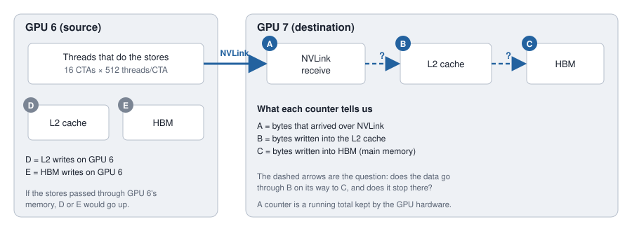
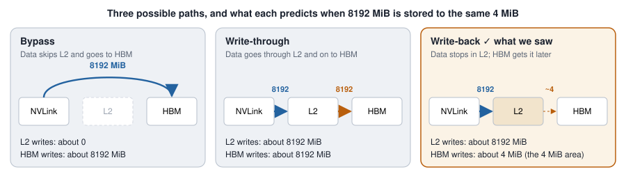
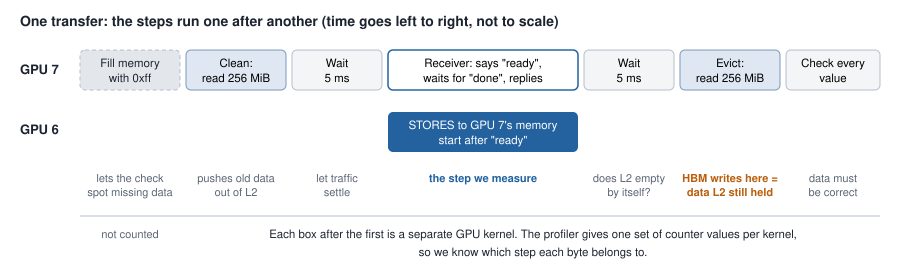
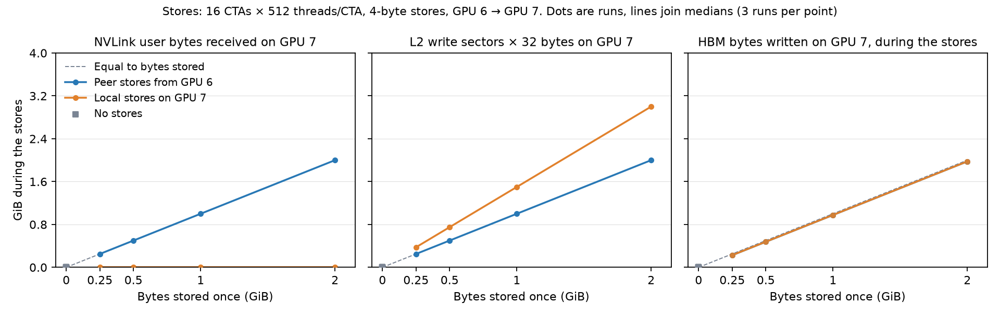
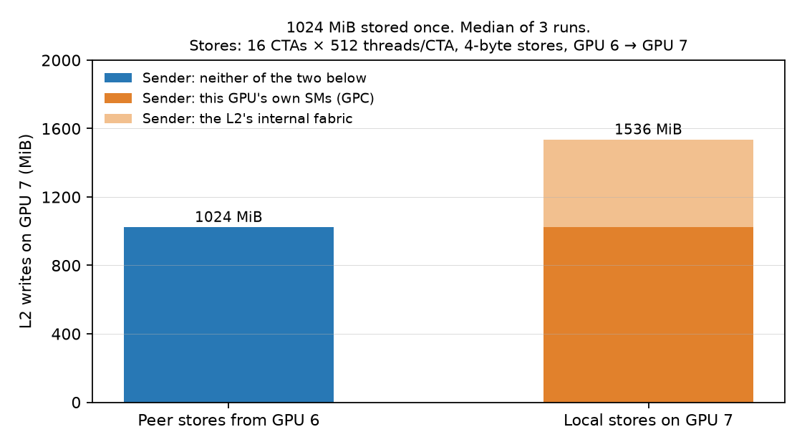
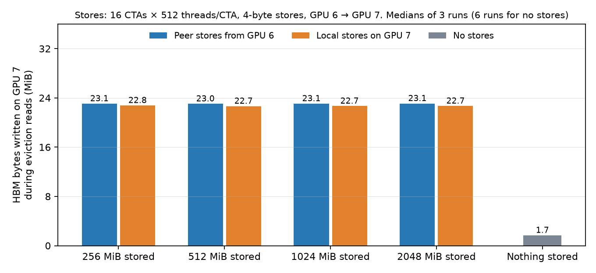
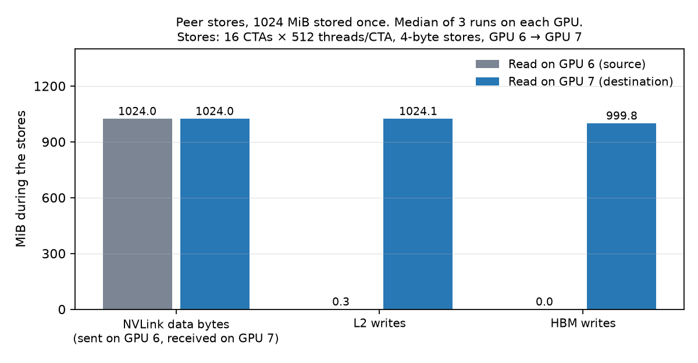
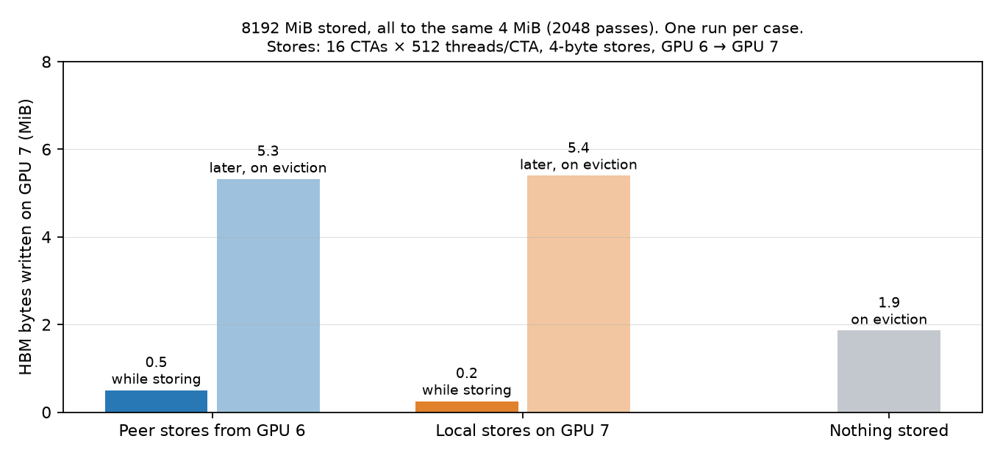

# Do peer stores pass through the destination GPU's L2 cache?

**Status (2026-11-11):** Experiments 1 to 5 below are done. The rest of the plan was stopped on request. See [What was not done](#what-was-not-done).

[Plan](08_peer_store_l2_path.md) · [Harness](../../common/README.md#peer-store-path-harness-plan-08) · [Data path diagram (web page)](https://claude.ai/artifact/PHd8x6SQX19eMbBwZsR4HA)

## The question

- Threads on GPU 6 write data straight into GPU 7's memory over NVLink. These writes are called **peer stores**. They use the NCCL device API (`ncclGetLsaPointer`).
- GPU 7 has a 50 MiB **L2 cache** in front of its main memory, **HBM**.
- **Question:** does the incoming data go through GPU 7's L2 cache on its way to HBM, or does it skip the cache?

## The answer

- **Yes, the data goes through GPU 7's L2 cache.** Every byte that arrived over NVLink was written into L2 ([Experiment 2](#experiment-2-does-the-data-enter-gpu-7s-l2)).
- **The L2 also keeps the data for a while.** It writes the data to HBM only when it needs the space ([Experiment 4](#experiment-4-does-gpu-7s-l2-keep-the-data)).
- **The data does not use GPU 6's own L2 or HBM** ([Experiment 3](#experiment-3-does-the-data-pass-through-gpu-6s-l2)).
- **Incoming data behaves like data written by GPU 7's own threads.** In cache terms, this is a **write-back** cache.
- **Two limits:**
  - The evidence that L2 keeps the data comes from one run per case.
  - We did not test whether incoming data pushes other programs' data out of L2.

## How we measured

### Counters

- The GPU keeps running totals in hardware, called **counters**. For example, one counter adds up every byte written into L2.
- NVIDIA's profiler, `ncu`, reads these counters before and after each GPU kernel.
- We read counters at five points:



- Each possible path gives different counter values. The clearest test stores 8192 MiB, but always to the same 4 MiB area:



### One transfer, step by step

- One transfer is a short series of steps. Each step is its own GPU kernel, so each step gets its own counter values.



- **Eviction reads** read a separate 256 MiB buffer, 5 times the size of L2. This pushes everything else out of L2.
- So any HBM writes during the eviction step are data that L2 was still holding.

### The counters we read

| Point in the diagram | What it counts | Counter name in `ncu` |
|---|---|---|
| A | Data bytes arriving over NVLink on GPU 7 | `nvlrx__bytes_packet_request_data_user.sum` |
| B | Data written into GPU 7's L2 | `lts__t_sectors_op_write.sum` |
| C | Bytes written to GPU 7's HBM | `dram__bytes_write.sum` |
| D | Data written into GPU 6's L2 | `lts__t_sectors_op_write.sum`, read on GPU 6 |
| E | Bytes written to GPU 6's HBM | `dram__bytes_write.sum`, read on GPU 6 |

- **L2 counts in blocks of 32 bytes, called sectors.** We multiply by 32 to get bytes.
- `.sum` means the total over the whole GPU.
- **The counters cover the whole GPU.** They include any other traffic on it. We checked that this background is small ([Experiment 1](#experiment-1-can-we-trust-the-counters)).

### The command

- One run of the program under the profiler:

```bash
ncu --replay-mode application --clock-control none --cache-control none \
    --devices 7 --metrics dram__bytes_write.sum,lts__t_sectors_op_write.sum,nvlrx__bytes_packet_request_data_user.sum,... \
    --csv --log-file peer_f1024_R1.ncu.csv \
    bin/peer_store_path configs/enter/peer_f1024.cfg peer_f1024_R1.json --gpus 6,7
```

- `--devices 7`: read counters on GPU 7. Experiment 3 uses `--devices 6`.
- `--cache-control none`: the profiler must not empty the caches, because the caches are what we measure.
- `--replay-mode application`: the GPU cannot read all 23 counters at once, so `ncu` runs the whole program 6 times and reads some counters each time.
- The config file sets who stores, how many bytes, and how many times. For example: `store_source=1` (GPU 6 stores), `footprint_mib=1024`, `passes=1`.

### Shared settings

| Setting | Value |
|---|---|
| GPUs | GPU 6 sends, GPU 7 receives. NVIDIA H100 80GB HBM3 |
| Threads that store | 16 CTAs × 512 threads/CTA, each storing 4 bytes at a time |
| Target memory | Memory on GPU 7 from `ncclMemAlloc`, registered with NCCL |
| Transfers per run | 5. The first 2 are warm-up and discarded; we keep the median of the last 3 |
| Reference: local stores | The same stores, but done by 16 CTAs × 512 threads/CTA on GPU 7 itself. This shows normal L2 behaviour |
| Reference: nothing stored | Only the waiting steps run. This shows the background level of the counters |

---

## Experiment 1: Can we trust the counters?

### Why

- All conclusions rest on the counters, so we first tried them on cases with a known answer.
- One risk was that GPU 7's counters might not see data sent by GPU 6.

### How

| Case | What runs | Expected |
|---|---|---|
| Nothing stored | Only a 3 ms wait on GPU 7 | All counters near 0 |
| Peer, 1024 MiB | GPU 6 stores 1024 MiB into GPU 7 | NVLink counter on GPU 7 shows 1024 MiB |
| Local, 1024 MiB | GPU 7 stores 1024 MiB itself | L2 and HBM counters show at least 1024 MiB |

- One run per case.

### Results

| Case | Arrived over NVLink (MiB) | Written into L2 (MiB) | Written to HBM (MiB) |
|---|---|---|---|
| Nothing stored | 0 | 0.25 | 0 |
| Peer, 1024 MiB | 1024.0 | 1024.1 | 999.8 |
| Local, 1024 MiB | 0 | 1536.3 | 1001.0 during the stores, 1022 by the end |

- Every written value was checked afterwards: 0 wrong values.

### What it means

- **The counters stay near zero when nothing happens.**
- **GPU 7's counters see data sent by GPU 6, to the byte.**
- **Multiplying sectors by 32 gives bytes.** The peer case gives 1024.1 MiB in L2 for 1024 MiB stored.
- **Local stores count 1.5 × in L2.** We do not know why. They still work as a reference, because all their data reaches HBM.

## Experiment 2: Does the data enter GPU 7's L2?

### Why

- This is the main question.
- If the data skips L2, the L2 counter on GPU 7 stays near zero.
- If the data goes through L2, the L2 counter grows with the amount sent.

### How

| Setting | Values |
|---|---|
| **Amount stored, each byte once** | **256, 512, 1024, 2048 MiB** |
| Who stores | GPU 6 (peer), or GPU 7 itself (local, for reference) |
| Also | Nothing stored, for 1 ms and 6 ms |
| Counters read on | GPU 7 |
| Runs | 3 per case, 30 in total |

- All amounts are larger than L2, so most data must go on to HBM whatever the path. Only the L2 counter can show the path here.

### Results



Peer stores from GPU 6, median of 3 runs, in MiB:

| Amount stored | Arrived over NVLink | Written into L2 | Written to HBM during the stores |
|---|---|---|---|
| 256 | 256.0 | 256.1 | 231.8 |
| 512 | 512.0 | 512.1 | 487.8 |
| 1024 | 1024.0 | 1024.1 | 999.8 |
| 2048 | 2048.0 | 2048.3 | 2024.0 |

Local stores on GPU 7, for reference, median of 3 runs, in MiB:

| Amount stored | Written into L2 | Written to HBM during the stores |
|---|---|---|
| 256 | 384.2 | 232.8 |
| 512 | 768.3 | 489.0 |
| 1024 | 1536.3 | 1000.9 |
| 2048 | 3072.3 | 2024.9 |

- With nothing stored, all three counters stayed near 0.
- L2 writes against amount stored, over all 12 peer runs: slope **1.0002**. No run is more than 0.32 MiB from the line.

The L2 counters also say who sent each write:



- Local stores: 1024 MiB from GPU 7's own SMs, plus 512 MiB counted again by the L2's internal network.
- Peer stores: 1024 MiB, and the counters name neither sender.

Where the last part of the data went:



- During the stores, HBM got 23 to 24 MiB less than was stored, at every amount.
- During the eviction reads that came later, HBM got about 23 MiB, against 1.7 MiB with nothing stored. So L2 was still holding about **21 MiB**.
- In the 5 ms wait between the stores and the eviction, HBM got at most 0.4 MiB.
- 0 wrong values in all runs.

### What it means

- **The data enters GPU 7's L2.** Every byte that arrived over NVLink was written into L2, at every amount.
- **It enters L2 in a different way from local stores.** It is counted once, not 1.5 ×, and it does not come from GPU 7's own SMs. We do not know which part of the GPU the counters name as its sender.
- **When the transfer ends, about 21 MiB of the data is still only in L2.** L2 does not write it to HBM by itself within 5 ms. This data is still correct when read.

## Experiment 3: Does the data pass through GPU 6's L2?

### Why

- The data might also stop in the sender's L2 cache before it leaves over NVLink.

### How

- The same peer case as Experiment 2: GPU 6 stores 1024 MiB into GPU 7, each byte once.
- Counters read on **GPU 6**, then compared with the GPU 7 runs of Experiment 2.
- 3 runs.

### Results



| Counter | On GPU 6 (MiB) | On GPU 7 (MiB) |
|---|---|---|
| NVLink data: sent on GPU 6, received on GPU 7 | 1024.0 | 1024.0 |
| Written into L2 | 0.3 | 1024.1 |
| Written to HBM | 0.0 | 999.8 |

- Writes going to another GPU's memory, counted in GPU 6's L2: 0.

### What it means

- **The data leaves GPU 6 through NVLink without being written into GPU 6's L2 or HBM.**

## Experiment 4: Does GPU 7's L2 keep the data?

### Why

- Experiment 2 shows the data enters L2, but not whether L2 keeps it. The amounts were 5 to 40 times larger than L2, so L2 had to pass almost everything on to HBM either way.
- This experiment stores many times to the same small area, which fits in L2:
  - If L2 keeps the data, each new store just replaces the old value in L2. HBM sees almost nothing.
  - If L2 passes the data straight on (write-through), HBM gets every store.

### How

| Setting | Value |
|---|---|
| Area stored to | **The same 4 MiB**, which fits easily in the 50 MiB L2 |
| Times over that area | **2048**, so 8192 MiB is stored in total |
| Who stores | GPU 6 (peer), or GPU 7 itself (local, for reference) |
| Counters read on | GPU 7 |
| Runs | 1 per case |

### Results



| Case | Arrived over NVLink (MiB) | Written into L2 (MiB) | Written to HBM during the stores (MiB) | Written to HBM later, during eviction, above the nothing-stored level (MiB) |
|---|---|---|---|---|
| Peer, from GPU 6 | 8192.0 | 8194.5 | **0.5** | **3.5** |
| Local, on GPU 7 | 0 | 12288.5 | **0.25** | **3.5** |

- 0 wrong values.

### What it means

- **All 8192 MiB reached L2, but only about 4 MiB reached HBM.** That is the size of the area. L2 kept the data and wrote only the final values, when the eviction reads needed the space.
- **This rules out write-through and bypass.** Both would write about 8192 MiB to HBM.
- **Peer stores and local stores behave the same here.**
- **This rests on one run per case.**

## Experiment 5: Does starting a new kernel empty the L2?

### Why

- This experiment checks our method, not the data path.
- Each step of a transfer is a separate kernel.
- If the GPU wrote L2's data to HBM between kernels, those writes would not be counted by any step. L2 would also look empty by the time the eviction reads run, and Experiment 4 would be misleading.

### How

- The same cases as Experiment 4, run in two ways:
  - **Separate kernels:** the stores, then the eviction reads in a new kernel, as in all other experiments.
  - **One kernel:** the stores and the eviction reads inside the same kernel, with no gap between kernels.
- Compare the total HBM writes. 1 run per case.

### Results

| Case | Total HBM writes, separate kernels (MiB) | Total HBM writes, one kernel (MiB) |
|---|---|---|
| Peer, from GPU 6 | 5.8 | 5.3 |
| Local, on GPU 7 | 5.6 | 5.1 |

- Both totals include about 1.9 MiB of background from the eviction reads.

### What it means

- **The totals match within 0.5 MiB.** If L2 were emptied between kernels, the separate-kernel total would be missing about 3.5 MiB.
- **So the GPU does not empty L2 between kernels, and our step-by-step method is valid.**

---

## Side notes

### Speed of the stores

| Who stores | Counters read on | Speed at 256 / 512 / 1024 / 2048 MiB (GB/s, median of 3 runs) |
|---|---|---|
| GPU 6 (peer) | GPU 7 | 283 / 312 / 330 / 338 |
| GPU 6 (peer) | GPU 6 | 1024 MiB only: 348 |
| GPU 7 (local) | GPU 7 | 959 / 973 / 976 / 978 |
| GPU 6 (peer), no profiler | None | 2048 MiB only: 347 |

- **Reading counters on GPU 7 slows the peer stores.** Each transfer takes about 160 to 190 µs longer, so small transfers look slower. The cause is not known. The byte counts are not affected.

### Still not explained

- **Why L2 holds about 21 MiB at the end, and not more.** L2 is 50 MiB.
- **About 2 to 3 MiB per transfer was not found in any HBM count.** This is under 1% of the data. One eviction pass may not push out everything.
- **Why local stores count 1.5 × in L2.**
- **Which part of GPU 7 the counters name as the sender of peer stores.**

### What this does not show

- Whether incoming data pushes other programs' data out of L2.
- The exact route between the NVLink receiver and L2. Counters show that L2 handled the data, not how the data got there.
- Other setups: other GPUs, other store sizes, or memory not allocated by NCCL.

## What was not done

| Part of the plan | Status |
|---|---|
| Repeat Experiment 4 with 3 runs | Not done |
| Check that one eviction pass pushes out everything (1, 2, 4 passes) | Not done |
| Repeated stores at more area sizes (1 to 2048 MiB) | Runs finished before the scope cut, not analysed here |
| Read speed right after the stores; lines already in L2 | Runs finished before the scope cut, not analysed here |
| Does incoming data push out other data | Not run |

## Notes on the runs

- **Changes from the plan:**
  - 3 runs per case, not 5.
  - The profiler method is `ncu --replay-mode application`, which the plan did not list. The plan's first choices were not needed.
- **Bugs fixed before the measured runs:**
  - At first the eviction reads did nothing, because the compiler removed them. The fix writes the read value to shared memory.
  - With nothing stored, the final check failed, because the memory still held its fill value. The check is now skipped when nothing is stored.
- **A stop during the runs:** the Experiment 2 job stopped on 2026-10-31 at 02:12 UTC, and the log shows no error. It was restarted at 03:35. One run that the stop cut off (`peer_f256_R3`) was deleted and run again. Runs from before and after the gap agree.
- **Other users:** GPUs 6 and 7 had no other processes before the runs. Each run checks that the GPUs are idle.

## How to reproduce

```bash
cd experiments/h100x2/thread_store/common
make bin/peer_store_path
python3 scripts/run_peer_store_path.py validate --gpus 6,7 --rounds 1                                   # Experiments 1, 4, 5
python3 scripts/run_peer_store_path.py enter --gpus 6,7 --rounds 3                                      # Experiment 2
python3 scripts/run_peer_store_path.py enter --gpus 6,7 --rounds 3 --mode counters-source --only peer_f1024  # Experiment 3
python3 scripts/analyze_peer_store_path.py ../observation/peer_store_l2_path/results/2026-10-31        # tables and figures
```

- Raw results are kept only on the local machine, in `results/2026-10-31/`.
- The analysis script needs `matplotlib`.
- Config files are in `configs/validate/` (Experiments 1, 4, 5) and `configs/enter/` (Experiments 2, 3).

## Session log

| Date | GPUs | What ran |
|---|---|---|
| 2026-10-30 | None | Plan written |
| 2026-10-31 | 6, 7 | Harness built and tested. Experiments 1 to 5. Other parts of the plan until the scope cut |
| 2026-11-01 to 2026-11-11 | None | Report rewritten, no new runs |

## Appendix: metric ids

For readers of the [common setup](../00_common_setup.md):

| In this report | Metric id |
|---|---|
| Speed of the stores | A1 |
| Wrong values | A11 |
| HBM writes on GPU 6 / on GPU 7 | C1 / C2 |
| L2 writes | C3 |
| Profiler settings | C8 |
| NVLink bytes | C9 |
