# Observing shared-resource interference in a thread-issued peer-store copy

**Question.** Beyond completed-transfer throughput, which observations distinguish a copy running alone from the same copy with arithmetic on separate source SMs, streaming reads on separate source SMs, or streaming reads on the destination?

**Answer.** With memory reads at a controlled rate on separate SMs, the copy always slows down a little, and more at higher read rates. **Reads on the destination GPU** (copy 128 CTAs × 512 threads/CTA, 2048 MiB) lower copy throughput by **0.14%, 0.28%, 0.29% and 0.83%** at read targets of 20, 40, 60 and 80% of HBM peak, and by **1.82%** at a 95% target (48 pressure CTAs), in every run; at 95% the reads themselves lose **16.2%** of their rate when the copy runs. **Reads on the source GPU** (copy 64 CTAs × 512 threads/CTA, because the pressure CTAs need SMs) lower copy throughput by **0.6%, 1.7%, 1.3% and 4.0%** at the same targets and **5.6%** at the 95% target, in every run; at the 80% target the reads reached only 71% of peak, and at the 95% target 94% alone but 82% next to the copy. In both cases the time to issue loads and stores does not change; the extra time is in completion (ordering and acknowledgement waiting). On the source GPU, which SMs the copy CTAs happen to occupy changes the copy by up to 8% between runs, more than the read pressure; matched pairs were therefore made inside each run. Earlier tests with plain-load reads and CTA count as the knob found changes of at most about 0.1% at the same 128 × 512 copy. No hardware counters were collected, so the memory-system part that causes the slowdown is not identified.

Communication calibration is the reference-selection stage of this shared-resource experiment. Its configuration, stopping criterion, measured results, and validation are included below, followed by the destination-pressure comparisons using that reference. Dated directories retain run records, derived tables, and figures; they are supporting evidence rather than separate experiments the reader must assemble.

[Plan and original expectations](04_shared_resource_contention.md) · [Common metric definitions](../00_common_setup.md) · [Communication-reference selection](#communication-reference-selection) · [Destination-memory results](#memory-reads-on-the-destination-gpu) · [Run configurations](configs/)

| Meaning used in this report | Registry |
|---|---|
| Acknowledged completed-transfer duration / useful throughput | A1 |
| Per-CTA start, issue, ordering, publication, and acknowledgement waiting | A2–A6 |
| Sparse issue progress | A7 |
| Co-runner activity and achieved logical work | A8–A9 |
| Physical SM placement and full-payload correctness | A10–A11 |
| Timeline, operating-state telemetry, directional link observations | B1–B3 |
| Endpoint memory counters, scheduler/source evidence, instruction and acquisition validation | C1–C8 |

## Measurement method and scope

The tables distinguish **controlled independent variables**, fixed settings, and measured responses. Launch geometries always include both CTA count and threads per CTA, with the workload role identified; a count alone is not a configuration label. The following table describes the initial GPU 4 → 5 runs. Later reference-selection and destination-pressure tables explicitly replace the device pair, communication geometry, payload, and batch size. Results from different devices or binaries are not pooled.

| Configuration knob | Role | Setting |
|---|---|---|
| Device pair and direction | Constant | Source rank 0 / physical GPU 4 → destination rank 1 / physical GPU 5 |
| Communication interface | Constant | NCCL LSA pointer; thread-issued peer stores |
| Payload and element width | Constant | 256 MiB; 4-byte integer bit patterns; scalar communication loads/stores |
| Communication geometry | Default constant; overridden only in baseline sweeps | 32 CTAs × 256 threads |
| Traversal | Default constant; overridden only in traversal comparison | Contiguous CTA regions with CTA-local stride |
| Receiver/control reservation | Constant | One destination CTA; distinct SM from destination read CTAs |
| Residency policy | Constant | One resident CTA per SM, enforced by shared-memory reservation and checked against recorded SM IDs |
| Completion protocol | Constant | All-writer system fences, per-CTA completion publication, destination acknowledgement |
| Source pattern / validation | Constant policy | Change pattern and poison destination each iteration; verify every transferred element after timing |
| Clock and power policy | Constant policy; operating state observed | No clock locking or power-limit changes; actual clocks/power are not controlled values |
| Primary sampling | Default constant | Three warm-ups, twelve retained transfers per invocation; baseline repeats and paired repetitions specified below |
| Co-runner-alone calibration sampling | Separate control setting | Two warm-ups and five retained 20 ms windows; the matched-duration follow-up overrides this |
| Instrumentation | Default constant | Detailed phase timing and eight issue checkpoints per source CTA; acquisition study overrides probe detail |

The initial runs used physical GPU 4 as source rank 0 and GPU 5 as destination rank 1 under the user’s GPU 4–7 allocation. Later runs used only GPUs 6 → 7 under the updated allocation. GPUs 0–3 have other tenants and are excluded. Both GPUs in each selected pair are H100 80GB HBM3 with 132 SMs and 50 MiB L2 (queried directly; see `device_attributes.json`), connected through the machine's NVLink fabric (topology reports NV18). The device UUIDs, software versions, source/binary/NCCL-library hashes, and repository revision are retained in `results/2026-10-27/provenance.json`. Clocks and power settings are unchanged.

In the initial runs, the source reads a 256 MiB local array and issues scalar four-byte stores through a pointer obtained from an NCCL symmetric LSA window into destination memory. Every writing thread fences before its CTA leader publishes completion. The destination acquires all CTA completion flags and acknowledges back to source; completed duration uses source-local timestamps from the earliest issuing CTA start to the latest acknowledgement observation. A verification kernel checks every destination element against an iteration-dependent pattern after every transfer; destination memory is poisoned first. This is completed device-protocol throughput, not a measurement of raw link bandwidth.

A fused kernel runs on each GPU with dedicated communication/control CTAs and optional co-runner CTAs. More than half an SM's shared memory is reserved per CTA, occupancy is checked to be exactly one CTA per SM, and every launch validates unique recorded SM IDs. The initial pressure comparisons hold source geometry at 32 communication CTAs × 256 threads/CTA; the final destination-pressure comparison uses 128 × 512 and batch 8, as specified below. The co-runner either updates eight independent FP32 FMA accumulators or performs coalesced scalar/vector reads from a disjoint 1 GiB array. Read work is consumed in checksums; generated arithmetic has no reported register spills. No mitigation is tested.

Each independent harness invocation normally contains three warm-ups and twelve retained transfers. Baseline geometry/traversal settings repeat in five rounds; pressure comparisons use five separately initialized interleaved healthy/perturbed pairs per selected CTA level. Report summaries use invocation medians, not all nested transfers as independent samples. Co-runner-alone controls retain five 20 ms windows. Sparse phase/checkpoint instrumentation and a minimal-boundary mode quantify acquisition effects. Hardware profiling runs are separate and do not replace primary timing samples.

Both modes retain boundary and placement probes; there is no entirely probe-free completed-timing path. Co-runner rates use total logical work divided by the union of co-runner active intervals, including pre-transfer startup and post-transfer tail. A minimum interval-coverage observation checks overlap on each GPU's own timer, without subtracting timestamps across GPUs. Coarse whole-process telemetry includes initialization and validation and cannot establish sub-transfer clock causality.

## Communication reference selection

### Motivation

A contention test needs a reference: the copy running alone, at a setting where adding more issuing threads no longer makes it faster. If the copy is still limited by how many requests its own threads send, the copy may not slow down under contention simply because it never uses much of the shared resources. Then a "no slowdown" result says little. So, before adding any pressure, we increased the number of issuing threads step by step until throughput stopped rising.

### Setup

Every step below is the copy alone: no co-runner on either GPU, one destination control CTA (same threads/CTA as the source), CTA-local stride unless stated, scalar 4-byte loads and stores, full destination check after every transfer, no clock or power changes.

| Step | GPU pair | Harness build | Transfer size | Elements per thread before storing | **What changes** | Runs per setting |
|---|---|---|---|---|---|---|
| 1. First sweep | 4 → 5 | First build | 256 MiB | 1 | **CTAs 4–32 at 256 threads/CTA; threads/CTA 64–512 at 32 CTAs**; traversal check at 32 × 256 | 5 |
| 2. Same sweep, new GPU pair | 6 → 7 | First build | 256 MiB | 1 | **CTAs 4–64 at 256 and 512 threads/CTA; threads/CTA 64–512 at 32 CTAs**; traversal check at 32 × 256 | 5 |
| 3. Larger limits | 6 → 7 | Limits raised to 132 CTAs and 1024 threads/CTA | 256 MiB | 1 | **Threads/CTA 512–1024 at 128 CTAs; CTAs 64–132 at 1024 threads/CTA** | 1 (screen), then 5 |
| 4. Longer transfers | 6 → 7 | Same as step 3, plus a transfer-size setting | **256–2048 MiB** | 1 | Transfer size at 128 × 1024 | 1 (screen) |
| 5. Final checks | 6 → 7 | Adds "elements per thread": each thread loads B source elements, then stores them; no extra fences | 2048 MiB (and 4096 MiB once) | **1, 2, 4, 8** | **Threads/CTA 512, 768, 1024 at 128 CTAs; elements per thread at 128 × 1024; 2048 vs 4096 MiB; 64 vs 128 CTAs** | 5 |

Each run has 3 warm-up and 12 measured transfers; the run's value is the median of its 12 transfers. Settings are run in rotated order. A new build changes the generated GPU code, so each step measures its own references and results from different builds are never joined into one curve. Config files: `baseline_*.cfg`, [configs/saturation_gpu6_7/](configs/saturation_gpu6_7/), and the selected [saturated_destination_reference.cfg](configs/saturated_destination_reference.cfg).

### Method

**What is measured.** Throughput = useful bytes ÷ time from the first source CTA start to the last source CTA seeing the destination's acknowledgement. This includes the completion protocol (every writing thread fences, each CTA publishes "done", the destination acknowledges). It is not raw link bandwidth. Per-CTA issue-loop, ordering and acknowledgement-wait times are also recorded; they are not remote-store latency.

**Stopping rule, fixed before step 5.** Throughput is flat when two successive increases in issuing threads each change the median by less than 1%, and the three medians lie within 1% of each other. Elements per thread and transfer size are then checked the same way, so that we do not stop only because a software limit was reached. The 1% is a practical tolerance, not a statistical test.

**Why steps 3–5 were needed.** Step 2 was still rising at its largest setting (64 × 512: 314.8 GB/s), the limit of that build. Raising the limits (step 3) gave only small gains at 256 MiB. Longer transfers (step 4) raised throughput further. Loading several elements per thread (step 5) then reached the flat region.

### Results

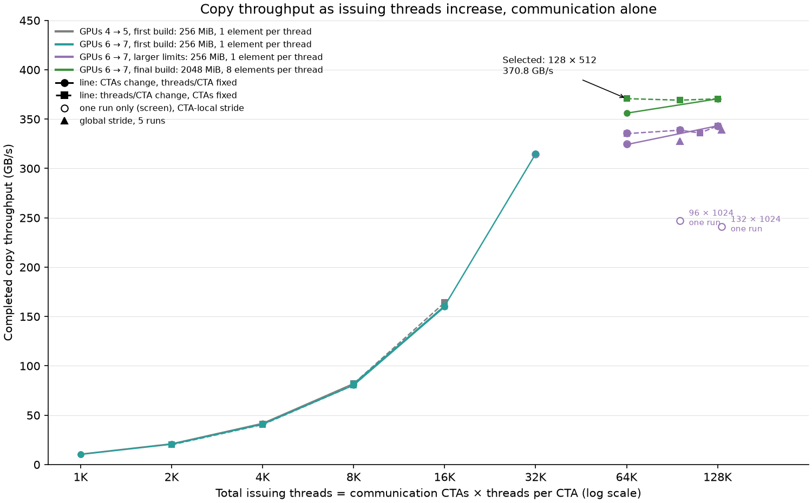

*Copy alone. X: communication CTAs × threads per CTA (log scale). Colour: calibration step (GPU pair, build, transfer size, elements per thread). Solid line with circles: CTAs change at fixed threads/CTA. Dashed line with squares: threads/CTA change at fixed CTAs. A line joins only runs from one sweep. Filled points: median of 5 runs, bars min–max (often smaller than the marker). Hollow circles: one run only. Triangles: global stride. Made by [plot_reference_selection.py](../../common/scripts/plot_reference_selection.py) from the saved run tables.*

| Step | Communication CTAs × threads/CTA | Transfer size, elements/thread | Median GB/s (min–max of 5 runs) |
|---|---|---|---|
| 1 (GPUs 4 → 5) | 4 × 256 / 32 × 256 / 32 × 512 | 256 MiB, 1 | 10.59 / 82.04 / 164.13 (163.86–164.23) |
| 2 (GPUs 6 → 7) | 4 × 256 / 32 × 256 / 32 × 512 | 256 MiB, 1 | 10.32 / 80.51 / 160.79 (160.70–161.15) |
| 2 | 64 × 256 / **64 × 512** | 256 MiB, 1 | 159.83 / **314.83** (314.60–315.30) |
| 3 | 128 × 512 / 128 × 768 / 128 × 896 / 128 × 1024 | 256 MiB, 1 | 335.33 / 338.77 / 335.91 / 343.23 (343.01–343.49) |
| 3 | 64 × 1024 | 256 MiB, 1 | 324.23 (323.86–324.98) |
| 3, global stride | 96 × 1024 / 132 × 1024 | 256 MiB, 1 | 327.85 / 339.26 |
| 3, one run, CTA-local | 96 × 1024 / 132 × 1024 | 256 MiB, 1 | 247.19 / 240.88 |
| 4, one run each | 128 × 1024 | 256 / 512 / 1024 / 2048 MiB, 1 | 342.85 / 356.81 / 364.03 / 367.74 |

Full per-run tables: `results/2026-10-27/runs.csv` (step 1), `results/2026-10-27-gpu6-7/runs.csv` (step 2), [results/2026-10-27-saturation-gpu6-7/runs.csv](results/2026-10-27-saturation-gpu6-7/runs.csv) (steps 3–5, with issue, ordering and acknowledgement times).

**Final checks at the top of the curve.** Step 5, GPUs 6 → 7, final build, CTA-local stride. Each row: median of 5 runs, with min–max. Bold row: selected reference.

| Communication CTAs × threads/CTA | Transfer size | Elements/thread | Median GB/s (min–max) | Transfer time µs | Issue loop µs | Ordering µs | Acknowledgement wait µs |
|---|---|---|---|---|---|---|---|
| **128 × 512** | 2048 MiB | 8 | **370.75** (370.66–370.86) | 5792.2 | 5599.2 | 9.9 | 180.3 |
| 128 × 768 | 2048 MiB | 8 | 369.21 (369.13–369.40) | 5816.5 | 5616.1 | 11.2 | 187.6 |
| 128 × 1024 | 2048 MiB | 8 | 370.53 (370.43–370.63) | 5795.6 | 5607.9 | 9.2 | 176.0 |
| 128 × 1024 | 2048 MiB | 1 | 367.76 (367.72–367.89) | 5839.4 | 5624.4 | 22.9 | 190.8 |
| 128 × 1024 | 2048 MiB | 2 | 368.84 (368.71–369.06) | 5822.3 | 5617.3 | 16.9 | 185.8 |
| 128 × 1024 | 2048 MiB | 4 | 370.02 (369.93–370.09) | 5803.7 | 5608.7 | 10.7 | 181.0 |
| 128 × 1024 | 4096 MiB | 8 | 371.73 (371.51–371.79) | 11554.1 | 11225.4 | 9.6 | 321.2 |
| 64 × 1024 | 2048 MiB | 8 | 356.04 (355.95–356.11) | 6031.6 | 5612.1 | 8.2 | 406.7 |

Times are medians over CTAs and runs. The issue loop includes source loads, stores and waiting caused by the memory system or link; phase times do not add up to the transfer time.

| Change at 128 CTAs (everything else fixed) | Median change within a round |
|---|---|
| 512 → 768 threads/CTA (2048 MiB, 8 elements) | −0.43% |
| 768 → 1024 threads/CTA (2048 MiB, 8 elements) | +0.35% |
| 2 → 4 elements/thread (1024 threads/CTA, 2048 MiB) | +0.31% |
| 4 → 8 elements/thread (1024 threads/CTA, 2048 MiB) | +0.13% |
| 2048 → 4096 MiB (1024 threads/CTA, 8 elements) | +0.31% |

### Interpretation

- **At low thread counts the copy is limited by its own threads.** Up to 32K issuing threads, doubling CTAs or doubling threads/CTA doubles throughput, on both GPU pairs (they differ by about 2–3%). In this range a copy that does not slow under contention may simply not be asking for much.
- **Throughput stops rising at about 370 GB/s.** At 128 CTAs with 8 elements per thread and 2048 MiB, 512, 768 and 1024 threads/CTA lie within 0.42% of each other. More elements per thread and a twice-longer transfer each add less than 1%. This meets the stopping rule.
- **The dips at 96 and 132 CTAs are about how work is split, not a limit.** With CTA-local stride, those CTA counts give uneven, badly aligned regions (one run each: about 247 and 241 GB/s). Global stride at the same counts gives 328 and 339 GB/s. This was not investigated further; 128 CTAs avoids it.
- **The flat region is a property of this program, not proof of a hardware limit.** It does not show that HBM, L2 or NVLink is full. No hardware counter was used.

**Selected reference:** source **128 CTAs × 512 threads/CTA**, **2048 MiB**, **8 elements per thread**, **CTA-local stride**, destination control **1 × 512**, no reads: **370.75 GB/s**. Later tests must use this full setting, the same build, and their own fresh copy-only runs. The earlier source-arithmetic and source-read tests used 32 × 256, 256 MiB, 1 element per thread, and are not covered by this reference.

### Validation and retained evidence

- **Probe cost.** At the selected setting, detailed timing probes change throughput by a median +0.020% compared with minimal probes (five adjacent pairs). Both modes keep start/end and correctness records.
- **Accepted data for steps 3–5.** 121 runs and 1452 transfers; every transfer passed the full destination check and the placement and timing checks. The generated code keeps scalar stores and has no register spills.
- **Rejected attempt.** Probe checks were once started while the last confirmation round was still running, so two jobs overlapped on GPUs 6–7. All eight round-5 confirmation runs and all probe runs of that attempt were excluded, kept locally under `results/2026-10-27-saturation-gpu6-7/batch/raw/rejected_overlap/`, and run again one at a time ([rejected-run summary](results/2026-10-27-saturation-gpu6-7/batch/rejected_runs_summary.json)). The run wrapper now takes a lock per GPU before its idle check. No accepted runs overlap.
- **What is in Git.** Configs, scripts, build hashes, summary tables and figures. Raw JSON, telemetry, logs, source snapshots and instruction dumps stay local; each step's source and binary hashes are recorded, and earlier binaries are kept locally as `common/bin/push_harness_before_*`. Reproducing an earlier step needs that step's build, not the latest one. The earlier figures (`baseline.png`, `communication_alone.png`, `scaling_overview.png`, `calibration_steps.png`, `plateau.png`) remain in their results folders but are replaced here by the figure and tables above.

## Arithmetic on separate source SMs

### Motivation

Test whether arithmetic activity elsewhere on the issuing GPU affects communication even though its CTAs retain dedicated SMs. A slowdown could motivate investigation of GPU-wide operating state; this setup does not inject direct sharing of communication SM registers or issue slots.

### Setup

**Controlled independent variable:** source arithmetic co-runner CTA count M. Each pressure level is paired with M=0 using identical communication geometry and resource reservation; achieved arithmetic rate is a measured response.

| Configuration knob | Role | Values / fixed setting |
|---|---|---|
| **Arithmetic co-runner CTA count M** | **Independent variable** | Reference: 0 co-runner CTAs (inactive); pressure: **8** CTAs × 256 threads/CTA, **32** CTAs × 256 threads/CTA, **100** CTAs × 256 threads/CTA |
| Co-runner location | Constant | Source GPU 4, on SMs separate from communication |
| Co-runner arithmetic | Constant | FP32 FMA; eight independent accumulators; 256 rounds per work unit; checksum retained |
| Threads per co-runner CTA | Constant | 256 |
| Communication geometry and traversal | Constants | 32 CTAs × 256 threads; CTA-local stride |
| Intentional bulk co-runner memory traffic | Constant | None |
| Destination role | Constant | Receiver/control only; no read co-runner |
| Binary revision | Constant within each comparison | Initial scalar-campaign binary |
| Repetitions | Constant | Five interleaved M=0 / M>0 invocation pairs per level |
| Standalone control | Separate calibration arm | Same arithmetic workload/reservation with the copy disabled; five retained 20 ms windows |
| Other communication/device settings | Constants | Shared settings above |
| Configuration files | Configuration mapping | `healthy.cfg`, `compute_{8,32,100}.cfg`, corresponding `_solo.cfg` files |

### Method

Five interleaved healthy/perturbed pairs per level, three warm-ups and twelve retained transfers per invocation; a separate co-runner-alone invocation per level uses five 20 ms windows. Timers record issue, all-writer ordering, publication, acknowledgement observation, and eight issue-progress checkpoints. SM IDs and readiness/stop intervals validate placement and coverage. The initial compiler report has 40 registers and zero spills for the fused kernel. Profiling validation is reported separately below.

### Results

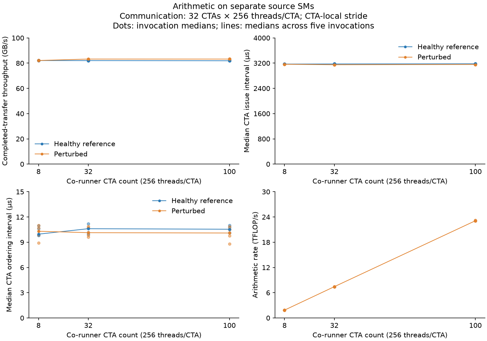

| Communication (CTAs × threads/CTA; traversal) | Co-runner geometry H → P (CTAs × threads/CTA) | Healthy throughput (GB/s) | Perturbed throughput (GB/s) | Paired throughput change | Issue interval H → P (µs) | Ordering interval H → P (µs) | Achieved co-runner rate |
|---|---:|---:|---:|---:|---:|---:|---:|
| 32 × 256; CTA-local stride | 0 × 256 (inactive) → 8 × 256 | 82.06 | 82.10 | +0.04% | 3170.82 → 3164.29 | 9.96 → 10.30 | 1.86 |
| 32 × 256; CTA-local stride | 0 × 256 (inactive) → 32 × 256 | 82.02 | 83.23 | +1.50% | 3173.45 → 3149.18 | 10.61 → 10.14 | 7.43 |
| 32 × 256; CTA-local stride | 0 × 256 (inactive) → 100 × 256 | 81.89 | 83.22 | +1.60% | 3180.00 → 3157.77 | 10.54 → 10.10 | 23.11 |

Rates are logical achieved arithmetic work in TFLOP/s. Phase values are medians of invocation medians; throughput change is the median of the five paired relative changes. The complete standardized effect and range fields are retained in `comparisons.json`.

### Interpretation

- **No degraded communication case was established by this arithmetic injection.** Throughput changes are approximately +0.04%, +1.50%, and +1.60% as arithmetic activity rises to about 23 TFLOP/s. The larger effects are improvements in throughput, not evidence of degradation.
- **Placement and activity validate the control.** The co-runner is active over the measured interval on distinct SMs and generated arithmetic is retained without spills. This is stronger evidence of a tested negative case than relying on a configured CTA count.
- **Short kernel overlap does not establish sustained power/thermal behavior.** Source sampled maximum SM clock is 1980 MHz with and without pressure, but coarse telemetry includes setup and misses exact transfer phases. No clock-causal explanation is established for the small improvements, and long preheated workloads are outside this session.

## Rate-controlled memory reads: shared method

The two memory sections below start with tests that use the rate-controlled memory co-runner. This section describes what both have in common. [Plan](04_shared_resource_contention.md#memory-pressure-with-the-rate-controlled-co-runner-revision-2026-10-28) · [Co-runner calibration](../../../../h100x1/memory_co_runner/calibration/hbm_read_rate/README.md) · [Configs](configs/rate_pressure/) · [Results](results/2026-10-28-rate-pressure/)

### The co-runner

| Item | Setting |
|---|---|
| Pressure CTAs | 24 CTAs × 1024 threads/CTA, on the GPU under test; thread 0 starts bulk copies (TMA) of 64 KiB chunks from a separate 1 GiB buffer, 3 chunks in flight; thread 32 watches the stop signal; the other threads are idle |
| **The knob: target read rate** | **20, 40, 60, 80% of HBM peak** (3352 GB/s): 670, 1341, 2011, 2682 GB/s, with 24 pressure CTAs; **95%** (3185 GB/s) with **48** pressure CTAs, because 24 CTAs stop at about 91% |
| Reference | The same 24 pressure CTAs, started but idle (they read nothing) |
| Shared memory | 196,864 bytes for every CTA on both GPUs in every run, including references |
| Copy | 2048 MiB; 8 elements loaded per thread before storing; CTA-local stride; all-writer fence, publication, acknowledgement; full destination check after every transfer |

The read rate is counted from the chunks the co-runner finished (requested bytes over its active time). It is not hardware-counted HBM traffic.

### Matched pairs inside one run

**Finding that changed the method.** When the copy uses 64 CTAs next to 24 pressure CTAs, the GPU puts the copy CTAs on a different set of SMs in each run (process), but on the same set for all launches of that run. The copy throughput follows that placement:

| Copy SM set | Runs (copy 64 CTAs × threads/CTA, idle pressure CTAs) | Copy GB/s |
|---|---|---|
| A | 64 × 512 two runs; 64 × 768 one run | 341.6, 342.0; 349.7 |
| B | 64 × 512 three runs | 370.7, 370.5, 370.4 |
| C | 64 × 768 one run; 64 × 1024 one run | 370.0; 371.9 |
| D | 64 × 768 one run; 64 × 1024 one run | 354.6; 359.3 |

Across the 20 paired runs of the source test there were 7 different copy SM sets. The reference level ranged from 341.7 to 371.2 GB/s between runs, but at most 0.62 GB/s between runs with the same SM set. Within one transfer, the 64 copy CTAs finish their issue loops between about 2.1 and 6.3 ms; the slowest CTAs set the copy time. Why some SM sets are slower is not known from these data.

A comparison of two separate runs could therefore differ by up to 8% from placement alone. So, unlike the plan, the main comparison does not pair separate runs. **Each run alternates launches: idle, reading, idle, reading, …** (or reading first in every other run), 4 warm-ups and 12 measured transfers. Each run gives one matched pair: the median of its 6 reading transfers against the median of its 6 idle transfers, on the same SMs and buffers. Five runs per target level, levels in rotated order. The 128-CTA copy of the destination test covers almost every SM and always used the same SM set; it uses the same alternation for consistency.

### Runs and checks

- **GPUs.** The two experiments ran at the same time on two different allocated GPU pairs, each experiment entirely on one pair. Each host process was bound to the CPU socket of its GPUs. The pairs share only the NVLink switch fabric; each copy moves about 370 GB/s.
- **Build checks.** Against the previous build at 128 × 512 (no co-runner, default shared memory), the final build gives 370.65 GB/s and the previous build 370.86 GB/s (3 runs each), a −0.06% difference. The copy-only calibration ran on an earlier build of the same day that differed only in host code and in one configuration field at the end of the config record; the final build was checked separately.
- **Every record** passed the full destination check, the read checksum, the distinct-SM check, and (for reading launches) the check that every pressure CTA was active during the whole copy. No two runs overlapped on one pair. Memory clock 2619 MHz in every sample; SM clock up to 1980 MHz; power at most 172 W; clock-event masks 0x0 and 0x1 only.
- **Counts.** Source test: 133 runs, 1164 transfers, 215 reads-only windows. Destination test: 120 runs, 948 transfers, 275 reads-only windows. These include the 95% level and its screen.
- **The 95% level.** A screen of reads alone (copy off, one run each) with 32, 40 and 48 pressure CTAs found that no setting reaches exactly 95% in the fused kernel; 48 CTAs with the 95% target gave 3149 GB/s (source GPU) and 3159 GB/s (destination GPU), about 94%. The same 48-CTA setting is used on both GPUs. Its reference uses the same 48 CTAs, idle, in the same run.
- **Not done:** separate Nsight Systems timelines (plan step 7) and hardware memory counters.

## Memory reads on separate source SMs

### Rate-controlled reads on the source GPU

#### Motivation

The copy reads its 2048 MiB source array from the source GPU's memory. Does it slow down when other SMs on the same GPU read memory at a known, rising rate? Earlier source tests (below) reached only about 30% of HBM peak next to the copy, with a much weaker copy.

#### Setup

| Knob | Role | Setting |
|---|---|---|
| **Target read rate on the source GPU** | **Independent variable** | **20, 40, 60, 80% of HBM peak** with 24 pressure CTAs; **95%** with 48 pressure CTAs; reference: the same pressure CTAs, idle, in the same run |
| Copy | Constant, chosen by calibration | **64 CTAs × 512 threads/CTA**, 2048 MiB, 8 elements per thread, CTA-local stride |
| Source pressure CTAs | Constant within a level | 24 × 1024 threads/CTA (20–80%) or 48 × 1024 threads/CTA (95%); 3 × 64 KiB in flight |
| Destination | Constant | 1 control CTA × 512 threads/CTA; no destination pressure |
| Pairs | Constant | 5 alternating runs per target (6 idle + 6 reading transfers each) |

**Choosing the copy setting.** 128 copy CTAs plus 24 pressure CTAs do not fit in 132 SMs, so the copy had at most 108 CTAs. Copy alone next to 24 idle pressure CTAs, 5 runs each:

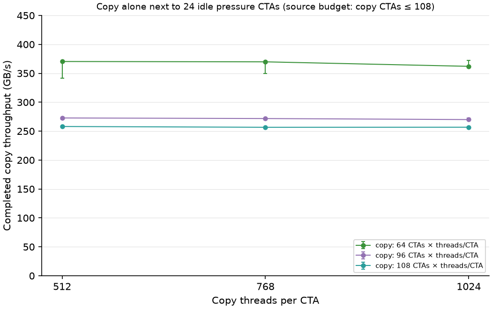

| Copy CTAs × threads/CTA | Median GB/s (min–max of 5 runs) |
|---|---|
| **64 × 512** | **370.40** (341.58–370.68) |
| 64 × 768 | 369.81 (349.66–370.04) |
| 64 × 1024 | 362.05 (359.30–371.92) |
| 96 × 512 / 768 / 1024 | 272.79 / 271.79 / 270.00 |
| 108 × 512 / 768 / 1024 | 258.06 / 256.66 / 256.78 |

64 × 512 has the highest median, and adding threads does not raise it, so it is the selected copy. 96 and 108 CTAs are much slower: with CTA-local stride their regions are uneven, the same effect seen at 96 and 132 CTAs in the reference selection. The wide min–max at 64 CTAs is the SM-placement effect described in the shared method.

#### Method

As in the shared method: alternating runs; reads alone (copy off, the 64 control CTAs only time a 20 ms window) at each target, 5 runs; a check of 5 adjacent pairs of runs with no pressure CTAs versus idle pressure CTAs; duration-matched reads-only versus reads-with-copy pairs at 80%; minimal versus detailed probes at 80%.

#### Results

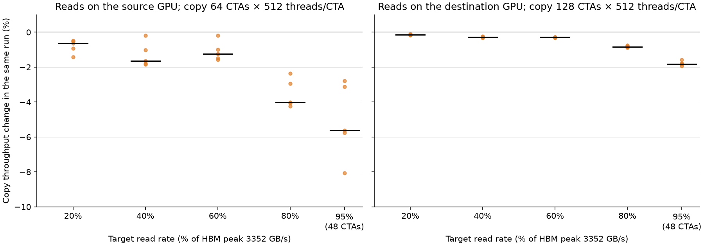

*Each dot: one run, copy throughput of its reading launches versus its idle launches, in percent. Bar: median of the 5 runs.*

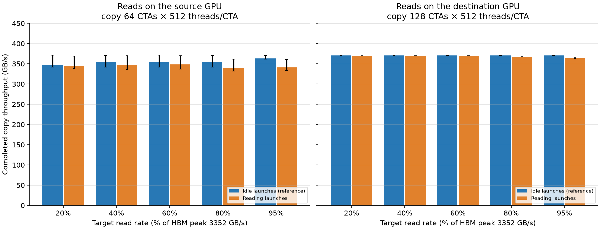

*Bars: median over 5 runs of each run's median; whiskers: min–max over runs. The wide source whiskers are run-to-run SM placement, not noise inside a run.*

All rows: copy 64 × 512, 2048 MiB, 8 elements per thread, CTA-local stride; source pressure 3 × 64 KiB in flight per CTA, 24 × 1024 (20–80%) or 48 × 1024 (95%); destination control 1 × 512.

| Target read rate | Achieved reads next to the copy, GB/s (% of peak) | Copy, idle launches, GB/s (min–max over runs) | Copy, reading launches, GB/s | Change in the same run, median (min to max) | Runs slower |
|---|---|---|---|---|---|
| 20% | 669.8 (20.0%) | 347.29 (341.74–371.20) | 345.50 | −0.64% (−1.42 to −0.48) | 5/5 |
| 40% | 1340.4 (40.0%) | 354.03 (341.98–370.78) | 347.51 | −1.66% (−1.84 to −0.18) | 5/5 |
| 60% | 2010.0 (60.0%) | 354.43 (341.94–371.16) | 348.83 | −1.25% (−1.58 to −0.19) | 5/5 |
| 80% | **2389.8 (71.3%)**, runs 2093–2518 | 353.90 (342.04–370.63) | 339.11 | **−4.02%** (−4.24 to −2.36) | 5/5 |
| 95% (48 CTAs) | **2749.9 (82.0%)**, runs 2495–2801 | 363.17 (361.42–371.03) | 341.10 | **−5.62%** (−8.06 to −2.78) | 5/5 |

The reference spread between runs comes from SM placement, so a standardized effect (difference ÷ spread of the reference between runs) would mostly measure placement; the change inside each run is the meaningful number. Slowest 5% of transfers at 80%: 341.8 GB/s idle, 331.8 GB/s reading; slowest transfer 341.6 and 330.5 GB/s. At 95%: 361.0 and 333.4 GB/s; slowest transfer 361.0 and 332.8 GB/s.

**Where the extra time goes** (median CTA times, idle → reading launches, at 80%):

| Phase | Idle launches | Reading launches | Change |
|---|---|---|---|
| Issue loop | 5460 µs | 5502 µs | +0.8% |
| Ordering (fence) | 8.95 µs | 14.34 µs | +57% |
| Acknowledgement wait | 577 µs | 785 µs | +29% |
| Spread of issue-loop end times across CTAs | 3701 µs | 2808 µs | −24% |

At 95% (48 pressure CTAs): issue loop 5124 → 5304 µs (+1.9%), ordering 9.4 → 27.2 µs (+183%), acknowledgement wait 801 → 1050 µs (+31%), spread of issue-loop end times 3586 → 1946 µs (−47%).

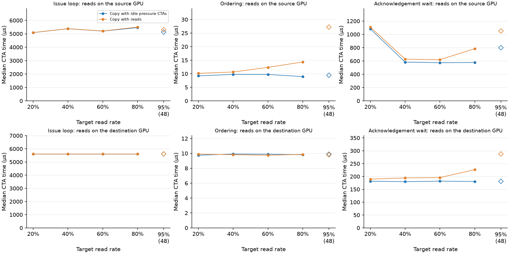

At 20–60%, ordering grows by 8–28% and acknowledgement wait by 4–8%; the issue loop changes by at most +0.2%. Full tables: `phases.csv` in `results/2026-10-28-rate-pressure/source/`. Phase medians do not add up to the transfer time.

**Read side (secondary).**

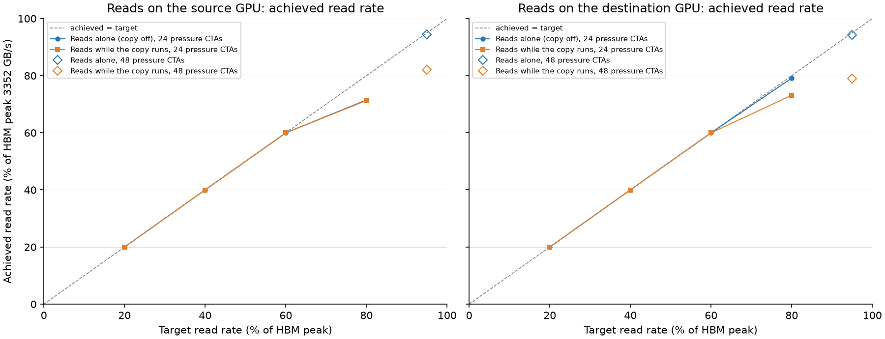

| Target | Reads alone (copy off), GB/s | Reads next to the copy, GB/s |
|---|---|---|
| 20% (670) | 670.0 | 669.8 |
| 40% (1341) | 1340.8 | 1340.4 |
| 60% (2011) | 2010.7 | 2010.0 |
| 80% (2682) | 2396.1 (runs 2188–2543) | 2389.8 (runs 2093–2518) |
| 95% (3185), 48 CTAs | 3163.9 (94.4%; runs 3030–3164) | 2749.9 (82.0%; runs 2495–2801) |

Up to 60% the reads reach their target, alone and next to the copy. At 80% they fall short **even with the copy off**. In these runs the 24 pressure CTAs land on neighbouring SMs (for example SMs 4, 5, 6, 7, 20, 21), and each reaches only about 86–111 GB/s; 80% needs about 112 GB/s per CTA. The same placement gives the same shortfall with and without the copy (2188 and 2093 GB/s). In the destination test the pressure CTAs spread over every second SM and reach 2652 GB/s alone. With 48 pressure CTAs (95% target) the reads reach 94.4% alone but only 82.0% while the copy runs: here the reads clearly give way to the copy.

**Other checks.** No pressure CTAs versus idle pressure CTAs, 5 pairs of separate runs: 346.94 versus 370.83 GB/s. All five runs without pressure CTAs had the same slow level (346.9–347.0), and four of five idle runs the fast level. This is a placement difference between the two launch sizes, so this check cannot show the effect of idle CTAs alone. Duration-matched reads at 80% (separate runs): 2525.2 GB/s alone versus 2092.7 GB/s with the copy (median −14.8%, runs −20.2% to −1.3%); because pressure-CTA placement also changes between runs, this number is not reliable. Detailed versus minimal probes (separate runs): +8.3% median (−0.5% to +9.6%), also dominated by placement, so it is not a probe-cost estimate; the destination test gives that estimate below.

#### Interpretation

- **The copy slows down in every run, and more at higher read rates.** The change inside each run is −0.6% at 20%, about −1.3% to −1.7% at 40–60%, −4.0% at 80% (reads reached 71% of peak), and −5.6% at 95% with 48 pressure CTAs (reads reached 82% next to the copy, 94% alone). All 25 runs are slower with reads than without. This is the largest communication slowdown measured in this experiment so far; one 95% run lost 8.1%.
- **The extra time is mostly in finishing, not in issuing.** The issue loop changes by less than 1% up to 80% and by 1.9% at 95%. Ordering and acknowledgement waiting grow (+57% and +29% at 80%; +183% and +31% at 95%). Reads on the source change when the copy's last writes and its completion signal finish, more than how fast CTAs issue loads and stores. Why is not shown by these timers.
- **Where the copy CTAs sit matters as much as the reads.** SM placement alone changes the copy by up to 8% between runs, more than the 80% read pressure. Runs on "fast" SM sets also slowed less at 40–60% (−0.2% to −1.0%) than runs on "slow" sets (−1.2% to −1.8%); with 5 runs per level this is an observation, not a result.
- **The co-runner's own placement limits it.** Next to 64 copy CTAs, the strongest level (80%) was not reached even without the copy. The achieved rate, not the target, is the pressure that was applied.
- **Not shown:** which memory-system part causes the slowdown. No hardware counters were collected; requested read bytes are not counted HBM bytes.

### Earlier plain-load tests on GPUs 4 → 5

These are the earlier tests: copy 32 × 256, 256 MiB, 1 element per thread, plain-load reads with CTA count as the knob, GPUs 4 → 5. A revision with role-specific thread counts calibrated plain-load reads on 2026-10-27 to 2026-10-28 (records under `results/2026-10-27-source-memory-gpu6-7/`, no paired runs); it was replaced by the rate-controlled test above.

#### Motivation

Local source reads could compete with communication's input loads or other shared issuing-endpoint resources. The observation question is whether source supply waiting can be separated from reflected destination backpressure. Logical co-runner throughput must first validate the pressure actually generated.

#### Setup

**Controlled independent variable:** source read co-runner CTA count M in the main comparisons. Read implementation and pacing are separate controlled comparisons, each with its own matched reference; achieved read rate is measured rather than prescribed.

| Configuration knob | Role | Values / fixed setting |
|---|---|---|
| **Source read CTA count M** | **Independent variable in the main comparisons** | Reference: 0 co-runner CTAs (inactive); pressure: **8** CTAs × 256 threads/CTA, **32** CTAs × 256 threads/CTA, **100** CTAs × 256 threads/CTA; additional scalar calibration at 16 CTAs × 256 threads/CTA and 64 CTAs × 256 threads/CTA |
| **Read implementation** | **Controlled variant, analyzed separately** | **Scalar 4-byte reads; vector 16-byte reads with four checksum chains and four-way unrolling** |
| **Pacing rounds per burst P** | **Independent variable in the separate pacing sweep** | **0, 64, 256, 1024** at fixed M=100; P=0 in main comparisons |
| Co-runner location | Constant | Source GPU 4, on SMs separate from communication |
| Working set / partitioning | Constants | Disjoint 1 GiB array; contiguous region per read CTA; checksum consumes reads |
| Read-burst size / CTA size | Constants | 256 KiB logical bytes per burst; 256 threads/CTA |
| Communication geometry and traversal | Constants | 32 CTAs × 256 threads; CTA-local stride; scalar communication unchanged |
| Destination role | Constant | Receiver/control only, no destination co-runner |
| Binary revision | Constant within each comparison | Initial binary for scalar reads; revised binary for vector reads; references remeasured per binary |
| Repetitions | Constant | Five interleaved M=0 / M>0 pairs per main level; shared primary sampling |
| Standalone control | Separate calibration arm | Same read workload/reservation with the copy disabled; five retained 20 ms windows |
| Other communication/device settings | Constants | Shared settings above |
| Configuration files | Configuration mapping | `source_memory_*.cfg`, `vector_source_memory_*.cfg`, corresponding `_solo.cfg` and pacing configs |

#### Method

Each level uses five interleaved pairs and standalone co-runner controls. The scalar campaign additionally calibrates 16 and 64 CTAs; optional pacing runs use 64, 256, or 1024 arithmetic rounds per 256 KiB burst. Read work is counted and consumed in checksums. The scalar co-runner's limited achieved request rate motivates the recorded vector refinement; its revised binary uses freshly measured healthy references. Initial and revised phase times are not pooled across binary revisions.

#### Results

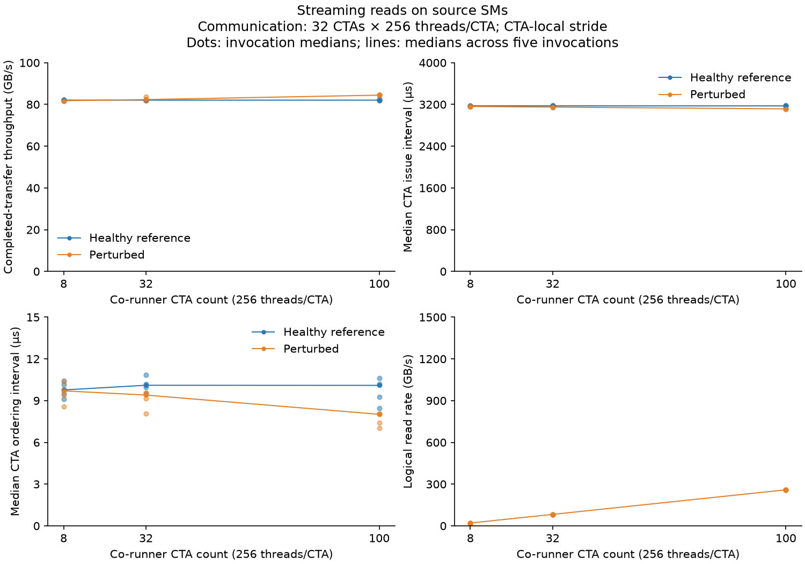

| Communication (CTAs × threads/CTA; traversal) | Co-runner geometry H → P (CTAs × threads/CTA) | Healthy throughput (GB/s) | Perturbed throughput (GB/s) | Paired throughput change | Issue interval H → P (µs) | Ordering interval H → P (µs) | Achieved co-runner rate |
|---|---:|---:|---:|---:|---:|---:|---:|
| 32 × 256; CTA-local stride | 0 × 256 (inactive) → 8 × 256 | 82.06 | 81.78 | -0.41% | 3172.88 → 3160.84 | 9.77 → 9.70 | 20.48 |
| 32 × 256; CTA-local stride | 0 × 256 (inactive) → 32 × 256 | 82.04 | 82.32 | +0.50% | 3172.22 → 3148.78 | 10.10 → 9.40 | 82.42 |
| 32 × 256; CTA-local stride | 0 × 256 (inactive) → 100 × 256 | 82.05 | 84.44 | +2.97% | 3171.98 → 3114.66 | 10.10 → 8.02 | 259.00 |

Logical read rates are GB/s over the co-runner active interval, including startup and tail. They are not physical HBM bytes or a claim of saturated source memory.

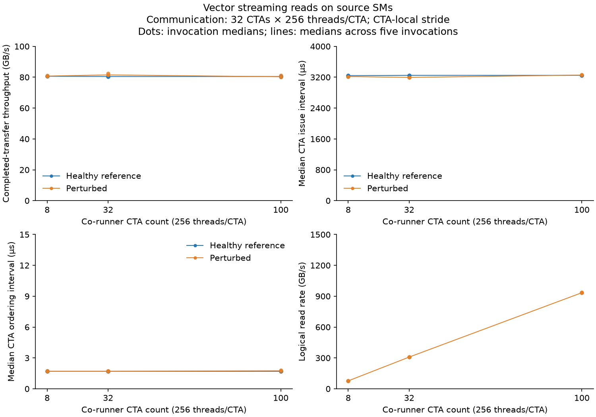

| Communication (CTAs × threads/CTA; traversal) | Co-runner geometry H → P (CTAs × threads/CTA) | Healthy throughput (GB/s) | Perturbed throughput (GB/s) | Paired throughput change | Issue interval H → P (µs) | Ordering interval H → P (µs) | Logical read rate (GB/s) |
|---|---:|---:|---:|---:|---:|---:|---:|
| 32 × 256; CTA-local stride | 0 × 256 (inactive) → 8 × 256 | 80.60 | 80.73 | +0.16% | 3241.06 → 3218.48 | 1.70 → 1.71 | 77.04 |
| 32 × 256; CTA-local stride | 0 × 256 (inactive) → 32 × 256 | 80.45 | 81.50 | +1.40% | 3248.34 → 3194.74 | 1.70 → 1.71 | 308.42 |
| 32 × 256; CTA-local stride | 0 × 256 (inactive) → 100 × 256 | 80.46 | 80.29 | -0.14% | 3248.57 → 3255.41 | 1.70 → 1.75 | 934.12 |

At 100 CTAs, the vector injector achieves about 934 GB/s logical reads; the median paired communication change is −0.14%. This is a small negative effect, not a demonstrated severe degraded case. All source co-runner intervals cover the source communication interval. Source code semantics of the copy are unchanged, but the revised compiled fused kernel has a different baseline; only same-binary paired references are used.

#### Interpretation

- **The scalar injector does not establish strong source contention.** At 100 CTAs it achieves about 259 GB/s logical reads while communication throughput increases by about 3%; the issue interval shortens and the ordering interval does not grow. Increasing CTA count alone would have mislabeled this as a severe degradation case.
- **Actual achieved demand belongs in the observation plane evaluation.** Work counts, overlap, and endpoint counters are needed to distinguish an ineffective injector from communication that tolerates the tested demand. They expose pressure, not automatically a fault.
- **The vector injector generates more demand without a large copy slowdown.** Its achieved logical read rate rises by roughly 3.6× over the scalar 100-CTA case, yet acknowledged transfer throughput remains close to its same-binary reference. A missing slowdown cannot be attributed to absent overlap, but also does not prove memory-resource independence.
- **The refined binary needs its own reference.** Adding vector co-runner code changes the fused kernel's register allocation (54 registers, zero spills) and its baseline issue/ordering timing, despite preserving communication source semantics. Matched controls prevent that compiler effect from being counted as injected interference.

## Memory reads on the destination GPU

### Rate-controlled reads on the destination GPU

#### Motivation

Incoming peer stores land in the destination GPU's memory. Does the copy slow down when other SMs on the destination read memory at a known, rising rate? The plain-load test below changed read CTAs, not a rate, and showed at most −0.12% copy change while its reads slowed by about 21%.

#### Setup

| Knob | Role | Setting |
|---|---|---|
| **Target read rate on the destination GPU** | **Independent variable** | **20, 40, 60, 80% of HBM peak** with 24 pressure CTAs; **95%** with 48 pressure CTAs; reference: the same pressure CTAs, idle, in the same run |
| Copy | Constant | **128 CTAs × 512 threads/CTA**, 2048 MiB, 8 elements per thread, CTA-local stride; no source pressure |
| Destination pressure CTAs | Constant within a level | 24 × 1024 threads/CTA (20–80%) or 48 × 1024 threads/CTA (95%); 3 × 64 KiB in flight |
| Destination control | Constant | 1 CTA × 512 threads/CTA, on its own SM |
| Pairs | Constant | 5 alternating runs per target (6 idle + 6 reading transfers each) |

**Confirming the copy setting under the larger shared memory**, with 24 idle pressure CTAs, 5 runs each: 128 × 512 gives 370.62 GB/s (370.41–370.78) and 128 × 1024 gives 370.40 GB/s (370.26–370.47). They differ by less than 1%, so 128 × 512 is kept.

#### Method

As in the shared method. Reads alone: copy off, the source's 128 control CTAs only time a 20 ms window, 5 runs per target. Also: 5 pairs of runs with no pressure CTAs versus idle pressure CTAs; duration-matched reads-only versus reads-with-copy pairs at 80%; minimal versus detailed probes at 80%.

#### Results

The figures are the right-hand panels of the figures in the source section above.

All rows: copy 128 × 512, 2048 MiB, 8 elements per thread, CTA-local stride; destination pressure 3 × 64 KiB in flight per CTA, 24 × 1024 (20–80%) or 48 × 1024 (95%); destination control 1 × 512.

| Target read rate | Achieved reads next to the copy, GB/s (% of peak) | Copy, idle launches, GB/s (min–max over runs) | Copy, reading launches, GB/s | Change in the same run, median (min to max) | Runs slower |
|---|---|---|---|---|---|
| 20% | 669.8 (20.0%) | 370.64 (370.46–370.67) | 370.05 | −0.14% (−0.17 to −0.10) | 5/5 |
| 40% | 1340.4 (40.0%) | 370.71 (370.62–370.89) | 369.72 | −0.28% (−0.32 to −0.23) | 5/5 |
| 60% | 2010.0 (60.0%) | 370.68 (370.51–370.83) | 369.55 | −0.29% (−0.33 to −0.29) | 5/5 |
| 80% | **2451.7 (73.1%)** | 370.62 (370.45–370.72) | 367.55 | **−0.83%** (−0.89 to −0.74) | 5/5 |
| 95% (48 CTAs) | **2645.0 (78.9%)** | 370.59 (370.44–370.69) | 363.93 | **−1.82%** (−1.94 to −1.57) | 5/5 |

The reference spread between runs is very small (IQR 0.11–0.23 GB/s), so a standardized effect would look large (for example −13.6 at 80%); in absolute terms the largest change is about 3 GB/s. Slowest 5% of transfers at 80%: 370.3 GB/s idle, 367.2 GB/s reading; at 95%: 370.0 and 362.9 GB/s.

**Where the extra time goes** (median CTA times, idle → reading launches):

| Target | Issue loop µs | Ordering µs | Acknowledgement wait µs | Receiver wait µs |
|---|---|---|---|---|
| 20% | 5600.9 → 5603.0 | 9.75 → 9.90 | 181.5 → 189.6 (+3.7%) | 5795.6 → 5804.8 |
| 40% | 5600.5 → 5602.2 | 9.91 → 9.82 | 179.7 → 194.3 (+7.3%) | 5794.5 → 5810.0 |
| 60% | 5600.8 → 5601.8 | 9.89 → 9.75 | 181.7 → 195.8 (+9.4%) | 5794.9 → 5812.6 |
| 80% | 5602.2 → 5602.1 | 9.82 → 9.86 | 180.5 → 226.4 (+25.8%) | 5795.8 → 5844.3 |
| 95% (48 CTAs) | 5601.0 → 5601.7 | 9.90 → 9.82 | 181.6 → 287.2 (+56.1%) | 5796.4 → 5902.4 |

**Read side (secondary).**

| Target | Reads alone (copy off), GB/s | Reads next to the copy, GB/s |
|---|---|---|
| 20% (670) | 670.0 | 669.8 |
| 40% (1341) | 1340.8 | 1340.4 |
| 60% (2011) | 2010.7 | 2010.0 |
| 80% (2682) | 2652.6 (79.1%) | 2451.7 (73.1%) |
| 95% (3185), 48 CTAs | 3162.3 (94.3%) | 2645.0 (78.9%) |

Duration-matched pairs at 80% (separate runs, same active time: 5858 µs alone, 5849 µs with the copy): reads alone 2650.8 GB/s, with the copy 2448.8 GB/s, median change **−7.62%** (−7.67% to −7.48%), 5/5 runs lower. At 95% (48 CTAs; 5921 µs alone, 5914 µs with the copy): 3156.4 GB/s alone, 2645.2 GB/s with the copy, **−16.2%** (−16.22% to −16.18%), 5/5 lower.

**Other checks.** No pressure CTAs versus idle pressure CTAs: 370.69 versus 370.60 GB/s, median change −0.03% (−0.05% to +0.01%), so the idle CTAs and the larger shared memory do not change the copy. Detailed versus minimal probes at 80%: +0.003% (−0.005% to +0.056%). Opening and closing references: 370.61 and 370.60 GB/s.

#### Interpretation

- **The copy slows down a little, in every run, and more at higher read rates.** −0.14%, −0.28%, −0.29% and −0.83% at 20, 40, 60 and 80%, and −1.82% at 95% with 48 pressure CTAs. All 25 runs are slower with reads. At 95% the drop is about 7 GB/s out of 371.
- **Only completion gets slower.** Issue loop and ordering do not change. The acknowledgement wait grows (+26% at 80%) and the receiver's wait grows by about 0.8%. Incoming stores are issued as fast as before; the time until the destination has seen all of them and answered grows. Whether the stores themselves arrive later or the receiver sees them later is not separated by these timers.
- **The reads give way more than the copy.** At 80% the reads lose 7.6% of their rate when the copy runs (2651 → 2449 GB/s), while the copy loses 0.8%. At 95% the reads lose 16.2% (3156 → 2645 GB/s) and the copy 1.8%; reads and copy together then use about 2645 + 364 ≈ 3010 GB/s, 90% of peak. Together they ask for about 2450 + 370 ≈ 2820 GB/s, 84% of peak. This matches the plain-load test below: the destination's local reads, not the incoming copy, take most of the loss.
- **The source sees more than the destination.** At similar achieved reads (about 71–73% of peak), the copy slows by about 4% with source reads and about 0.8% with destination reads. But the two tests use different copy settings (64 versus 128 CTAs) and the source effect also depends on placement, so this is not a clean comparison of locations.
- **Not shown:** which memory-system part limits the reads or delays completion. No hardware counters; requested read bytes are not counted HBM bytes.

### Plain-load reads at the selected communication reference

This was the primary destination result before the rate-controlled test above; it uses plain-load reads with read CTAs as the knob. The reference-selection stage above determines the communication configuration; calibration and pressure measurements together form this experiment.

#### Motivation

Earlier destination-pressure tests used communication settings whose throughput still increased with more issuing threads. This comparison uses the separately confirmed plateau and asks whether destination pressure now reduces communication performance.

#### Setup

| Knob | Role | Setting |
|---|---|---|
| Endpoint pair | Constant | Physical GPU 6 → GPU 7; H100 80 GB; 132 SMs each |
| Source communication | Constant | 128 CTAs × 512 threads/CTA; 2048 MiB; CTA-local stride; batch 8 independent scalar 4-byte operations |
| **Destination read count** | **Independent variable** | **0 (copy-only), 8, 32, 100, 131 CTAs × 512 threads/CTA** |
| Destination control | Constant | 1 CTA × 512 threads/CTA, one polling lane, separate SM from reads |
| Destination reads | Constant | Disjoint local 1 GiB buffer; vector loads; 256 KiB bursts; pacing 0 |
| Residency | Constant | One CTA per SM; 116736 dynamic shared bytes per CTA |
| Completion | Constant | All writers system-fence, CTA publication, destination observation and acknowledgement |
| Primary pairs | Constant | Five pairs per read setting; three warm-ups + twelve retained transfers per invocation; rotate level order |
| Read-only calibration | Separate control | Five invocations × five retained 20 ms windows per level; two warm-ups |
| Read-only matched pairs | Separate control | Five pairs per level; three warm-ups + twelve windows; source timer controls 128 × 512, destination control 1 × 512 |
| Probe overhead | Separate control | Five minimal/detailed pairs with reads 131 × 512 |

The exact per-run files are in [configs/saturated_contention_gpu6_7/](configs/saturated_contention_gpu6_7/); each records all fixed and varied knobs. The receiver uses one polling lane, and the read kernel uses four independent checksum chains with four-way unrolling.

#### Method

The binary and source hashes exactly match the successful batch calibration ([build_provenance.json](results/2026-10-27-saturated-contention-gpu6-7/build_provenance.json)). No CUDA code, clocks, or power settings changed. Reads-alone calibration precedes primary pairs. Each primary pressure run immediately follows its own copy-only reference. Read performance uses a separate set of adjacent reads-only / reads-with-copy pairs, with the solo timer set to the median concurrent read-active duration measured in the primary runs.

There are 112 accepted timing invocations, 864 retained transfers and 340 retained read-only windows. Every retained transfer passed full-payload verification. Recorded SM IDs show distinct SMs for all CTAs within each endpoint; every read CTA covers the full destination receiver interval and completes work. Host telemetry intervals confirm no accepted invocations overlap. Per-device locks guard runs. Raw JSON, snapshots and telemetry remain local under ignored `results/2026-10-27-saturated-contention-gpu6-7/raw/`; reproduction requires those files or rerunning the saved runner.

Results use medians of five invocation medians. Percentage changes are medians of the five paired percentage changes, so they need not equal the ratio of displayed grand medians. Reference IQR is across invocation medians. The standardized difference is (pressure median − reference median) / reference IQR; a small denominator can make a tiny practical change look large.

#### Results

Bars show medians of five invocation medians; whiskers show their minimum and maximum. Both axes start at zero.

All rows: source communication **128 × 512**, **2048 MiB**, **batch 8**, **CTA-local stride**; destination control **1 × 512**. Geometry notation means CTAs × threads/CTA. Copy-only references have destination reads **0 × 512**.

| Destination reads | Copy-only GB/s (min–max) | With reads GB/s | Paired change % (min–max) | Slower pairs | Reference IQR GB/s | Difference / IQR |
|---|---|---|---|---|---|---|
| 8 × 512 | 370.742 (370.646–370.757) | 370.634 | -0.021 (-0.035–-0.002) | 5/5 | 0.0604 | -1.78 |
| 32 × 512 | 370.708 (370.668–370.755) | 370.270 | -0.114 (-0.139–-0.071) | 5/5 | 0.0225 | -19.44 |
| 100 × 512 | 370.690 (370.543–370.720) | 370.338 | -0.092 (-0.095–-0.069) | 5/5 | 0.0369 | -9.58 |
| 131 × 512 | 370.706 (370.620–370.791) | 370.275 | -0.119 (-0.143–-0.084) | 5/5 | 0.0604 | -7.13 |

| Destination reads | Copy-only / with-reads p05 GB/s | Copy-only / with-reads minimum GB/s |
|---|---|---|
| 8 × 512 | 370.213 / 370.252 | 369.803 / 370.178 |
| 32 × 512 | 370.328 / 369.888 | 369.723 / 369.453 |
| 100 × 512 | 370.366 / 369.998 | 370.121 / 369.844 |
| 131 × 512 | 370.343 / 370.030 | 370.309 / 369.809 |

Transfer-level p05 and minima cover 60 retained transfers per arm and condition. They expose slow transfers rather than treating all within-invocation samples as independent repetitions.

| Destination reads | Completed duration µs, only / with reads | Issue-loop µs, only / with reads | Ordering µs, only / with reads | Acknowledgement wait µs, only / with reads |
|---|---|---|---|---|
| 8 × 512 | 5792.40 / 5794.08 | 5601.42 / 5598.90 | 9.92 / 9.82 | 179.61 / 181.23 |
| 32 × 512 | 5792.93 / 5799.78 | 5599.98 / 5600.42 | 9.93 / 9.84 | 181.09 / 185.62 |
| 100 × 512 | 5793.20 / 5798.72 | 5601.00 / 5600.74 | 9.85 / 9.81 | 180.42 / 186.63 |
| 131 × 512 | 5792.96 / 5799.70 | 5600.27 / 5601.61 | 9.83 / 9.98 | 179.02 / 185.51 |

Issue-loop duration includes source loads, posted stores, and synchronization; it is not individual remote-store latency. Phase medians do not add up to completed duration. Full phase/spread comparisons are in [phases.csv](results/2026-10-27-saturated-contention-gpu6-7/phases.csv).

Destination read performance follows. These are **separate, duration-matched pairs**, not the copy-only references above. Source communication geometry is still **128 × 512**, payload **2048 MiB**, batch **8**, CTA-local stride; the reads-only arm uses source timer controls **128 × 512** and no copy.

| Destination reads | 20 ms calibration GB/s | Matched reads-only GB/s | With copy GB/s | Paired read change % | Actual active duration µs, only / with copy |
|---|---|---|---|---|---|
| 8 × 512 | 146.18 | 146.09 | 133.03 | -8.95 | 5830.6 / 5811.7 |
| 32 × 512 | 575.95 | 575.43 | 476.55 | -17.19 | 5841.6 / 5820.3 |
| 100 × 512 | 1661.32 | 1659.38 | 1328.56 | -19.93 | 5842.5 / 5820.7 |
| 131 × 512 | 2069.15 | 2066.36 | 1636.45 | -20.81 | 5844.3 / 5823.5 |

Actual standalone read intervals are about 19–22 µs longer than concurrent intervals despite matching the requested timer; startup/tail and stop checks remain included. Logical read GB/s counts completed 256 KiB bursts over the union of read-CTA active intervals, including startup/tail. It is not measured physical HBM traffic. Read-only calibration still rises from 100 × 512 to 131 × 512. This tests the maximum available CTA count of the unchanged injector, not an established HBM-saturation point. Filling the available SMs is not proof of HBM saturation.

Detailed probes change completed duration by a median -0.005% at reads 131 × 512 (five paired invocations; range -0.044% to +0.020%). Opening and closing copy-only references are 370.726 and 370.747 GB/s.

#### Interpretation

- **Communication changes little, consistently.** All 20 pairs decrease, with median effects below 0.12%. At reads 131 × 512, throughput moves from 370.706 to 370.275 GB/s. Large IQR-normalized values reflect very stable references, not large practical regressions. These adjacent pairs always put copy-only first, so a systematic order effect is not excluded.
- **The destination workload shows the larger change.** At reads 131 × 512, logical reads fall from 2066.36 to 1636.45 GB/s (-20.81%). Every read CTA completes bursts and covers receiver activity. This is evidence of interaction in the concurrent workload even though communication changes little.
- **Separate copying from completion waiting.** At reads 131 × 512, median CTA issue time changes from 5600.27 to 5601.61 µs, while acknowledgement waiting changes from 179.02 to 185.51 µs. This suggests checking completion/control progress before blaming a large slowdown in the copy loop. CTA medians cannot precisely apportion total duration or establish a remote-store latency.
- **The physical bottleneck remains unresolved.** No validated simultaneous L2/DRAM hardware-counter collection is available from the earlier profiler attempts. These results cannot identify HBM saturation, arbitration policy, or exact transaction routing. Source phase changes alone do not uniquely locate contention. Candidate explanations include a communication limit elsewhere, unequal sharing of endpoint service, and read-kernel limits that leave capacity for incoming writes. Distinguishing them requires validated traffic/counter evidence or separate controlled changes to the read workload.

### Reproduction and profiling for the selected reference

The timing and profiling observations here apply to GPUs 6 → 7 with the selected 128 × 512, 2048 MiB, batch-8 copy. The later acquisition section preserves the initial GPU 4 → 5 profiler trials.

Run `python experiments/h100x2/thread_store/common/scripts/run_saturated_contention.py` on allocated, idle physical GPUs 6–7 with the calibrated binary. The runner resumes only matching configs and validates retained outputs; remove neither accepted records nor provenance to force a different binary into this campaign. Run `analyze_saturated_contention.py` using the analysis environment with matplotlib. [runs.csv](results/2026-10-27-saturated-contention-gpu6-7/runs.csv), [communication.csv](results/2026-10-27-saturated-contention-gpu6-7/communication.csv), [reads.csv](results/2026-10-27-saturated-contention-gpu6-7/reads.csv), [phases.csv](results/2026-10-27-saturated-contention-gpu6-7/phases.csv), and [analysis_summary.json](results/2026-10-27-saturated-contention-gpu6-7/analysis_summary.json) are compact derived records. Device telemetry is sampled for whole invocations, including allocation, warm-ups and validation; it cannot establish clock state during individual short transfers.

| Device | Invocation-wide sampled SM clock range MHz | Maximum sampled power W | Runs with link-counter deltas |
|---|---|---|---|
| GPU 6 | 345–1980 | 145.82 | 112/112 |
| GPU 7 | 345–1980 | 165.21 | 112/112 |

Raw clock-reason masks in [environment_summary.json](results/2026-10-27-saturated-contention-gpu6-7/environment_summary.json) are 0x0 and 0x1. Clock samples span idle/setup and active work; this is not evidence of fixed clocks during communication. Link deltas include warm-ups, setup and verification, so they are not the transferred-payload counter for a retained window.

Separate Nsight Systems passes retain endpoint overlap and the intended geometry. Each capture has two warm-ups and one retained transfer with CUDA/NVTX tracing, CPU sampling and context-switch collection disabled, and no replay. Their timing is separate from the primary measurements. The strongest profile retains about the same logical read rate as the unprofiled runs; two single-transfer captures validate overlap, not the small primary effect size.

| Communication | Destination reads | Profiled communication GB/s | Profiled logical reads GB/s | Read coverage of receiver interval |
|---|---|---|---|---|
| 128 × 512; 2048 MiB; batch 8; CTA-local | 0 × 512 | 371.28 | 0.00 | 0.00 |
| 128 × 512; 2048 MiB; batch 8; CTA-local | 131 × 512 | 370.69 | 1636.94 | 1.00 |

Destination control is 1 × 512 in both profiles. Coverage is not applicable to the copy-only profile; its stored zero means no read CTAs. A kernel timeline alone cannot separate the fused read/control roles, so coverage and work counts come from device probes.

### Earlier destination-read tests on GPUs 4 → 5

#### Motivation

Keep source communication geometry unchanged and move the same local read workload to the receiving endpoint. If a slowdown occurs, combine sender progress with destination pressure and receiver/control observations rather than assuming a late acknowledgement means slow incoming writes.

#### Setup

**Controlled independent variable:** destination read co-runner CTA count M. The source copy configuration stays fixed. Read implementation and pacing are evaluated separately from the main M sweep.

| Configuration knob | Role | Values / fixed setting |
|---|---|---|
| **Destination read CTA count M** | **Independent variable in the main comparisons** | Reference: 0 co-runner CTAs (inactive); pressure: **8** CTAs × 256 threads/CTA, **32** CTAs × 256 threads/CTA, **100** CTAs × 256 threads/CTA; vector variant additionally **131** CTAs × 256 threads/CTA; additional scalar calibration at 16 CTAs × 256 threads/CTA and 64 CTAs × 256 threads/CTA |
| **Read implementation** | **Controlled variant, analyzed separately** | **Same scalar and vector read implementations as the source-read experiment** |
| **Pacing rounds per burst P** | **Independent variable in the separate pacing sweep** | **0, 64, 256, 1024** at fixed M=100; P=0 in main comparisons |
| Co-runner location | Constant | Destination GPU 5, on SMs separate from receiver/control |
| Receiver/control reservation | Constant | One CTA, leaving at most 131 SMs for read CTAs |
| Working set, burst, CTA size | Constants | Disjoint 1 GiB array; 256 KiB logical read bursts; 256 threads/CTA |
| Source configuration | Constant | GPU 4; 32 communication CTAs × 256 threads; CTA-local stride; no source co-runner |
| Binary revision | Constant within each comparison | Same-revision healthy reference for each scalar/vector variant |
| Repetitions | Constant | Five interleaved M=0 / M>0 pairs per main level; shared primary sampling |
| Standalone control | Separate calibration arm | Same read workload/reservation with the copy disabled; five retained 20 ms windows |
| Other communication/device settings | Constants | Shared settings above |
| Configuration files | Configuration mapping | `destination_memory_*.cfg`, `vector_destination_memory_*.cfg`, corresponding `_solo.cfg` and pacing configs |

#### Method

Five interleaved pairs per selected level; separate workload-alone controls, calibration points and pacing variants. Source timestamps measure acknowledged completion and phase progress; destination-local timestamps measure receiver wait and co-runner intervals. Completion polling uses one lane and one cache-line-separated flag per source CTA. Receiver timing includes host launch skew and must not be interpreted as one-way transfer latency. Counter/profile acquisition is separate from primary timing.

#### Results

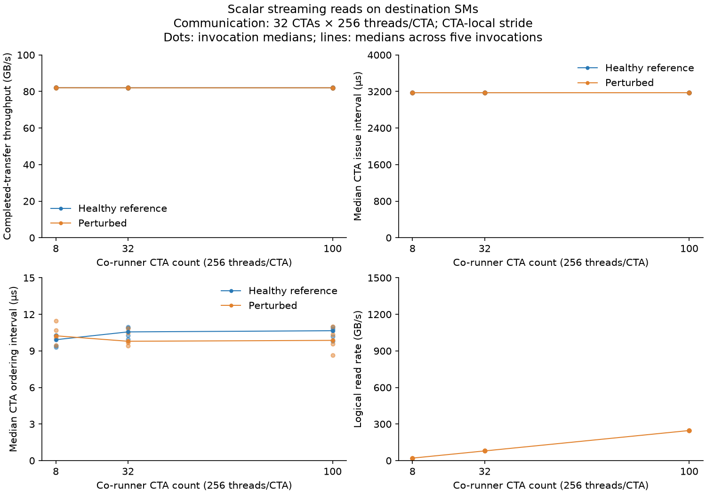

| Communication (CTAs × threads/CTA; traversal) | Co-runner geometry H → P (CTAs × threads/CTA) | Healthy throughput (GB/s) | Perturbed throughput (GB/s) | Paired throughput change | Issue interval H → P (µs) | Ordering interval H → P (µs) | Achieved co-runner rate |
|---|---:|---:|---:|---:|---:|---:|---:|
| 32 × 256; CTA-local stride | 0 × 256 (inactive) → 8 × 256 | 82.07 | 82.04 | -0.03% | 3172.87 → 3172.73 | 9.92 → 10.24 | 20.31 |
| 32 × 256; CTA-local stride | 0 × 256 (inactive) → 32 × 256 | 82.02 | 82.00 | -0.09% | 3173.08 → 3172.36 | 10.56 → 9.79 | 79.34 |
| 32 × 256; CTA-local stride | 0 × 256 (inactive) → 100 × 256 | 82.00 | 82.02 | -0.00% | 3172.80 → 3173.39 | 10.66 → 9.86 | 246.74 |

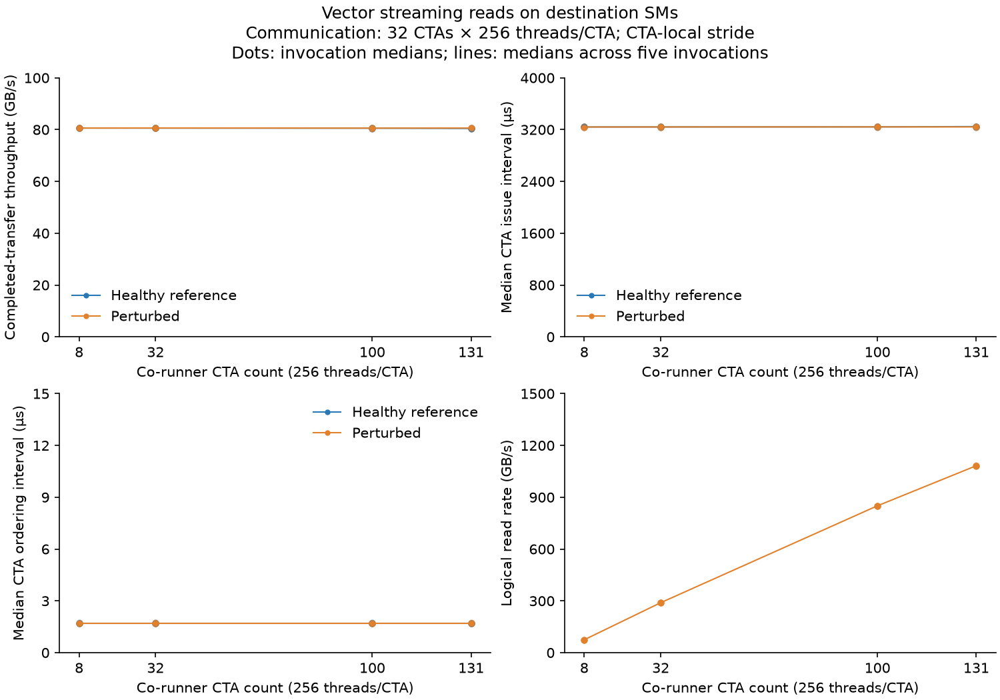

| Communication (CTAs × threads/CTA; traversal) | Co-runner geometry H → P (CTAs × threads/CTA) | Healthy throughput (GB/s) | Perturbed throughput (GB/s) | Paired throughput change | Issue interval H → P (µs) | Ordering interval H → P (µs) | Logical read rate (GB/s) |
|---|---:|---:|---:|---:|---:|---:|---:|
| 32 × 256; CTA-local stride | 0 × 256 (inactive) → 8 × 256 | 80.61 | 80.59 | -0.01% | 3240.78 → 3240.02 | 1.70 → 1.70 | 74.64 |
| 32 × 256; CTA-local stride | 0 × 256 (inactive) → 32 × 256 | 80.58 | 80.62 | +0.06% | 3241.14 → 3240.52 | 1.70 → 1.70 | 289.37 |
| 32 × 256; CTA-local stride | 0 × 256 (inactive) → 100 × 256 | 80.55 | 80.57 | +0.08% | 3242.14 → 3241.70 | 1.70 → 1.70 | 850.36 |
| 32 × 256; CTA-local stride | 0 × 256 (inactive) → 131 × 256 | 80.46 | 80.59 | +0.07% | 3246.80 → 3241.07 | 1.70 → 1.70 | 1082.33 |

The full destination reservation reaches 1082 GB/s logical reads concurrently with the copy. The 100- and 131-CTA median paired copy-throughput changes are +0.08% and +0.07%; neither establishes communication degradation. Destination co-runner intervals cover the destination control interval. The follow-up below tests the other workload’s progress rather than assuming no interference from unchanged copy speed.

#### Interpretation

- **Scalar destination reads leave the measured communication rate essentially unchanged.** The largest tested scalar co-runner rate is about 247 GB/s. Throughput changes stay within about one tenth of a percent; ordering intervals do not reveal a corresponding degradation.
- **Sender-only timing does not identify local endpoint demand.** A source issue/ordering trace alone cannot tell whether a nondegrading read co-runner is present at the destination. Independent activity/endpoint observations are required to establish that context.
- **Receiver waiting is a distinct dependency.** Its duration includes readiness, source arrival, all CTA publications, and acknowledgement. Full-buffer correctness passes after the protocol; a late local poll timestamp would not by itself locate the service bottleneck.

### Earlier destination workload progress with and without incoming stores on GPUs 4 → 5

#### Motivation

The primary question remains whether destination memory activity reduces communication throughput. First compare the copy alone against the same copy with destination reads, using the original paired communication measurements. Then inspect destination read progress as a secondary observation of interference. The extra reads-alone / reads-with-copy controls use similar active durations because the earlier 20 ms standalone windows were longer than the roughly 3.3 ms copy windows.

#### Setup

**Primary outcome: completed-transfer communication throughput.** Its controlled independent variable is destination read pressure, with the copy enabled in both comparison arms. **Secondary outcome: destination read progress.** The follow-up controls whether the incoming copy is enabled at a fixed read geometry. These are separate comparisons with different references.

| Configuration knob | Role | Values / fixed setting |
|---|---|---|
| **Destination read pressure M** | **Independent variable for the primary communication comparison** | Reference: 0 read CTAs; pressure: **100** read CTAs × 256 threads/CTA or **131** read CTAs × 256 threads/CTA; copy always enabled |
| **Incoming copy (`communication`)** | **Independent variable for the secondary read-progress controls** | **0: reads alone; 1: reads with the GPU 4 → GPU 5 copy and completion protocol** |
| **Destination read CTA count M in follow-up** | **Fixed within each secondary reads-alone / reads-with-copy pair** | **100** read CTAs × 256 threads/CTA; **131** read CTAs × 256 threads/CTA |
| Read implementation / location | Constants | Vector reads on GPU 5; same implementation, partitioning, and separate control SM in both arms |
| Working set, burst, CTA size, pacing | Constants | Disjoint 1 GiB array; 256 KiB bursts; 256 threads/CTA; P=0 |
| Source reservation | Constant geometry | 32 CTAs × 256 threads/CTA; issuing roles in both primary comparison arms; timed controls only in the copy-disabled secondary arm |
| Standalone duration (`solo_ns`) | Secondary reference setting | 3,300,000 ns; concurrent arm ends at copy completion, with its actual interval measured |
| Copy payload and traversal | Constants when copy enabled | 256 MiB; scalar four-byte operations; CTA-local stride |
| Binary and residency | Constants within each comparison | Same binary within each comparison; final binary for both secondary arms; identical vector-campaign GPU instructions across cohorts; one CTA per SM |
| Repetitions / samples | Constants | Five original copy-alone / copy-with-reads pairs per pressure geometry; five additional reads-alone / reads-with-copy pairs per follow-up stratum; three warm-ups and twelve retained windows/invocation |
| Clock/power policy | Constant policy | Unchanged; actual operating state observed |
| Primary communication configs | Configuration mapping | Copy alone: `healthy.cfg`; copy with reads: `vector_destination_memory_{100,131}.cfg`, from the same binary revision |
| Secondary follow-up configs | Configuration mapping | Reads alone: `destination_short_solo_{100,131}.cfg`; reads with copy: `vector_destination_memory_{100,131}.cfg` |

#### Method

First, use the original five interleaved copy-alone / copy-with-destination-reads pairs at each read geometry from `vector_destination_memory_{100,131}_{H,P}_*.json`. Both arms transfer the same payload with the same communication geometry and binary. Summarize each invocation by its median completed-transfer throughput and compute relative changes within its actual pair. These are the primary communication measurements already reported above, reused here rather than counted as new evidence.

Second, use the 20 additional follow-up invocations under `results/2026-10-27/mutual_interference/`: five interleaved reads-alone / reads-with-copy pairs per read geometry, each with three warm-ups and twelve retained windows. Present the copy-enabled follow-up throughput separately, then analyze destination read rate and active duration as secondary observations. The copy-disabled arm has no communication-throughput measurement and cannot serve as a healthy-copy reference. Follow-up copy-enabled values are not paired retrospectively with the original copy-only runs or pooled into their effect estimates.

#### Results

**Communication throughput — primary analysis.**

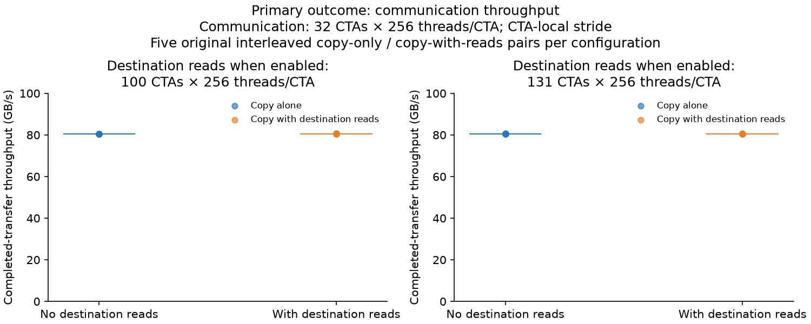

| Communication (CTAs × threads/CTA; traversal) | Destination reads reference → pressure (CTAs × threads/CTA) | Copy alone, original paired reference (GB/s) | Copy with reads, original paired run (GB/s) | Median paired communication change | Copy with reads, separate follow-up (GB/s) |
|---|---|---:|---:|---:|---:|
| 32 × 256; CTA-local stride | Inactive → 100 × 256 | 80.55 | 80.57 | +0.08% | 80.62 |
| 32 × 256; CTA-local stride | Inactive → 131 × 256 | 80.46 | 80.59 | +0.07% | 80.64 |

The original paired measurements show no substantial communication-throughput degradation at either pressure geometry. Their standardized throughput effects are +0.14 and +1.52 reference IQRs; the direction is a small throughput increase, not a slowdown. The follow-up copy-enabled invocations also deliver about 80.6 GB/s, but their values in the last column are a separate cohort, not additional paired estimates against the original reference. The figure uses only the original matched communication pairs. `mutual_interference/communication_summary.json` records that primary comparison.

**Destination read performance — secondary observation.**

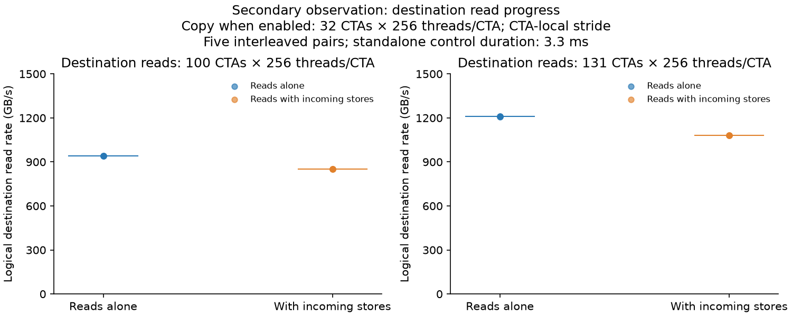

| Incoming copy H → P (CTAs × threads/CTA; traversal) | Destination reads (CTAs × threads/CTA) | Reads alone (GB/s) | Reads with copy (GB/s) | Median paired read-rate change | Active interval alone / with copy (µs) | Copy throughput (GB/s) |
|---|---|---:|---:|---:|---:|---:|
| Disabled → 32 × 256; CTA-local stride | 100 × 256 | 941.04 | 850.44 | -9.63% | 3333.01 / 3364.02 | 80.62 |
| Disabled → 32 × 256; CTA-local stride | 131 × 256 | 1209.45 | 1080.90 | -10.48% | 3333.33 / 3363.94 | 80.64 |

The standardized read-rate effects are −532.78 and −1783.94 healthy IQRs, respectively. These large standardized values reflect extremely small reference IQRs; the paired percentage and absolute rates convey the practical effect. Per-pair values and active durations are retained in `mutual_interference/summary.json` and per-window records in `transfers.csv`.

#### Interpretation

- **The primary communication outcome is no substantial throughput regression.** With 100 × 256 and 131 × 256 destination read geometries, the original paired changes are +0.08% and +0.07%. Copy-enabled follow-up runs remain near 80.6 GB/s. This experiment has not established degraded communication under the tested conditions.
- **Destination read slowdown is a secondary effect.** Read progress falls by 9.63% and 10.48% when the copy is present. That demonstrates an interaction affecting the destination workload; it does not replace communication-throughput evidence or establish that the communication operation itself degraded.
- **The duration control strengthens the observation.** Read-only and concurrent active intervals are about 3.333 and 3.364 ms, respectively, rather than the earlier 20 ms versus 3.3 ms comparison. Both numerator work and elapsed time are measured. Residual startup/tail and operating-state effects remain limitations; the intervals are similar, not exactly identical.
- **The mechanism remains unresolved.** The controlled change is presence of the copy and its associated completion protocol. This supports an effect on destination workload progress, not a verified attribution to HBM arbitration, L2 queues, or a particular fabric component. No hardware-counter evidence was accepted.

## Initial acquisition trials on GPUs 4 → 5

### Motivation

Determine which observations can be trusted for the observation plane and whether acquisition itself changes the tested interaction. Separate successful timing/timeline evidence from attempted counter collection.

### Setup

**Controlled independent variable in the overhead comparison:** probe detail. Profiler choice and capture mode are separate acquisition-validation trials; their measurements are not pooled with primary timing.

| Study / configuration knob | Role | Values / fixed setting |
|---|---|---|
| **Probe detail (`detailed`)** | **Independent variable in overhead pairs** | **0: minimal boundaries/placement/work; 1: add phase timing and eight issue checkpoints** |
| Communication / pressure in overhead pairs | Constants | 32 CTAs × 256 threads; 256 MiB; CTA-local stride; no co-runner |
| Binary revision in overhead pairs | Comparison stratum; constant within a pair | Initial and vector binaries evaluated separately, each with five interleaved pairs |
| Samples in overhead pairs | Constants | Three warm-ups; twelve retained transfers/invocation |
| **Acquisition tool / capture mode** | **Controlled factor in separate validation trials** | **Nsight Systems CUDA/NVTX; Nsight Compute application replay, CUDA start/stop range, and NVTX application-range capture** |
| Timeline conditions | Coverage variants | Healthy reference plus compute, scalar source/destination reads, vector source/destination reads; pressure cases use 100 co-runner CTAs × 256 threads/CTA; communication uses 32 CTAs × 256 threads/CTA |
| Timeline sampling | Constant per capture | One warm-up and one retained transfer; named host measurement range brackets both endpoint kernels |
| Counter-trial workload | Constant | Healthy mandatory-concurrency protocol; 32 × 256 issuing geometry; no pressure |
| Profiler clock/cache policy | Constants | No profiler clock locking or cache flushing; device settings unchanged |
| Configuration files | Configuration mapping | `healthy_minimal.cfg`, `healthy.cfg`, `profile_*.cfg` |

### Method

Minimal mode retains source start/end, co-runner work/intervals, placement, and correctness. Detailed mode adds issue, ordering, publication, and eight fixed-work checkpoints. For timelines, a host `measurement` NVTX range brackets the two endpoint kernels, with barriers outside the device measurement to avoid launching a peer while counter activation synchronizes contexts. SQLite extraction checks that exactly the source and destination fused kernels fall inside that range; device records independently validate CTA roles and overlap. Host-only profiling/control additions are checked against the vector campaign's SASS dump: generated device instructions are byte-for-byte identical. A guarded final healthy/pressure validation pair passes the unchanged analysis path.

Counter attempts preserve caches and avoid profiler clock locking. Whole-application replay blocks mandatory progress; CUDA start/stop range attempts either time out or report no ranges; NVTX application-range capture also reports no ranges, despite markers being visible in Nsight Systems. These attempts are not accepted as counter observations. An empty `.ncu-rep` file or exit code zero is not evidence of collection. Source-PC passes are not pursued after the underlying counter capture path fails validation.

### Results

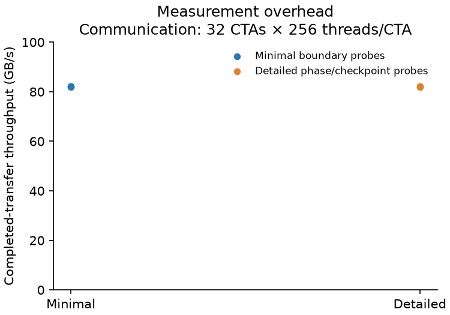

| Binary | Communication (CTAs × threads/CTA; traversal) | Minimal throughput (GB/s) | Detailed throughput (GB/s) | Median paired change |
|---|---|---:|---:|---:|
| Initial scalar campaign | 32 × 256; CTA-local stride; no co-runner | 82.06 | 82.03 | −0.04% |
| Vector campaign | 32 × 256; CTA-local stride; no co-runner | 80.57 | 80.60 | +0.05% |

The figure shows the initial revision's five independent pairs; the second revision's complete comparison is retained in `comparisons.json`. These tests bound the observed difference between two probe modes; they do not establish the cost versus a completely uninstrumented kernel.

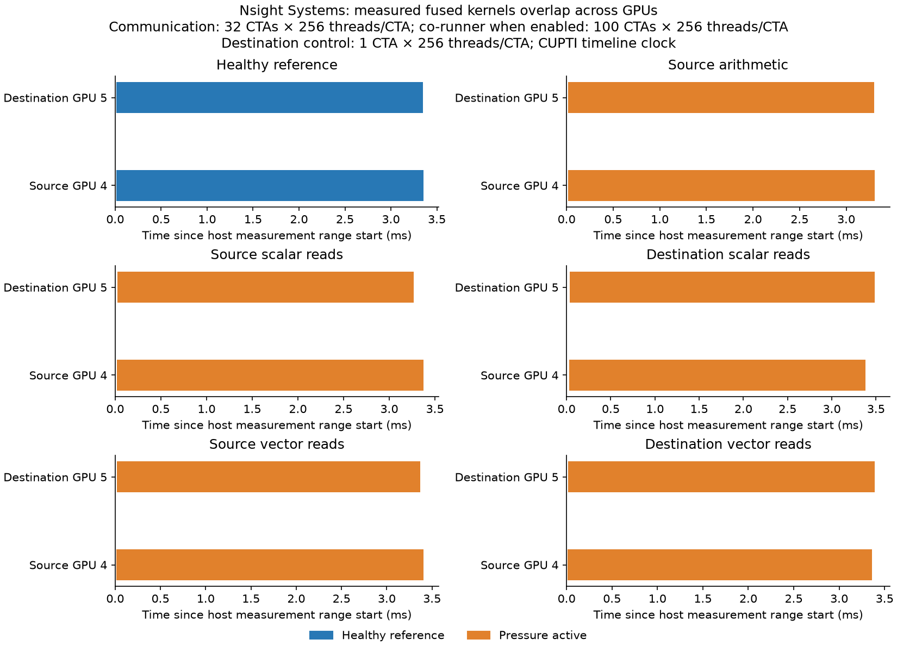

All six measurement ranges contain both GPU kernels. Source completed-transfer throughput in these traces ranges from about 80.19 to 82.96 GB/s; every pressure trace retains minimum co-runner interval coverage of 1.0 on its own GPU. Timeline throughput is not pooled with primary runs, and the initial compute/scalar campaign's binary differs from the later timeline binary. The trace establishes concurrent execution and valid acquisition, not a detailed physical bottleneck.

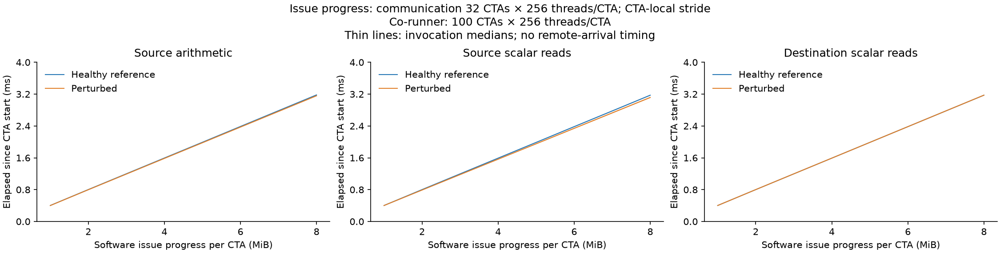

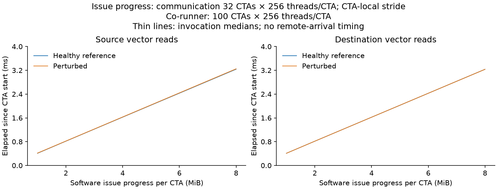

Checkpoint curves describe software issue progress, not remote arrival. The roughly linear curves and small paired changes do not provide a validated classifier of source versus destination degradation in this dataset. A shorter ordering interval in the later binary cannot be interpreted as a contention improvement across binaries.

### Interpretation

- **The inexpensive observations are usable for this controlled series.** Completed duration, phase/progress records, physical role placement, actual co-runner work, and full-buffer correctness establish what was executed and how it progressed. They expose the asymmetric workload effect above, while refusing a false degraded-copy label.
- **Device telemetry and link counts are context, not mechanism proof.** Whole-invocation samples include setup/verification and can miss the transfer window. Summed source NVLink transmission is about 3840 MiB for fifteen 256 MiB transfers, consistent with the intended path; the nearly fixed cumulative byte count cannot diagnose slower delivery by itself. Endpoint counters are not reset.
- **Profiler integration is part of observation cost.** Performance counters are enabled by platform policy, but the installed tool/launch integration did not yield a valid counter range. More privileges are not shown to be the solution. DRAM/L2 attribution and instruction-PC stall discrimination remain unvalidated rather than silently treated as zero.

## What these measurements support for the observation plane

| Observation | What it establishes here | What remains unproved |
|---|---|---|
| Acknowledged duration and useful throughput | A measured program plateau at 128 × 512, 2048 MiB, batch 8; consistent copy slowdowns that grow with a controlled read rate (destination up to −0.8%, source up to −4.0%) when pairs are made inside one run | Physical link/HBM saturation, a generally healthy production reference, or a universal anomaly threshold |
| CTA phase/checkpoint distributions | Issue progress, ordering/publication/ack costs, and tails within a binary; under read pressure the extra time appears in ordering and acknowledgement waiting, not in the issue loop | Per-store remote latency; unique endpoint or physical queue cause |
| Co-runner work rate, active interval, and role/SM mapping | Effective demand, overlap, spatial separation, and destination work-progress reduction | Physical HBM bandwidth; generic detection without application/workload instrumentation |
| Copy-CTA placement on SMs (recorded SM IDs) | With a 64-CTA copy, placement differs between runs and changes throughput by up to 8%; same placement gives the same level | Why some SM sets are slower; whether a production scheduler shows the same effect |
| Achieved versus target read rate | Whether the applied pressure was really delivered; on the source GPU the 80% target fell short because of where the pressure CTAs landed | Counted HBM traffic |
| Whole-process operating-state samples | Clock/power/thermal context and recorded confounders | Clock state at every short transfer or a power-causal explanation |
| Directional cumulative link bytes | Traffic consistency with the intended transfer path | Instantaneous congestion, queue occupancy, or a link fault |
| Validated CUDA/NVTX timeline | Endpoint kernels actually overlap in the captured measurement range | Individual CTA-role activity without device probes; physical memory/fabric service decomposition |
| Generated instructions / compiler report | Intended scalar copy, retained arithmetic/vector reads, and no reported spills | Dynamic instruction service or contention without accepted PC/counter collection |
| Attempted hardware counters / PC samples | Acquisition limits and a concrete next integration problem | Any HBM/L2/fabric bottleneck claim or a source-vs-destination stall classifier |

Communication-reference calibration is complete for the selected program configuration. The rate-controlled co-runner now sets read pressure directly and shows small, consistent copy slowdowns on both GPUs. Open questions: why completion, not issuing, absorbs the extra time; why copy-CTA placement matters so much on the source GPU; and how to obtain valid concurrent memory-counter evidence. Small communication changes alongside read slowdown do not establish that the tested shared resources are independent. Injection labels and known placement remain evaluation context rather than a runtime diagnosis signal. No detector, verified physical RCA mechanism, or mitigation is claimed.

## Session log

| Date | Devices / status | Configurations and deviations | Evidence |
|---|---|---|---|
| 2026-10-27 | Physical GPUs 4 → 5; user authorized 4–7 | New harness because the current repository had plans only; archived harness left untouched. Primary campaign complete: 279 invocations, 3156 retained transfers and 80 standalone windows. Follow-up: 20 matched-duration workload invocations. Six validated named-range timeline captures; counter attempts retained as failed/unvalidated. Final host-only revision validation: one healthy/pressure pair. All completed transfer checks pass. One guard-triggered pause during delayed CUDA-context teardown; subsequent launch waits briefly for idle state and still aborts if occupied. | Dated raw JSON, before/after XML/link snapshots, sampled telemetry, stdout/stderr logs, SASS, provenance hashes, and derived tables |
| 2026-10-27 | Physical GPUs 6 → 7; earlier lower-demand sweep | Communication 16/32/64 CTAs × 256/512 threads/CTA; 256 MiB, batch 1, CTA-local stride; destination reads 8/32/100/131 × the group thread count, control 1 × that count. 453 timing invocations, 4416 transfers, 740 standalone windows; four timeline captures. Communication changes −0.26% to +0.09%; matched read slowdown 6.67%–18.35%. Calibration was incomplete because throughput still rose at 64 × 512. | [Earlier run records and summaries](results/2026-10-27-gpu6-7/) |
| 2026-10-27 | Physical GPUs 6 → 7; reference selection within this experiment | Expanded concurrency, payload, and batch checks; selected 128 × 512, 2048 MiB, batch 8, CTA-local stride. 121 accepted invocations and 1452 transfers. One overlapping attempt excluded and reacquired; per-device locks added. | [Calibration records, tables, and hashes](results/2026-10-27-saturation-gpu6-7/) |
| 2026-10-27 | Physical GPUs 6 → 7; destination pressure at selected reference | Source 128 × 512, 2048 MiB, batch 8, CTA-local stride; destination reads 8/32/100/131 × 512, control 1 × 512. 112 timing invocations, 864 transfers, 340 reads-only windows, two validated timeline captures; all correctness and overlap checks passed. | [Contention records, tables, and hashes](results/2026-10-27-saturated-contention-gpu6-7/) |
| 2026-10-28 | Physical GPU 6; separate experiment | Rate-controlled memory co-runner built and calibrated alone (365 runs). | [HBM read-rate calibration](../../../../h100x1/memory_co_runner/calibration/hbm_read_rate/README.md) |
| 2026-10-28 | Two allocated GPU pairs, one experiment each, run at the same time | Rate-controlled reads on the source GPU (copy 64 × 512) and on the destination GPU (copy 128 × 512), targets 20/40/60/80%, 2048 MiB, 8 elements per thread, shared memory 196,864 bytes. Source: 117 runs, 1104 transfers; destination: 94 runs, 828 transfers. Deviations from the plan: pairs made inside each run (alternating launches) after finding run-to-run SM-placement effects; copy-only calibration ran on an earlier build of the same day (host-code difference only; final build checked separately); no Nsight Systems timelines. All checks passed; an earlier runner start stopped before any GPU work (wrong header path) and was restarted. Later the same day: a 95% level with 48 pressure CTAs (screen of 32/40/48 CTAs, then reads alone, alternating runs, and destination duration-matched pairs); same build. | [Rate-pressure records, tables, figures and hashes](results/2026-10-28-rate-pressure/) |

Raw primary samples, nested windows, paired effects, environmental summaries, timeline extraction, follow-up observations, source snapshots, compiler reports, and code/library hashes are retained under the corresponding dated results directories listed above. Raw JSON, snapshots, telemetry, logs, and profiler artifacts stay local and ignored by Git; compact summaries, configurations, figures, and analysis scripts remain versioned. Binary profiler artifacts remain on disk and are excluded from Git. `profile_attempt_commands.sh` records the initially planned counter workflow; actual completed and rejected attempts are identified by their individual logs. None of the counter/source-PC metrics listed as candidates is presented as a measured result.
