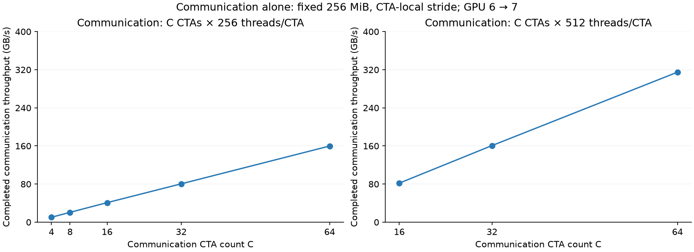
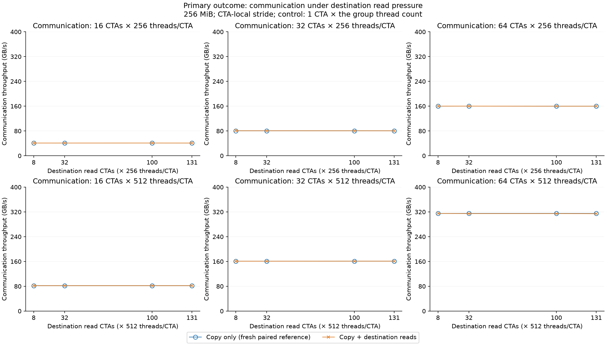
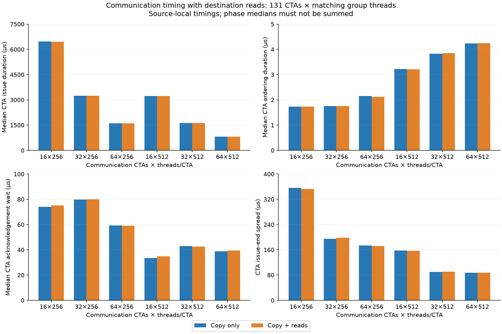
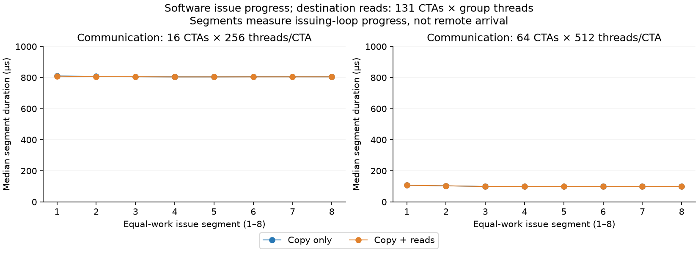
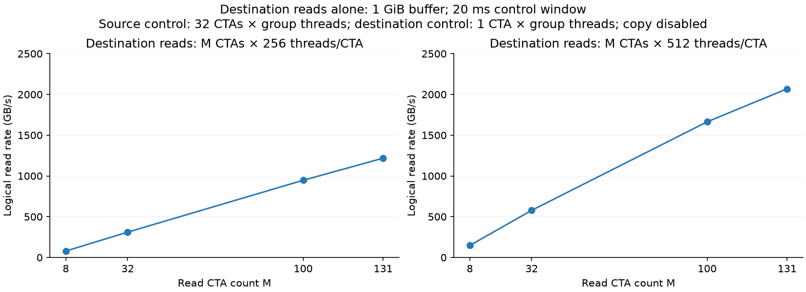
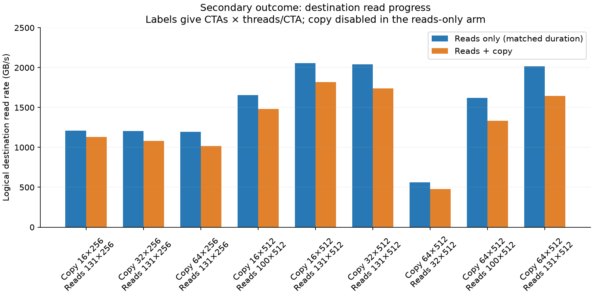
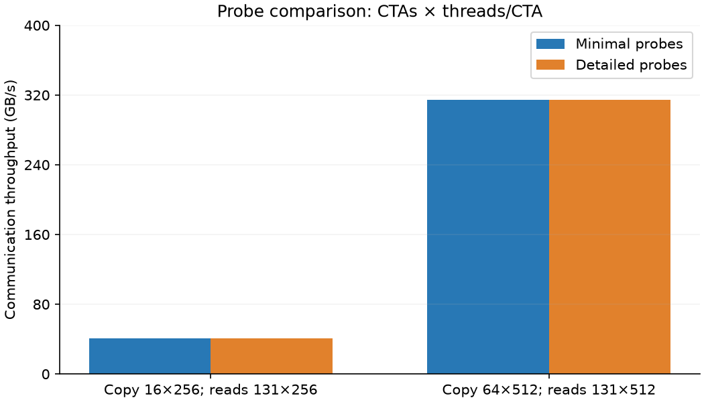
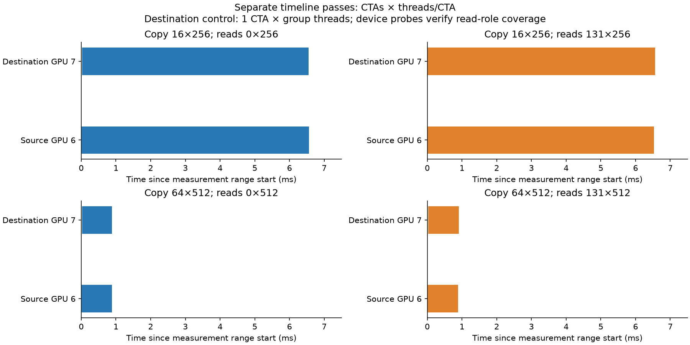

# Destination read pressure with more communication threads

Question: does destination memory work slow incoming communication when more source threads issue stores?

**Answer.** The tested destination reads still do not produce a substantial communication slowdown. Communication alone reaches 314.83 GB/s at 64 CTAs × 512 threads/CTA. Across the 24 tested pressure conditions, median paired communication-throughput changes range from -0.26% to +0.09%. 3 conditions have lower throughput in all five pressure/reference pairs. In the secondary duration-matched controls, destination read rates fall by 6.67% to 18.35%. These observations describe this workload and device pair; they do not identify HBM, L2, or NVLink as the limiting resource.

Executed on 2026-10-27 using physical GPUs 6 → 7 under the user's updated allocation. This is a separate session from the earlier GPU 4 → 5 report. The [plan](../../04_shared_resource_contention.md) specifies the intended comparisons; the [common setup](../../../00_common_setup.md) defines completion and metrics.

| Meaning | Common metric |
|---|---|
| Completed communication throughput and duration | A1: source earliest start to latest acknowledgement observation |
| CTA issue, ordering, publication, and acknowledgement timing | A2–A6; phase medians are not additive |
| Issue progress | A7; eight fixed-work checkpoints, not remote arrival |
| Co-runner active interval and logical work rate | A8–A9; includes startup and tail |
| CTA/SM placement and correctness | A10–A11 |
| Endpoint timeline | B1; separate profiling runs |
| Coarse operating state and directional link counters | B2–B3; whole invocation, not aligned to individual transfer phases |
| Hardware memory counters | C1–C3; unavailable as accepted evidence in this follow-up |

## Communication alone

### Motivation

Check whether adding communication threads still increases throughput. If the sender issues requests slowly, destination reads may have little effect on the copy even though both workloads use shared memory resources.

### Setup

| Knob | Role | Value |
|---|---|---|
| Devices | Constant | GPU 6 source → GPU 7 destination; H100 80 GB, 132 SMs each; NV18 topology |
| **Communication CTAs C** | **Independent variable at fixed threads/CTA** | **4, 8, 16, 32, 64** at 256 threads/CTA; **16, 32, 64** at 512 threads/CTA |
| **Threads/CTA T** | **Independent variable at 32 communication CTAs** | **64, 128, 256, 512**; receiver/control CTA uses the same thread count |
| **Traversal** | **Separate comparison** | CTA-local versus global stride, both at 32 CTAs × 256 threads/CTA |
| Payload and access | Constant | 256 MiB; scalar 4-byte local source loads and peer stores |
| Destination reads | Constant | Disabled: 0 read CTAs × T threads/CTA |
| Destination control | Constant within T | 1 CTA × T threads/CTA |
| Program | Constant | One unchanged binary across this follow-up; hashes in `build_provenance.json`; all references remeasured on GPUs 6 → 7 |

### Method

Five invocation rounds per complete setting, rotating setting order. Each invocation uses three warm-ups and twelve retained transfers, with full destination verification after every transfer. One-CTA-per-SM occupancy and unique SM IDs are checked. No clocks or power limits were changed. No profiler runs are mixed into the primary measurements.

### Results

The figure shows the median of five invocation medians; error bars show their minimum and maximum. The table also includes the thread-only and traversal checks.

| Communication CTAs × threads/CTA | Traversal | Median GB/s | Invocation range GB/s |
|---|---|---|---|
| 4 × 256 | CTA-local | 10.32 | 10.31–10.34 |
| 8 × 256 | CTA-local | 20.61 | 20.61–20.63 |
| 16 × 256 | CTA-local | 40.97 | 40.93–41.01 |
| 32 × 256 | CTA-local | 80.51 | 80.46–80.52 |
| 64 × 256 | CTA-local | 159.83 | 159.75–160.05 |
| 32 × 64 | CTA-local | 20.13 | 20.08–20.16 |
| 32 × 128 | CTA-local | 40.51 | 40.38–40.58 |
| 32 × 512 | CTA-local | 160.79 | 160.70–161.15 |
| 16 × 512 | CTA-local | 81.92 | 81.89–82.11 |
| 64 × 512 | CTA-local | 314.83 | 314.60–315.30 |
| 32 × 256 | Global stride | 81.41 | 81.31–81.56 |

At 512 threads/CTA, increasing communication CTAs from 32 to 64 changes throughput from 160.79 to 314.83 GB/s. The largest tested setting is still on a rising curve.

### Interpretation

- **Adding issuing threads tests sender demand.** Compare CTA counts within each fixed thread count before comparing groups. A changed receiver thread count accompanies the thread-count sweep, although only one receiver lane polls.
- **The largest configuration is not automatically saturated.** The harness accepts at most 64 communication CTAs and 512 threads/CTA. Throughput is still increasing at that boundary, so this test has not found where further threads stop helping. A flat region would still not identify the hardware limit by itself.

## Communication with destination reads

### Motivation

Test the same read pressure against several communication rates. Communication throughput is the primary outcome; destination-workload progress is reported separately below.

### Setup

| Knob | Role | Value |
|---|---|---|
| **Communication CTAs C** | **Independent variable with T and M fixed** | **16, 32, 64** |
| Threads per CTA T | Separate groups | 256 or 512; applies to source communication, destination reads, and destination control |
| **Destination read CTAs M** | **Independent variable with C × T fixed** | **0 (reference), 8, 32, 100, 131** |
| Read operation | Constant | Coalesced 16-byte vector loads, four checksum chains, 256 KiB per CTA burst; no added pacing |
| Read array | Constant | Separate 1 GiB buffer, divided among read CTAs; no overlap with incoming payload |
| Copy | Constant except C/T | 256 MiB, scalar stores, CTA-local stride, acknowledged completion |
| Reservations | Constant within each pair | One resident CTA per SM; destination control 1 CTA × T threads; no source co-runner |
| Configs | Complete recorded settings | `../../configs/destination_followup_gpu6_7/mixed_c*_t*_m*_{H,P}*.cfg` |

### Method

For each of 24 pressure conditions, five fresh copy-only / copy-with-reads pairs were interleaved. Condition order rotates between rounds. Each invocation retains twelve transfers after three warm-ups. The table reports medians of invocation medians and median percentage changes computed within actual pairs. The percentage column therefore need not equal the ratio of the two displayed aggregate medians. All comparisons use the same binary and physical GPU pair.

### Results

| Communication CTAs × threads/CTA | Destination reads: reference → pressure | Copy only GB/s | Copy + reads GB/s | Paired change | Slower pairs / 5 |
|---|---|---|---|---|---|
| 16 × 256 | 0 × 256 → 8 × 256 | 41.06 | 41.07 | +0.05% | 1 |
| 16 × 256 | 0 × 256 → 32 × 256 | 41.06 | 41.05 | -0.03% | 3 |
| 16 × 256 | 0 × 256 → 100 × 256 | 41.08 | 41.09 | +0.01% | 2 |
| 16 × 256 | 0 × 256 → 131 × 256 | 40.99 | 41.06 | -0.04% | 3 |
| 32 × 256 | 0 × 256 → 8 × 256 | 80.57 | 80.65 | +0.04% | 2 |
| 32 × 256 | 0 × 256 → 32 × 256 | 80.58 | 80.61 | +0.09% | 1 |
| 32 × 256 | 0 × 256 → 100 × 256 | 80.63 | 80.56 | -0.01% | 3 |
| 32 × 256 | 0 × 256 → 131 × 256 | 80.54 | 80.51 | -0.03% | 3 |
| 64 × 256 | 0 × 256 → 8 × 256 | 159.97 | 160.18 | +0.06% | 2 |
| 64 × 256 | 0 × 256 → 32 × 256 | 160.16 | 160.22 | -0.01% | 3 |
| 64 × 256 | 0 × 256 → 100 × 256 | 160.04 | 159.91 | -0.03% | 3 |
| 64 × 256 | 0 × 256 → 131 × 256 | 160.08 | 159.92 | -0.02% | 3 |
| 16 × 512 | 0 × 512 → 8 × 512 | 82.06 | 82.04 | -0.05% | 4 |
| 16 × 512 | 0 × 512 → 32 × 512 | 82.03 | 82.05 | +0.04% | 1 |
| 16 × 512 | 0 × 512 → 100 × 512 | 82.08 | 82.05 | -0.02% | 5 |
| 16 × 512 | 0 × 512 → 131 × 512 | 82.05 | 82.05 | +0.01% | 1 |
| 32 × 512 | 0 × 512 → 8 × 512 | 160.92 | 160.90 | +0.00% | 2 |
| 32 × 512 | 0 × 512 → 32 × 512 | 160.93 | 160.91 | -0.03% | 4 |
| 32 × 512 | 0 × 512 → 100 × 512 | 160.94 | 161.08 | +0.02% | 1 |
| 32 × 512 | 0 × 512 → 131 × 512 | 160.96 | 161.07 | +0.02% | 2 |
| 64 × 512 | 0 × 512 → 8 × 512 | 314.96 | 315.08 | -0.01% | 4 |
| 64 × 512 | 0 × 512 → 32 × 512 | 315.22 | 314.53 | -0.22% | 5 |
| 64 × 512 | 0 × 512 → 100 × 512 | 315.22 | 314.58 | -0.26% | 5 |
| 64 × 512 | 0 × 512 → 131 × 512 | 315.00 | 314.19 | -0.16% | 4 |

Completed durations for the strongest read setting (131 CTAs × the group thread count); maxima cover all 60 retained transfers in each arm.

| Communication CTAs × threads/CTA | Median duration µs: copy only / reads | Maximum duration µs: copy only / reads |
|---|---|---|
| 16 × 256 | 6548.10 / 6537.98 | 6573.06 / 6567.81 |
| 32 × 256 | 3333.12 / 3334.02 | 3350.78 / 3341.95 |
| 64 × 256 | 1676.93 / 1678.58 | 1685.25 / 1685.76 |
| 16 × 512 | 3271.47 / 3271.42 | 3286.62 / 3287.04 |
| 32 × 512 | 1667.68 / 1666.56 | 1672.83 / 1671.52 |
| 64 × 512 | 852.18 / 854.38 | 855.17 / 858.11 |

Each progress point is the median of five invocation medians over CTA/transfer segment samples. Segments contain equal useful work within a configuration; the first also includes startup synchronization. `checkpoint_summary.csv` retains the segment work size and invocation range. These are source-side software checkpoints, not destination arrival measurements.

Reference IQRs and standardized effects are in `communication.csv` and `analysis_summary.json`. A tiny reference IQR can produce a large standardized effect from a small practical change. `runs.csv` retains each invocation's median, maximum transfer duration, issue, ordering, acknowledgement, and issue-spread observations. Individual-transfer and per-CTA records remain local in `raw/`.

### Interpretation

- **Largest measured reduction:** communication 64 CTAs × 512 threads/CTA with destination reads 100 CTAs × 512 threads/CTA changes by -0.26% (median paired); 5/5 pairs are slower. This is an observed size and repeatability count, not a significance test.
- **Read workload overlap is checked directly:** minimum interval coverage across the pressure measurements is 1.000. This proves recorded lifetime coverage, not constant read-request intensity.
- **Completion is not just posted-store issue:** timing includes all-writer ordering, completion publication, receiver acknowledgement, and source observation. It does not require immediate physical HBM writeback or include a subsequent application consumer.
- **Shared-resource attribution remains open:** different responses across configurations could reflect sender demand, memory service, cache behavior, or operating state. No accepted hardware counters distinguish these explanations here.

## Destination reads alone

### Motivation

Measure how much read work the injector actually achieves before interpreting its CTA count as pressure.

### Setup

| Knob | Role | Value |
|---|---|---|
| **Destination read CTAs M** | **Independent variable within T** | **8, 32, 100, 131** |
| Threads/CTA T | Separate groups | 256 and 512 |
| Source control geometry | Constant within T | 32 CTAs × T threads, timed wait only; no communication |
| Destination control geometry | Constant within T | 1 CTA × T threads |
| Working set and instructions | Constant | Same 1 GiB vector-read workload as combined tests |
| Timed window | Constant target | 20 ms; actual active intervals recorded |

### Method

Five invocations per read geometry, each with two warm-ups and five retained windows. Settings rotate between rounds. The rate counts completed logical 256 KiB bursts across CTAs and divides by latest end minus earliest start. It includes control/checksum overhead and startup/tail work, and does not measure physical HBM bytes.

### Results

| Destination read CTAs × threads/CTA | Logical read GB/s | Invocation range GB/s |
|---|---|---|
| 8 × 256 | 78.23 | 78.20–78.44 |
| 32 × 256 | 310.58 | 309.91–310.63 |
| 100 × 256 | 946.53 | 946.34–948.26 |
| 131 × 256 | 1217.79 | 1215.49–1217.90 |
| 8 × 512 | 146.70 | 146.32–146.81 |
| 32 × 512 | 577.84 | 576.64–577.98 |
| 100 × 512 | 1663.59 | 1661.29–1663.94 |
| 131 × 512 | 2068.73 | 2068.45–2070.79 |

### Interpretation

- **Measure pressure, rather than assuming it from CTA count.** Both the number of CTAs and their thread count affect achieved read progress.
- **Read-rate limits need explanation.** More SMs or a flat logical read rate do not establish HBM saturation. Loop overhead, request supply, cache service, and memory service remain possible limits.

## Destination workload progress: secondary observation

### Motivation

Check whether incoming communication slows local destination reads even where communication throughput changes little.

### Setup

| Knob | Role | Value |
|---|---|---|
| **Communication enabled** | **Independent variable** | **Disabled / enabled**, with full communication geometry retained in each table row |
| Destination read geometry | Constant within each pair | 131 CTAs at each communication geometry, plus lower levels where all five primary pairs showed a communication reduction |
| Read operation, buffer, reservations | Constant | Same as primary comparisons |
| Standalone duration | Fixed per comparison | Median concurrent read-active duration from that condition's primary runs, converted to `solo_ns` |

### Method

Five interleaved reads-only / reads-with-copy pairs per selected condition; three warm-ups and twelve retained windows per invocation. Selection is recorded in `followup_selection_summary.json`; it is exploratory and not independent confirmation of a selected communication effect. Actual active windows are reported because equal requested duration does not guarantee equal measured duration. Copy-disabled windows have no communication throughput and are never used as healthy-copy references.

### Results

| Copy CTAs × threads/CTA (disabled → enabled) | Destination read CTAs × threads/CTA | Reads only GB/s | Reads + copy GB/s | Paired read change | Active µs: alone / copy |
|---|---|---|---|---|---|
| 16 × 256 | 131 × 256 | 1212.00 | 1131.52 | -6.67% | 6609.49 / 6587.17 |
| 32 × 256 | 131 × 256 | 1206.73 | 1081.28 | -10.43% | 3400.80 / 3364.78 |
| 64 × 256 | 131 × 256 | 1196.39 | 1018.81 | -14.90% | 1746.74 / 1710.86 |
| 16 × 512 | 100 × 512 | 1654.16 | 1480.61 | -10.46% | 3316.51 / 3294.74 |
| 16 × 512 | 131 × 512 | 2056.66 | 1816.12 | -11.70% | 3316.69 / 3293.71 |
| 32 × 512 | 131 × 512 | 2043.06 | 1737.20 | -14.97% | 1711.68 / 1688.85 |
| 64 × 512 | 32 × 512 | 561.50 | 479.91 | -14.53% | 896.34 / 875.07 |
| 64 × 512 | 100 × 512 | 1620.67 | 1335.44 | -17.63% | 897.76 / 876.40 |
| 64 × 512 | 131 × 512 | 2017.35 | 1647.07 | -18.35% | 899.31 / 876.35 |

### Interpretation

- **The two workloads can respond differently.** A reduction in destination read progress is evidence about that workload; it does not replace the primary communication-throughput comparison.
- **Duration matching removes a large avoidable difference.** It reduces the 20 ms versus short-copy-window mismatch, but startup/tail and operating-state differences remain. No physical memory-bandwidth attribution follows from logical rates alone.

## Measurement checks and separate timelines

### Motivation

Check that probe cost and profiler behavior do not create or remove the interaction being studied.

### Setup

| Knob | Role | Value |
|---|---|---|
| **Detailed probes enabled** | **Independent variable in overhead pairs** | **0 / 1**; both retain boundary, work, SM-placement, and correctness records |
| Communication geometries | Separate fixed comparisons | 16 CTAs × 256 threads/CTA; 64 CTAs × 512 threads/CTA |
| Destination reads | Constant within each comparison | 131 CTAs × the same group thread count |
| Timeline passes | Separate from primary timing | Low/high communication geometries, each with reads disabled and enabled; additional repeatable large reduction if present |

### Method

Five minimal/detailed pairs per probe comparison, with the same warm-up and retained-transfer counts. CUDA/NVTX timelines contain one measured transfer after two warm-ups. SQLite extraction verifies exactly two measured fused kernels, the physical device IDs, launch geometries, kernel overlap, and device-probe read interval coverage. Whole-invocation telemetry and before/after NVLink counters are summarized in `environment_summary.json`. The initial copy-only validation sends approximately 3840 MiB from GPU 6 and receives the same volume on GPU 7, matching fifteen 256 MiB transfers including warm-ups. This supports the intended path; it is not instantaneous link congestion or physical HBM traffic. Telemetry includes initialization and verification, so it cannot establish phase-specific clock effects. Hardware-counter replay had failed for this launch/tool combination in the earlier session; those failed modes were not reused as evidence or silently replaced by timeline data.

### Results

| Communication CTAs × threads/CTA | Destination reads CTAs × threads/CTA | Minimal GB/s | Detailed GB/s | Paired change |
|---|---|---|---|---|
| 16 × 256 | 131 × 256 | 41.10 | 41.09 | +0.02% |
| 64 × 512 | 131 × 512 | 314.61 | 314.58 | -0.03% |

| Communication CTAs × threads/CTA | Destination reads CTAs × threads/CTA | Profiled copy GB/s | Profiled logical reads GB/s | Read interval coverage |
|---|---|---|---|---|
| 16 × 256 | 0 × 256 | 41.11 | Inactive | No reads |
| 16 × 256 | 131 × 256 | 41.27 | 1130.86 | 1.000 |
| 64 × 512 | 0 × 512 | 315.47 | Inactive | No reads |
| 64 × 512 | 131 × 512 | 314.51 | 1647.37 | 1.000 |

### Interpretation

- **Timelines validate execution, not memory service.** Both endpoint kernels overlap, and device records distinguish CTA roles inside each fused kernel. Timeline durations are not used to replace the primary throughput measurements.
- **Read pressure is retained during the accepted timeline captures.** Profiled logical read rates differ from their primary-run medians by -0.12% to -0.04%; each pressure capture retains full read interval coverage. These single captured transfers validate execution conditions, not the statistical size of a slowdown.
- **Fresh references matter for small effects.** End-of-session copy-only checks were +0.08% to +0.35% above the initial calibration medians across the six communication settings. The primary pressure comparison therefore uses nearby paired references, not those earlier calibration medians.
- **Minimal probes are not probe-free.** The overhead comparison measures the extra phase/checkpoint probes only.
- **Raw evidence stays local.** Primary collection contains 453 invocations, 4416 retained completed transfers, and 740 retained standalone read windows. There are 4 additional profiled transfers. All copy runs passed full-buffer correctness checks; all runs passed placement and timing checks. Raw JSON, snapshots, telemetry, logs, per-transfer tables, and profiler artifacts are ignored by Git under `raw/`. Compact summaries, configuration files, analysis scripts, and figures are retained. A clean checkout requires a rerun or the local raw directory to reproduce the analysis.

Reproduction scripts: [runner](../../../../common/scripts/run_destination_followup.py), [analysis](../../../../common/scripts/analyze_destination_followup.py), [timelines](../../../../common/scripts/profile_destination_followup.py), and [report](../../../../common/scripts/report_destination_followup.py). The run wrapper reads GPU selection from the config; the CUDA workload is unchanged. No new physical-memory or per-store-latency measurement was added.
