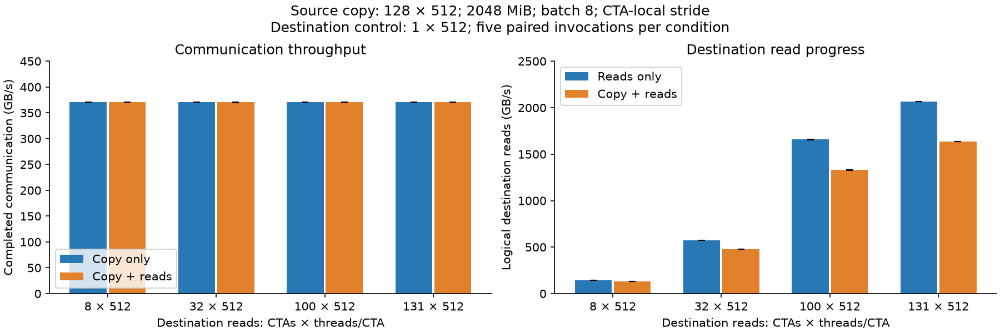
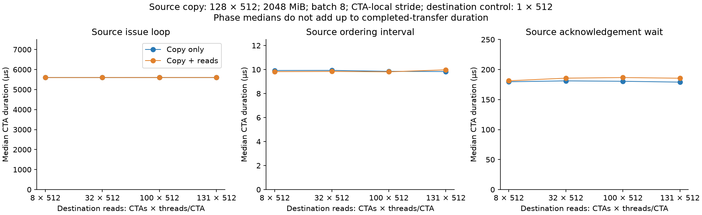
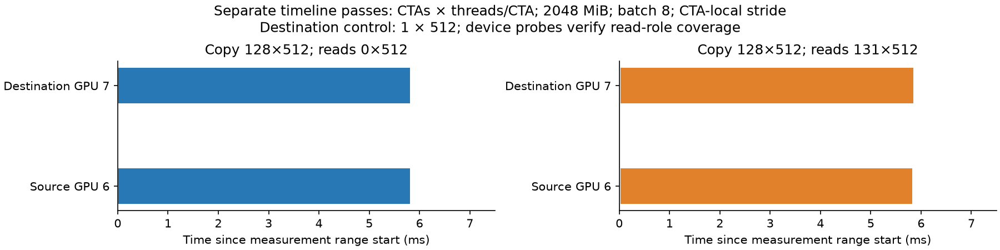

# Destination reads with the calibrated communication kernel

**Question.** Does destination read traffic slow the communication kernel after its request supply reaches the measured throughput plateau?

**Answer.** With communication fixed at 128 CTAs × 512 threads/CTA, 2048 MiB and batch 8, median paired communication changes range from -0.119% to -0.021%. All 20 primary pairs show a small decrease, but none establishes substantial communication degradation. At destination reads 131 × 512, the separately paired read rate changes by -20.81%. A practical program plateau does not identify the physical bottleneck.

[Plan](../../04_shared_resource_contention.md) · [Communication calibration](../2026-10-27-saturation-gpu6-7/README.md) · [Configurations](../../configs/saturated_contention_gpu6_7/) · [Analysis script](../../../../common/scripts/analyze_saturated_contention.py)

| Meaning | Registry |
|---|---|
| Completed communication duration / throughput | A1 |
| Source issue, ordering, publication, acknowledgement and CTA spread | A2–A7 |
| Destination read work, active duration and SM placement | A8–A10 |
| Payload correctness | A11 |
| Timeline and device operating state | B1–B3 |

## Communication under destination read pressure

### Motivation

Earlier destination-pressure tests used communication settings whose throughput still increased with more issuing threads. This comparison uses the separately confirmed plateau and asks whether destination pressure now reduces communication performance.

### Setup

| Knob | Role | Setting |
|---|---|---|
| Endpoint pair | Constant | Physical GPU 6 → GPU 7; H100 80 GB; 132 SMs each |
| Source communication | Constant | 128 CTAs × 512 threads/CTA; 2048 MiB; CTA-local stride; batch 8 independent scalar 4-byte operations |
| **Destination read count** | **Independent variable** | **0 (copy-only), 8, 32, 100, 131 CTAs × 512 threads/CTA** |
| Destination control | Constant | 1 CTA × 512 threads/CTA, one polling lane, separate SM from reads |
| Destination reads | Constant | Disjoint local 1 GiB buffer; vector loads; 256 KiB bursts; pacing 0 |
| Residency | Constant | One CTA per SM; 116736 dynamic shared bytes per CTA |
| Completion | Constant | All writers system-fence, CTA publication, destination observation and acknowledgement |
| Primary pairs | Constant | Five pairs per read setting; three warm-ups + twelve retained transfers per invocation; rotate level order |
| Read-only calibration | Separate control | Five invocations × five retained 20 ms windows per level; two warm-ups |
| Read-only matched pairs | Separate control | Five pairs per level; three warm-ups + twelve windows; source timer controls 128 × 512, destination control 1 × 512 |
| Probe overhead | Separate control | Five minimal/detailed pairs with reads 131 × 512 |

### Method

The binary and source hashes exactly match the successful batch calibration (`build_provenance.json`). No CUDA code, clocks, or power settings changed. Reads-alone calibration precedes primary pairs. Each primary pressure run immediately follows its own copy-only reference. Read performance uses a separate set of adjacent reads-only / reads-with-copy pairs, with the solo timer set to the median concurrent read-active duration measured in the primary runs.

There are 112 accepted timing invocations, 864 retained transfers and 340 retained read-only windows. Every retained transfer passed full-payload verification. Recorded SM IDs show distinct SMs for all CTAs within each endpoint; every read CTA covers the full destination receiver interval and completes work. Host telemetry intervals confirm no accepted invocations overlap. Per-device locks guard runs. Raw JSON, snapshots and telemetry remain local under ignored `raw/`; reproduction requires those files or rerunning the saved runner.

Results use medians of five invocation medians. Percentage changes are medians of the five paired percentage changes, so they need not equal the ratio of displayed grand medians. Reference IQR is across invocation medians. The standardized difference is (pressure median − reference median) / reference IQR; a small denominator can make a tiny practical change look large.

### Results

All rows: source communication **128 × 512**, **2048 MiB**, **batch 8**, **CTA-local stride**; destination control **1 × 512**. Geometry notation means CTAs × threads/CTA. Copy-only references have destination reads **0 × 512**.

| Destination reads | Copy-only GB/s (min–max) | With reads GB/s | Paired change % (min–max) | Slower pairs | Reference IQR GB/s | Difference / IQR |
|---|---|---|---|---|---|---|
| 8 × 512 | 370.742 (370.646–370.757) | 370.634 | -0.021 (-0.035–-0.002) | 5/5 | 0.0604 | -1.78 |
| 32 × 512 | 370.708 (370.668–370.755) | 370.270 | -0.114 (-0.139–-0.071) | 5/5 | 0.0225 | -19.44 |
| 100 × 512 | 370.690 (370.543–370.720) | 370.338 | -0.092 (-0.095–-0.069) | 5/5 | 0.0369 | -9.58 |
| 131 × 512 | 370.706 (370.620–370.791) | 370.275 | -0.119 (-0.143–-0.084) | 5/5 | 0.0604 | -7.13 |

| Destination reads | Copy-only / with-reads p05 GB/s | Copy-only / with-reads minimum GB/s |
|---|---|---|
| 8 × 512 | 370.213 / 370.252 | 369.803 / 370.178 |
| 32 × 512 | 370.328 / 369.888 | 369.723 / 369.453 |
| 100 × 512 | 370.366 / 369.998 | 370.121 / 369.844 |
| 131 × 512 | 370.343 / 370.030 | 370.309 / 369.809 |

Transfer-level p05 and minima cover 60 retained transfers per arm and condition. They expose slow transfers rather than treating all within-invocation samples as independent repetitions.

| Destination reads | Completed duration µs, only / with reads | Issue-loop µs, only / with reads | Ordering µs, only / with reads | Acknowledgement wait µs, only / with reads |
|---|---|---|---|---|
| 8 × 512 | 5792.40 / 5794.08 | 5601.42 / 5598.90 | 9.92 / 9.82 | 179.61 / 181.23 |
| 32 × 512 | 5792.93 / 5799.78 | 5599.98 / 5600.42 | 9.93 / 9.84 | 181.09 / 185.62 |
| 100 × 512 | 5793.20 / 5798.72 | 5601.00 / 5600.74 | 9.85 / 9.81 | 180.42 / 186.63 |
| 131 × 512 | 5792.96 / 5799.70 | 5600.27 / 5601.61 | 9.83 / 9.98 | 179.02 / 185.51 |

Issue-loop duration includes source loads, posted stores, and synchronization; it is not individual remote-store latency. Phase medians do not add up to completed duration. Full phase/spread comparisons are in `phases.csv`.

Destination read performance follows. These are **separate, duration-matched pairs**, not the copy-only references above. Source communication geometry is still **128 × 512**, payload **2048 MiB**, batch **8**, CTA-local stride; the reads-only arm uses source timer controls **128 × 512** and no copy.

| Destination reads | 20 ms calibration GB/s | Matched reads-only GB/s | With copy GB/s | Paired read change % | Actual active duration µs, only / with copy |
|---|---|---|---|---|---|
| 8 × 512 | 146.18 | 146.09 | 133.03 | -8.95 | 5830.6 / 5811.7 |
| 32 × 512 | 575.95 | 575.43 | 476.55 | -17.19 | 5841.6 / 5820.3 |
| 100 × 512 | 1661.32 | 1659.38 | 1328.56 | -19.93 | 5842.5 / 5820.7 |
| 131 × 512 | 2069.15 | 2066.36 | 1636.45 | -20.81 | 5844.3 / 5823.5 |

Actual standalone read intervals are about 19–22 µs longer than concurrent intervals despite matching the requested timer; startup/tail and stop checks remain included. Logical read GB/s counts completed 256 KiB bursts over the union of read-CTA active intervals, including startup/tail. It is not measured physical HBM traffic. Read-only calibration still rises from 100 × 512 to 131 × 512. This tests the maximum available CTA count of the unchanged injector, not an established HBM-saturation point. Filling the available SMs is not proof of HBM saturation.

Detailed probes change completed duration by a median -0.005% at reads 131 × 512 (five paired invocations; range -0.044% to +0.020%). Opening and closing copy-only references are 370.726 and 370.747 GB/s.

### Interpretation

- **Communication changes little, consistently.** All 20 pairs decrease, with median effects below 0.12%. At reads 131 × 512, throughput moves from 370.706 to 370.275 GB/s. Large IQR-normalized values reflect very stable references, not large practical regressions. These adjacent pairs always put copy-only first, so a systematic order effect is not excluded.
- **The destination workload shows the larger change.** At reads 131 × 512, logical reads fall from 2066.36 to 1636.45 GB/s (-20.81%). Every read CTA completes bursts and covers receiver activity. This is evidence of interaction in the concurrent workload even though communication changes little.
- **Separate copying from completion waiting.** At reads 131 × 512, median CTA issue time changes from 5600.27 to 5601.61 µs, while acknowledgement waiting changes from 179.02 to 185.51 µs. This suggests checking completion/control progress before blaming a large slowdown in the copy loop. CTA medians cannot precisely apportion total duration or establish a remote-store latency.
- **The physical bottleneck remains unresolved.** No validated simultaneous L2/DRAM hardware-counter collection is available from the earlier profiler attempts. These results cannot identify HBM saturation, arbitration policy, or exact transaction routing. Source phase changes alone do not uniquely locate contention. Candidate explanations include a communication limit elsewhere, unequal sharing of endpoint service, and read-kernel limits that leave capacity for incoming writes. Distinguishing them requires validated traffic/counter evidence or separate controlled changes to the read workload.

## Reproduction and available observations

Run `python experiments/h100x2/thread_store/common/scripts/run_saturated_contention.py` on allocated, idle physical GPUs 6–7 with the calibrated binary. The runner resumes only matching configs and validates retained outputs; remove neither accepted records nor provenance to force a different binary into this campaign. Run `analyze_saturated_contention.py` using the analysis environment with matplotlib. `runs.csv`, `communication.csv`, `reads.csv`, `phases.csv`, and `analysis_summary.json` are compact derived records. Device telemetry is sampled for whole invocations, including allocation, warm-ups and validation; it cannot establish clock state during individual short transfers.

| Device | Invocation-wide sampled SM clock range MHz | Maximum sampled power W | Runs with link-counter deltas |
|---|---|---|---|
| GPU 6 | 345–1980 | 145.82 | 112/112 |
| GPU 7 | 345–1980 | 165.21 | 112/112 |

Raw clock-reason masks in `environment_summary.json` are 0x0 and 0x1. Clock samples span idle/setup and active work; this is not evidence of fixed clocks during communication. Link deltas include warm-ups, setup and verification, so they are not the transferred-payload counter for a retained window.

Separate Nsight Systems passes retain endpoint overlap and the intended geometry. Each capture has two warm-ups and one retained transfer with CUDA/NVTX tracing, CPU sampling and context-switch collection disabled, and no replay. Their timing is separate from the primary measurements. The strongest profile retains about the same logical read rate as the unprofiled runs; two single-transfer captures validate overlap, not the small primary effect size.

| Communication | Destination reads | Profiled communication GB/s | Profiled logical reads GB/s | Read coverage of receiver interval |
|---|---|---|---|---|
| 128 × 512; 2048 MiB; batch 8; CTA-local | 0 × 512 | 371.28 | 0.00 | 0.00 |
| 128 × 512; 2048 MiB; batch 8; CTA-local | 131 × 512 | 370.69 | 1636.94 | 1.00 |

Destination control is 1 × 512 in both profiles. Coverage is not applicable to the copy-only profile; its stored zero means no read CTAs. A kernel timeline alone cannot separate the fused read/control roles, so coverage and work counts come from device probes.
