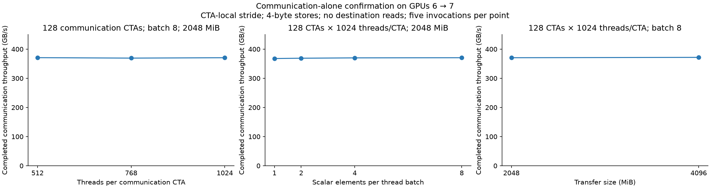
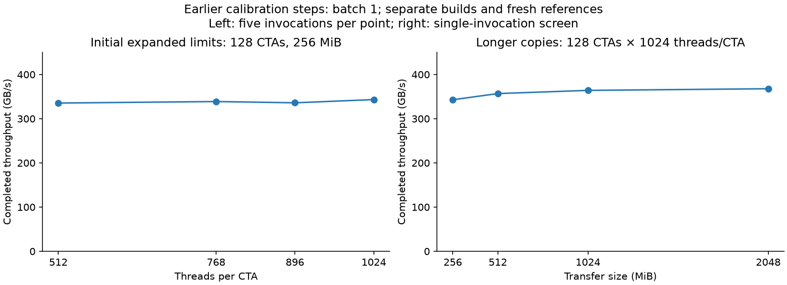

# Communication saturation calibration — correction

**Result.** The repeated confirmation passes the stated near-plateau criterion. The selected reference is **128 communication CTAs × 512 threads/CTA, 2048 MiB, batch 8, CTA-local stride**, at **370.75 GB/s**. Destination reads are disabled. This is a measured throughput plateau for this copy implementation and completion protocol; it does not identify the physical limiting resource.

The earlier 64-CTA × 512-thread sweep was incomplete calibration. It should not have been followed by the contention grid while throughput was still increasing. The [plan](../../04_shared_resource_contention.md) now makes this calibration a prerequisite. Earlier measurements remain valid for their recorded settings, but are not a saturated reference.

| Observation | Meaning |
|---|---|
| Completed throughput and duration (A1) | Acknowledged source-local interval; primary outcome |
| Issue, ordering, acknowledgement (A3, A4, A6) | Per-CTA phase medians; not individual remote-store latency and not additive |
| Placement and correctness (A10, A11) | Unique CTA/SM records and full-payload verification |

Definitions are in the [common setup](../../../00_common_setup.md).

## Confirming where throughput stops improving

### Motivation

Increase communication demand beyond the earlier software limits and check whether more threads, more independent scalar operations per thread, or longer transfers still improve throughput.

### Setup

| Knob | Role | Configuration |
|---|---|---|
| GPUs | Constant | Physical GPU 6 → GPU 7; H100, NV18 topology; no clock or power-setting changes |
| **Threads per CTA** | **Independent variable** | **512, 768, 1024**, at 128 CTAs, 2048 MiB, batch 8 |
| **Batch size** | **Independent variable** | **1, 2, 4, 8** scalar elements per thread, at 128 CTAs × 1024 threads/CTA and 2048 MiB |
| **Transfer size** | **Independent variable** | **2048 versus 4096 MiB**, at 128 CTAs × 1024 threads/CTA and batch 8 |
| CTA-count check | Separate comparison | 64 versus 128 CTAs × 1024 threads/CTA, 2048 MiB, batch 8 |
| Accesses | Constant | Scalar 4-byte source loads and peer stores; CTA-local stride |
| Batch implementation | Controlled request supply | Load B independent source elements into registers, then issue their B matching scalar stores; no added fences |
| Destination | Constant within each thread group | 0 read CTAs × group threads; 1 control CTA × group threads, with one polling lane |
| Placement | Constant policy | One CTA per SM, checked through occupancy and recorded SM IDs |
| Sampling | Constant | Five rotated rounds per setting; three warm-ups and twelve retained transfers per invocation |
| Compiler | Constant for confirmation | 52 registers, 4100 bytes static shared memory, no spills; one binary for all batch comparisons |

### Method

Completed duration is source earliest start to latest acknowledgement observation, and throughput is useful bytes divided by that duration. All writers fence before publishing completion; destination acknowledgement and full-buffer verification are retained. Detailed runs also record issue, ordering, and acknowledgement intervals and up to eight software issue checkpoints. Those checkpoints are not remote arrival measurements, and non-divisible loop lengths can yield fewer than eight checkpoints.

The practical criterion is less than 1% median gain on two successive increases in issuing threads, confirmed over five rounds; the three thread-count medians must also span less than 1%. Batch-size and transfer-size checks test whether another avoidable request-supply or short-transfer limitation remains. One percent is a calibration tolerance, not a statistical significance test. Compare within the same compiled program and report the size of each change.

### Results

The figure uses zero-based shared scales. Points are medians of five invocation medians; error bars show their minimum and maximum.

| Communication CTAs × threads/CTA | Payload MiB | Batch elements/thread | Median GB/s | Invocation range GB/s | Median completed µs |
|---|---|---|---|---|---|
| 128 × 512 | 2048 | 8 | 370.75 | 370.66–370.86 | 5792.24 |
| 128 × 768 | 2048 | 8 | 369.21 | 369.13–369.40 | 5816.48 |
| 128 × 1024 | 2048 | 8 | 370.53 | 370.43–370.63 | 5795.63 |
| 128 × 1024 | 2048 | 1 | 367.76 | 367.72–367.89 | 5839.41 |
| 128 × 1024 | 2048 | 2 | 368.84 | 368.71–369.06 | 5822.29 |
| 128 × 1024 | 2048 | 4 | 370.02 | 369.93–370.09 | 5803.71 |
| 64 × 1024 | 2048 | 8 | 356.04 | 355.95–356.11 | 6031.55 |
| 128 × 1024 | 4096 | 8 | 371.73 | 371.51–371.79 | 11554.14 |

| Controlled change: CTAs × threads/CTA; other settings fixed | Median within-round throughput change |
|---|---|
| 128 × 512 → 128 × 768; 2048 MiB; batch 8 | -0.425% |
| 128 × 768 → 128 × 1024; 2048 MiB; batch 8 | +0.348% |
| 128 × 1024; 2048 MiB; batch 2 → 4 | +0.312% |
| 128 × 1024; 2048 MiB; batch 4 → 8 | +0.133% |
| 128 × 1024; batch 8; 2048 → 4096 MiB | +0.313% |

### Interpretation

- **More issuing threads no longer give a useful gain at the selected settings.** The 512-, 768-, and 1024-thread medians span 0.418%. The largest positive step in the thread comparison is 0.348%.
- **Additional request batching and a longer transfer also give less than 1% improvement** in the final upper-level comparisons. These are checks against stopping merely because a configured limit was reached.
- **Use the full selected configuration in later tests.** A reference with only the CTA/thread counts but a different payload or batch size is not this calibrated workload. Changing the binary requires fresh references.
- **Physical cause remains unresolved.** These measurements establish a practical throughput plateau. They do not prove HBM saturation or identify a particular NVLink/L2 queue. No hardware-counter result is claimed.

## What had to change before that confirmation

### Motivation

Document why the previous sweep was insufficient and preserve the exploratory steps rather than presenting only the successful endpoint.

### Setup

| Stage | Independent variables | Fixed settings |
|---|---|---|
| Expanded concurrency | CTA counts 64, 96, 128, 132; threads/CTA 512, 768, 896, 1024 in the recorded combinations | 256 MiB, batch 1, no destination reads; traversal explicitly recorded |
| Transfer duration | Payload 256, 512, 1024, 2048 MiB | 128 CTAs × 1024 threads/CTA, batch 1, CTA-local stride |
| Larger-payload cross-checks | 128 CTAs × 512/768 threads; 64 CTAs × 1024 threads; 132 CTAs × 1024 threads with global stride | 2048 MiB, batch 1, no destination reads |
| Final request-supply check | Batch 1/2/4/8 and the complete configurations above | Separate batch-capable binary; fresh controls |

### Method

The communication/control arrays and per-lane checksum storage were expanded safely for 132 CTAs and 1024 threads/CTA. Device block-size and one-CTA-per-SM checks remain enabled. Adding `payload_mib` changed host configuration only: the saved GPU instruction dumps for the concurrency and payload builds are identical. Adding batched scalar operations changed GPU code and registers (54 → 52), so the final comparisons use new same-binary references.

The initial 96- and 132-CTA local-stride settings performed poorly. The existing global-stride option recovered much of that throughput. Local CTA region starts are not equally aligned for those CTA counts; traversal also changes address order, so the screen alone does not isolate an alignment mechanism. The selected 128-CTA setting keeps contiguous regions aligned and avoids treating that work-assignment effect as saturation.

### Results

`runs.csv` retains every accepted invocation's full configuration and issue, ordering, acknowledgement, and completed timings, grouped by binary phase. The transfer-size screen is exploratory (one invocation per point); the final plateau is supported by the separate five-round confirmation above.

### Interpretation

- **Extending the original limits was necessary but insufficient.** The 256 MiB case still had small gains near the enlarged thread limit; larger transfers raised sustained throughput further.
- **The final configuration tests stronger request supply.** Its same-binary comparisons show that further thread and batch increases do not materially raise throughput. Do not attribute every change between the earlier and final builds to batching alone, because compilation also changed.
- **Keep the earlier negative results in their original scope.** They characterize the lower-demand settings. Future contention tests must use fresh controls at the selected plateau and must first calibrate the destination workload's achieved pressure.

## Validation and retained evidence

The final minimal/detailed probe comparison at **128 CTAs × 512 threads/CTA, 2048 MiB, batch 8, no destination reads** uses five interleaved pairs. Median paired throughput change from minimal to detailed probes is **+0.020%**. Both modes retain boundary and correctness observations; this is not an entirely uninstrumented reference.

Accepted data contains **121 invocations and 1452 retained transfers**, including the small old/new-binary correctness checks. Every copy passed full-buffer verification and the placement/timing checks. The generated code retains scalar bulk stores; no register spills were reported.

**Rejected scheduling attempt.** I started probe checks while the last confirmation round was still running. Two own jobs overlapped on GPUs 6–7. All eight round-5 confirmation records and every probe record from that attempt were conservatively excluded, preserved under `batch/raw/rejected_overlap/`, and reacquired sequentially. `batch/rejected_runs_summary.json` records the reason and filenames. The wrapper now holds exclusive per-device file locks before its idle check; a host-only test verified that a second invocation is rejected before GPU work starts. A final audit also verified that all 121 accepted invocation telemetry intervals are non-overlapping. Rejected samples are not included in the figures, tables, or counts above.

Raw JSON, telemetry, logs, source snapshots, instruction dumps, and the rejected attempt remain local and ignored by Git. Configurations, analysis scripts, build hashes, derived summaries, and figures remain versioned. Each phase records its own source/binary hashes. Earlier binaries are retained locally under `common/bin/push_harness_before_*`; reproducing an earlier phase requires that phase's source and binary, not the latest default build.
