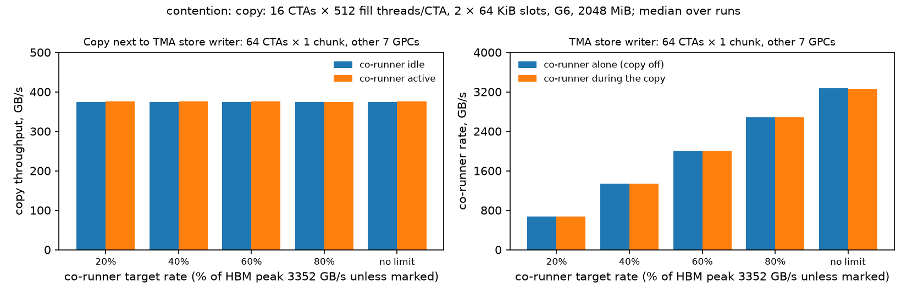
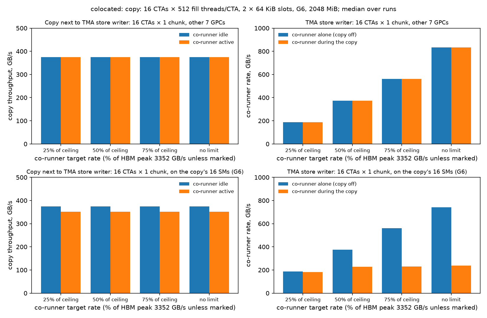
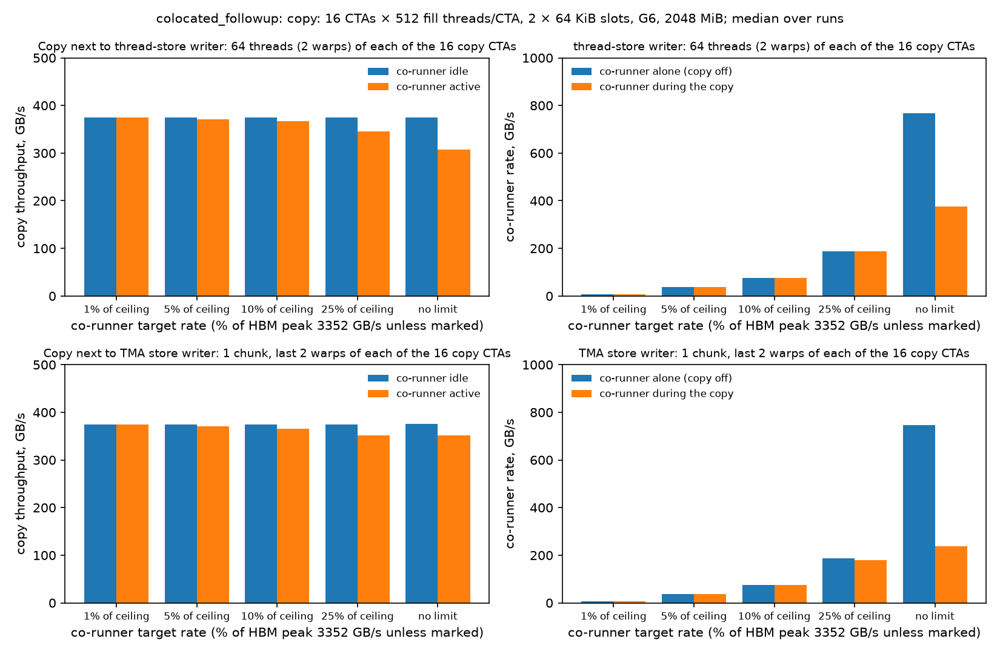
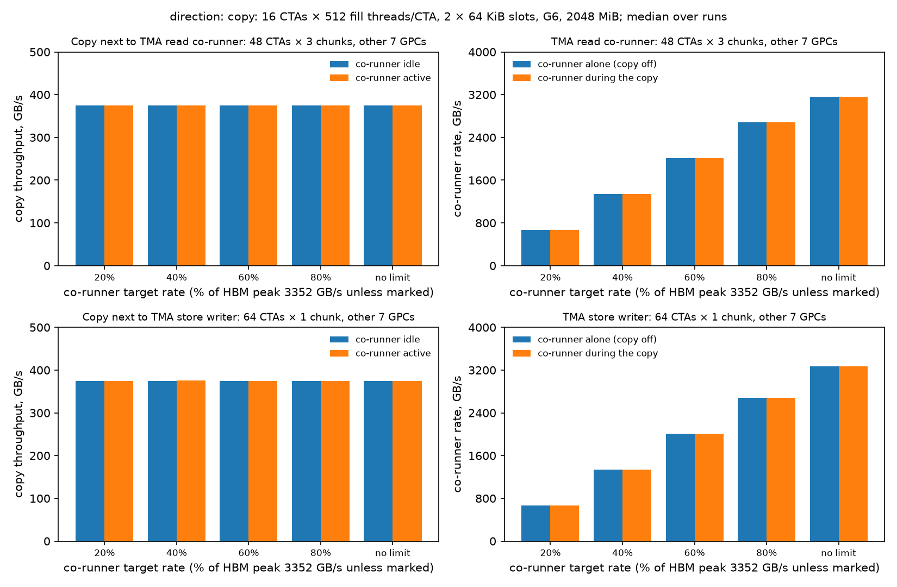
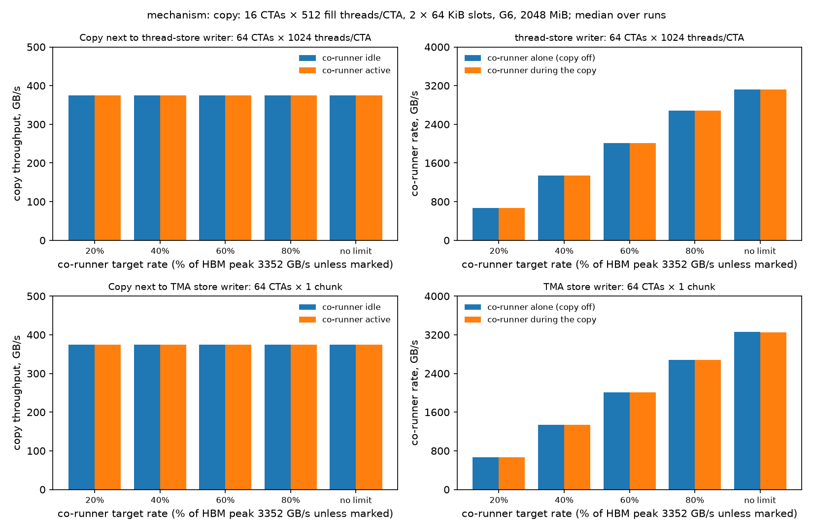

# TMA push next to TMA memory co-runners

**Status (2026-11-10): E1.1, E1.2, E1.3, E1.5, E1.6, E1.7, E1.8 and a follow-up to E1.5 done. E1.4 was dropped before any run.**

[Plan](01_data_store_congest.md) · [Series index](../PLANS.md) · [Common setup and new metric ids](../00_common_setup.md) · [Harness](../../common/README.md) · [Run configurations](configs/) · [Matching thread-store experiment (plan 07)](../../../thread_store/observation/data_store_congest/README.md)

**Question.** When some SMs of the source GPU push data to the peer GPU with TMA bulk stores, while TMA co-runners store to (or read from) local memory, does the push slow down? Does it matter whether the co-runner runs on other SMs, on the same SMs, or on the destination GPU?

**Answer.** **Only when the co-runner stores from the copy's own SMs.** A writer in two spare warps of each copy CTA slows the copy in proportion to the bytes it stores from those SMs: from −0.2% at 7 GB/s to about −2.6% at 75 GB/s. With TMA bulk stores, the loss stops at **about −6.3%** (375 → 352 GB/s), because during the copy the writer itself is capped at about 230–240 GB/s (−68% of its rate alone). A writer made of ordinary thread stores from the same two warps is not capped as hard, so the copy loses more: **−7.9% at 187 GB/s and −18.0% with no limit** (the writer then stores 375 GB/s). So the TMA unit is not needed for this effect; storing from the same SM is. The same TMA writer on 16 other SMs changed the copy by +0.01% to +0.05%. On other SMs of the source GPU, 64 TMA store writer CTAs at 670–3270 GB/s (20–98% of HBM peak) changed the copy by +0.02% to +0.14%. TMA reads at the same rates (up to 3159 GB/s) changed it by −0.00% to +0.07%, and 64 thread-store writer CTAs (up to 3124 GB/s) by −0.04% to +0.10%. On the destination GPU, the same writer changed the copy by −0.03% to −0.20%, and the writer itself lost 11.2% at no limit. These no-effect results repeat plan 07's thread-store results with both flows made of TMA requests. The calibration behind this: the TMA push reaches a plateau of about 375 GB/s from 12 copy CTAs, the same NVLink limit as the thread-store copy (371 GB/s). One TMA copy CTA sends about 51 GB/s, against about 35 GB/s for a thread-store copy CTA. Once the push is on its plateau, thread 0 spends a growing part of its loop waiting for free staging slots.

| Word used in this report | Metric id ([common setup](../00_common_setup.md), [thread-store setup](../../../thread_store/observation/00_common_setup.md)) |
|---|---|
| Copy throughput: payload bytes ÷ time from first copy CTA start to the acknowledgement | A1 |
| Issue loop, ordering interval, acknowledgement wait (per copy CTA, medians) | A3, A4, A6 |
| Slot wait: share of thread 0's issue loop spent waiting for a staging slot to be read out | A15 |
| Fill share: share of thread 0's issue loop from a free slot to its bulk store (fill + barriers) | A16 |
| Bulk completion wait: last bulk store started → all of the CTA's bulk stores completed | A17 |
| Co-runner active interval and coverage of the copy window | A8 |
| Co-runner rate: 64 KiB chunks ÷ co-runner active time (requested bytes) | A9 |
| Copy change: median copy throughput with the co-runner active ÷ with it idle, in the same run, minus 1 | A1 (paired) |
| Role and physical SM of each CTA, both GPUs | A10 |
| Full destination check after every transfer; co-runner check after every launch | A11 |
| SM-to-GPC map (reused from plan 07) | A12 |

## Words and setup shared by all sections

| Item | Setting |
|---|---|
| GPUs | Source → destination **0 → 1** and **4 → 5**, both 2026-11-10. Each sub-experiment ran on one pair, except E1.6 (see its section). Plan 07 found the same SM-to-GPC map on both pairs. Each raw record names its pair |
| Copy (TMA push) | Thread 0 of each copy CTA starts `cp.async.bulk` stores of 64 KiB chunks from a ring of shared-memory staging slots into the destination's window (NCCL LSA peer pointer). The copy threads first fill each slot with position-dependent values (the plan-07 value function). No source HBM reads. Each CTA owns a contiguous run of chunks. Payload 2048 MiB. Completion: thread 0 waits for its bulk stores, fences, publishes "done"; the receiver acknowledges |
| Co-runners | **TMA store writer:** thread 0 stores one 64 KiB shared-memory chunk again and again into its slice of a local 1 GiB buffer. **TMA read co-runner:** thread 0 reads 64 KiB chunks into shared memory (plan 04). Optional rate limit: chunk *k* of a CTA starts no earlier than start + *k* × interval |
| Placement | One CTA per SM on both GPUs (1024 threads/CTA). **One layout for every run** (user's choice): copy packed into G6 (18 SMs) first; co-runners spread over the 7 other GPCs. In E1.5, one co-runner in the last two warps of each copy CTA instead |
| Shared memory | 196,864 bytes per CTA in every run, so L1 size is the same in all arms |
| Repeats | Copy alone: 3 warm-ups + 12 transfers per run, run value = median. With a co-runner: 3 warm-ups, then 6 idle + 6 active transfers alternating. 3 runs per setting, rotated order |
| Not controlled | Clocks and power unchanged (snapshots before and after every run). Shared machine: every run started on idle GPUs under a per-device lock |
| Not collected | Profiler timelines and counters (B1, C1–C9). Co-runner rates count requested bytes; plan 07's counter check matched them to DRAM writes for its store writers, with a different binary |

Raw records stay local: `results/2026-11-10/<group>/raw/` (git-ignored). Tables and figures were made from them by [analyze_tma_calibration.py](../../common/scripts/analyze_tma_calibration.py) and [analyze_tma_contention.py](../../common/scripts/analyze_tma_contention.py). Without the local raw directory, reproducing them requires a rerun.

## Build check

### Motivation

A TMA bulk store into a peer GPU's memory through an NCCL LSA pointer had not been used in this project. Before calibrating, every role combination had to run and verify.

### Setup

One run of each combination on GPUs 0 → 1: copy alone, copy with slots filled once, TMA store writer alone and with the copy, reader with the copy, thread-store writer with the copy, writer on the copy's SMs (alone and with the copy), writer on the destination (alone and with the copy). Payload 256 MiB, 1 warm-up + 2 transfers. Configs: [configs/smoke/](configs/smoke/).

### Method

Every transfer was fully checked at the destination, and every co-runner launch was checked. These runs are not used in any result.

### Results

All 10 runs verified. The default copy (16 CTAs, spread over all GPCs) gave about 369.5 GB/s with this short payload.

### Interpretation

- **TMA bulk stores to the NCCL peer pointer work** and keep the full destination check, including misplaced chunks.

## TMA push alone

### Motivation

The TMA push is a new workload, so it needs its own reference: the setting where more copy CTAs or staging slots no longer raise throughput. The plan expected the plateau near the thread-store value (about 370 GB/s), reached with fewer SMs.

### Setup

| Knob | Role | Values |
|---|---|---|
| **Copy CTAs** | **Independent variable** | **1, 2, 4, 8, 12, 16, 24, 32, 48** |
| **Staging slots per CTA** | **Independent variable** | **1, 2, 3** × 64 KiB |
| **Chunk size × fill threads/CTA** | **Independent variable (second step)** | **16, 32, 64 KiB × 128, 256, 512, 1024**, plus slots filled once at each chunk size; at 4 CTAs × 2 slots |
| Fill threads/CTA | Constant in the first step | 512 |
| Placement | Constant | Packed from G6 (G6 holds the first 18) |
| Co-runner | Constant | Absent; all other SMs hold idle CTAs |
| GPUs, runs | Constant | 0 → 1; 3 runs per setting |

Configs: [configs/copy_alone/](configs/copy_alone/), named `copy_c<CTAs>_t<fill threads>_k<chunk KiB>_s<slots>_[fill|once_]packed_R<run>.cfg`.

### Method

1. Stopping rule, as in plan 07: on the plateau when within 1% of the plateau value and two successive increases add less than 1%.
2. Deviation from the plan: the chunk × fill step ran at 4 CTAs, not at the selected 16. On the plateau, NVLink sets the throughput, so the step could not show what limits one CTA.
3. Deviation: the plan said "the fewest CTAs on the plateau" (12). 16 was chosen because it is equally on the plateau and uses the same 16 G6 SMs as plan 07's copy, so the two copies meet co-runners on the same SMs.

### Results

*TMA push alone, 64 KiB chunks, 512 fill threads/CTA, packed from G6, 2048 MiB, GPUs 0 → 1. Points: median of 3 runs; bars: min–max (smaller than the marker). The 2-slot line lies under the 3-slot line.*

Copy throughput, GB/s (median of 3 runs; min–max within 1.5 GB/s everywhere), with slot wait at 2 slots:

| Copy CTAs × 512 fill threads/CTA | 1 slot × 64 KiB | 2 slots | 3 slots | Slot wait, 2 slots | Bulk completion wait, 2 slots |
|---|---|---|---|---|---|
| 1 | 35.8 | 51.1 | 51.1 | 39.2% | 1.86 µs |
| 2 | 71.6 | 101.3 | 102.1 | 39.2% | 1.86 µs |
| 4 | 143.2 | 204.1 | 204.1 | 39.1% | 1.84 µs |
| 8 | 285.9 | 349.1 | 349.0 | 43.4% | 1.86 µs |
| 12 | 373.8 | 374.4 | 374.4 | 62.7% | 2.12 µs |
| 16 | 375.1 | 375.1 | 375.0 | 71.9% | 2.83 µs |
| 24 | 374.2 | 374.3 | 374.3 | 81.3% | 3.21 µs |
| 32 | 374.2 | 374.3 | 374.3 | 85.8% | 3.95 µs |
| 48 | 374.3 | 374.5 | 374.4 | 89.3% | 5.25 µs |

What limits one CTA: 4 copy CTAs × 2 slots, copy throughput in GB/s (median of 3 runs):

| Chunk | 128 fill threads/CTA | 256 | 512 | 1024 | Slots filled once (512) |
|---|---|---|---|---|---|
| 16 KiB | 117.5 | 115.5 | 111.5 | 87.5 | 201.6 |
| 32 KiB | 200.1 | 199.9 | 185.3 | 159.4 | 204.1 |
| 64 KiB | 204.1 | 204.1 | 204.1 | 204.1 | 204.1 |

Table: [copy_sweep_summary.csv](results/2026-11-10/copy_sweep_summary.csv).

### Interpretation

- **The TMA push reaches its plateau of about 375 GB/s at 12 CTAs**, the same NVLink limit as plan 07's thread-store copy (371 GB/s). The plateau does not depend on the issue mechanism. More CTAs do not help.
- **One TMA copy CTA sends about 51 GB/s with 2 or more slots, and 35.8 GB/s with 1.** A thread-store copy CTA sends about 35 GB/s. With one slot, thread 0 cannot fill the next chunk while the last is read out.
- **With 64 KiB chunks the TMA side limits a CTA, not the fill.** 51 GB/s per CTA holds for 128–1024 fill threads and when slots are filled only once. With 16 and 32 KiB chunks the fill and its two barriers per chunk limit the CTA. More fill threads make it worse, because the barriers cost more.
- **Slot wait shows back-pressure once on the plateau.** Below the plateau, thread 0 waits about 39% of its loop for the TMA unit to read a slot out. On the plateau, the wait grows with every added CTA (63% at 12, 89% at 48): each CTA gets a smaller share of NVLink and waits longer. The bulk completion wait grows in the same way. Neither is the time of one chunk on NVLink.
- **Selected copy: 16 CTAs × 2 slots × 64 KiB × 512 fill threads/CTA, in G6: 375.1 GB/s alone.**

## Co-runners alone

### Motivation

The pressure must be known before it is applied, in this binary and under this shared-memory reservation. A writer that shares the copy's SMs is new, and its ceiling was not known.

### Setup

| Knob | Role | Values |
|---|---|---|
| **TMA store writer CTAs × chunks in flight** | **Independent variable** | **4, 8, 16, 24, 32, 48, 64 × 1, 2**, no limit |
| **Target rate** | **Independent variable** | **670, 1341, 2011, 2682 GB/s (20–80% of HBM peak), no limit** |
| TMA read co-runner | Constant | 48 CTAs × 3 chunks (plan 04, plan 07), the same targets |
| Writer on the copy's SMs | Constant | One TMA store writer (1 chunk) in each of the 16 copy CTAs in G6, no limit |
| Placement | Constant | Co-runners spread over the 7 GPCs other than G6 |
| Copy | Constant | Off; copy CTA 0 times six 20 ms windows; the copy's SMs keep their role |
| GPUs, runs | Constant | 4 → 5; 3 runs per setting |

Configs: [configs/co_runner_alone/](configs/co_runner_alone/).

### Method

Selection rule, as in plan 07: the fewest CTAs within 95% of the ceiling with even CTAs (slowest ÷ fastest ≥ 0.95).

### Results

*TMA store writer alone, no limit, spread over the 7 GPCs other than G6. Median of 3 runs; bars: min–max.*

| TMA store writer CTAs | 1 chunk in flight GB/s (% of peak) | 2 chunks |
|---|---|---|
| 4 | 208 (6.2%) | 255 (7.6%) |
| 8 | 417 (12.4%) | 510 (15.2%) |
| 16 | 834 (24.9%) | 1020 (30.4%) |
| 24 | 1251 (37.3%) | 1529 (45.6%) |
| 32 | 1668 (49.8%) | 2040 (60.8%) |
| 48 | 2502 (74.6%) | 3050 (91.0%) |
| 64 | 3255 (97.1%), slowest ÷ fastest CTA 0.947 | 3279 (97.8%), slowest ÷ fastest 0.65 |

| Co-runner | Target 670 GB/s | 1341 | 2011 | 2682 | No limit |
|---|---|---|---|---|---|
| TMA store writer, 64 CTAs × 1 chunk | 670.2 | 1341.1 | 2011.1 | 2681.9 | 3255.3 |
| TMA read co-runner, 48 CTAs × 3 chunks | 670.0 | 1340.9 | 2010.7 | 2681.6 | 3177.4 |
| TMA store writer on the copy's 16 SMs (G6), 1 chunk | — | — | — | — | 748.6 (run medians 748.6, 749.7, 745.0) |

Table: [co_runner_alone_summary.csv](results/2026-11-10/co_runner_alone_summary.csv).

### Interpretation

- **The TMA store writer repeats plan 07:** about 52 GB/s per CTA with 1 chunk and 64 GB/s with 2; 64 CTAs × 1 chunk reach 3255 GB/s (97.1%; plan 07: 3257).
- **Selected TMA store writer: 64 CTAs × 1 chunk in flight.** Only 64 CTAs come within 95% of the ceiling. Its slowest ÷ fastest CTA ratio, 0.947, is just under the 0.95 rule; 2 chunks add 0.7% but make CTAs very uneven (0.65).
- **Both co-runners meet every target within 0.02%.**
- **The writer on the copy's 16 G6 SMs reaches 749 GB/s (about 47 GB/s per SM).** On 16 spread SMs it reached 834 GB/s (the "other SMs" arm below). Plan 07 found that one GPC carries only about 700–800 GB/s of stores, so G6's store capacity is the likely limit. The levels of the same-SM test are 25, 50 and 75% of 749 GB/s.

## Shared method for the tests with a co-runner

- **Pairs inside one run.** Every run alternates transfers with the co-runner idle and active: 3 warm-ups, then 6 idle and 6 active transfers. Odd rounds start idle, even rounds start active. Idle co-runner CTAs start and wait on the same SMs (and the same warps, in E1.5), so the two halves differ only in the co-runner's traffic. The run's **copy change** is median(active) ÷ median(idle) − 1. Tables give the median of the per-run changes over 3 runs, with min and max.
- **Reference variability.** The interquartile range (IQR) of all idle transfers of one co-runner kind (3 runs × 5 levels × 6 transfers, or 4 levels in E1.5). "Change ÷ idle IQR" divides the change of the pooled medians in GB/s by that IQR. Transfers are nested in runs, so this is a guide to size, not a test.
- **Opening and closing references.** One run with idle co-runners before and after each test checks for drift.
- **Co-runner side.** Its rate during the copy (active transfers) is compared with the same co-runner alone on the same SMs, with the copy off, in windows matched to its measured active time in the mixed run.
- **Order.** At each level, the arms run back to back in one round; level and arm order rotate between rounds.
- **Checks.** Every copy transfer is fully checked at the destination; every co-runner launch is checked; every co-runner CTA must cover the whole copy window.

## TMA writes on other SMs of the source GPU

### Motivation

This is the main test (E1.3 in the [plan](01_data_store_congest.md)). A fused kernel may write its results with TMA while other SMs push data to the peer GPU with TMA. With the copy in G6 and the writer in the other GPCs, the two flows share only the source GPU's crossbar, L2 and HBM path. Plan 07 found no copy slowdown in this layout with a thread-store copy. The plan expected the same, and a growing slot wait if the store path pushed back.

### Setup

| Knob | Role | Values |
|---|---|---|
| **Writer target rate** | **Independent variable** | **Idle (reference half), 670, 1341, 2011, 2682 GB/s, no limit** |
| Copy | Constant | 16 CTAs × 512 fill threads/CTA × 2 slots × 64 KiB, G6, 2048 MiB |
| TMA store writer | Constant | 64 CTAs × 1 chunk, the 7 GPCs other than G6, source GPU |
| GPUs, runs | Constant | 0 → 1; 3 runs per level; opening and closing references; probe-cost check (3 pairs, detailed timers on vs off, no limit) |

Configs: [configs/contention/](configs/contention/).

### Method

As in the shared method above. No deviations.

### Results

*Left: copy throughput in the idle and active halves of the same runs. Right: writer alone (copy off) and during the copy, on the same SMs. Median over 3 runs.*

| TMA store writer target, GB/s | Runs | Copy, idle half GB/s | Copy change (min to max) | Change ÷ idle IQR | Writer alone GB/s | Writer during the copy GB/s | Writer change | Slot wait idle → active | Bulk completion wait µs idle → active |
|---|---|---|---|---|---|---|---|---|---|
| 670 (20%) | 3 | 374.9 | +0.02% (0.00 to +0.16) | 0.3 | 671 | 671 | 0.0% | 72.0% → 71.9% | 2.79 → 2.79 |
| 1341 (40%) | 3 | 374.6 | +0.14% (+0.08 to +0.15) | 0.9 | 1341 | 1341 | 0.0% | 71.8% → 71.8% | 2.74 → 2.86 |
| 2011 (60%) | 3 | 374.6 | +0.13% (+0.08 to +0.16) | 0.9 | 2011 | 2011 | 0.0% | 72.0% → 71.9% | 2.66 → 2.78 |
| 2682 (80%) | 3 | 374.8 | +0.07% (+0.01 to +0.07) | 0.3 | 2682 | 2682 | 0.0% | 71.9% → 71.9% | 2.76 → 2.87 |
| No limit | 3 | 374.8 | +0.13% (−0.02 to +0.15) | 0.5 | 3270 | 3267 | −0.1% | 71.9% → 71.9% | 2.70 → 2.83 |

Idle IQR: 0.53 GB/s. References: 375.16 GB/s (opening), 375.14 GB/s (closing). Probe cost: copy throughput with detailed timers 375.04–375.10 GB/s, without 374.94–374.96 GB/s. Table: [contention_summary.csv](results/2026-11-10/contention_summary.csv).

### Interpretation

- **No copy slowdown.** The copy changed by +0.02% to +0.14% while 64 TMA writer CTAs stored up to 3270 GB/s (98% of HBM peak) into local memory. Every change is below one idle IQR.
- **No back-pressure signal either.** Slot wait (72%) and bulk completion wait (2.7–2.9 µs) are the same in both halves.
- **The writer is not slowed** (0.0% to −0.1%).
- **This repeats plan 07's result with both flows made of TMA requests.** On other SMs, the source GPU's crossbar, L2 and HBM path has room for both flows at these rates. As in plan 07, this does not name a part that has spare capacity.
- **The timers cost nothing measurable** (about 0.03%, within run-to-run variation).

## TMA writes from the same SMs as the push

### Motivation

This is the TMA-specific test (E1.5). Each copy CTA hosts one TMA store writer in its last two warps, so the copy and the writer share each SM's TMA unit, its shared memory and its connection out of the SM. A fused kernel that pushes data and writes results from the same CTA would do this. Plan 07 could not test it. The plan expected a slowdown here that is absent with the writer on other SMs at the same rate, and a growing slot wait if the copy's chunks queue behind the writer's.

### Setup

| Knob | Role | Values |
|---|---|---|
| **Where the writer runs** | **Independent variable** | **Same SMs** (one writer in the last two warps of each of the 16 copy CTAs, G6) vs **other SMs** (16 writer CTAs spread over the 7 GPCs other than G6) |
| **Writer target rate** | **Independent variable** | **Idle (reference half), 187, 374, 562 GB/s (25, 50, 75% of the same-SM ceiling of 749 GB/s), no limit** |
| Copy | Constant | 16 CTAs × 512 fill threads/CTA × 2 slots × 64 KiB, G6, 2048 MiB |
| TMA store writer | Constant | 16 CTAs × 1 chunk in flight, 64 KiB chunk after the copy's slots in shared memory |
| GPUs, runs | Constant | 4 → 5; 3 runs per level and arm; opening and closing references for both arms |

Configs: [configs/colocated/](configs/colocated/).

### Method

As in the shared method above. In the same-SM arm the copy and writer threads use separate named barriers, so neither waits for the other's barrier. When the writer is idle, its two warps sleep in a polling loop in both arms.

### Results

*Top: writer on 16 other SMs. Bottom: writer on the copy's own 16 SMs. Left: copy throughput, idle and active halves of the same runs. Right: writer alone (copy off) and during the copy. Median over 3 runs.*

| Writer | Target, GB/s | Runs | Copy, idle half GB/s | Copy change (min to max) | Change ÷ idle IQR | Writer alone GB/s | Writer during the copy GB/s | Writer change | Slot wait idle → active | Bulk completion wait µs idle → active |
|---|---|---|---|---|---|---|---|---|---|---|
| Other SMs | 187 | 3 | 375.0 | +0.02% (0.00 to +0.05) | 0.3 | 187 | 187 | 0.0% | 71.9% → 71.9% | 2.73 → 2.85 |
| Other SMs | 374 | 3 | 375.0 | +0.01% (−0.02 to +0.03) | 0.2 | 374 | 374 | 0.0% | 71.9% → 71.9% | 2.81 → 2.78 |
| Other SMs | 562 | 3 | 375.0 | +0.05% (−0.01 to +0.13) | 0.4 | 562 | 562 | 0.0% | 71.9% → 71.9% | 2.72 → 2.76 |
| Other SMs | No limit | 3 | 375.0 | +0.03% (+0.02 to +0.04) | 0.3 | 834 | 833 | 0.0% | 71.9% → 71.9% | 2.68 → 2.86 |
| **Same SMs** | 187 | 3 | 374.8 | **−6.09%** (−6.19 to −6.05) | −45.0 | 187 | 181 | −3.3% | 71.8% → 73.4% | 2.43 → 4.04 |
| **Same SMs** | 374 | 3 | 374.8 | **−6.11%** (−6.13 to −5.93) | −45.0 | 374 | 227 | −39.2% | 71.8% → 73.4% | 2.48 → 3.99 |
| **Same SMs** | 562 | 3 | 374.9 | **−6.18%** (−6.26 to −5.94) | −45.2 | 562 | 231 | −58.9% | 71.8% → 73.5% | 2.44 → 4.00 |
| **Same SMs** | No limit | 3 | 375.0 | **−6.30%** (−6.39 to −6.14) | −46.1 | 743 | 238 | −67.9% | 71.8% → 73.5% | 2.37 → 4.11 |

Idle IQR: 0.38 GB/s (other SMs), 0.51 GB/s (same SMs). Copy phase medians, same SMs: issue loop 5706–5710 µs idle → 6060–6071 µs active (+6.2%); fill share 19.2% → 18.0%; ordering interval 2.7 → 2.4–2.5 µs. Other SMs: issue loop 5705–5710 µs in both halves. Table: [colocated_summary.csv](results/2026-11-10/colocated_summary.csv).

### Interpretation

*Note 2026-11-10, after the [follow-up](#writes-from-the-same-sms-at-low-rates-tma-and-thread-stores): the first reading of these results said the loss does not depend on the writer's bytes. That was wrong. During the copy the writer reached only 181–238 GB/s at every level here, so the levels barely differed in achieved rate. At lower rates the loss grows with the writer's bytes. The bullets below are corrected; the data are unchanged.*

- **A TMA store writer on the copy's own SMs slows the TMA push by about 6% (375 → 352 GB/s).** The three runs at each level agree within 0.3 percentage points, about 45 idle IQRs. The same writer on 16 other SMs changes the copy by +0.01% to +0.05%. Storing from the copy's SMs is what matters.
- **The loss is nearly the same at every level here, because the writer's achieved rate is.** The targets range from 187 GB/s to no limit, but during the copy the writer stores only 181 to 238 GB/s. The follow-up shows the loss growing from −0.2% to −6.4% as the writer goes from 7 to 187 GB/s.
- **The writer loses much more than the copy.** During the copy, the same-SM writer is capped at about 230–240 GB/s (about 15 GB/s per SM). With no limit, it loses 68% of its 743 GB/s.
- **Together they send less than one TMA CTA sends alone.** Per SM, the copy sends about 22 GB/s and the writer about 15 GB/s: 37 GB/s, against about 51 GB/s for a single TMA copy CTA (E1.1) and 47 GB/s for the writer alone on these SMs. Sharing an SM costs total throughput.
- **The loss is in the issue loop, after the fill.** The issue loop grows by 6.2%, as much as the copy loses. The fill share does not grow (19% → 18%). Slot wait grows a little (71.8% → 73.4%), and the bulk completion wait grows from about 2.4 to 4.0 µs. The copy's chunks are held up after they are issued, consistent with the TMA unit, or the path out of the SM, serving both flows.
- **A full GPC does not explain it.** The copy (352 GB/s) and the writer (238 GB/s) together put about 590 GB/s through G6, below the 749 GB/s the writer alone carried there. At the lowest level the total is about 530 GB/s and the loss is the same.
- **A spinning warp does not explain it.** With a rate limit, the writer's thread busy-waits between chunks; with no limit it does not. The loss is the same in both cases.
- **These runs alone cannot name the shared part.** The follow-up below tests whether the TMA unit is needed.

## Writes from the same SMs at low rates: TMA and thread stores

### Motivation

This follow-up to the same-SM test was not in the plan; it was added on 2026-11-10 after E1.5. It asks two questions. **Does the loss appear with the first chunks?** E1.5's lowest level was 25% of the writer's ceiling, and the writer was capped near 230–240 GB/s at every level, so E1.5 could not show how the loss grows. **Does it need the TMA unit?** If the copy and the writer meet in the SM's TMA unit, a writer that stores from the same SM *without* TMA should not slow the copy. If they meet on the SM's path out, it should.

### Setup

| Knob | Role | Values |
|---|---|---|
| **Writer mechanism (same SMs)** | **Independent variable** | **TMA store writer** (thread 0 of the last two warps, 1 × 64 KiB chunk in flight) vs **thread-store writer** (all 64 threads of the last two warps, 16-byte stores, 64 KiB per block) |
| **Writer target rate** | **Independent variable** | **Idle (reference half), 7, 37, 75, 187 GB/s (1, 5, 10, 25% of the TMA writer's same-SM ceiling of 749 GB/s), no limit**; the same GB/s for both writers |
| Copy | Constant | 16 CTAs × 512 fill threads/CTA × 2 slots × 64 KiB, G6, 2048 MiB |
| Writer CTAs | Constant | One in each of the 16 copy CTAs |
| GPUs, runs | Constant | 4 → 5; 3 runs per level and writer, back to back in each round; opening and closing references for both |

Configs: [configs/colocated_followup/](configs/colocated_followup/).

### Method

As in the shared method above. The harness did not allow a thread-store writer on a copy SM. It was changed to allow one whose 64 threads are exactly the two spare warps (a host-side check only). The rebuilt binary's GPU code was compared with the binary used for every earlier result (`cuobjdump -sass`) and is byte-identical. E1.8 was running on 0 → 1 when the binary was swapped (atomic rename), so its runs used one binary or the other with the same GPU code.

### Results

*Top: thread-store writer in the last two warps of each copy CTA. Bottom: TMA store writer in the same warps. Left: copy throughput, idle and active halves of the same runs. Right: writer alone (copy off) and during the copy. Median over 3 runs. "Ceiling" is the TMA writer's 749 GB/s for both rows; the thread-store writer runs at the same GB/s.*

| Writer on the copy's SMs | Target GB/s | Runs | Copy, idle half GB/s | Copy change (min to max) | Change ÷ idle IQR | Writer alone GB/s | Writer during the copy GB/s | Writer change | Slot wait idle → active | Fill share idle → active | Bulk completion wait µs idle → active | Issue loop µs idle → active |
|---|---|---|---|---|---|---|---|---|---|---|---|---|
| TMA | 7 | 3 | 374.8 | −0.19% (−0.26 to −0.10) | −1.5 | 7.2 | 7.2 | 0.0% | 71.8% → 71.7% | 19.2% → 19.4% | 2.35 → 2.49 | 5709 → 5719 |
| TMA | 37 | 3 | 374.9 | −1.15% (−1.25 to −1.12) | −9.7 | 37.2 | 37.2 | 0.0% | 71.8% → 72.0% | 19.2% → 19.2% | 2.46 → 2.60 | 5710 → 5773 |
| TMA | 75 | 3 | 374.9 | −2.58% (−2.58 to −2.57) | −22.0 | 75.2 | 75.2 | 0.0% | 71.6% → 72.2% | 19.3% → 19.0% | 2.46 → 2.74 | 5709 → 5855 |
| TMA | 187 | 3 | 375.0 | −6.36% (−6.37 to −6.02) | −53.4 | 187.1 | 180.5 | −3.6% | 71.6% → 73.3% | 19.3% → 18.1% | 2.37 → 4.05 | 5708 → 6075 |
| TMA | No limit | 3 | 375.1 | −6.26% (−6.42 to −6.26) | −53.0 | 745.2 | 236.7 | −68.2% | 71.6% → 73.3% | 19.3% → 18.1% | 2.47 → 4.09 | 5707 → 6067 |
| Thread stores | 7 | 3 | 374.8 | −0.14% (−0.16 to −0.09) | −1.2 | 7.0 | 7.0 | 0.0% | 71.7% → 71.1% | 19.3% → 19.9% | 2.42 → 2.68 | 5708 → 5718 |
| Thread stores | 37 | 3 | 375.0 | −1.03% (−1.04 to −0.98) | −9.5 | 37.0 | 37.0 | 0.0% | 71.8% → 69.7% | 19.2% → 21.4% | 2.34 → 2.45 | 5707 → 5765 |
| Thread stores | 75 | 3 | 374.8 | −2.17% (−2.17 to −2.00) | −20.1 | 75.0 | 75.0 | 0.0% | 71.7% → 67.5% | 19.3% → 23.5% | 2.40 → 2.52 | 5709 → 5827 |
| Thread stores | 187 | 3 | 374.9 | **−7.91%** (−8.10 to −7.87) | −76.0 | 187.0 | 187.0 | 0.0% | 71.8% → 62.3% | 19.2% → 29.2% | 2.52 → 2.84 | 5710 → 6174 |
| Thread stores | No limit | 3 | 374.9 | **−17.99%** (−18.23 to −17.79) | −173.5 | 766.7 | 374.9 | −51.1% | 71.9% → 55.0% | 19.2% → 37.4% | 2.45 → 4.25 | 5711 → 6935 |

Idle IQR: 0.44 GB/s (TMA), 0.39 GB/s (thread stores). References: 375.08 / 375.17 GB/s (TMA, opening / closing), 375.12 / 375.00 GB/s (thread stores). No other tenant was present before or after any run. Table: [colocated_followup_summary.csv](results/2026-11-10/colocated_followup_summary.csv).

### Interpretation

- **The loss grows with the bytes the writer stores from the copy's SMs.** With the TMA writer: −0.19% at 7 GB/s, −1.15% at 37, −2.58% at 75, −6.36% at 187. The copy loses about 0.12–0.13 GB/s for every GB/s the writer stores (for example 9.7 GB/s lost at 75 GB/s written). It repeats E1.5 at the levels both ran: −6.36% against −6.09% at 187 GB/s, −6.26% against −6.30% with no limit.
- **The TMA writer's loss stops at about 6% because the writer stops.** Above about 187 GB/s, the TMA writer cannot store more than about 230–240 GB/s while the copy runs, so the copy loses no more.
- **The TMA unit is not needed.** Thread stores from the same two warps slow the copy about as much per byte at low rates (−0.14%, −1.03%, −2.17% at 7, 37, 75 GB/s), and more at high rates: −7.91% at 187 GB/s and **−17.99% with no limit**. The thread-store writer keeps 375 GB/s during the copy (−51% of its 767 GB/s alone), so it takes a larger share. What the two writers share with the copy is the SM's path out to the crossbar (or something after it that is per SM). This rules out an explanation limited to the TMA unit; it does not name the part.
- **The copy's own timers tell the two writers apart.** With the TMA writer, the fill share stays at 18–19%, slot wait rises a little (to 73%), and the bulk completion wait grows (2.4 → 4.1 µs): the copy's chunks are delayed after issue. With the thread-store writer, the fill share grows (19% → 37%) and slot wait falls (72% → 55%): the copy's threads take longer to fill each slot, and the TMA unit waits less. This is the first case in this series where the slot-wait and fill-share observations separate two causes that slow the copy by similar amounts.
- **Same SM or same GPC is not separated.** The writer on "other SMs" (E1.5) was in other GPCs. G6 has only 2 SMs beside the copy's 16, so a writer on other SMs of the same GPC could not reach these rates. This plan does not test GPC placement (user's choice); plan 07 found no effect from crowded GPCs with a thread-store copy.

## TMA reads instead of TMA writes

### Motivation

Plan 07 found that local reads did not slow a thread-store copy (E7.5). This repeats the main test with the TMA read co-runner instead of the TMA store writer, at the same byte rates, to see whether the direction of local traffic matters for a TMA push (E1.6). The plan expected less change with reads than with writes.

### Setup

| Knob | Role | Values |
|---|---|---|
| **Direction of local traffic** | **Independent variable** | **TMA reads** (48 CTAs × 3 chunks) vs **TMA writes** (64 CTAs × 1 chunk, the main test repeated in this session) |
| **Target rate** | **Independent variable** | **Idle (reference half), 671, 1341, 2011, 2682, 3267 GB/s** (reads: the write rates achieved during the copy in the main test); writes: 670–2682 GB/s and no limit |
| Placement | Constant | Co-runners on the 7 GPCs other than G6; copy in G6 |
| Copy | Constant | 16 CTAs × 512 fill threads/CTA × 2 slots × 64 KiB, 2048 MiB |
| Runs | Constant | 3 runs per level and direction; opening and closing references for both |

Configs: [configs/direction/](configs/direction/).

### Method

As in the shared method above. **Deviation: the test ran on two GPU pairs.** Round 1, one round-2 run (reads at 1341 GB/s) and the opening references ran on 0 → 1. Another tenant then started a workload on GPUs 0 and 1 (529 MiB, later 52.7 GB and about 45% utilization; its process is not visible from this container). The run then in progress (writes at 1341 GB/s, round 2) ended with that memory present, so it was excluded and kept under `results/2026-11-10/rejected/other_tenant_gpu0_1/`. The guard refused the next run. The rest of round 2, round 3 and the closing references ran on 4 → 5. Each run carries its own idle reference, so per-run changes do not mix pairs. The idle IQR pools both pairs.

### Results

*Top: TMA reads. Bottom: TMA writes, same session. Left: copy throughput, idle and active halves of the same runs. Right: co-runner alone (copy off) and during the copy. Median over 3 runs.*

| Direction | Target, GB/s | Runs | Copy, idle half GB/s | Copy change (min to max) | Change ÷ idle IQR | Co-runner alone GB/s | During the copy GB/s | Co-runner change | Slot wait idle → active |
|---|---|---|---|---|---|---|---|---|---|
| Reads | 671 | 3 | 374.9 | +0.02% (0.00 to +0.05) | 0.4 | 671 | 671 | 0.0% | 71.8% → 71.8% |
| Reads | 1341 | 3 | 375.0 | +0.03% (−0.01 to +0.05) | 0.2 | 1341 | 1340 | 0.0% | 71.9% → 71.9% |
| Reads | 2011 | 3 | 374.8 | +0.07% (−0.04 to +0.12) | 0.6 | 2010 | 2010 | 0.0% | 72.0% → 71.9% |
| Reads | 2682 | 3 | 375.0 | +0.01% (0.00 to +0.06) | 0.3 | 2681 | 2681 | 0.0% | 71.9% → 71.9% |
| Reads | 3267 (no limit: 3159 reached) | 3 | 375.0 | 0.00% (−0.02 to +0.10) | 0.2 | 3159 | 3159 | 0.0% | 71.9% → 71.9% |
| Writes | 670 | 3 | 374.7 | +0.09% (+0.03 to +0.09) | 0.7 | 671 | 671 | 0.0% | 71.8% → 71.7% |
| Writes | 1341 | 3 | 374.7 | +0.08% (+0.03 to +0.15) | 1.0 | 1341 | 1341 | 0.0% | 72.0% → 72.0% |
| Writes | 2011 | 3 | 374.7 | +0.12% (+0.06 to +0.14) | 0.8 | 2011 | 2011 | 0.0% | 72.0% → 71.9% |
| Writes | 2682 | 3 | 374.8 | +0.08% (+0.08 to +0.08) | 0.7 | 2682 | 2682 | 0.0% | 72.0% → 71.9% |
| Writes | No limit | 3 | 374.7 | +0.12% (+0.05 to +0.14) | 1.1 | 3269 | 3267 | 0.0% | 72.0% → 71.9% |

Idle IQR: 0.47 GB/s (reads), 0.41 GB/s (writes). References: 375.00 and 375.08 GB/s (reads, opening on 0 → 1, closing on 4 → 5); 375.11 and 375.16 GB/s (writes). The highest read target (3267 GB/s) is above the reader's ceiling, so it ran at its maximum, 3159 GB/s. Table: [direction_summary.csv](results/2026-11-10/direction_summary.csv).

### Interpretation

- **Local reads do not slow the TMA push either:** −0.00% to +0.07%, below one idle IQR, up to 3159 GB/s of TMA reads.
- **Writes in the same session repeat the main test** (+0.08% to +0.12%), on a partly different GPU pair.
- **Direction makes no difference here,** because neither direction has an effect from other SMs. Plan 07 found the same with a thread-store copy.
- **The reader is not slowed by the copy.**

## TMA writes on the destination GPU

### Motivation

On the source GPU the push uses no source memory. On the destination GPU, incoming peer stores and local TMA stores are written into the same L2 and HBM. Plan 07 found that a thread-store writer on the destination slowed itself (−10.3% at no limit), not the copy. The plan expected the TMA push to behave the same, unless back-pressure from the destination reached the source's TMA units.

### Setup

| Knob | Role | Values |
|---|---|---|
| **GPU that runs the TMA store writer** | **Independent variable** | **Destination vs source**, back to back in each round |
| **Writer target rate** | **Independent variable** | **Idle (reference half), 670, 1341, 2011, 2682 GB/s, no limit** |
| Copy | Constant | 16 CTAs × 512 fill threads/CTA × 2 slots × 64 KiB, G6 of the source, 2048 MiB |
| TMA store writer | Constant | 64 CTAs × 1 chunk on the 7 GPCs other than G6 of the GPU that runs it |
| Receiver | Constant | 1 CTA in G6 of the destination |
| GPUs, runs | Constant | 4 → 5; 3 runs per level and arm; opening and closing references |

Configs: [configs/destination/](configs/destination/).

### Method

As in the shared method above. With the writer on the destination, the receiver orders it around the transfer with signals: it starts before "destination ready" and stops after the acknowledgement. The writer-alone runs on the destination are timed by the receiver CTA.

### Results

*Top: writer on the destination GPU. Bottom: writer on the source GPU (as E1.3), same session. Median over 3 runs.*

| Writer on | Target, GB/s | Runs | Copy, idle half GB/s | Copy change (min to max) | Change ÷ idle IQR | Writer alone GB/s | Writer during the copy GB/s | Writer change |
|---|---|---|---|---|---|---|---|---|
| Destination | 670 | 3 | 375.0 | −0.04% (−0.05 to 0.00) | −0.5 | 671 | 671 | 0.0% |
| Destination | 1341 | 3 | 375.0 | −0.03% (−0.05 to −0.02) | −0.6 | 1341 | 1341 | 0.0% |
| Destination | 2011 | 3 | 374.9 | −0.04% (−0.07 to −0.03) | −1.0 | 2011 | 2011 | 0.0% |
| Destination | 2682 | 3 | 375.0 | −0.11% (−0.12 to −0.03) | −1.8 | 2682 | 2682 | 0.0% |
| Destination | No limit | 3 | 375.1 | −0.20% (−0.21 to −0.19) | −4.0 | 3276 | 2910 | **−11.2%** |
| Source | 670 | 3 | 374.7 | +0.11% (+0.05 to +0.11) | 0.6 | 671 | 671 | 0.0% |
| Source | 1341 | 3 | 374.5 | +0.09% (+0.05 to +0.16) | 0.8 | 1341 | 1341 | 0.0% |
| Source | 2011 | 3 | 374.5 | +0.11% (+0.01 to +0.13) | 0.7 | 2011 | 2011 | 0.0% |
| Source | 2682 | 3 | 374.5 | +0.09% (+0.05 to +0.19) | 0.7 | 2682 | 2682 | 0.0% |
| Source | No limit | 3 | 374.7 | +0.08% (+0.08 to +0.13) | 0.6 | 3270 | 3267 | −0.1% |

Idle IQR: 0.20 GB/s (destination), 0.61 GB/s (source). Slot wait 71.9% and bulk completion wait 2.7–2.8 µs in both halves of both arms. Table: [destination_summary.csv](results/2026-11-10/destination_summary.csv).

### Interpretation

- **The copy barely changes with the writer on the destination:** −0.03% to −0.20%. The largest, −0.20% at no limit, is 4 idle IQRs. The destination reference was very steady (IQR 0.20 GB/s), so the change is consistent across runs (−0.19 to −0.21%) but small in practice (about 0.75 GB/s).
- **The destination writer gives way instead: −11.2% at no limit** (3276 → 2910 GB/s), close to plan 07's −10.3% with a thread-store copy and writer. Below the HBM write ceiling, both keep their rates.
- **No back-pressure reaches the source's TMA units.** Slot wait and bulk completion wait do not change. When the destination's memory is busy, the local writer slows, not the incoming push.

## Thread-store writer instead of TMA store writer

### Motivation

Plan 07 (E7.6) compared a thread-store and a TMA writer next to a thread-store copy. This test (E1.8) completes the comparison for a TMA copy, so all four pairs of copy mechanism and writer mechanism have been measured on other SMs. The plan expected the same as with the TMA writer if only the byte rate matters.

### Setup

| Knob | Role | Values |
|---|---|---|
| **Writer mechanism** | **Independent variable** | **Thread-store writer** (64 CTAs × 1024 threads/CTA, 16-byte stores) vs **TMA store writer** (64 CTAs × 1 chunk), back to back in each round |
| **Writer target rate** | **Independent variable** | **Idle (reference half), 670, 1341, 2011, 2682 GB/s, no limit** |
| Placement | Constant | Writers on the 7 GPCs other than G6; copy in G6 |
| Copy | Constant | 16 CTAs × 512 fill threads/CTA × 2 slots × 64 KiB, 2048 MiB |
| GPUs, runs | Constant | 0 → 1; 3 runs per level and writer; opening and closing references |

Configs: [configs/mechanism/](configs/mechanism/).

### Method

As in the shared method above. The runs started after the other tenant had left GPUs 0 and 1; every run began and ended with both GPUs empty. During the phase, the binary was swapped for one with byte-identical GPU code (see the follow-up's Method).

### Results

| Writer | Target GB/s | Runs | Copy, idle half GB/s | Copy change (min to max) | Change ÷ idle IQR | Writer alone GB/s | Writer during the copy GB/s | Writer change | Slot wait idle → active |
|---|---|---|---|---|---|---|---|---|---|
| Thread stores | 670 | 3 | 374.7 | +0.10% (+0.09 to +0.10) | 0.8 | 670 | 670 | 0.0% | 72.0% → 71.9% |
| Thread stores | 1341 | 3 | 375.1 | −0.04% (−0.04 to +0.05) | −0.1 | 1341 | 1341 | 0.0% | 71.7% → 71.8% |
| Thread stores | 2011 | 3 | 374.8 | +0.07% (+0.07 to +0.13) | 0.7 | 2011 | 2011 | 0.0% | 71.8% → 71.7% |
| Thread stores | 2682 | 3 | 375.0 | +0.03% (+0.03 to +0.06) | 0.3 | 2682 | 2682 | 0.0% | 71.9% → 71.9% |
| Thread stores | No limit | 3 | 374.9 | +0.04% (0.00 to +0.11) | 0.4 | 3124 | 3123 | 0.0% | 71.8% → 71.7% |
| TMA | 670 | 3 | 374.8 | +0.08% (+0.08 to +0.11) | 0.5 | 671 | 671 | 0.0% | 72.0% → 71.9% |
| TMA | 1341 | 3 | 374.9 | +0.08% (−0.01 to +0.12) | 0.3 | 1341 | 1341 | 0.0% | 72.0% → 71.9% |
| TMA | 2011 | 3 | 374.9 | +0.07% (+0.03 to +0.09) | 0.5 | 2011 | 2011 | 0.0% | 71.8% → 71.7% |
| TMA | 2682 | 3 | 374.7 | +0.06% (+0.05 to +0.16) | 0.7 | 2682 | 2682 | 0.0% | 71.8% → 71.7% |
| TMA | No limit | 3 | 374.6 | +0.08% (+0.07 to +0.21) | 0.9 | 3265 | 3255 | −0.3% | 72.0% → 71.9% |

Idle IQR: 0.47 GB/s (thread stores), 0.52 GB/s (TMA). References: 375.05 / 374.98 GB/s (thread stores, opening / closing), 375.06 / 375.13 GB/s (TMA). Table: [mechanism_summary.csv](results/2026-11-10/mechanism_summary.csv).

### Interpretation

- **On other SMs, neither writer mechanism slows the TMA push:** −0.04% to +0.10% with thread stores and +0.06% to +0.08% with TMA, all below one idle IQR.
- **With plan 07, all four pairings of copy and writer mechanism show no effect from other SMs** at up to 3124–3270 GB/s of local writes.
- **The thread-store writer reaches 3124 GB/s here**, a little below plan 07's 3194 GB/s for the same setting (different binary, different GPCs: 7 here, 8 there).

## Selected settings

| Role | Setting | Alone |
|---|---|---|
| Copy | 16 CTAs × 512 fill threads/CTA × 2 slots × 64 KiB, packed into G6, 2048 MiB | 375.1 GB/s |
| TMA store writer | 64 CTAs × 1 chunk in flight, the 7 GPCs other than G6 | targets met within 0.02%; no limit 3255 GB/s |
| TMA read co-runner | 48 CTAs × 3 chunks, the 7 GPCs other than G6 | targets met within 0.02%; no limit 3177 GB/s |
| TMA store writer on the copy's SMs | 16 × 1 chunk, last two warps of each copy CTA | no limit 749 GB/s |

Stored in [results/2026-11-10/selection.json](results/2026-11-10/selection.json).

## Open questions

The same-SM slowdown is the one new effect. The follow-up answered two questions: the loss grows from the first bytes, and it does not need the TMA unit. Still open, none run:

| Question | Test |
|---|---|
| Which part of the SM's path out is shared? | `ncu` pass on one same-SM level for each writer (SM-to-crossbar and L1/shared-memory counters, NVLink bytes). Needs profiler counter permission, as in plan 07's counter check |
| Does the TMA writer's chunk size matter? | Same-SM TMA writer with 4, 16, 64 KiB chunks at a fixed byte rate; the harness has a fixed 64 KiB co-runner chunk and would need a knob |
| Is it the SM or the GPC? | A writer on other SMs of G6 only; G6 has 2 free SMs, so this needs a smaller copy. Not part of this plan (user's choice) |
| Does a local-read co-runner on the same SMs slow the copy? | Same-SM TMA reader; needs a shared-memory budget smaller than 3 × 64 KiB next to the copy's slots |

## Deviations from the plan

1. **One GPC layout (user's choice, 2026-11-10).** Copy packed into G6, co-runners in the other 7 GPCs, in every run including calibration. E1.4/E1.4b (shared and crowded GPCs) and the copy placement step were dropped before any run.
2. **GPC maps reused** from plan 07; no mapping runs.
3. **Copy: 16 CTAs, not the fewest on the plateau (12)**, to use the same SMs as plan 07's copy.
4. **Chunk × fill step at 4 CTAs**, where one CTA limits throughput, not at the selected setting.
5. **3 runs per setting**, as in plan 07 since 2026-10-30 (the conventions ask for 5).
6. **E1.3 started late.** Its first queued start waited on itself (a process-name check matched its own command line) and never ran; it was started again by hand. No records were affected.
7. **E1.6 split across pairs.** See its section.
8. **Follow-up to E1.5 added** (not in the plan): same-SM writers at 1–25% of ceiling, as TMA and as thread stores. The harness gained a host-side permission for a same-SM thread-store writer; GPU code unchanged (byte-identical SASS).
9. **E1.5 interpretation corrected** after the follow-up (dated note in its section): the loss depends on the writer's achieved rate, which E1.5's levels did not vary.

## Session log

- **2026-11-10.** Plan, harness (`bin/tma_congest`), runner and analysis written. User allocated GPUs 0, 1, 4, 5. Build check on 0 → 1 (10 runs, all verified). E1.1 copy sweep and chunk × fill step on 0 → 1. E1.2 co-runner calibration on 4 → 5, at the same time as the copy sweep (the copy sweep sends NVLink traffic only between 0 and 1; the co-runner runs use only local HBM on GPU 4). One queued chunk-sweep start was refused by the per-device lock while the copy sweep still held GPUs 0 and 1; nothing ran, and the refusal log is in `results/2026-11-10/rejected/`. E1.5 and E1.7 on 4 → 5. E1.3 on 0 → 1. E1.6 started on 0 → 1; another tenant then started a workload on GPUs 0 and 1 (52.7 GB each, about 45% utilization), so one run was excluded and the test moved to 4 → 5. Results in `results/2026-11-10/`.
- **2026-11-10, later.** The GPUs were reset (host uptime unchanged); the other tenant's workload on 0 and 1 was gone and all 8 GPUs were idle. Local files, records and binary were intact. E1.8 on 0 → 1 and the same-SM follow-up on 4 → 5, at the same time (separate pairs; the follow-up's NVLink traffic is only between 4 and 5). No other tenant before or after any run. Same dated results directory.
