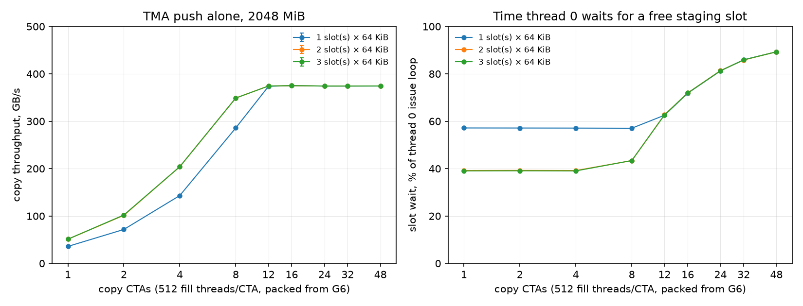
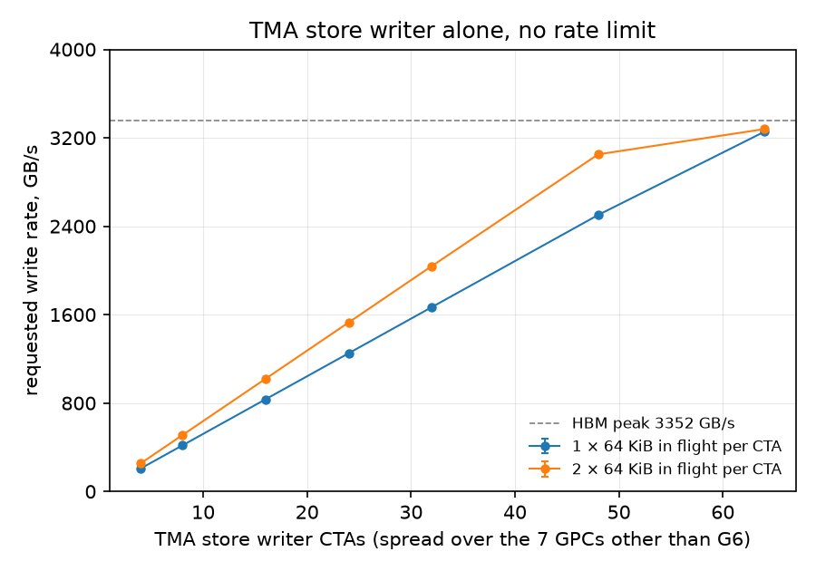
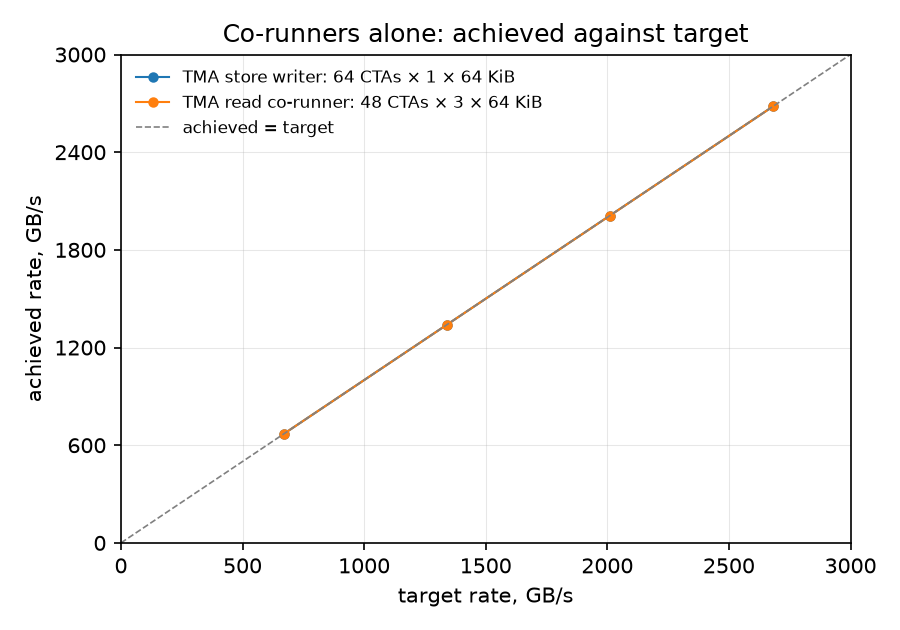
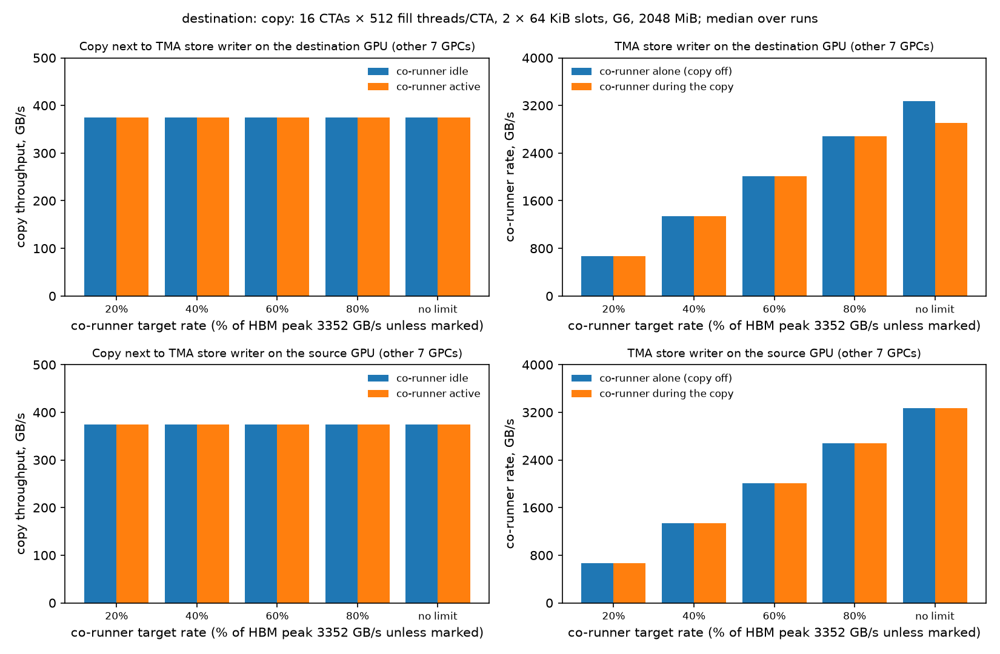
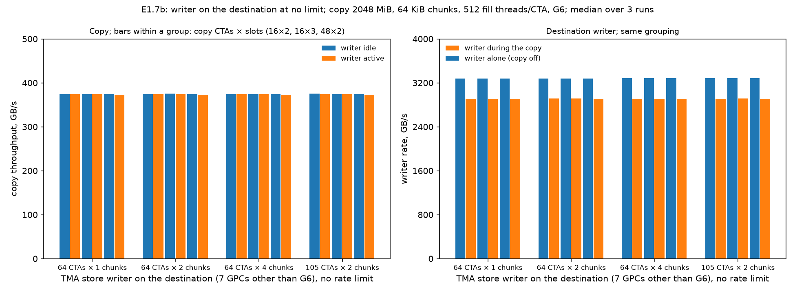

# TMA push next to TMA memory co-runners

**Status (2026-11-13):** all planned tests done (E1.1–E1.3, E1.5–E1.8), plus a follow-up to E1.5 and an extension of E1.7 (E1.7b, more requests in flight). E1.4 was dropped before any run.

[Plan](01_data_store_congest.md) · [Series index](../PLANS.md) · [Common setup and new metric ids](../00_common_setup.md) · [Harness](../../common/README.md) · [Run configurations](configs/) · [Matching thread-store experiment (plan 07)](../../../thread_store/observation/data_store_congest/README.md)

## Question and answer

**Question.** Some SMs of the source GPU push data to the peer GPU with TMA bulk stores. At the same time, TMA co-runners store to (or read from) local memory. Does the push slow down? Does it matter where the co-runner runs?

**Answer: the push slows down only when the co-runner stores from the push's own SMs.**

How to read this table:

- **Copy:** 16 CTAs × 512 fill threads/CTA × 2 slots × 64 KiB, in G6; about 375 GB/s alone.
- **Co-runner rate:** what the co-runner achieved during the copy, from its lowest to its highest level.
- **Copy change:** in each run, the copy's throughput while the co-runner is active ÷ while it is idle, − 1; median of 3 runs. Shown from the lowest to the highest co-runner level. Negative = the copy got slower.
- **Co-runner change:** the co-runner's rate during the copy ÷ its rate alone, − 1.
- All terms are defined in the [glossary](#glossary-every-measured-value-in-this-report) below.

| Where the co-runner runs | Co-runner | Co-runner rate | Copy change | Co-runner change |
|---|---|---|---|---|
| **Same SMs as the copy** | TMA store writer | 7 → 237 GB/s (capped) | **−0.2% → −6.3%** | 0% → −68% |
| **Same SMs as the copy** | Thread-store writer | 7 → 375 GB/s | **−0.1% → −18.0%** | 0% → −51% |
| 16 other SMs | TMA store writer | 187 → 834 GB/s | +0.01% to +0.05% | 0% |
| 64 other SMs | TMA store writer | 670 → 3270 GB/s | +0.02% to +0.14% | 0% to −0.1% |
| 64 other SMs | Thread-store writer | 670 → 3124 GB/s | −0.04% to +0.10% | 0% |
| 48 other SMs | TMA read co-runner | 671 → 3159 GB/s | −0.00% to +0.07% | 0% |
| Destination GPU | TMA store writer | 670 → 3276 GB/s | −0.03% to −0.20% | 0% → **−11.2%** |
| Destination GPU, more requests in flight (E1.7b) | TMA store writer, up to 105 CTAs × 2 chunks; copy up to 48 CTAs or 3 slots | 2907–2913 GB/s at no limit | −0.17% to −0.45% | −11.2% to −11.4% |

- **On the same SMs, the copy's loss grows with the bytes the writer stores.** It is about 0.13 GB/s of copy for every GB/s written.
- **The TMA unit is not needed for this.** Thread stores from the same SMs slow the copy as much, or more. The TMA writer's loss stops near 6% only because that writer cannot store more than about 237 GB/s during the copy.
- **Everywhere else, the copy does not change.** This repeats plan 07's thread-store results with TMA on both sides.

| Calibration result | Value |
|---|---|
| TMA push plateau | About 375 GB/s from 12 copy CTAs (thread-store copy in plan 07: 371 GB/s) |
| One TMA copy CTA | About 51 GB/s (a thread-store copy CTA: about 35 GB/s) |
| Sign of back-pressure on the plateau | Thread 0 waits longer for free staging slots: 63% of its loop at 12 CTAs, 89% at 48 |

### Glossary: every measured value in this report

Read this once; every table below uses these names. Metric ids: [common setup](../00_common_setup.md) (A15–A17) and [thread-store setup](../../../thread_store/observation/00_common_setup.md) (the others).

**How values are combined.** One **transfer** is one 2048 MiB push. One **run** is one harness invocation with several transfers. Per-CTA values are first combined into one value per transfer (median over the copy CTAs). Unless a table says otherwise, a run's value is the median of its transfers, and a table cell is the median of 3 runs.

Copy (the communication under test):

| Name | What it measures | How it is computed | How to read a change |
|---|---|---|---|
| **Copy throughput** (A1) | How fast the whole transfer finished, including the completion protocol | 2048 MiB ÷ (last copy CTA's end − first copy CTA's start), on the source GPU's clock. A CTA's end is when it sees the destination's acknowledgement | Lower = the communication got slower. This is the primary result |
| **Issue loop** (A3) | How long thread 0 of a copy CTA takes to start the bulk stores of all its chunks | Timer from the CTA's start to its last bulk store started, in µs. Median over the copy CTAs | Longer = chunks were started more slowly (waiting for slots, or a slower fill) |
| **Slot wait** (A15) | Share of the issue loop thread 0 spends waiting for a staging slot to become free, that is, for the TMA unit to finish *reading* the chunk that used the slot before | SM clock cycles thread 0 spends in `cp.async.bulk.wait_group.read`, ÷ its issue-loop cycles. Median over the copy CTAs | Higher = the TMA unit empties slots more slowly, because the path behind it (SM way out, crossbar, NVLink) accepts data more slowly. A sign of back-pressure |
| **Fill share** (A16) | Share of the issue loop from "slot free" to "bulk store started": the copy threads write the chunk's values into the slot, plus two barriers | SM clock cycles of that span ÷ issue-loop cycles. Median over the copy CTAs | Higher = filling slots got slower (for example, other work on the same SM competes with the fill threads) |
| **Bulk completion wait** (A17) | After the last chunk is started, how long until all of this CTA's bulk stores report that their writes are complete | Timer from the last bulk store started until `cp.async.bulk.wait_group 0` returns, in µs. Median over the copy CTAs | Longer = writes already accepted take longer to complete. It is not the time of one chunk on NVLink |
| **Ordering interval** (A4) | The fence after completion | Timer across `fence.proxy.async.global` + system fence, µs | Reference only |
| **Acknowledgement wait** (A6) | Time from publishing "done" until the destination's acknowledgement arrives | Timer, µs. Includes waiting for the slowest copy CTA | Reference only |

Comparisons with a co-runner:

| Name | What it means |
|---|---|
| **Idle half, active half** | In one run, transfers alternate between the co-runner *idle* (its CTAs start and wait, no traffic) and *active*. 6 + 6 transfers per run |
| **Copy, idle half (GB/s)** | Median copy throughput over all idle-half transfers of the runs at that level |
| **Copy change** | For each run: median(active-half throughput) ÷ median(idle-half throughput) − 1. The table gives the median of the 3 runs' changes, with their min and max. Negative = the co-runner slowed the copy |
| **Idle IQR** | Interquartile range (middle 50% spread) of all idle-half transfers of one co-runner kind, in GB/s. The copy's normal run-to-run noise |
| **Change ÷ idle IQR** | (Active median − idle median, in GB/s) ÷ idle IQR. About 1 or less = within normal noise. A guide to size, not a statistical test, because transfers are nested in runs |
| **Opening / closing reference** | One run with the co-runner idle the whole time, before and after a test. If the two differ, the machine drifted during the test |

Co-runner (the pressure):

| Name | What it means |
|---|---|
| **Target** | The rate the co-runner is asked for, total of all its CTAs, in GB/s. Each CTA starts chunk *k* no earlier than start + *k* × interval. "No limit" = no waiting. Percentages are of HBM peak, 3352 GB/s, unless the table says "of ceiling" |
| **Ceiling** | The highest rate a co-runner setting reaches with no limit, alone |
| **Co-runner rate** (A9) | Bytes the co-runner asked to move (64 KiB per chunk) ÷ its active time, all its CTAs together, GB/s. Requested bytes, not counted DRAM bytes |
| **Co-runner alone** | Its rate in a separate run with the copy off, on the same SMs, in windows as long as its active time during the copy |
| **Co-runner during the copy** | Its rate in the active-half transfers of the mixed runs |
| **Co-runner change** | During the copy ÷ alone − 1. Negative = the copy slowed the co-runner |
| **Slowest ÷ fastest CTA** | Rate of the slowest co-runner CTA ÷ rate of the fastest. 1 = all CTAs got the same share; below 0.95 = uneven |
| **Coverage** (A8) | Every co-runner CTA must be active from before the copy starts until after it ends; runs that fail are rejected |

## Setup shared by all sections

| Item | Setting |
|---|---|
| GPUs | Source → destination **0 → 1** and **4 → 5**, both 2026-11-10 |
| GPU pairs per test | One pair per test, except E1.6 (see its section). Each raw record names its pair |
| Copy issue | Thread 0 of each copy CTA starts `cp.async.bulk` stores of 64 KiB chunks into the destination's window (NCCL LSA peer pointer) |
| Copy data | The copy threads fill each shared-memory slot with position-dependent values (the plan-07 value function). No source HBM reads |
| Copy layout | Each copy CTA owns a contiguous run of chunks. Payload 2048 MiB |
| Copy completion | Thread 0 waits for its bulk stores, fences, publishes "done"; the receiver acknowledges |
| TMA store writer | Thread 0 stores one 64 KiB shared-memory chunk again and again into its slice of a local 1 GiB buffer |
| TMA read co-runner | Thread 0 reads 64 KiB chunks into shared memory (plan 04) |
| Rate limit | Chunk *k* of a co-runner CTA starts no earlier than start + *k* × interval |
| Placement | One CTA per SM on both GPUs, 1024 threads/CTA. Copy in G6 (18 SMs); co-runners on the other 7 GPCs. One layout for every run (user's choice) |
| Same-SM placement | One co-runner in the last two warps of each copy CTA |
| Shared memory | 196,864 bytes per CTA in every run, so L1 size is the same in all arms |
| Repeats, copy alone | 3 warm-ups + 12 transfers per run; run value = median |
| Repeats, with a co-runner | 3 warm-ups, then 6 idle + 6 active transfers, alternating |
| Runs | 3 per setting, rotated order |
| Not controlled | Clocks and power (snapshots before and after every run). Every run started on idle GPUs under a per-device lock |
| Not collected | Profiler timelines and counters (B1, C1–C9). Co-runner rates count requested bytes |

Data and tools:

- Raw records stay local in `results/2026-11-10/<group>/raw/` (git-ignored). Without them, reproducing the tables needs a rerun.
- Tables and figures: [analyze_tma_calibration.py](../../common/scripts/analyze_tma_calibration.py), [analyze_tma_contention.py](../../common/scripts/analyze_tma_contention.py).

## Build check

### Motivation

A TMA bulk store into a peer GPU's memory through an NCCL LSA pointer had not been used in this project. Every role combination had to run and verify before calibration.

### Setup

| Item | Setting |
|---|---|
| Combinations | Copy alone; copy with slots filled once; TMA store writer alone and with the copy; reader with the copy; thread-store writer with the copy; writer on the copy's SMs, alone and with the copy; writer on the destination, alone and with the copy |
| Size | 256 MiB, 1 warm-up + 2 transfers, one run each |
| GPUs | 0 → 1 |

Configs: [configs/smoke/](configs/smoke/).

### Method

Every transfer and every co-runner launch was checked. These runs are not used in any result.

### Results

- All 10 runs verified.
- The default copy (16 CTAs spread over all GPCs) gave about 369.5 GB/s with this short payload.

### Interpretation

- **TMA bulk stores to the NCCL peer pointer work.** The full destination check, including misplaced chunks, still applies.

## TMA push alone

### Motivation

The TMA push needs its own reference: the setting where more copy CTAs or slots no longer raise throughput. The plan expected a plateau near the thread-store value (about 370 GB/s), reached with fewer SMs.

### Setup

| Knob | Role | Values |
|---|---|---|
| **Copy CTAs** | **Independent variable** | **1, 2, 4, 8, 12, 16, 24, 32, 48** |
| **Staging slots per CTA** | **Independent variable** | **1, 2, 3** × 64 KiB |
| **Chunk size × fill threads/CTA** | **Independent variable (second step)** | **16, 32, 64 KiB × 128, 256, 512, 1024**, plus slots filled once; at 4 CTAs × 2 slots |
| Fill threads/CTA | Constant in the first step | 512 |
| Placement | Constant | Packed from G6 (G6 holds the first 18) |
| Co-runner | Constant | None; all other SMs hold idle CTAs |
| GPUs, runs | Constant | 0 → 1; 3 runs per setting |

Configs: [configs/copy_alone/](configs/copy_alone/), named `copy_c<CTAs>_t<fill threads>_k<chunk KiB>_s<slots>_[fill|once_]packed_R<run>.cfg`.

### Method

1. Stopping rule, as in plan 07: within 1% of the plateau value, and two successive increases add less than 1%.
2. Deviation: the chunk × fill step ran at 4 CTAs, not at the selected 16. On the plateau, NVLink sets the throughput, so the step could not show what limits one CTA.
3. Deviation: the plan said "the fewest CTAs on the plateau" (12). 16 was chosen: it is equally on the plateau and uses the same 16 G6 SMs as plan 07's copy.

### Results

*TMA push alone, 64 KiB chunks, 512 fill threads/CTA, packed from G6, 2048 MiB, GPUs 0 → 1. Points: median of 3 runs; bars: min–max (smaller than the marker). The 2-slot line lies under the 3-slot line.*

How to read this table:

- **Rows:** number of copy CTAs, each with 512 fill threads.
- **"1 slot", "2 slots", "3 slots":** copy throughput in GB/s with that many 64 KiB staging slots per CTA. Median of 3 runs; each run's value is the median of its 12 transfers. Min–max across runs is within 1.5 GB/s everywhere.
- **Slot wait (2-slot runs):** the slot wait of the [glossary](#glossary-every-measured-value-in-this-report), measured in the same runs as the "2 slots" column. Share of thread 0's issue loop spent waiting for the TMA unit to free a slot.
- **Bulk completion wait (2-slot runs):** from the CTA's last bulk store started until all its writes are complete, in the same runs.
- Both timer columns: median over the copy CTAs per transfer, then over transfers, then over runs.

| Copy CTAs × 512 fill threads/CTA | Throughput, 1 slot (GB/s) | 2 slots | 3 slots | Slot wait, 2-slot runs (share of issue loop) | Bulk completion wait, 2-slot runs |
|---|---|---|---|---|---|
| 1 | 35.8 | 51.1 | 51.1 | 39.2% | 1.86 µs |
| 2 | 71.6 | 101.3 | 102.1 | 39.2% | 1.86 µs |
| 4 | 143.2 | 204.1 | 204.1 | 39.1% | 1.84 µs |
| 8 | 285.9 | 349.1 | 349.0 | 43.4% | 1.86 µs |
| 12 | 373.8 | 374.4 | 374.4 | 62.7% | 2.12 µs |
| 16 | 375.1 | 375.1 | 375.0 | 71.9% | 2.83 µs |
| 24 | 374.2 | 374.3 | 374.3 | 81.3% | 3.21 µs |
| 32 | 374.2 | 374.3 | 374.3 | 85.8% | 3.95 µs |
| 48 | 374.3 | 374.5 | 374.4 | 89.3% | 5.25 µs |

What limits one CTA. How to read this table:

- **All cells:** copy throughput in GB/s of 4 copy CTAs × 2 slots, median of 3 runs. At 4 CTAs the copy is below the NVLink plateau, so the CTAs themselves set the throughput.
- **Rows:** chunk size, which is also the slot size.
- **Columns 128–1024:** fill threads per CTA; every chunk is filled with its own values before it is sent (normal mode).
- **"Slots filled once":** each slot is filled once at the start and then sent again and again, so there is no fill work in the loop. If this column is faster than the normal one, the fill limits the CTA.

| Chunk | 128 fill threads/CTA | 256 | 512 | 1024 | Slots filled once (512) |
|---|---|---|---|---|---|
| 16 KiB | 117.5 | 115.5 | 111.5 | 87.5 | 201.6 |
| 32 KiB | 200.1 | 199.9 | 185.3 | 159.4 | 204.1 |
| 64 KiB | 204.1 | 204.1 | 204.1 | 204.1 | 204.1 |

Table: [copy_sweep_summary.csv](results/2026-11-10/copy_sweep_summary.csv).

### Interpretation

- **Plateau: about 375 GB/s from 12 CTAs.** This is the same NVLink limit as plan 07's thread-store copy (371 GB/s), so the issue mechanism does not change it.
- **One TMA copy CTA sends about 51 GB/s with 2 or more slots.** With 1 slot it sends 35.8 GB/s, because thread 0 cannot fill the next chunk while the last one is read out.
- **With 64 KiB chunks, the TMA side limits a CTA, not the fill.** Throughput is the same for 128–1024 fill threads and with slots filled once.
- **With 16 and 32 KiB chunks, the fill and its two barriers per chunk limit a CTA.** More fill threads make it worse, because the barriers cost more.
- **Slot wait shows back-pressure on the plateau.** It is about 39% below the plateau and grows with every added CTA after it (63% at 12, 89% at 48).
- **Selected copy: 16 CTAs × 2 slots × 64 KiB × 512 fill threads/CTA, in G6: 375.1 GB/s alone.**

## Co-runners alone

### Motivation

The pressure must be known before it is applied, in this binary and with this shared-memory reservation. A writer that shares the copy's SMs is new; its ceiling was not known.

### Setup

| Knob | Role | Values |
|---|---|---|
| **TMA store writer CTAs × chunks in flight** | **Independent variable** | **4, 8, 16, 24, 32, 48, 64 × 1, 2**, no limit |
| **Target rate** | **Independent variable** | **670, 1341, 2011, 2682 GB/s (20–80% of HBM peak), no limit** |
| TMA read co-runner | Constant | 48 CTAs × 3 chunks (plan 04, plan 07), same targets |
| Writer on the copy's SMs | Constant | One TMA store writer (1 chunk) in each of the 16 copy CTAs in G6, no limit |
| Placement | Constant | Co-runners spread over the 7 GPCs other than G6 |
| Copy | Constant | Off; copy CTA 0 times six 20 ms windows |
| GPUs, runs | Constant | 4 → 5; 3 runs per setting |

Configs: [configs/co_runner_alone/](configs/co_runner_alone/).

### Method

Selection rule, as in plan 07: the fewest CTAs within 95% of the ceiling, with even CTAs (slowest ÷ fastest ≥ 0.95).

### Results

*TMA store writer alone, no limit, spread over the 7 GPCs other than G6. Median of 3 runs; bars: min–max.*

How to read this table: each cell is the writer's rate alone with no limit (requested bytes ÷ active time), median of 3 runs. Each run's value is the median of 6 windows of 20 ms. "Chunks in flight" is how many 64 KiB bulk stores one writer CTA may have unfinished at once. The percentage is of HBM peak, 3352 GB/s.

| TMA store writer CTAs | 1 chunk in flight, GB/s (% of peak) | 2 chunks |
|---|---|---|
| 4 | 208 (6.2%) | 255 (7.6%) |
| 8 | 417 (12.4%) | 510 (15.2%) |
| 16 | 834 (24.9%) | 1020 (30.4%) |
| 24 | 1251 (37.3%) | 1529 (45.6%) |
| 32 | 1668 (49.8%) | 2040 (60.8%) |
| 48 | 2502 (74.6%) | 3050 (91.0%) |
| 64 | 3255 (97.1%) | 3279 (97.8%) |

Slowest ÷ fastest CTA (the slowest writer CTA's rate ÷ the fastest one's) at 64 CTAs: 0.947 with 1 chunk, 0.65 with 2. The selection rule asks for at least 0.95.

How to read this table: each cell is the co-runner's achieved rate alone, in GB/s, median of 3 runs, at the target rate in the column header. A cell equal to its header means the rate limit works. "No limit" shows the ceiling.

| Co-runner | Target 670 GB/s | 1341 | 2011 | 2682 | No limit |
|---|---|---|---|---|---|
| TMA store writer, 64 CTAs × 1 chunk | 670.2 | 1341.1 | 2011.1 | 2681.9 | 3255.3 |
| TMA read co-runner, 48 CTAs × 3 chunks | 670.0 | 1340.9 | 2010.7 | 2681.6 | 3177.4 |
| TMA store writer on the copy's 16 SMs (G6) | — | — | — | — | 748.6 |

Run medians of the same-SM writer: 748.6, 749.7, 745.0 GB/s. Table: [co_runner_alone_summary.csv](results/2026-11-10/co_runner_alone_summary.csv).

### Interpretation

- **The TMA store writer repeats plan 07.** One CTA writes about 52 GB/s with 1 chunk and 64 GB/s with 2. 64 CTAs × 1 chunk reach 3255 GB/s (plan 07: 3257).
- **Selected TMA store writer: 64 CTAs × 1 chunk.** Only 64 CTAs come within 95% of the ceiling. Its CTA ratio (0.947) is just under the 0.95 rule; 2 chunks add 0.7% but make CTAs very uneven.
- **Both co-runners meet every target within 0.02%.**
- **The same-SM writer reaches 749 GB/s (about 47 GB/s per SM).** On 16 spread SMs it reaches 834 GB/s. G6's store capacity is the likely limit: plan 07 found about 700–800 GB/s per GPC.
- **The same-SM test uses 25, 50 and 75% of 749 GB/s as its levels.**

## Shared method for the tests with a co-runner

| Item | Rule |
|---|---|
| Pairs inside one run | 3 warm-ups, then 6 idle and 6 active transfers, alternating. Odd rounds start idle, even rounds start active |
| Idle co-runner | Its CTAs start and wait on the same SMs (and the same warps, in the same-SM tests). The two halves differ only in the co-runner's traffic |
| Copy change | median(active) ÷ median(idle) − 1, per run. Tables give the median over 3 runs, with min and max |
| Reference variability | IQR of all idle transfers of one co-runner kind. "Change ÷ idle IQR" divides the change in GB/s by it. Transfers are nested in runs, so this is a guide to size, not a test |
| Drift check | One run with idle co-runners before and after each test (opening and closing references) |
| Co-runner side | Its rate during the copy against the same co-runner alone on the same SMs, copy off, in windows matched to its active time |
| Order | At each level, the arms run back to back; level and arm order rotate between rounds |
| Checks | Every copy transfer checked at the destination; every co-runner launch checked; every co-runner CTA covers the whole copy |

### How to read the co-runner tables

Each test below first gives a copy table, then the co-runner columns and the copy-timer columns (in one or two tables, depending on the test). The columns always mean the following. Full definitions are in the [glossary](#glossary-every-measured-value-in-this-report).

**Copy table** (the primary result):

| Column | Meaning |
|---|---|
| Target | Rate asked of the co-runner, all its CTAs together |
| Copy, idle half | Copy throughput while the co-runner was idle, in the same runs: the reference |
| Copy change (min to max) | Per run, active ÷ idle − 1; median of the 3 runs, with the smallest and largest run. Negative = the copy got slower |
| Change ÷ idle IQR | The change in GB/s divided by the copy's normal spread. Up to about ±1 = within noise |

**Co-runner table:**

| Column | Meaning |
|---|---|
| Alone | Co-runner rate with the copy off, same SMs, matched window |
| During the copy | Co-runner rate in the active-half transfers |
| Change | During ÷ alone − 1. Negative = the copy slowed the co-runner |

**Copy timer table** (why the copy changed, if it did). Each value is "idle half → active half", median over the copy CTAs and over the transfers of that half:

| Column | Rises when |
|---|---|
| Slot wait (share of thread 0's issue loop) | The TMA unit empties slots more slowly: back-pressure from behind the TMA unit |
| Fill share (share of the issue loop) | The copy threads fill slots more slowly: competition inside the SM |
| Bulk completion wait (µs) | Writes already started take longer to complete |
| Issue loop (µs) | Thread 0 takes longer to start all its chunks; it grows by about the same share as the copy slows |

## TMA writes on other SMs of the source GPU

### Motivation

This is the main test (E1.3 in the [plan](01_data_store_congest.md)). It models a fused kernel that writes results with TMA while other SMs push data to the peer GPU with TMA.

- **What the flows share:** the source GPU's crossbar, L2 and HBM path. Copy and writer are in different GPCs.
- **Plan 07:** no slowdown in this layout with a thread-store copy.
- **Expected:** the same, with a growing slot wait if the store path pushed back.

### Setup

| Knob | Role | Values |
|---|---|---|
| **Writer target rate** | **Independent variable** | **Idle (reference half), 670, 1341, 2011, 2682 GB/s, no limit** |
| Copy | Constant | 16 CTAs × 512 fill threads/CTA × 2 slots × 64 KiB, G6, 2048 MiB |
| TMA store writer | Constant | 64 CTAs × 1 chunk, the 7 GPCs other than G6, source GPU |
| GPUs, runs | Constant | 0 → 1; 3 runs per level |
| Probe-cost check | Constant | 3 runs with detailed timers on and 3 off, no limit |

Configs: [configs/contention/](configs/contention/).

### Method

As in the shared method. No deviations.

### Results

*Left: copy throughput in the idle and active halves of the same runs. Right: writer alone (copy off) and during the copy, on the same SMs. Median over 3 runs.*

Columns: see [How to read the co-runner tables](#how-to-read-the-co-runner-tables).

Copy (idle IQR 0.53 GB/s):

| TMA store writer target, GB/s | Copy, idle half, GB/s | Copy change (min to max) | Change ÷ idle IQR |
|---|---|---|---|
| 670 (20%) | 374.9 | +0.02% (0.00 to +0.16) | 0.3 |
| 1341 (40%) | 374.6 | +0.14% (+0.08 to +0.15) | 0.9 |
| 2011 (60%) | 374.6 | +0.13% (+0.08 to +0.16) | 0.9 |
| 2682 (80%) | 374.8 | +0.07% (+0.01 to +0.07) | 0.3 |
| No limit | 374.8 | +0.13% (−0.02 to +0.15) | 0.5 |

Writer and copy timers:

| Target, GB/s | Writer alone, GB/s | Writer during the copy, GB/s | Writer change | Slot wait, idle → active | Bulk completion wait, idle → active |
|---|---|---|---|---|---|
| 670 | 671 | 671 | 0.0% | 72.0% → 71.9% | 2.79 → 2.79 µs |
| 1341 | 1341 | 1341 | 0.0% | 71.8% → 71.8% | 2.74 → 2.86 µs |
| 2011 | 2011 | 2011 | 0.0% | 72.0% → 71.9% | 2.66 → 2.78 µs |
| 2682 | 2682 | 2682 | 0.0% | 71.9% → 71.9% | 2.76 → 2.87 µs |
| No limit | 3270 | 3267 | −0.1% | 71.9% → 71.9% | 2.70 → 2.83 µs |

| Check | Value |
|---|---|
| Opening / closing reference | 375.16 / 375.14 GB/s |
| Probe cost | 375.04–375.10 GB/s with detailed timers, 374.94–374.96 GB/s without |

Table: [contention_summary.csv](results/2026-11-10/contention_summary.csv).

### Interpretation

- **No copy slowdown.** Every change is below one idle IQR, up to 3270 GB/s of local TMA writes (98% of HBM peak).
- **No back-pressure signal.** Slot wait and bulk completion wait are the same in both halves.
- **The writer is not slowed either.**
- **This repeats plan 07 with TMA on both sides.** It does not name which part has spare capacity.
- **The timers cost nothing measurable** (about 0.03%).

## TMA writes from the same SMs as the push

### Motivation

This is the TMA-specific test (E1.5). It models a fused kernel that pushes data and writes results from the same CTA.

- **Setup in short:** each copy CTA hosts one TMA store writer in its last two warps.
- **What they share:** the SM's TMA unit, its shared memory and its connection out of the SM.
- **Expected:** a slowdown absent with the writer on other SMs, and a growing slot wait if the copy's chunks queue behind the writer's.

### Setup

| Knob | Role | Values |
|---|---|---|
| **Where the writer runs** | **Independent variable** | **Same SMs** (last two warps of each of the 16 copy CTAs, G6) vs **other SMs** (16 writer CTAs on the 7 GPCs other than G6) |
| **Writer target rate** | **Independent variable** | **Idle (reference half), 187, 374, 562 GB/s (25, 50, 75% of 749 GB/s), no limit** |
| Copy | Constant | 16 CTAs × 512 fill threads/CTA × 2 slots × 64 KiB, G6, 2048 MiB |
| TMA store writer | Constant | 16 CTAs × 1 chunk; its 64 KiB chunk sits after the copy's slots in shared memory |
| GPUs, runs | Constant | 4 → 5; 3 runs per level and arm |

Configs: [configs/colocated/](configs/colocated/).

### Method

- As in the shared method.
- In the same-SM arm, copy threads and writer threads use separate named barriers, so neither waits for the other.
- An idle writer's two warps sleep in a polling loop, in both arms.

### Results

*Top: writer on 16 other SMs. Bottom: writer on the copy's own 16 SMs. Left: copy throughput, idle and active halves. Right: writer alone (copy off) and during the copy. Median over 3 runs.*

Columns: see [How to read the co-runner tables](#how-to-read-the-co-runner-tables).

Copy (idle IQR: 0.38 GB/s other SMs, 0.51 GB/s same SMs):

| Writer | Target, GB/s | Copy, idle half, GB/s | Copy change (min to max) | Change ÷ idle IQR |
|---|---|---|---|---|
| Other SMs | 187 | 375.0 | +0.02% (0.00 to +0.05) | 0.3 |
| Other SMs | 374 | 375.0 | +0.01% (−0.02 to +0.03) | 0.2 |
| Other SMs | 562 | 375.0 | +0.05% (−0.01 to +0.13) | 0.4 |
| Other SMs | No limit | 375.0 | +0.03% (+0.02 to +0.04) | 0.3 |
| **Same SMs** | 187 | 374.8 | **−6.09%** (−6.19 to −6.05) | −45.0 |
| **Same SMs** | 374 | 374.8 | **−6.11%** (−6.13 to −5.93) | −45.0 |
| **Same SMs** | 562 | 374.9 | **−6.18%** (−6.26 to −5.94) | −45.2 |
| **Same SMs** | No limit | 375.0 | **−6.30%** (−6.39 to −6.14) | −46.1 |

Writer and copy timers:

| Writer | Target, GB/s | Writer alone, GB/s | Writer during the copy, GB/s | Writer change | Slot wait, idle → active | Bulk completion wait, idle → active |
|---|---|---|---|---|---|---|
| Other SMs | 187 | 187 | 187 | 0.0% | 71.9% → 71.9% | 2.73 → 2.85 µs |
| Other SMs | 374 | 374 | 374 | 0.0% | 71.9% → 71.9% | 2.81 → 2.78 µs |
| Other SMs | 562 | 562 | 562 | 0.0% | 71.9% → 71.9% | 2.72 → 2.76 µs |
| Other SMs | No limit | 834 | 833 | 0.0% | 71.9% → 71.9% | 2.68 → 2.86 µs |
| **Same SMs** | 187 | 187 | 181 | −3.3% | 71.8% → 73.4% | 2.43 → 4.04 µs |
| **Same SMs** | 374 | 374 | 227 | −39.2% | 71.8% → 73.4% | 2.48 → 3.99 µs |
| **Same SMs** | 562 | 562 | 231 | −58.9% | 71.8% → 73.5% | 2.44 → 4.00 µs |
| **Same SMs** | No limit | 743 | 238 | −67.9% | 71.8% → 73.5% | 2.37 → 4.11 µs |

Other copy timers, same SMs, idle → active:

| Timer | Idle | Active |
|---|---|---|
| Issue loop | 5706–5710 µs | 6060–6071 µs (+6.2%) |
| Fill share | 19.2% | 18.0% |
| Ordering interval | 2.7 µs | 2.4–2.5 µs |

With the writer on other SMs, the issue loop is 5705–5710 µs in both halves. Table: [colocated_summary.csv](results/2026-11-10/colocated_summary.csv).

### Interpretation

> **Correction, 2026-11-10.** The first reading said the loss does not depend on the writer's bytes. That was wrong. At every level here the writer achieved only 181–238 GB/s during the copy, so the levels hardly differed. The [follow-up](#writes-from-the-same-sms-at-low-rates-tma-and-thread-stores) shows the loss growing with the writer's bytes. The data are unchanged.

- **A TMA writer on the copy's own SMs slows the copy by about 6%** (375 → 352 GB/s). The runs agree within 0.3 percentage points, about 45 idle IQRs.
- **The same writer on 16 other SMs has no effect** (+0.01% to +0.05%).
- **The loss is the same at every level because the writer's achieved rate is.** Targets go from 187 GB/s to no limit, but the writer stores only 181–238 GB/s during the copy.
- **The writer loses much more than the copy:** −68% with no limit, capped at about 15 GB/s per SM.
- **Together they send less than one TMA CTA alone.** Per SM: copy 22 + writer 15 = 37 GB/s, against 51 GB/s for one TMA copy CTA.
- **The loss shows after issue, not in the fill.** The issue loop grows 6.2%, bulk completion wait grows 2.4 → 4.0 µs, and the fill share does not grow.
- **A full GPC does not explain it.** Copy and writer together put about 590 GB/s through G6, below the 749 GB/s the writer alone carried there.
- **A spinning warp does not explain it.** The writer's thread busy-waits only with a rate limit, and the loss is the same with no limit.

## Writes from the same SMs at low rates: TMA and thread stores

### Motivation

Added on 2026-11-10 after the same-SM test; not in the plan. It asks two questions:

1. **Does the loss start with the first bytes?** The same-SM test's lowest level was 187 GB/s, already near the writer's cap.
2. **Does it need the TMA unit?** If the copy and writer meet in the TMA unit, a writer that stores from the same SM *without* TMA should not slow the copy. If they meet on the SM's path out, it should.

### Setup

| Knob | Role | Values |
|---|---|---|
| **Writer mechanism (same SMs)** | **Independent variable** | **TMA store writer** (thread 0 of the last two warps, 1 × 64 KiB chunk) vs **thread-store writer** (all 64 threads of those warps, 16-byte stores) |
| **Writer target rate** | **Independent variable** | **Idle (reference half), 7, 37, 75, 187 GB/s (1, 5, 10, 25% of 749 GB/s), no limit**; same GB/s for both writers |
| Copy | Constant | 16 CTAs × 512 fill threads/CTA × 2 slots × 64 KiB, G6, 2048 MiB |
| Writer CTAs | Constant | One in each of the 16 copy CTAs |
| GPUs, runs | Constant | 4 → 5; 3 runs per level and writer, back to back in each round |

Configs: [configs/colocated_followup/](configs/colocated_followup/).

### Method

1. As in the shared method.
2. Harness change: the harness now allows a thread-store writer on a copy SM if it uses exactly the two spare warps (64 threads). This is a host-side check only.
3. The rebuilt binary's GPU code (`cuobjdump -sass`) is byte-identical to the binary behind every earlier result.
4. E1.8 was running on 0 → 1 when the binary was swapped (atomic rename). Its runs used one binary or the other, with the same GPU code.

### Results

*Top: thread-store writer in the last two warps of each copy CTA. Bottom: TMA store writer in the same warps. Left: copy throughput, idle and active halves. Right: writer alone (copy off) and during the copy. Median over 3 runs. "Ceiling" means 749 GB/s for both rows.*

Columns: see [How to read the co-runner tables](#how-to-read-the-co-runner-tables).

Copy (idle IQR: 0.44 GB/s TMA, 0.39 GB/s thread stores):

| Writer on the copy's SMs | Target, GB/s | Copy, idle half, GB/s | Copy change (min to max) | Change ÷ idle IQR |
|---|---|---|---|---|
| TMA | 7 | 374.8 | −0.19% (−0.26 to −0.10) | −1.5 |
| TMA | 37 | 374.9 | −1.15% (−1.25 to −1.12) | −9.7 |
| TMA | 75 | 374.9 | −2.58% (−2.58 to −2.57) | −22.0 |
| TMA | 187 | 375.0 | −6.36% (−6.37 to −6.02) | −53.4 |
| TMA | No limit | 375.1 | −6.26% (−6.42 to −6.26) | −53.0 |
| Thread stores | 7 | 374.8 | −0.14% (−0.16 to −0.09) | −1.2 |
| Thread stores | 37 | 375.0 | −1.03% (−1.04 to −0.98) | −9.5 |
| Thread stores | 75 | 374.8 | −2.17% (−2.17 to −2.00) | −20.1 |
| Thread stores | 187 | 374.9 | **−7.91%** (−8.10 to −7.87) | −76.0 |
| Thread stores | No limit | 374.9 | **−17.99%** (−18.23 to −17.79) | −173.5 |

Writer:

| Writer | Target, GB/s | Alone, GB/s | During the copy, GB/s | Change |
|---|---|---|---|---|
| TMA | 7 | 7.2 | 7.2 | 0.0% |
| TMA | 37 | 37.2 | 37.2 | 0.0% |
| TMA | 75 | 75.2 | 75.2 | 0.0% |
| TMA | 187 | 187.1 | 180.5 | −3.6% |
| TMA | No limit | 745.2 | 236.7 | −68.2% |
| Thread stores | 7 | 7.0 | 7.0 | 0.0% |
| Thread stores | 37 | 37.0 | 37.0 | 0.0% |
| Thread stores | 75 | 75.0 | 75.0 | 0.0% |
| Thread stores | 187 | 187.0 | 187.0 | 0.0% |
| Thread stores | No limit | 766.7 | 374.9 | −51.1% |

Copy timers, idle → active:

| Writer | Target, GB/s | Slot wait | Fill share | Bulk completion wait | Issue loop |
|---|---|---|---|---|---|
| TMA | 7 | 71.8% → 71.7% | 19.2% → 19.4% | 2.35 → 2.49 µs | 5709 → 5719 µs |
| TMA | 37 | 71.8% → 72.0% | 19.2% → 19.2% | 2.46 → 2.60 µs | 5710 → 5773 µs |
| TMA | 75 | 71.6% → 72.2% | 19.3% → 19.0% | 2.46 → 2.74 µs | 5709 → 5855 µs |
| TMA | 187 | 71.6% → 73.3% | 19.3% → 18.1% | 2.37 → 4.05 µs | 5708 → 6075 µs |
| TMA | No limit | 71.6% → 73.3% | 19.3% → 18.1% | 2.47 → 4.09 µs | 5707 → 6067 µs |
| Thread stores | 7 | 71.7% → 71.1% | 19.3% → 19.9% | 2.42 → 2.68 µs | 5708 → 5718 µs |
| Thread stores | 37 | 71.8% → 69.7% | 19.2% → 21.4% | 2.34 → 2.45 µs | 5707 → 5765 µs |
| Thread stores | 75 | 71.7% → 67.5% | 19.3% → 23.5% | 2.40 → 2.52 µs | 5709 → 5827 µs |
| Thread stores | 187 | 71.8% → 62.3% | 19.2% → 29.2% | 2.52 → 2.84 µs | 5710 → 6174 µs |
| Thread stores | No limit | 71.9% → 55.0% | 19.2% → 37.4% | 2.45 → 4.25 µs | 5711 → 6935 µs |

| Check | Value |
|---|---|
| Opening / closing reference, TMA arm | 375.08 / 375.17 GB/s |
| Opening / closing reference, thread-store arm | 375.12 / 375.00 GB/s |
| Other tenants | None before or after any run |

Table: [colocated_followup_summary.csv](results/2026-11-10/colocated_followup_summary.csv).

### Interpretation

- **The loss grows with the bytes the writer stores from the copy's SMs.** TMA writer: −0.19% at 7 GB/s, −1.15% at 37, −2.58% at 75, −6.36% at 187.
- **Rule of thumb:** the copy loses about 0.13 GB/s for every GB/s written (for example 9.7 GB/s lost at 75 GB/s written).
- **It repeats the same-SM test where both ran:** −6.36% against −6.09% at 187 GB/s; −6.26% against −6.30% with no limit.
- **The TMA writer's loss stops near 6% because the writer stops.** It cannot store more than about 237 GB/s during the copy.
- **The TMA unit is not needed.** Thread stores from the same warps slow the copy about as much per byte at low rates.
- **Thread stores slow the copy more at high rates** (−7.91% at 187 GB/s, −17.99% with no limit), because that writer keeps 375 GB/s during the copy.
- **So the shared part is on each SM's way out** (to the crossbar or just after it). These runs do not name it.
- **The copy's timers tell the two writers apart:**

  | Writer on the same SMs | Fill share | Slot wait | Bulk completion wait | Reading |
  |---|---|---|---|---|
  | TMA | Flat (19% → 18%) | Up a little (→ 73%) | Up (2.4 → 4.1 µs) | Chunks delayed after issue |
  | Thread stores | Up (19% → 37%) | Down (72% → 55%) | Flat until no limit | Slots filled more slowly |

- **This is the first case in the series where slot wait and fill share separate two causes** that slow the copy by similar amounts.
- **Same SM or same GPC is not separated.** The "other SMs" writer was in other GPCs, and G6 has only 2 spare SMs. GPC placement is outside this plan (user's choice).

## TMA reads instead of TMA writes

### Motivation

Plan 07 found that local reads did not slow a thread-store copy. This test (E1.6) repeats the main test with the TMA read co-runner, at the same byte rates. The plan expected less change with reads than with writes.

### Setup

| Knob | Role | Values |
|---|---|---|
| **Direction of local traffic** | **Independent variable** | **TMA reads** (48 CTAs × 3 chunks) vs **TMA writes** (64 CTAs × 1 chunk, the main test repeated) |
| **Target rate, reads** | **Independent variable** | **Idle, 671, 1341, 2011, 2682, 3267 GB/s** (the write rates achieved in the main test) |
| **Target rate, writes** | **Independent variable** | **Idle, 670, 1341, 2011, 2682 GB/s, no limit** |
| Placement | Constant | Co-runners on the 7 GPCs other than G6; copy in G6 |
| Copy | Constant | 16 CTAs × 512 fill threads/CTA × 2 slots × 64 KiB, 2048 MiB |
| Runs | Constant | 3 per level and direction |

Configs: [configs/direction/](configs/direction/).

### Method

As in the shared method, with one deviation: **the test ran on two GPU pairs.**

1. Round 1, the opening references and one round-2 run (reads at 1341 GB/s) ran on 0 → 1.
2. Another tenant then started a workload on GPUs 0 and 1 (529 MiB, later 52.7 GB and about 45% utilization). Its process is not visible from this container.
3. The run in progress (writes at 1341 GB/s, round 2) ended with that memory present. It is excluded and kept in `results/2026-11-10/rejected/other_tenant_gpu0_1/`.
4. The guard refused the next run.
5. The rest of round 2, round 3 and the closing references ran on 4 → 5.
6. Each run carries its own idle reference, so per-run changes do not mix pairs. The idle IQR pools both pairs.

### Results

*Top: TMA reads. Bottom: TMA writes, same session. Left: copy throughput, idle and active halves. Right: co-runner alone (copy off) and during the copy. Median over 3 runs.*

Columns: see [How to read the co-runner tables](#how-to-read-the-co-runner-tables).

Copy (idle IQR: 0.47 GB/s reads, 0.41 GB/s writes):

| Direction | Target, GB/s | Copy, idle half, GB/s | Copy change (min to max) | Change ÷ idle IQR |
|---|---|---|---|---|
| Reads | 671 | 374.9 | +0.02% (0.00 to +0.05) | 0.4 |
| Reads | 1341 | 375.0 | +0.03% (−0.01 to +0.05) | 0.2 |
| Reads | 2011 | 374.8 | +0.07% (−0.04 to +0.12) | 0.6 |
| Reads | 2682 | 375.0 | +0.01% (0.00 to +0.06) | 0.3 |
| Reads | 3267 (reached 3159) | 375.0 | 0.00% (−0.02 to +0.10) | 0.2 |
| Writes | 670 | 374.7 | +0.09% (+0.03 to +0.09) | 0.7 |
| Writes | 1341 | 374.7 | +0.08% (+0.03 to +0.15) | 1.0 |
| Writes | 2011 | 374.7 | +0.12% (+0.06 to +0.14) | 0.8 |
| Writes | 2682 | 374.8 | +0.08% (+0.08 to +0.08) | 0.7 |
| Writes | No limit | 374.7 | +0.12% (+0.05 to +0.14) | 1.1 |

Co-runner and slot wait:

| Direction | Target, GB/s | Alone, GB/s | During the copy, GB/s | Change | Slot wait, idle → active |
|---|---|---|---|---|---|
| Reads | 671 | 671 | 671 | 0.0% | 71.8% → 71.8% |
| Reads | 1341 | 1341 | 1340 | 0.0% | 71.9% → 71.9% |
| Reads | 2011 | 2010 | 2010 | 0.0% | 72.0% → 71.9% |
| Reads | 2682 | 2681 | 2681 | 0.0% | 71.9% → 71.9% |
| Reads | 3267 | 3159 | 3159 | 0.0% | 71.9% → 71.9% |
| Writes | 670 | 671 | 671 | 0.0% | 71.8% → 71.7% |
| Writes | 1341 | 1341 | 1341 | 0.0% | 72.0% → 72.0% |
| Writes | 2011 | 2011 | 2011 | 0.0% | 72.0% → 71.9% |
| Writes | 2682 | 2682 | 2682 | 0.0% | 72.0% → 71.9% |
| Writes | No limit | 3269 | 3267 | 0.0% | 72.0% → 71.9% |

| Check | Value |
|---|---|
| References, reads (opening on 0 → 1 / closing on 4 → 5) | 375.00 / 375.08 GB/s |
| References, writes | 375.11 / 375.16 GB/s |
| Highest read target | 3267 GB/s is above the reader's ceiling; it ran at its maximum, 3159 GB/s |

Table: [direction_summary.csv](results/2026-11-10/direction_summary.csv).

### Interpretation

- **Local reads do not slow the TMA push** (−0.00% to +0.07%, below one idle IQR).
- **Writes repeat the main test** (+0.08% to +0.12%), on a partly different GPU pair.
- **Direction makes no difference here,** because neither direction has an effect from other SMs. Plan 07 found the same.
- **The reader is not slowed by the copy.**

## TMA writes on the destination GPU

### Motivation

On the destination GPU, incoming peer stores and local TMA stores go into the same L2 and HBM.

- **Plan 07:** a thread-store writer on the destination slowed itself (−10.3% at no limit), not the copy.
- **Expected:** the same, unless back-pressure from the destination reached the source's TMA units.

### Setup

| Knob | Role | Values |
|---|---|---|
| **GPU that runs the writer** | **Independent variable** | **Destination vs source**, back to back in each round |
| **Writer target rate** | **Independent variable** | **Idle (reference half), 670, 1341, 2011, 2682 GB/s, no limit** |
| Copy | Constant | 16 CTAs × 512 fill threads/CTA × 2 slots × 64 KiB, G6 of the source, 2048 MiB |
| TMA store writer | Constant | 64 CTAs × 1 chunk on the 7 GPCs other than G6 |
| Receiver | Constant | 1 CTA in G6 of the destination |
| GPUs, runs | Constant | 4 → 5; 3 runs per level and arm |

Configs: [configs/destination/](configs/destination/).

### Method

- As in the shared method.
- The receiver orders the destination writer around the transfer with signals: it starts before "destination ready" and stops after the acknowledgement.
- The receiver CTA times the writer-alone runs on the destination.

### Results

*Top: writer on the destination GPU. Bottom: writer on the source GPU, same session. Median over 3 runs.*

Columns: see [How to read the co-runner tables](#how-to-read-the-co-runner-tables).

Copy (idle IQR: 0.20 GB/s destination, 0.61 GB/s source):

| Writer on | Target, GB/s | Copy, idle half, GB/s | Copy change (min to max) | Change ÷ idle IQR |
|---|---|---|---|---|
| Destination | 670 | 375.0 | −0.04% (−0.05 to 0.00) | −0.5 |
| Destination | 1341 | 375.0 | −0.03% (−0.05 to −0.02) | −0.6 |
| Destination | 2011 | 374.9 | −0.04% (−0.07 to −0.03) | −1.0 |
| Destination | 2682 | 375.0 | −0.11% (−0.12 to −0.03) | −1.8 |
| Destination | No limit | 375.1 | −0.20% (−0.21 to −0.19) | −4.0 |
| Source | 670 | 374.7 | +0.11% (+0.05 to +0.11) | 0.6 |
| Source | 1341 | 374.5 | +0.09% (+0.05 to +0.16) | 0.8 |
| Source | 2011 | 374.5 | +0.11% (+0.01 to +0.13) | 0.7 |
| Source | 2682 | 374.5 | +0.09% (+0.05 to +0.19) | 0.7 |
| Source | No limit | 374.7 | +0.08% (+0.08 to +0.13) | 0.6 |

Writer:

| Writer on | Target, GB/s | Alone, GB/s | During the copy, GB/s | Change |
|---|---|---|---|---|
| Destination | 670 | 671 | 671 | 0.0% |
| Destination | 1341 | 1341 | 1341 | 0.0% |
| Destination | 2011 | 2011 | 2011 | 0.0% |
| Destination | 2682 | 2682 | 2682 | 0.0% |
| Destination | No limit | 3276 | 2910 | **−11.2%** |
| Source | 670 | 671 | 671 | 0.0% |
| Source | 1341 | 1341 | 1341 | 0.0% |
| Source | 2011 | 2011 | 2011 | 0.0% |
| Source | 2682 | 2682 | 2682 | 0.0% |
| Source | No limit | 3270 | 3267 | −0.1% |

Slot wait (71.9%) and bulk completion wait (2.7–2.8 µs) are the same in both halves of both arms. Table: [destination_summary.csv](results/2026-11-10/destination_summary.csv).

### Interpretation

- **The copy barely changes with the writer on the destination** (−0.03% to −0.20%).
- **The largest change is small in practice.** −0.20% at no limit is 4 idle IQRs only because the reference was very steady; it is about 0.75 GB/s.
- **The destination writer gives way instead:** −11.2% at no limit (3276 → 2910 GB/s). Plan 07: −10.3%.
- **No back-pressure reaches the source's TMA units.** Slot wait and bulk completion wait do not change.

## More requests in flight, writer on the destination

### Motivation

E1.7b, added on 2026-11-13. In E1.7 the destination's HBM was full only at "no limit". There the local writer gave way (−11.2%) and the incoming push kept its rate. A memory system that shares out a full HBM might serve each side by how many requests it has waiting.

- **Question:** does the split change if either side keeps more requests outstanding?
- **Expected if it does:** more writer requests take more of HBM from the push; more copy requests win some back.

### Setup

| Knob | Role | Values |
|---|---|---|
| **Destination writer: CTAs × chunks in flight** | **Independent variable** | **64 × 1** (E1.7 setting), **64 × 2**, **64 × 4**, **105 × 2** |
| **Copy: CTAs × staging slots** | **Independent variable** | **16 × 2** (selected), **16 × 3**, **48 × 2** |
| Writer target | Constant | No limit (the only E1.7 level with full HBM) |
| Writer placement | Constant | Destination, 7 GPCs other than G6 (105 CTAs = all but one of their 106 mapped SMs); receiver in G6 |
| Copy | Constant | 64 KiB chunks, 512 fill threads/CTA, packed from G6 (48 CTAs: G6 + G7 + 12 SMs of G1), 2048 MiB |
| Shared memory, runs | Constant | 196,864 bytes per CTA; 3 runs per cell; GPUs 4 → 5 |

What "in flight" controls on each side:

- **Writer chunks in flight:** how many of a writer CTA's 64 KiB bulk stores may be unfinished at once (`cp.async.bulk.wait_group`). This bounds outstanding writes.
- **Copy slots:** only how many chunks wait to be *read out of shared memory*; writes already on NVLink are not bounded by it. So a third slot adds about one more queued chunk per CTA.
- **Copy CTAs:** more TMA units issuing at once. The copy stays at about 375 GB/s, but more requests are outstanding.

Configs: [configs/destination_inflight/](configs/destination_inflight/).

### Method

1. As in the shared method: each mixed run alternates 6 idle-writer and 6 active transfers.
2. Opening and closing references for each copy setting.
3. Rounds rotate the writer order and, within it, the copy order; each writer setting's cells run back to back.
4. **Deviation from the shared method:** the writer-alone run does not depend on the copy (the copy is off), so it ran once per writer setting per round, not once per cell. Its window equals the active time of that round's 16 × 2 cell.
5. New results folder `results/2026-11-13/`; `selection.json` was copied from `results/2026-11-10/`.

### Results

*Left: copy throughput, idle and active halves of the same runs; within each writer group the bars are copy 16 × 2, 16 × 3, 48 × 2. Right: destination writer alone (copy off) and during the copy, same grouping. Median over 3 runs.*

Columns: see [How to read the co-runner tables](#how-to-read-the-co-runner-tables). "Idle IQR" is the copy's spread over the idle transfers of that cell only.

Copy:

| Destination writer | Copy CTAs × slots | Copy, idle half, GB/s | Copy change (min to max) | Change ÷ idle IQR | Idle IQR, GB/s |
|---|---|---|---|---|---|
| 64 × 1 | 16 × 2 | 375.0 | −0.18% (−0.20 to −0.17) | −4.7 | 0.15 |
| 64 × 1 | 16 × 3 | 375.0 | −0.17% (−0.20 to −0.14) | −2.5 | 0.26 |
| 64 × 1 | 48 × 2 | 374.4 | −0.38% (−0.43 to −0.32) | −6.3 | 0.22 |
| 64 × 2 | 16 × 2 | 375.0 | −0.21% (−0.22 to −0.18) | −3.9 | 0.19 |
| 64 × 2 | 16 × 3 | 375.0 | −0.21% (−0.23 to −0.18) | −3.8 | 0.21 |
| 64 × 2 | 48 × 2 | 374.4 | −0.45% (−0.49 to −0.45) | −8.7 | 0.20 |
| 64 × 4 | 16 × 2 | 375.0 | −0.23% (−0.23 to −0.21) | −3.3 | 0.25 |
| 64 × 4 | 16 × 3 | 375.0 | −0.20% (−0.22 to −0.20) | −3.7 | 0.20 |
| 64 × 4 | 48 × 2 | 374.4 | −0.45% (−0.49 to −0.42) | −5.0 | 0.34 |
| 105 × 2 | 16 × 2 | 375.1 | −0.21% (−0.24 to −0.19) | −3.7 | 0.24 |
| 105 × 2 | 16 × 3 | 375.0 | −0.20% (−0.22 to −0.20) | −4.7 | 0.16 |
| 105 × 2 | 48 × 2 | 374.3 | −0.37% (−0.52 to −0.36) | −5.5 | 0.29 |

Destination writer. "Slowest ÷ fastest CTA" is the rate of the slowest writer CTA ÷ the fastest one (1 = even):

| Destination writer | Alone, GB/s | During the copy, GB/s (by copy 16 × 2 / 16 × 3 / 48 × 2) | Change | Slowest ÷ fastest CTA, alone → during the copy |
|---|---|---|---|---|
| 64 × 1 | 3277 | 2911 / 2910 / 2909 | −11.2% | 0.96 → 0.75 |
| 64 × 2 | 3281 | 2913 / 2913 / 2911 | −11.2% to −11.3% | 0.64 → 0.55 |
| 64 × 4 | 3283 | 2911 / 2910 / 2909 | −11.3% to −11.4% | 0.65 → 0.55 |
| 105 × 2 | 3282 | 2907 / 2913 / 2910 | −11.3% to −11.4% | 0.39 → 0.35 |

Copy timers, idle → active. Medians over copy CTAs and transfers; they hardly differ between writer settings, so each cell gives the range over the 4 writer settings:

| Copy CTAs × slots | Slot wait | Bulk completion wait | Acknowledgement wait |
|---|---|---|---|
| 16 × 2 | 71.7–71.9% → 71.8–71.9% | 2.79–2.83 → 2.76–2.85 µs | 12.6–13.0 → 23.8–25.5 µs |
| 16 × 3 | 71.9% → 71.9% | 4.87–4.94 → 4.85–4.95 µs | 11.9–13.4 → 22.9–25.2 µs |
| 48 × 2 | 89.3% → 89.3% | 5.30–5.54 → 5.34–5.48 µs | 721–724 → 743–749 µs |

| Check | Value |
|---|---|
| Opening / closing references | 16 × 2: 374.95 / 374.99 GB/s; 16 × 3: 374.94 / 375.06; 48 × 2: 374.29 / 374.46 |
| Other tenants | None before or after any of the 54 runs |
| The E1.7 cell repeated (64 × 1 writer, 16 × 2 copy) | Copy −0.18% (E1.7: −0.20%); writer 2911 GB/s during the copy (E1.7: 2910) |

Table: [destination_inflight_summary.csv](results/2026-11-13/destination_inflight_summary.csv).

### Interpretation

- **More requests in flight on either side do not change the split.** In every cell the writer gets 2907–2913 GB/s during the copy, and the push keeps its rate.
- **The writer gets what the push leaves.** Writer during the copy (≈ 2910) + copy (≈ 375) ≈ 3285 GB/s, the writer's own ceiling alone (3277–3283). The push takes its NVLink-limited rate first.
- **More writer requests only make writer CTAs more uneven.** Alone, slowest ÷ fastest falls from 0.96 (64 × 1) to 0.39 (105 × 2), while the total stays the same.
- **More copy slots change nothing.** 16 × 3 behaves like 16 × 2 (−0.17% to −0.21%).
- **The 48-CTA copy loses a little more: −0.37% to −0.45%, about 1.5 GB/s,** at every writer setting. It does not grow with writer requests. Its CTAs are already very uneven alone (acknowledgement wait about 720 µs), which may make its slowest CTA more exposed.
- **The small loss sits in the acknowledgement wait.** It grows by 10–13 µs (16-CTA copies), about the 0.2% of a 5.73 ms transfer. Issue loop, slot wait and bulk completion wait do not change. So copy CTAs finish their own writes on time, and the end of the transfer comes a little later.
- **What this cannot say:** whether the push is served first by design, or simply because its 375 GB/s is a small part of what HBM can take. A test with more incoming traffic (several source GPUs pushing into one destination) would separate the two; it needs a 3-GPU tree.

## Thread-store writer instead of TMA store writer

### Motivation

Plan 07 compared both writer mechanisms next to a thread-store copy. This test (E1.8) does the same next to a TMA copy, so all four pairings are measured on other SMs. The plan expected the same as with the TMA writer if only the byte rate matters.

### Setup

| Knob | Role | Values |
|---|---|---|
| **Writer mechanism** | **Independent variable** | **Thread-store writer** (64 CTAs × 1024 threads/CTA, 16-byte stores) vs **TMA store writer** (64 CTAs × 1 chunk), back to back |
| **Writer target rate** | **Independent variable** | **Idle (reference half), 670, 1341, 2011, 2682 GB/s, no limit** |
| Placement | Constant | Writers on the 7 GPCs other than G6; copy in G6 |
| Copy | Constant | 16 CTAs × 512 fill threads/CTA × 2 slots × 64 KiB, 2048 MiB |
| GPUs, runs | Constant | 0 → 1; 3 runs per level and writer |

Configs: [configs/mechanism/](configs/mechanism/).

### Method

- As in the shared method.
- The runs started after the other tenant had left GPUs 0 and 1. Every run began and ended with both GPUs empty.
- During the phase, the binary was swapped for one with byte-identical GPU code (see the follow-up's Method).

### Results

Columns: see [How to read the co-runner tables](#how-to-read-the-co-runner-tables).

Copy (idle IQR: 0.47 GB/s thread stores, 0.52 GB/s TMA):

| Writer | Target, GB/s | Copy, idle half, GB/s | Copy change (min to max) | Change ÷ idle IQR |
|---|---|---|---|---|
| Thread stores | 670 | 374.7 | +0.10% (+0.09 to +0.10) | 0.8 |
| Thread stores | 1341 | 375.1 | −0.04% (−0.04 to +0.05) | −0.1 |
| Thread stores | 2011 | 374.8 | +0.07% (+0.07 to +0.13) | 0.7 |
| Thread stores | 2682 | 375.0 | +0.03% (+0.03 to +0.06) | 0.3 |
| Thread stores | No limit | 374.9 | +0.04% (0.00 to +0.11) | 0.4 |
| TMA | 670 | 374.8 | +0.08% (+0.08 to +0.11) | 0.5 |
| TMA | 1341 | 374.9 | +0.08% (−0.01 to +0.12) | 0.3 |
| TMA | 2011 | 374.9 | +0.07% (+0.03 to +0.09) | 0.5 |
| TMA | 2682 | 374.7 | +0.06% (+0.05 to +0.16) | 0.7 |
| TMA | No limit | 374.6 | +0.08% (+0.07 to +0.21) | 0.9 |

Writer and slot wait:

| Writer | Target, GB/s | Alone, GB/s | During the copy, GB/s | Change | Slot wait, idle → active |
|---|---|---|---|---|---|
| Thread stores | 670 | 670 | 670 | 0.0% | 72.0% → 71.9% |
| Thread stores | 1341 | 1341 | 1341 | 0.0% | 71.7% → 71.8% |
| Thread stores | 2011 | 2011 | 2011 | 0.0% | 71.8% → 71.7% |
| Thread stores | 2682 | 2682 | 2682 | 0.0% | 71.9% → 71.9% |
| Thread stores | No limit | 3124 | 3123 | 0.0% | 71.8% → 71.7% |
| TMA | 670 | 671 | 671 | 0.0% | 72.0% → 71.9% |
| TMA | 1341 | 1341 | 1341 | 0.0% | 72.0% → 71.9% |
| TMA | 2011 | 2011 | 2011 | 0.0% | 71.8% → 71.7% |
| TMA | 2682 | 2682 | 2682 | 0.0% | 71.8% → 71.7% |
| TMA | No limit | 3265 | 3255 | −0.3% | 72.0% → 71.9% |

| Check | Value |
|---|---|
| References, thread stores (opening / closing) | 375.05 / 374.98 GB/s |
| References, TMA | 375.06 / 375.13 GB/s |

Table: [mechanism_summary.csv](results/2026-11-10/mechanism_summary.csv).

### Interpretation

- **On other SMs, neither writer mechanism slows the TMA push.** All changes are below one idle IQR.
- **With plan 07, all four pairings of copy and writer mechanism show no effect from other SMs.**
- **The thread-store writer reaches 3124 GB/s here**, a little below plan 07's 3194 GB/s (different binary; 7 GPCs here, 8 there).

## Selected settings

| Role | Setting | Alone |
|---|---|---|
| Copy | 16 CTAs × 512 fill threads/CTA × 2 slots × 64 KiB, G6, 2048 MiB | 375.1 GB/s |
| TMA store writer | 64 CTAs × 1 chunk, the 7 GPCs other than G6 | Targets met within 0.02%; no limit 3255 GB/s |
| TMA read co-runner | 48 CTAs × 3 chunks, the 7 GPCs other than G6 | Targets met within 0.02%; no limit 3177 GB/s |
| TMA store writer on the copy's SMs | 16 × 1 chunk, last two warps of each copy CTA | No limit 749 GB/s |

Stored in [results/2026-11-10/selection.json](results/2026-11-10/selection.json).

## Open questions

Already answered by the follow-up: the same-SM loss grows from the first bytes, and it does not need the TMA unit. Still open, none run:

| Question | Test | Needs |
|---|---|---|
| Which part of the SM's way out is shared? | `ncu` pass on one same-SM level per writer: SM-to-crossbar and L1/shared-memory counters, NVLink bytes | Profiler counter permission |
| Does the TMA writer's chunk size matter? | Same-SM TMA writer with 4, 16, 64 KiB chunks at a fixed byte rate | A chunk-size knob in the harness |
| Is it the SM or the GPC? | A writer only on other SMs of G6 | A smaller copy (G6 has 2 spare SMs); outside this plan (user's choice) |
| Do same-SM reads slow the copy? | Same-SM TMA reader | Less than 3 × 64 KiB of reader shared memory next to the copy's slots |

## Deviations from the plan

| # | Deviation | Reason or effect |
|---|---|---|
| 1 | One GPC layout for every run; E1.4/E1.4b and the copy placement step dropped | User's choice, before any run |
| 2 | GPC maps reused from plan 07 | No mapping runs needed |
| 3 | Copy: 16 CTAs, not 12 | Same plateau; same SMs as plan 07's copy |
| 4 | Chunk × fill step at 4 CTAs | Only below the plateau can it show what limits a CTA |
| 5 | 3 runs per setting (conventions: 5) | As in plan 07 since 2026-10-30 |
| 6 | E1.3 started late | Its queued start waited on itself (a process-name check matched its own command line); restarted by hand; no records affected |
| 7 | E1.6 split across two GPU pairs | Another tenant on GPUs 0 and 1; see its Method |
| 8 | Same-SM follow-up added | Host-side harness check widened; GPU code byte-identical |
| 9 | Same-SM interpretation corrected | The loss follows the writer's achieved rate, which the same-SM levels did not vary |
| 10 | E1.7b added (2026-11-13) | User's request; writer-alone run once per writer setting per round, since it does not depend on the copy |

## Session log

**2026-11-10, first session**

- Plan, harness (`bin/tma_congest`), runner and analysis written. User allocated GPUs 0, 1, 4, 5.
- Build check on 0 → 1: 10 runs, all verified.
- Copy sweep and chunk × fill step on 0 → 1.
- Co-runner calibration on 4 → 5, at the same time as the copy sweep. The copy sweep sends NVLink traffic only between 0 and 1; the co-runner runs use only GPU 4's local HBM.
- One queued chunk-sweep start was refused by the per-device lock while the copy sweep held GPUs 0 and 1. Nothing ran; the log is in `results/2026-11-10/rejected/`.
- Same-SM test and destination test on 4 → 5. Main test on 0 → 1.
- Reads test started on 0 → 1. Another tenant then started a workload on GPUs 0 and 1; one run was excluded and the test moved to 4 → 5.

**2026-11-10, second session**

- The GPUs had been reset (host uptime unchanged). The other tenant was gone; all 8 GPUs were idle. Local files, records and binary were intact.
- Thread-store writer test on 0 → 1 and same-SM follow-up on 4 → 5, at the same time on separate pairs.
- No other tenant before or after any run.

**2026-11-13**

- User's question about requests in flight with the writer on the destination. User allocated GPUs 4 → 5 for it.
- E1.7b on 4 → 5: 54 runs (36 mixed, 12 writer-alone, 6 references), all verified. No other tenant before or after any run.

Results: `results/2026-11-10/` and `results/2026-11-13/`.
