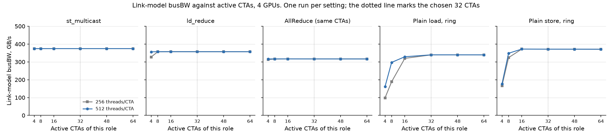
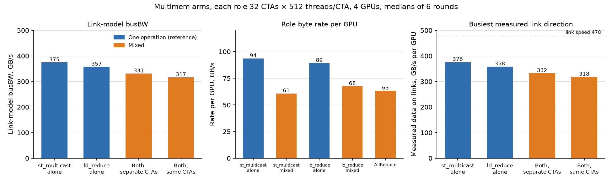
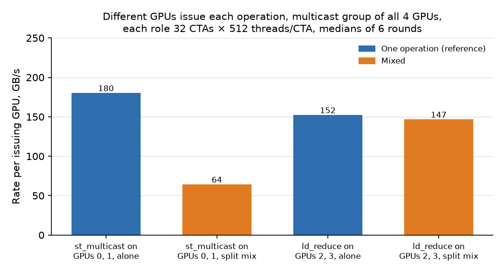

# Mixing `st_multicast` and `ld_reduce` on one GPU: report

**Question.** When each GPU issues `st_multicast` and `ld_reduce` at the same time, does busBW fall by about 20% compared with one operation alone, while plain loads and stores mixed in the same way do not fall? This repeats section 3.4 of [Shouxu's scale-up switch report](../../../../../notes/references/scaleup-switch%20(shouxu%20expr%20report).pdf). The [plan](01_multimem_load_store_mix.md) set the pass limits before any run.

**Answer.** **The drop is reproduced, but it is smaller: mixing `st_multicast` and `ld_reduce` on each GPU lowers AllReduce busBW to 0.865 of the single-operation busBW, a 13% drop where the report found about 21%.** busBW here is computed for the NVLS algorithm that ran: the data each GPU moves in its busier link direction, which is algBW × 1 for AllGather and ReduceScatter and algBW × (1 + 1/n) = 1.25 for AllReduce on 4 GPUs. The author confirmed that the report's busBW is not the nccl-tests number. Our measured link counters show the same drop (0.866), and real NCCL kernels give 0.861. Each operation also slows down when mixed: `st_multicast` by 35% and `ld_reduce` by 24%. Same-CTA and separate-CTA mixes give almost the same busBW. Plain loads and stores lose only 3%. When different GPUs issue each operation, `ld_reduce` keeps its rate but `st_multicast` loses 64%, unlike the report. The report used GB300 with fifth-generation NVLink, about twice our link speed, so only ratios are compared. These runs do not show the cause of the slowdown. **Correction (2026-11-07):** an earlier version of this report used the nccl-tests busBW, whose AllReduce factor belongs to the Ring algorithm, and concluded "not reproduced". The data did not change. See [How busBW is computed](#how-busbw-is-computed-allreduce-on-nvls-against-ring).

| Report's claim | Measure | Report | Here | Verdict under the plan's limits |
|---|---|---|---|---|
| Mixing lowers multimem busBW | AllReduce busBW ÷ mean of the two single-operation busBW | about 0.79 (550 ÷ 700) | **0.865** (harness), **0.861** (NCCL); measured link data 0.866 | **Reproduced** (limit ≤ 0.90). The drop is 13%, smaller than the report's 21% |
| Same and separate CTAs behave alike | Separate-CTA busBW ÷ AllReduce busBW | about 1.02 (560 ÷ 550) | **1.045** | **Reproduced** (limit 0.95–1.05), near the upper edge. How the report combined two roles into one number is not known |
| Plain loads and stores do not fall | Plain mix busBW ÷ mean of plain load alone and plain store alone | about 1.0 | **0.968** | **Reproduced** |
| No drop when different GPUs issue each operation | Rate in split mix ÷ rate alone, each operation | about 1.0 | `st_multicast` **0.356**, `ld_reduce` **0.963** | **Not reproduced** for `st_multicast`, **reproduced** for `ld_reduce`. Our traffic may differ from the report's; see that section |

| Word in this report | Metric or setting in the [common setup](../00_common_setup.md) |
|---|---|
| Role byte rate | N1 |
| busBW, link-model busBW | N5: algBW × 1 for one multimem operation, algBW × 1.25 for AllReduce, see [How busBW is computed](#how-busbw-is-computed-allreduce-on-nvls-against-ring) |
| algBW | Buffer bytes ÷ time; in the harness, 4 × the role byte rate |
| CTA progress ratio | N3, the largest CTA chunk count ÷ the smallest in one role |
| Role overlap | N4 |
| Correct results, wrong words | A11 |
| Device state | B2 |
| Link data | B3, whole-run `nvidia-smi nvlink -gt d` differences, divided by the time of all windows |

All results below use physical GPUs 4–7, and raw records are only on this machine or from a rerun. Each table states its configuration. Round-to-round spread is very small. The reference busBW interquartile range is at most 0.04 GB/s in our harness and at most 0.13 GB/s in NCCL. A standardized effect, `(median mixed − median reference) / IQR reference`, would be in the hundreds or thousands and would say only that the denominator is tiny. So this report gives absolute values and ratios.

**GPU 6 condition.** From 21:43 UTC on 2026-11-01, GPU 6 held about 122 MiB at 0% utilization, with no visible process and no known owner. The session guard stopped for it. The user accepted it as not occupying the GPU, and the guard limit for GPU 6 only was raised to 150 MiB. Calibration ran before this memory appeared and the later sessions ran with it. The five single-role results at 32 CTAs × 512 threads/CTA match to 0.1 GB/s across that change, so we see no effect on those arms. We cannot prove there is none; see the odd GPU 6 result in the multimem table section.

## How busBW is computed: AllReduce on NVLS against Ring

The report gives every result as "busBW" and does not say how it computed it. **The author confirmed to the user that it is not the number nccl-tests prints.** This report therefore computes busBW from the bytes each GPU really moves on its links for the algorithm that runs. In the [common setup](../00_common_setup.md#link-model-busbw-n5) this is metric N5, "link-model busBW". For a given algorithm, busBW is the data one GPU sends, or receives, in its busier link direction, divided by the time.

Notation: n GPUs, S the AllReduce buffer size in bytes, t the time, and **algBW = S / t**. In the harness each GPU finishes its own part of S/n, so algBW = n × the role byte rate.

### Ring AllReduce: busBW = algBW × 2(n−1)/n

NCCL's Ring kernel is `runRing` in [`src/device/all_reduce.h:14-82`](../../../../../src/device/all_reduce.h). The buffer is cut into n chunks of S/n. Each GPU sends to its next GPU only, in 2(n−1) steps of one chunk:

| Step in `runRing` | Line | Chunks sent to the next GPU |
|---|---|---|
| `directSend`: first chunk | 47 | 1 |
| `directRecvReduceDirectSend`: reduce and pass on | 55 | n − 2 |
| `directRecvReduceCopyDirectSend`: final sum, keep and pass on | 64 | 1 |
| `directRecvCopyDirectSend`: pass the sums on | 72 | n − 2 |
| **Total** | | **2(n − 1) chunks = 2(n−1)/n × S** |

Each GPU receives the same amount from its previous GPU. So both link directions carry 2(n−1)/n × S, and **busBW = algBW × 2(n−1)/n**.

### NVLS AllReduce: busBW = algBW × (1 + 1/n)

With NVLS, GPU r handles only part r (size S/n). It reads part r from all n GPUs with `ld_reduce`, and writes the sum to all n GPUs with `multimem.st`. The harness does this in `stepAllreduce` ([`mm_mix.cu:206-216`](../../common/src/mm_mix.cu)). NCCL does the same in its symmetric kernel `allreduceMultimem` ([`src/device/symmetric/all_reduce.cuh:437-484`](../../../../../src/device/symmetric/all_reduce.cuh)), and on one node in the legacy NVLS kernel, whose reduce warps call `directRecvDirectSend` on the multicast handle `nvls->down` ([`src/device/all_reduce.h:441-456`](../../../../../src/device/all_reduce.h)).

Counting the data on one GPU's links:

| Traffic | Out of each GPU | Into each GPU |
|---|---|---|
| `ld_reduce`: the switch reads every GPU's copy of every part | S/n for each of the n parts = **S** | the sum of its own part: **S/n** |
| `multimem.st`: the switch writes every part to every GPU | its own part once: **S/n** | one copy of each of the n parts: **S** |
| **Total per direction** | **S + S/n** | **S/n + S** |

The two operations are issued one after the other for each 16-byte pack, over many packs at once, so both directions carry data at the same time. **busBW = algBW × (1 + 1/n).**

This counts the issuing GPU among the n GPUs that are read and written, so its own copy crosses its own link. The link counters on our H100 confirm this (see [How link data is measured](#how-link-data-is-measured)). If a platform kept the own copy local, each direction would carry (n−1)/n × S + S/n = S, and the factor would be 1. Request packets and acknowledgements are not counted.

The same counting gives **busBW = algBW × 1** for AllGather by `st_multicast` (out S/n, in S) and for ReduceScatter by `ld_reduce` (out S, in S/n). For Ring AllGather and ReduceScatter the factor is (n−1)/n.

### The two side by side

| | Ring | NVLS |
|---|---|---|
| Who each GPU talks to | Next and previous GPU only | All n GPUs, through the switch |
| Data per direction per GPU | 2(n−1)/n × S | (1 + 1/n) × S |
| busBW ÷ algBW at n = 4 | **1.5** | **1.25** |
| busBW ÷ algBW at n = 8 | 1.75 | 1.125 |
| Largest algBW if one link direction carries B | B ÷ 1.5 | B ÷ 1.25 |
| With our B = 372 GB/s (plain store alone) | 248 GB/s | 298 GB/s |

NVLS moves less data per GPU than Ring, so at the same link speed it allows a larger algBW. The factor from one algorithm must not be used for the other. nccl-tests prints busBW with the Ring factor whatever algorithm NCCL ran, so for an NVLS AllReduce its busBW is 1.5 ÷ 1.25 = 1.2 times the data actually on the links.

### Worked example: our AllReduce

| Quantity | Harness, 32 CTAs × 512 threads/CTA | NCCL `AllReduce_RSxLDMC_AGxSTMC`, 4 CTAs × 512 threads/CTA |
|---|---|---|
| Role byte rate per GPU (own part) | 63.3 GB/s | |
| algBW | 4 × 63.3 = 253.2 GB/s | 250.7 GB/s (nccl-tests `algbw`) |
| **NVLS busBW = algBW × 1.25** | **316.5 GB/s** | **313.4 GB/s** |
| Measured busiest link direction | 318 GB/s | not measured |
| Share of the 298 GB/s algBW ceiling above | 85% | 84% |

The single operations: `st_multicast` alone gives algBW = busBW = 4 × 93.6 = 374.5 GB/s, and `ld_reduce` alone 4 × 89.2 = 357.0 GB/s. So AllReduce busBW ÷ mean of the two = 316.5 ÷ 365.75 = **0.865**.

**Correction (2026-11-07).** An earlier version of this report used the nccl-tests busBW. With the Ring factors (1.5 for AllReduce, 0.75 for one operation) the same rates give 1.385, and that version concluded "not reproduced". This busBW definition was chosen after the data were seen, because the author's answer came after the runs. The plan's pass limits are unchanged.

## Support check

### Motivation

Every multimem experiment depends on this. The VM runs in pass-through mode and shows no NVSwitch device, so support could not be assumed. The plan expected either outcome and set a stop rule if multimem was not available.

### Setup

| Setting | Value |
|---|---|
| GPUs | Physical 4, 5, 6, 7 through `CUDA_VISIBLE_DEVICES=4,5,6,7`; NVIDIA H100 80GB HBM3 |
| Other tenants | GPUs 4–7 showed 4 MiB used, 0% use and no compute process before each run. GPUs 0–3 were busy and were not touched |
| Driver | 595.71.05, CUDA 13.2 |
| NCCL | In-tree 2.32.3, confirmed by each log line `NCCL version 2.32.3+cuda13.0` |
| Clocks and power | Unchanged |
| Forcing | `NCCL_NVLS_ENABLE` not set, so NCCL reads the real attribute |

### Method

| Step | Command or program | What it shows |
|---|---|---|
| 1 | [`multicast_probe.cu`](../../common/src/multicast_probe.cu) | Raw `CU_DEVICE_ATTRIBUTE_MULTICAST_SUPPORTED` per GPU |
| 2 | `NTHREADS=4 rmsnorm_multimem` with `NCCL_DEBUG=INFO NCCL_DEBUG_SUBSYS=INIT` | NCCL's support decision, and real multimem loads and stores on 4 GPUs with a check against a CPU reference |
| 3 | `all_reduce_perf -t 1 -g 4 -b 1G -e 1G -f 2 -n 20 -w 5 -c 1 -R 2 -d float -o sum`, against the in-tree library | Which kernel NCCL's own tuning chooses |
| 4 | Same as step 3, with `NCCL_SYM_KERNEL=allreduce:AllReduce_RSxLDMC_AGxSTMC` | Forcing that kernel works, for the later NCCL cross-check |

Deviations from the plan:

- **Added steps 1 and 4.** Step 1 reads the attribute directly. Step 4 replaces a wrong selector.
- **One failed attempt, kept.** `NCCL_ALGO=allreduce:SYMK_RSxLDMC_AGxSTMC`, which the plan first cited, stopped with `Unrecognized element token` and exit code 3. `NCCL_ALGO` does not take kernel names. The log is kept as `allreduce_forced.log`. The plan is corrected.
- **Step 2 built outside the source tree**, with `nvcc` directly, so `docs/` holds no build products.

### Results

This is a yes-or-no check with no comparison between settings, so it has no figure.

| Step | Result |
|---|---|
| 1. Raw attribute | `multicastSupported=1` on all 4 GPUs |
| 2. NCCL support decision | `NVLS multicast support is available`, `transport enabled, symmetric multimem enabled`, on all 4 ranks |
| 2. Multimem example | `SUCCESS`, exit code 0, 1024 tokens per GPU, 256 threads per block |
| 3. Kernel chosen by default | `AllReduce_RSxLDMC_AGxSTMC`, 4 channels (CTAs), 512 threads, on all 52 logged calls |
| 3 and 4. Wrong values | 0 in out-of-place and in-place runs |
| 4. Forced kernel | Same kernel, 4 channels, 512 threads |

Bandwidth in the kernel check, for 1 GiB `float` sum on 4 GPUs. One run per row, with INFO logging on every call. algBW is the `algbw` nccl-tests prints; busBW = 1.25 × algBW:

| Kernel selection | Communication: CTAs × threads/CTA | algBW out-of-place, in-place, GB/s | busBW out-of-place, in-place, GB/s |
|---|---|---|---|
| Default | NCCL `AllReduce_RSxLDMC_AGxSTMC`: 4 × 512 | 250.37, 250.12 | 313.0, 312.7 |
| Forced with `NCCL_SYM_KERNEL` | NCCL `AllReduce_RSxLDMC_AGxSTMC`: 4 × 512 | 250.27, 250.27 | 312.8, 312.8 |

### Interpretation

- **Multimem works on GPUs 4–7, and the plan continues.** The stop rule in the plan does not apply. This covers these four GPUs and this driver only.
- **The busBW values are not a reproduction result.** They come from a check with logging on, with no matched AllGather or ReduceScatter reference. They say nothing yet about the report's 20% drop.
- **NCCL used 4 CTAs here, not the report's 32 blocks.** The channel count comes from NCCL's own tuning at 1 GiB. The calibration (E1.1) must cover low CTA counts, and the NCCL cross-check (E1.7) must record channels for each collective.
- **This check's busBW is not compared with the plan's rough guess.** The plan guessed 280–305 GB/s for the mix by scaling the report's numbers with the Ring factor. The report does not use that factor, so the guess has no meaning.
- **Whether traffic used the switch's multicast path is not measured.** Correct values and the kernel name show that the multimem instructions ran. The link data section below looks at whole-run link bytes, but does not show the path inside the switch.
- **Two warnings appear once in each NCCL log, and neither was investigated.** `rma_socket requires GDRCopy` names a socket RMA transport. `Call to bind failed: Address already in use` comes from one rank's RAS client socket at `localhost:28028`. Neither stopped a run. The cause of the bind failure is not known; no process was listening on that port when checked after the runs.

## Calibration: where each operation stops gaining from more CTAs

### Motivation

A mix can only show a shared limit if each operation alone has reached its plateau. AllReduce needs its own sweep, because each thread waits for its `ld_reduce` before it can store, so too little request supply could look like interference.

### Setup

| Setting | Value |
|---|---|
| **Controlled independent variable** | **Active CTAs of one role: 4, 8, 16, 32, 48, 64** |
| Threads/CTA | 256 and 512 |
| Roles, one per run | `st_multicast`, `ld_reduce`, AllReduce on the same CTAs, plain load on a ring, plain store on a ring |
| Fixed | 4 GPUs, 300 ms window, 1 warm-up window and 5 kept windows, 16-byte packs, 2 GiB part per rank |
| Configs | `configs/e1_1/`, for example `e1_1_allreduce_c32_t512.cfg` |

### Method

We ran 60 settings once each, with 0 wrong words. **Deviation:** the plan asked for 3 runs per setting. The session stopped for GPU 6 after the first round. We then agreed with the user to drop the other two rounds, because one round had already chosen the setting. So the spread part of the plan's stopping rule was not measured at neighboring settings. The multimem and plain tables below repeat the chosen setting 6 times per arm, and they test it. Two runs in this sweep (`e1_1_plain_load_c16_t512`, `e1_1_reduce_c48_t512`) also showed clock-event reason `0x4` in some samples. Their median SM clock stayed at 1980 MHz, and neither is the chosen setting.

### Results



| Role, threads/CTA | 4 CTAs | 8 CTAs | 16 CTAs | 32 CTAs | 48 CTAs | 64 CTAs |
|---|---|---|---|---|---|---|
| `st_multicast`, 256 | 374.5 | 374.5 | 374.6 | 374.5 | 374.6 | 374.5 |
| `st_multicast`, 512 | 374.5 | 374.5 | 374.6 | 374.5 | 374.5 | 374.5 |
| `ld_reduce`, 256 | 327.4 | 356.5 | 357.3 | 357.2 | 357.1 | 357.0 |
| `ld_reduce`, 512 | 356.4 | 357.2 | 357.2 | 357.0 | 357.1 | 356.9 |
| AllReduce, 256 | 312.9 | 316.0 | 317.0 | 316.9 | 316.9 | 316.9 |
| AllReduce, 512 | 316.5 | 316.7 | 316.7 | 316.5 | 316.4 | 316.4 |
| Plain load, 256 | 98.3 | 188.8 | 319.7 | 339.3 | 339.6 | 339.5 |
| Plain load, 512 | 161.5 | 297.2 | 328.8 | 339.6 | 339.5 | 339.4 |
| Plain store, 256 | 166.5 | 323.9 | 371.8 | 371.5 | 371.5 | 371.2 |
| Plain store, 512 | 175.9 | 348.4 | 371.8 | 371.4 | 371.2 | 370.9 |

All values are busBW in GB/s, on 4 GPUs, with one run per setting.

### Interpretation

- **32 CTAs × 512 threads/CTA is on the plateau for all five roles.** Both CTA steps after 32 change busBW by less than 1%. We keep the report's 32 CTAs, and we use 512 threads/CTA.
- **Too little request supply does not explain the AllReduce result.** AllReduce is already flat at 8 CTAs × 512 threads/CTA.
- **A flat curve does not name the limit.** `st_multicast` stays at 280.9 GB/s even at 4 CTAs. The link data section below suggests the links into each GPU, but this does not prove it.

## Multimem table: each operation alone, then both

### Motivation

This is the main result. It models a collective where each GPU issues both operations for its whole run. The plan expected about 0.8 times the single-operation busBW, from the report. A wall-clock busBW alone would hide which role lost speed.

### Setup

| Arm | Role table per GPU | Comparison role |
|---|---|---|
| `st_multicast` alone | `st_multicast`: 32 CTAs × 512 threads/CTA | Reference |
| `ld_reduce` alone | `ld_reduce`: 32 CTAs × 512 threads/CTA | Reference |
| **Both, separate CTAs** | `st_multicast`: 32 CTAs × 512 threads/CTA; `ld_reduce`: 32 CTAs × 512 threads/CTA | Mixed |
| **Both, same CTAs** | AllReduce: 32 CTAs × 512 threads/CTA | Mixed |

The **controlled independent variable** is which operations run, and whether they share CTAs. Fixed: 4 GPUs, 300 ms window, 16-byte packs, a separate 2 GiB part per rank, roles spread over GPCs, the same launch. Configs are in `configs/e1_2/`.

### Method

We ran the four arms once per round for 6 rounds, with the arm order rotated, in one session. All 24 runs had 0 wrong words, role overlap of at least 99.98% where two roles ran on one GPU, 1980 MHz median SM clock and no clock-event reasons.

### Results



| Arm, 4 GPUs | Rate per GPU, GB/s | busBW, GB/s | CTA progress ratio |
|---|---|---|---|
| `st_multicast` alone: 32 CTAs × 512 threads/CTA | 93.6 | 374.5 | 5.81 |
| `ld_reduce` alone: 32 CTAs × 512 threads/CTA | 89.2 | 357.0 | 1.01 |
| Both, separate CTAs, `st_multicast` part: 32 CTAs × 512 threads/CTA | 60.7 | 330.8 for the arm: in 4 × 60.7 + 67.5 = 310, out 60.7 + 4 × 67.5 = 331 | 2.10 |
| Both, separate CTAs, `ld_reduce` part: 32 CTAs × 512 threads/CTA | 67.5 | (same arm) | 2.09 |
| Both, same CTAs (AllReduce): 32 CTAs × 512 threads/CTA | 63.3 | 316.5 | 5.38 |

| Ratio, one per round | Median | Range over 6 rounds |
|---|---|---|
| **AllReduce busBW ÷ mean of the two alone** | **0.865** | 0.865–0.865 |
| **Separate-CTA busBW ÷ AllReduce busBW** | **1.045** | 1.045–1.045 |
| Separate-CTA busBW ÷ mean of the two alone | 0.904 | 0.904–0.905 |
| `st_multicast` rate, separate CTAs ÷ alone | 0.649 | 0.649–0.649 |
| `ld_reduce` rate, separate CTAs ÷ alone | 0.757 | 0.756–0.757 |

### Interpretation

- **The report's drop is reproduced, but it is smaller.** AllReduce busBW is 0.865 of the single-operation value in all 6 rounds, below the plan's "reproduced" limit of 0.90. That is a 13% drop. The report's 550 ÷ 700 is a 21% drop.
- **Measured link data shows the same drop.** The busiest measured link direction falls from 367 to 318 GB/s, a ratio of 0.866 (link data section). So the drop is not an effect of the model.
- **Each operation slows down when mixed.** `st_multicast` loses 35% and `ld_reduce` loses 24% of its rate. AllReduce's rate is 29–32% below each operation alone.
- **Same and separate CTAs give nearly the same busBW, 1.045.** This is inside the plan's 0.95–1.05 limit, near its upper edge. With separate CTAs the two roles run at different rates (60.7 and 67.5), so the busier direction carries a little more than in AllReduce. The report gives 560 ÷ 550 = 1.02. How it combined two roles into one number is not known.
- **One GPU behaves oddly in the separate-CTA mix.** `ld_reduce` on GPU 6 runs at about 63.9 GB/s, while the others run at about 68.7 GB/s, in all 6 rounds. This does not appear in the single-operation arms. GPU 6 is also the GPU holding the 122 MiB, but we did not measure this arm without that memory, so we cannot say whether they are connected.
- **The uneven CTA progress is a store-side pattern, not a multicast-only one.** Plain store alone shows the same ratio (5.84). Plain load shows 1.01. We did not find the cause.

## Plain load/store table: the same mix without multimem

### Motivation

This is the control behind the report's third claim. If plain traffic also fell, the drop would not be specific to multimem.

### Setup

| Arm | Role table per GPU | Comparison role |
|---|---|---|
| Plain load alone | Plain load: 32 CTAs × 512 threads/CTA | Reference |
| Plain store alone | Plain store: 32 CTAs × 512 threads/CTA | Reference |
| **Plain mix** | Plain load: 32 CTAs × 512 threads/CTA; plain store: 32 CTAs × 512 threads/CTA | Mixed |

The **controlled independent variable** is which plain operations run. Traffic pattern is a ring, `GPU 4 → 5 → 6 → 7 → 4`: each GPU loads from the next and stores to the next. Other settings match the multimem table. Configs are in `configs/e1_3/`.

### Method

We ran the three arms for 6 rounds, rotated, in one session, right after the multimem session. All 18 runs had 0 wrong words, role overlap of at least 99.99%, 1980 MHz and no clock-event reasons.

### Results


| Arm, 4 GPUs | busBW, GB/s | CTA progress ratio |
|---|---|---|
| Plain load alone: 32 CTAs × 512 threads/CTA | 339.6 | 1.01 |
| Plain store alone: 32 CTAs × 512 threads/CTA | 371.4 | 5.84 |
| Plain mix, plain load part: 32 CTAs × 512 threads/CTA | 175.3 | 2.02 |
| Plain mix, plain store part: 32 CTAs × 512 threads/CTA | 168.8 | 2.07 |
| Plain mix, summed | 344.1 | |

Plain mix ÷ mean of the two alone: median **0.968**, range 0.968–0.968 over 6 rounds.

### Interpretation

- **The report's control result is reproduced.** 0.968 is above the plan's limit of 0.95.
- **A small drop exists.** The 3.2% is outside the very small round-to-round spread, so it is real here, though it is within the limit.
- **For plain roles, busBW is the data on the links.** Each plain pack crosses one link once, so the summed busBW of the mix (344.1 GB/s) matches the 345 GB/s measured per direction. It can be compared directly with the multimem result: 0.968 here against 0.865 for multimem.
- **GPUs do not share the plain mix equally.** Plain load per GPU is about 191, 157, 201 and 151 GB/s, in rank order, and plain store shows a similar pattern. We did not study the cause.

## Split mix: different GPUs issue each operation

### Motivation

The report's section title says the effect is "at each GPU". That rests on its section 3.3: with two GPUs running AllGather and two others running ReduceScatter, each group kept about 690 GB/s. If this control also falls, the limit may not be at the issuing GPU.

### Setup

| Arm | GPUs at ranks 0, 1 (physical 4, 5) | GPUs at ranks 2, 3 (physical 6, 7) |
|---|---|---|
| `st_multicast` on two GPUs | `st_multicast`: 32 CTAs × 512 threads/CTA | No role |
| `ld_reduce` on two GPUs | No role | `ld_reduce`: 32 CTAs × 512 threads/CTA |
| **Split mix** | `st_multicast`: 32 CTAs × 512 threads/CTA | `ld_reduce`: 32 CTAs × 512 threads/CTA |

The **controlled independent variable** is whether the other operation runs at the same time on the other two GPUs. **The multicast group holds all 4 GPUs in every arm.** Other settings match the multimem table. Configs are in `configs/e1_4/`.

### Method

We ran the three arms for 6 rounds, rotated, in one session. All 18 runs had 0 wrong words, 1980 MHz and no clock-event reasons.

**Deviations.** The 2-GPU multicast group variant in the plan was dropped in the scope cut, so we cannot compare directly with a group of two. Role overlap could not be read from timestamps here, because the two roles run on different GPUs and each GPU clock has its own origin, seconds apart. Within one run the offsets between GPUs stay constant to within 0.1 ms over the windows, each window takes 300.6–300.9 ms, and all GPUs start from one shared signal. So we treat the roles as overlapping, but the 95% overlap check in the plan was not measured for this arm.

### Results



| Arm: each role 32 CTAs × 512 threads/CTA | Rate per issuing GPU, GB/s | Split ÷ alone |
|---|---|---|
| `st_multicast` on ranks 0, 1, alone | 180.1 | |
| `st_multicast` on ranks 0, 1, split mix | 64.2 | **0.356** |
| `ld_reduce` on ranks 2, 3, alone | 152.2 | |
| `ld_reduce` on ranks 2, 3, split mix | 146.6 | **0.963** |

| Split mix link data, GB/s | Ranks 0, 1 (issue `st_multicast`) | Ranks 2, 3 (issue `ld_reduce`) |
|---|---|---|
| Into each GPU | 129 | 275 |
| Out of each GPU | 357–359 | 294 |

### Interpretation

- **The report's "no drop" holds for `ld_reduce` and fails for `st_multicast` in this traffic.** `ld_reduce` is above the 0.95 limit. `st_multicast` loses 64%.
- **Outgoing link traffic on ranks 0 and 1 could explain the multicast loss, but this is not proven.** Those GPUs also serve the `ld_reduce` reads of ranks 2 and 3, about 293 GB/s. With the multicast store data, their outgoing links carry about 358 GB/s. That is about what `ld_reduce` alone (358 GB/s) and plain store (372 GB/s) carry. The GB/s left over, about 65–79, is close to the 64 GB/s multicast reached. If this reading is right, read replies win over new multicast stores.
- **This does not contradict the report's 690 GB/s.** If the report used separate 2-GPU groups, ranks 0 and 1 would not serve those reads. We did not run this. So this result cannot tell whether a limit sits in the GPU or the switch.

## Link data: how full are the links?

### Motivation

busBW is computed from rates with a model of the traffic. The link counters measure what the links really carried, so they test that model and show how full the links are.

### Setup

| Setting | Value |
|---|---|
| **Controlled independent variable** | **The arms of the sections above**; this section adds only the observation |
| Instrument | `nvidia-smi nvlink -gt d`, before and after each run. Summed over each GPU's links, divided by the time of all 6 windows (warm-up included) |
| Limits | Includes setup and checking traffic. Whole-run and whole-GPU only |

### Method

#### How link data is measured

Each H100 has NVLink links to the NVSwitch fabric. The driver counts every byte a GPU sends on each link (Tx) and every byte it receives (Rx). `nvidia-smi nvlink -gt d` prints these counters. Reading them changes nothing on the GPU, and the harness never touches them.

1. **Before each run**, `run_session.py` saves the output of `nvidia-smi nvlink -i 4,5,6,7 -gt d` ([`run_session.py:58-62`](../../common/scripts/run_session.py)).
2. The run executes `mm_mix`: 1 warm-up window and 5 kept windows of 300 ms each.
3. **After the run**, it saves the same output again.
4. For each GPU, `mm_summary.py` adds up the Tx counters of all its links, before and after, and takes the difference; the same for Rx ([`mm_summary.py:116-126`](../../common/scripts/mm_summary.py)). This gives the bytes that GPU sent and received during the run.
5. It divides by 6 × 300 ms = 1.8 s. The results are "out of each GPU" and "into each GPU", in GB/s.
6. **Busiest direction** is the larger of the two for each GPU, averaged over the 4 GPUs, then the median over the rounds of an arm ([`make_figures.py`](../../common/scripts/make_figures.py), `busiest_direction`). For `st_multicast` alone it is "into" (376 GB/s); for `ld_reduce` alone it is "out of" (358 GB/s). A link full in one direction limits the rate, even if the other direction is nearly empty.

Limits: the counters run over the whole run, so they also include setup and checking traffic, and the time divides by the nominal 1.8 s. They give one total per run and per GPU, not a value per window or per role. They count data only as the driver reports it, and they cannot show the path inside the switch.

**Deviation:** the plan's `ncu` counter pass was dropped in the scope cut. So we have no HBM or L2 bytes, and no per-direction counters during the window itself. Validation against known traffic is the fit in the table below.

### Results


Prediction uses `m` for the `st_multicast` rate and `r` for the `ld_reduce` rate. Each store counts 4 times coming in and once going out, and each load counts once coming in and 4 times going out.

| Arm: each role 32 CTAs × 512 threads/CTA | Predicted in / out, GB/s | Measured in / out, GB/s |
|---|---|---|
| `st_multicast` alone (m = 93.6) | 374 / 94 | 376 / 94 |
| `ld_reduce` alone (r = 89.2) | 89 / 357 | 90 / 358 |
| Both, separate CTAs (m = 60.7, r = 67.5) | 310 / 331 | 312 / 332 |
| Both, same CTAs (m = r = 63.3) | 317 / 317 | 318 / 318 |
| Split mix, ranks 0, 1 (m = 64.2, r = 146.6) | 128 / 357 | 129 / 358 |
| Split mix, ranks 2, 3 | 275 / 293 | 275 / 294 |

| Busiest link direction, mean over GPUs | Mixed, GB/s | Reference (mean alone), GB/s | Ratio |
|---|---|---|---|
| Multimem, both on same CTAs | 318 | 367 | 0.866 |
| Multimem, both on separate CTAs | 332 | 367 | 0.906 |
| Plain mix | 345 | 356 | 0.969 |

### Interpretation

- **The plan's traffic model was wrong by one copy.** Link data fits 4 copies in, not 3. The issuing GPU's links carry its own multicast and reduce data as well. In the split arms, GPUs that issue `st_multicast` receive the data of both issuers, which shows this directly. We did not observe the path inside the switch.
- **Single-operation multimem looks limited by one link direction.** `st_multicast` carries about 361–376 GB/s into each GPU, whether 2 or 4 GPUs issue. This may explain why its busBW stays at 280.9 GB/s at any CTA count. The link speed of 478 GB/s is a raw figure. Plain store reaches only 372 GB/s of data on the same links.
- **Mixing multimem lowers link data more than mixing plain traffic does.** The busiest direction falls by 9–13%, compared with 3% for plain traffic. These counters confirm the traffic model behind busBW in the [busBW section](#how-busbw-is-computed-allreduce-on-nvls-against-ring).
- **Whether the links are full in the mix is not settled.** Against plain store (372 GB/s), the mixes look about 11–15% under full. But the plain mix, which also has traffic in both directions, carries only 345 GB/s. Against that, AllReduce (318 GB/s) is about 8% under, and separate CTAs (332 GB/s) about 4% under, in the busiest direction. Request packets and protocol bytes may fill the rest, and we did not measure them. A shared in-flight limit, as the report proposes, is possible but not shown.
- **AllReduce falls 15% short of its link limit, and the single operations do not.** With the most data we moved in one direction (plain store, 372 GB/s), AllReduce could reach busBW 372 and reaches 318 (85%). `st_multicast` alone reaches 376 and `ld_reduce` alone 358, about the same as plain store. The H100 nameplate of 900 GB/s counts both directions, so 450 GB/s each way, and plain store reaches 83% of that.
- **The report's numbers fit the link model on its own platform, if its busBW counts link data.** Its single operations at about 700 GB/s sit a little below its plain loads (768 GB/s), as ours (375 and 357) sit near our plain store (372). Its AllReduce at 550 is 0.79 of them, where ours is 0.865. So the mixing loss looks larger on GB300 than on H100. An earlier version of this bullet assumed nccl-tests units for the report and concluded that the report fits a model where the issuing GPU's own copy does not use its link. That conclusion is withdrawn with the assumption. We have no GB300 measurement.

## NCCL cross-check: real collectives

### Motivation

Our role loops are not the author's code. The in-tree kernels run the same operations, so this ties the harness to real NCCL, and also shows if our fixed-time design changed the result.

### Setup

| Setting | Value |
|---|---|
| **Controlled independent variable** | **Collective and forced kernel: AllGather (`AllGather_STMC`), ReduceScatter (`ReduceScatter_LDMC`), AllReduce (`AllReduce_RSxLDMC_AGxSTMC`)** |
| Selection | `NCCL_SYM_KERNEL=<collective>:<kernel>` |
| Command | `<program> -t 1 -g 4 -b 8G -e 8G -f 2 -n 20 -w 5 -c 1 -R 2 -d float -o sum`, with `LD_LIBRARY_PATH` set to the in-tree library |
| CTAs × threads | Chosen by NCCL: 4 × 512 in every call. Read from the log |
| Runner | [`run_nccl_check.py`](../../common/scripts/run_nccl_check.py), with the same locks and idle guard |

### Method

We ran 5 rounds, rotated, for 15 runs. Every run had 52 log lines with the forced kernel and none with another, and 0 wrong values. One earlier one-round test with the same settings is kept in `results/2026-11-01/e1_7_smoke/` and is not counted. It gave the same result. **Deviation:** the report used 32 blocks, but NCCL chose 4 CTAs here and we did not force 32. The harness is flat from 4 to 32 CTAs at 512 threads/CTA, so we do not expect this to change the ratio, though we did not test this in NCCL.

### Results


busBW from the `algbw` that nccl-tests prints (buffer bytes ÷ time), × 1 for AllGather and ReduceScatter and × 1.25 for AllReduce. The `busbw` that nccl-tests prints is not used:

| Collective | NCCL algBW, 4 CTAs × 512 threads/CTA, GB/s | NCCL busBW, GB/s | Harness busBW, 32 CTAs × 512 threads/CTA (6 rounds), GB/s | Report busBW, GB/s |
|---|---|---|---|---|
| AllGather / `st_multicast` | 372.9 | 372.9 | 374.5 | 700 |
| ReduceScatter / `ld_reduce` | 355.3 | 355.3 | 357.0 | 670–700 |
| AllReduce / same CTAs | 250.7 | 313.4 | 316.5 | 550 |
| AllReduce ÷ mean of the other two | | **0.861** (range 0.860–0.861) | **0.865** | about 0.79 |

### Interpretation

- **Real NCCL agrees with the harness within about 1%.** The busBW ratio is not caused by our role loops or our fixed-time window.
- **Real NCCL shows the same 14% drop.** Its ratio is 0.861, against 0.865 in the harness. So the drop is not caused by our role loops, and the remaining difference from the report (0.79) is not a harness problem. The candidates are the report's platform (GB300 with fifth-generation NVLink, where NCCL can also use TMA kernels), its NCCL version, its unstated settings, and its busBW formula, which may differ from ours. We did not test any of these.

## What this report does not establish

- **The cause of the multimem slowdown.** Rates fall and link data falls, but neither timing nor whole-run bytes name a resource.
- **Why the report's drop is larger** (0.79 against 0.865), **and the report's exact busBW formula.** The author said it is not the nccl-tests number; we use the NVLS byte count, which may not be the same. Its GPU and link are known (GB300, fifth-generation NVLink), but its driver, NCCL version and benchmark are not. We have no GB300 to run on.
- **Link use during the window.** We used whole-run totals, without an `ncu` pass.
- **The report's split-mix traffic.** We used a multicast group of 4 GPUs only.
- **How the slowdown grows with pressure, and whether addresses matter.** The extension sweeps and the rank-offset test in the plan were dropped.

## Session log

| Date (UTC) | GPUs | What ran | Deviations | Results |
|---|---|---|---|---|
| 2026-11-01 | 4–7 | Support check, steps 1–4 | See that section | `results/2026-11-01/e1_0/raw/` |
| 2026-11-01, until 21:43 | 4–7 | Calibration, 60 runs | Stopped by the guard for 122 MiB on GPU 6; other rounds dropped by agreement | `results/2026-11-01/e1_1/` |
| 2026-11-01, from 23:06 | 4–7 | Multimem table (24 runs), plain table (18), split mix (18) | GPU 6 limit raised to 150 MiB, as agreed. One E1.3 start failed before any GPU work because of a wrong working directory; it was rerun | `results/2026-11-01/e1_2/`, `e1_3/`, `e1_4/` |
| 2026-11-01, until 23:20 | 4–7 | NCCL cross-check (3 test runs, 15 counted runs) | NCCL chose 4 CTAs | `results/2026-11-01/e1_7_smoke/`, `e1_7/` |
| 2026-11-07 | None | Re-analysis of the recorded data only. The author confirmed the report's busBW is not the nccl-tests number, so link-model busBW (N5) became the primary measure. The verdict for the main claim changed from "not reproduced" to "reproduced, smaller drop" | Measure chosen after the data; plan limits unchanged | `results/2026-11-01/report_summary.json` and figures regenerated; earlier values unchanged |

Raw records are ignored by git and exist only on this machine, or from a rerun. Summaries, figures and `results/2026-11-01/report_summary.json` are kept in git. Figures and that file come from [`make_figures.py`](../../common/scripts/make_figures.py), run with `/tmp/thread_store_analysis_env/bin/python` or any Python with matplotlib.

Run a session from this directory, with `CUDA_VISIBLE_DEVICES` unset:

```bash
python3 ../../common/scripts/run_session.py configs/plans/e1_2.json <new raw directory> configs/e1_2
```

The harness is [`mm_mix.cu`](../../common/src/mm_mix.cu), built with `make` in `common/`. Roles, placement and windows are described in the [common setup](../00_common_setup.md).

To rebuild from the repository root:

```bash
/usr/local/cuda/bin/nvcc -std=c++17 experiments/h100x4/nvls/common/src/multicast_probe.cu -o multicast_probe -lcuda
EXAMPLES=docs/examples
/usr/local/cuda/bin/nvcc -O3 -std=c++17 -arch=sm_90 --expt-relaxed-constexpr -Xcompiler -pthread \
  -Ibuild/include -I$EXAMPLES/common/include -I$EXAMPLES/07_kernel_fusion/include \
  $EXAMPLES/07_kernel_fusion/02_rmsnorm_multimem/c/main.cu $EXAMPLES/common/src/utils.cc \
  -o rmsnorm_multimem -Lbuild/lib -lnccl -Xlinker -rpath=$PWD/build/lib
```

Run nccl-tests with `LD_LIBRARY_PATH=$PWD/build/lib`, otherwise it loads the system NCCL.
