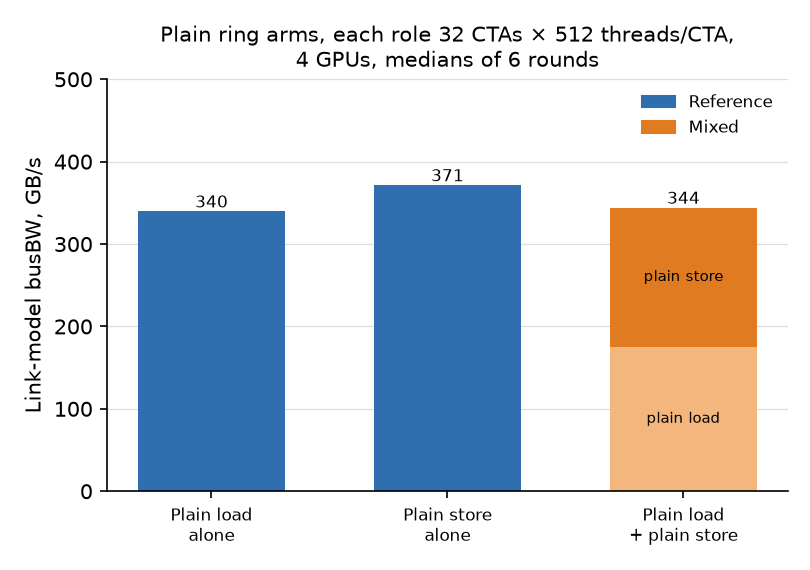
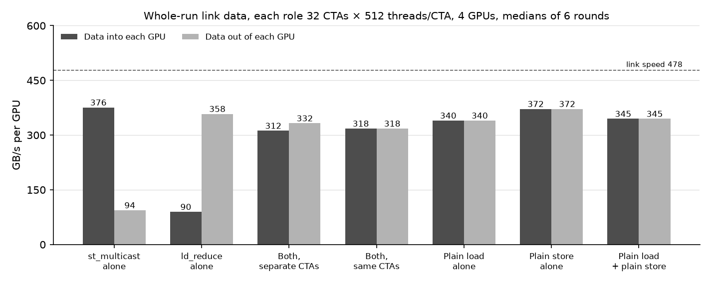
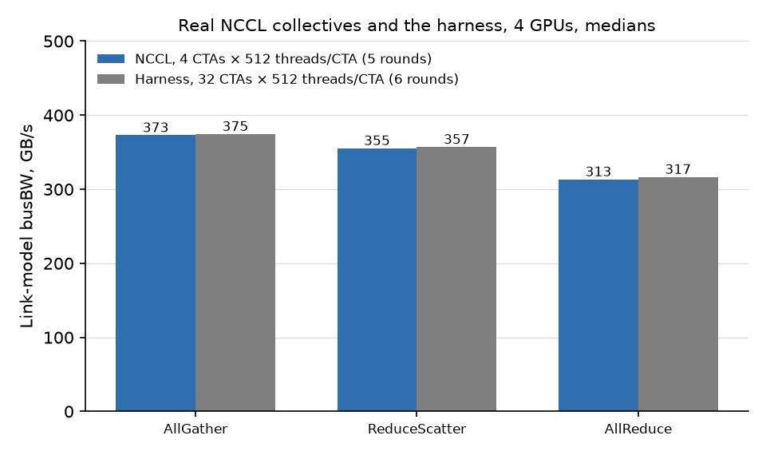

# Mixing `st_multicast` and `ld_reduce` on one GPU: report

**Question.** When every GPU issues `st_multicast` and `ld_reduce` at the same time, does busBW fall by about 20%, compared with each operation run alone as its collective?

- Each operation alone is an NVLS AllGather or an NVLS ReduceScatter on all 4 GPUs.
- The control: plain loads and stores mixed the same way should not fall.
- This repeats section 3.4 of [Shouxu's scale-up switch report](../../../../../notes/references/scaleup-switch%20(shouxu%20expr%20report).pdf). The [plan](01_multimem_load_store_mix.md) set the pass limits before any run.

**Answer: the drop is reproduced, but it is smaller — 13% here against about 21% in the report.**

| Arm, 4 × H100 | busBW, GB/s | ÷ mean of AllGather and ReduceScatter |
|---|---|---|
| NVLS AllGather (`st_multicast` on all GPUs) | 374.5 | reference |
| NVLS ReduceScatter (`ld_reduce` on all GPUs) | 357.0 | reference |
| NVLS AllReduce, both on the same CTAs | 316.5 | **0.865** |
| AllGather + ReduceScatter, separate CTAs | 330.8 | 0.904 |
| Real NCCL kernels, same comparison | | 0.861 |
| Measured link counters, same comparison | | 0.866 |

- **busBW here is the data each GPU moves in its busier link direction.** That is algBW × 1 for AllGather and ReduceScatter, and algBW × 1.25 for AllReduce on 4 GPUs. The author confirmed that the report does not use the nccl-tests busBW. See [How busBW is computed](#how-busbw-is-computed-allreduce-on-nvls-against-ring).
- **Each operation slows down when mixed.** The `st_multicast` CTAs lose 35% and the `ld_reduce` CTAs 24%. Same and separate CTAs behave almost alike (1.045).
- **The controls:** plain loads and stores lose only 3%. When different GPUs issue each operation, the reduce half keeps its rate (0.963) but the multicast half loses 64%, unlike the report.
- **Limits:** the report ran on GB300 with fifth-generation NVLink, about twice our link speed, so only ratios are compared. These runs do not show the cause; see [Possible causes](#possible-causes-of-the-slowdown).

**Correction (2026-11-07).** An earlier version used the nccl-tests busBW, whose AllReduce factor belongs to the Ring algorithm, and concluded "not reproduced". The data did not change.

| Report's claim | Measure | Report | Here | Verdict under the plan's limits |
|---|---|---|---|---|
| Mixing lowers multimem busBW | NVLS AllReduce busBW ÷ mean of NVLS AllGather and NVLS ReduceScatter busBW | about 0.79 (550 ÷ 700) | **0.865** (harness), **0.861** (NCCL); measured link data 0.866 | **Reproduced** (limit ≤ 0.90). The drop is 13%, smaller than the report's 21% |
| Same and separate CTAs behave alike | AllGather + ReduceScatter on separate CTAs, busBW ÷ NVLS AllReduce busBW | about 1.02 (560 ÷ 550) | **1.045** | **Reproduced** (limit 0.95–1.05), near the upper edge. How the report combined two roles into one number is not known |
| Plain loads and stores do not fall | Plain mix busBW ÷ mean of plain load alone and plain store alone | about 1.0 | **0.968** | **Reproduced** |
| No drop when different GPUs issue each operation | Rate of each half in the split mix ÷ rate of that half alone (multicast from ranks 0, 1; reduce by ranks 2, 3) | about 1.0 (690 GB/s per group) | multicast half **0.356**, reduce half **0.963** | **Not reproduced** for `st_multicast`, **reproduced** for `ld_reduce`. Our traffic may differ from the report's; see that section |

| Word in this report | Metric or setting in the [common setup](../00_common_setup.md) |
|---|---|
| NVLS AllGather, NVLS ReduceScatter, NVLS AllReduce | Arms where all 4 GPUs run the role at once, each on its own 2 GiB part: `st_multicast`, `ld_reduce`, or both on the same CTAs. Each is one full collective |
| AllGather + ReduceScatter, separate CTAs | Arm where each GPU runs 32 `st_multicast` CTAs and 32 `ld_reduce` CTAs at once. The report's name for it |
| `st_multicast`, `ld_reduce` | The instructions, and the CTA roles that issue them |
| Role byte rate | N1, see [How each number is measured](#how-each-number-is-measured) |
| busBW, link-model busBW | N5: algBW × 1 for NVLS AllGather or ReduceScatter, algBW × 1.25 for NVLS AllReduce, see [How busBW is computed](#how-busbw-is-computed-allreduce-on-nvls-against-ring) |
| algBW | Buffer bytes ÷ time; in the harness, 4 × the role byte rate |
| CTA progress ratio | N3, the largest CTA chunk count ÷ the smallest in one role |
| Role overlap | N4 |
| Correct results, wrong words | A11 |
| Device state | B2 |
| Link data | B3, whole-run `nvidia-smi nvlink -gt d` differences, divided by the time of all windows |

Notes that apply to every section:

- All results use physical GPUs 4–7. Raw records exist only on this machine, or from a rerun.
- Each table states its configuration.
- **Spread between rounds is tiny:** the busBW interquartile range of the references is at most 0.04 GB/s in the harness and 0.13 GB/s in NCCL. A standardized effect, `(median mixed − median reference) / IQR reference`, would be in the hundreds or thousands and would only show that the denominator is tiny. So this report gives absolute values and ratios.

**GPU 6 condition.**

| When | What |
|---|---|
| From 21:43 UTC on 2026-11-01 | GPU 6 held about 122 MiB at 0% utilization, with no visible process and no known owner |
| Then | The session guard stopped. The user accepted it as not occupying the GPU, and the guard limit for GPU 6 only was raised to 150 MiB |
| Calibration | Ran before this memory appeared |
| All later sessions | Ran with it |

- The five single-arm results at 32 CTAs × 512 threads/CTA match to 0.1 GB/s across that change, so we see no effect on those arms.
- We cannot prove there is none; see the odd GPU 6 result in the multimem table section.

## Which NCCL implementation of NVLS AllReduce this report covers

**Added 2026-11-17.** The rest of the report is unchanged. This section says which code ran.

**Answer: every measurement in this report used multimem on registered symmetric windows. NCCL's classic NVLS algorithm (`NCCL_ALGO=NVLS`) was never run.** In this report, "NVLS AllGather", "NVLS ReduceScatter" and "NVLS AllReduce" mean "the collective built from multimem (NVLink SHARP) instructions", not NCCL's algorithm named NVLS.

NCCL 2.32.3 has two AllReduce implementations that use multimem. Both use the same two instructions, `multimem.ld_reduce` and `multimem.st`, but on different memory and with different work around them:

| | Classic NVLS algorithm | Symmetric multicast kernel |
|---|---|---|
| How it is selected | `NCCL_ALGO=NVLS`; buffers not registered as symmetric windows | Buffers registered with `ncclCommWindowRegister(…, NCCL_WIN_COLL_SYMMETRIC)`; NCCL picks the kernel, or `NCCL_SYM_KERNEL=allreduce:AllReduce_RSxLDMC_AGxSTMC` forces it |
| Code | `RunWorkColl<…, NCCL_ALGO_NVLS, NCCL_PROTO_SIMPLE>` in [`src/device/all_reduce.h`](../../../../../src/device/all_reduce.h) | `ncclSymkRun_AllReduce_RSxLDMC_AGxSTMC` in [`src/device/symmetric/all_reduce.cuh`](../../../../../src/device/symmetric/all_reduce.cuh) |
| Memory the switch works on | NCCL's own internal buffer, bound to a multicast object by NCCL | The user's buffer, bound to a multicast object at registration |
| Work around the instructions | Each CTA has three warp groups: copy the input into NCCL's buffer, reduce through the switch, copy the result out. Groups and GPUs wait on step flags every 128 KiB. Only 4 of 20 warps per CTA issue multimem | Every warp loads with `ld_reduce` and stores with `st` directly on the user's buffer. One barrier across GPUs at the start of the call and one at the end |
| Name in the NCCL log | `Algo NVLS proto SIMPLE` | `AllReduce [Symmetric]: … -> Kernel AllReduce_RSxLDMC_AGxSTMC` |

The full call paths of both, from `all_reduce_perf` down to the PTX, are in the [NVLS AllReduce walkthrough](../../../../../notes/nvls_allreduce_walkthrough.html).

What each part of this report ran:

| Part of this report | What ran | Which implementation it matches | Evidence |
|---|---|---|---|
| Harness (`mm_mix`): the multimem table, the split mix, the calibration, the link data | Our own kernel. Memory from `ncclMemAlloc`, registered as a symmetric window, device communicator with `lsaMultimem = true` ([`mm_mix.cu:613-619`](../../common/src/mm_mix.cu)). Every thread issues `multimem.ld_reduce` and `multimem.st` directly through `ncclGetLsaMultimemPointer` ([`mm_mix.cu:142-149`](../../common/src/mm_mix.cu), [`:320-335`](../../common/src/mm_mix.cu)). No staging buffer, no step flags | **Symmetric multicast**: the role loops are modelled on its `allreduceMultimem` |
| NCCL cross-check | NCCL symmetric kernels, forced: `AllGather_STMC`, `ReduceScatter_LDMC`, `AllReduce_RSxLDMC_AGxSTMC`, with `-R 2` ([`run_nccl_check.py:45-50`](../../common/scripts/run_nccl_check.py)) | **Symmetric multicast** | Every log names the forced kernel and no other |
| Support check, step 3 (NCCL's own choice) | With `-R 2` at 1 GiB, NCCL chose `AllReduce_RSxLDMC_AGxSTMC` by itself | **Symmetric multicast** | Kernel name on all 52 logged calls |
| Classic NVLS | Not run | — | — |

What this means for the results:

- **The comparison with the source report is like for like.** Its section 3.4 used the author's own benchmark, which issues multimem directly from 32 blocks per operation. Our harness does the same on registered memory. The NCCL cross-check uses the NCCL kernels with the same structure, and it agrees with the harness within about 1%.
- **The busBW factor applies to both implementations.** The [AllReduce scalability series](../../../../h100-scale/allreduce/scalability/link_bytes/README.md) measured NVLink data bytes per payload byte on GPUs 4–7 at 2 GiB: 1.2503 for classic NVLS and 1.2500 for the symmetric kernel, both matching 1 + 1/4. Classic NVLS's extra copies stay in each GPU's own memory and do not reach NVLink.
- **The 13% mixing drop is not shown for classic NVLS.** Its reduce warps also issue `ld_reduce` and then `st` in the same warps, so the same effect is plausible. But classic NVLS also copies data, waits on flags, and has fewer warps issuing multimem, so its rate may be limited elsewhere. The ratio for classic NVLS would need classic NVLS AllGather and ReduceScatter references, which were not measured.
- **A hint only:** on the same GPUs 4–7 at 2 GiB, classic NVLS AllReduce reached 309.0 GB/s busBW (16 CTAs × 640 threads/CTA) and the symmetric kernel 314.9 GB/s (4 CTAs × 512 threads/CTA), in the [scalability series](../../../../h100-scale/allreduce/scalability/gpu_count_scaling/README.md). That compares AllReduce alone and says nothing about the mixing ratio.
- **The source report's NCCL numbers have the same ambiguity.** Its section 2 explains NCCL AllGather and ReduceScatter at about 620 GB/s by copies through a "bounce buffer", which matches classic NVLS's copies through its own buffer. It reports higher rates "registered", and its section 3 gives "registered AllReduce about 550". It does not say whether "registered" means NVLS buffer registration (`ncclCommRegister`, the classic kernel without copies) or symmetric windows (the symmetric kernels). This is a question for the author, alongside the open points in [What this report does not establish](#what-this-report-does-not-establish).

## How each number is measured

Every table in this report is built from the same few measurements. This section says what each one is, where it comes from in the code, and works through one real run. The run is `e1_2_single_multicast_R1`: NVLS AllGather, 32 `st_multicast` CTAs × 512 threads/CTA on each GPU, round 1. Raw records are in `results/2026-11-01/e1_2/raw/`.

### What one CTA does and records

- **Parts:** each GPU owns a part of 2 GiB in each region of its window. Rank r uses bytes `r × 2 GiB` to `(r + 1) × 2 GiB`.
- **Slices and chunks:** the 32 CTAs of a role split that part into 32 slices. Each CTA walks its slice in chunks of 1 MiB and starts again at the beginning when it reaches the end (`runRoleLoop`, [`mm_mix.cu:273-310`](../../common/src/mm_mix.cu)).
- **Packs:** inside a chunk, every thread moves 16-byte packs, 8 loads then 8 stores. A chunk is finished when every thread of the CTA has done its stores for that chunk.

All CTAs on all 4 GPUs start from one shared signal. After 300 ms, a controller CTA on each GPU raises a stop flag. Each CTA stops before its next chunk, so a chunk is never counted half done. Each CTA writes one record per window:

| Field in the raw record | Meaning |
|---|---|
| `start_ns` | GPU time when this CTA started its loop |
| `end_ns` | GPU time when it stopped. It is read after `__threadfence_system()`, so the CTA's stores are complete before the time is taken |
| `chunks` | Number of 1 MiB chunks it finished |

### What one counted byte means for each role

A role byte is **one byte of this GPU's own 2 GiB part** that the role finished. It is counted once, however many links it crosses.

| Role | One counted byte is… | Where it goes |
|---|---|---|
| `st_multicast` | one byte loaded from local `localInput` and stored once with `multimem.st` | the switch writes it into all 4 GPUs' output region |
| `ld_reduce` | one byte of the sum returned by `multimem.ld_reduce`, stored to local `localOutput` | the switch read that byte position on all 4 GPUs to make the sum |
| AllReduce | one byte position that was summed (`ld_reduce`) and then written to all 4 GPUs (`multimem.st`) | both of the above |
| Plain load | one byte loaded from the next GPU and stored locally | crosses one link, from the next GPU |
| Plain store | one byte loaded locally and stored on the next GPU | crosses one link, to the next GPU |

### Role byte rate per GPU (metric N1)

For one role, on one GPU, in one window ([`mm_summary.py:20-31`](../../common/scripts/mm_summary.py)):

`rate = (sum of chunks over the role's CTAs) × 1 MiB ÷ (latest end_ns − earliest start_ns)`

The time is that GPU's own clock; clocks of different GPUs are never compared. Bytes per nanosecond equal GB/s (decimal).

Worked example, GPU 4 (rank 0), first kept window:

| Input | Value |
|---|---|
| Chunks finished by the 32 `st_multicast` CTAs | 26,709 (fewest in one CTA 380, most 2,193) |
| Earliest start → latest end | 300.914 ms |
| Rate | 26,709 × 1,048,576 B ÷ 300.914 ms = **93.07 GB/s** |

In words: GPU 4 sent 93.07 GB/s of its own data into the multicast, and each of those bytes landed on all 4 GPUs.

### From one window to the number in a table

| Step | Rule | Example (NVLS AllGather, round 1) |
|---|---|---|
| 1. Per GPU, per window | Formula above | GPU 4: 93.07, GPU 5: 95.9, GPU 6: 92.2, GPU 7: 93.4 GB/s |
| 2. Per window | Mean over the GPUs that run the role | 93.63 GB/s |
| 3. Per run | Median over the 5 kept windows (the warm-up window is dropped) | windows 93.63, 93.65, 93.63, 93.64, 93.63 → **93.63** |
| 4. Per arm, in the tables | Median over the 6 rounds | **93.6 GB/s** "rate per GPU" |

When two roles run on one GPU, each role gets its own rate from its own CTAs. In the AllGather + ReduceScatter run on separate CTAs, round 1, GPU 4's 32 `st_multicast` CTAs did 17,332 chunks in 301.358 ms (60.31 GB/s), and its 32 `ld_reduce` CTAs did 19,768 chunks in 301.362 ms (68.78 GB/s), at the same time.

### algBW and busBW

| Quantity | How it is computed |
|---|---|
| algBW | All 4 GPUs run the role and finish 4 parts together, so **algBW = 4 × rate per GPU** |
| busBW, one multimem collective | algBW × 1 for NVLS AllGather or NVLS ReduceScatter, algBW × 1.25 for NVLS AllReduce. Derived in the next section |
| busBW, plain role | The rate per GPU, because each byte crosses one link once |
| busBW, two roles on one GPU | Larger of "into each GPU" = 4 × `st_multicast` rate + 1 × `ld_reduce` rate, and "out of each GPU" = 1 × `st_multicast` rate + 4 × `ld_reduce` rate |

busBW is computed per run, then the median over rounds is taken ([`make_figures.py`](../../common/scripts/make_figures.py), `link_model_bus`).

### Ratios

A ratio such as "NVLS AllReduce busBW ÷ mean of NVLS AllGather and ReduceScatter busBW" is computed **within each round**, from the run values of that round, and the table gives the median and range over the 6 rounds (`round_ratios` in `make_figures.py`). Because rounds hardly differ, the median of the ratios equals the ratio of the medians to 3 digits.

### Other measurements

| Measurement | How it is obtained | Example |
|---|---|---|
| CTA progress ratio (N3) | On each GPU and window: the largest `chunks` ÷ the smallest among the role's CTAs. Per run: the median over windows of the largest value over GPUs. Per arm: median over rounds | GPU 4 above: 2,193 ÷ 380 = 5.77. Arm value 5.81 |
| Role overlap (N4) | On each GPU with two roles: the time both roles were running ÷ the time from the first start to the last end, from the CTA records | at least 99.98% in every mixed run |
| Wrong words (A11) | After each window, every word a role wrote is compared with the value it must hold | 0 in every run |
| Link data (B3) | GPU byte counters read before and after each run; see [How link data is measured](#how-link-data-is-measured) | 318 GB/s each way for AllReduce |
| NCCL bandwidth | nccl-tests prints `algbw` = buffer bytes ÷ mean time of one call over 20 timed calls (after 5 warm-up calls). busBW is computed from it as above | AllReduce: 250.7 GB/s algBW |

## How busBW is computed: AllReduce on NVLS against Ring

- The report gives every result as "busBW" without saying how it computed it. **The author confirmed to the user that it is not the number nccl-tests prints.**
- This report therefore computes busBW from the bytes each GPU really moves on its links, for the algorithm that runs: **the data one GPU sends or receives in its busier link direction, divided by the time.**
- In the [common setup](../00_common_setup.md#link-model-busbw-n5) this is metric N5, "link-model busBW".

Notation: n GPUs, S the AllReduce buffer size in bytes, t the time, and **algBW = S / t**. In the harness each GPU finishes its own part of S/n, so algBW = n × the role byte rate.

### Ring AllReduce: busBW = algBW × 2(n−1)/n

NCCL's Ring kernel is `runRing` in [`src/device/all_reduce.h:14-82`](../../../../../src/device/all_reduce.h). The buffer is cut into n chunks of S/n. Each GPU sends to its next GPU only, in 2(n−1) steps of one chunk:

| Step in `runRing` | Line | Chunks sent to the next GPU |
|---|---|---|
| `directSend`: first chunk | 47 | 1 |
| `directRecvReduceDirectSend`: reduce and pass on | 55 | n − 2 |
| `directRecvReduceCopyDirectSend`: final sum, keep and pass on | 64 | 1 |
| `directRecvCopyDirectSend`: pass the sums on | 72 | n − 2 |
| **Total** | | **2(n − 1) chunks = 2(n−1)/n × S** |

Each GPU receives the same amount from its previous GPU. So both link directions carry 2(n−1)/n × S, and **busBW = algBW × 2(n−1)/n**.

### NVLS AllReduce: busBW = algBW × (1 + 1/n)

With NVLS, GPU r handles only part r (size S/n): it reads part r from all n GPUs with `ld_reduce`, and writes the sum to all n GPUs with `multimem.st`. The same path runs in:

- the harness: `stepAllreduce` ([`mm_mix.cu:206-216`](../../common/src/mm_mix.cu));
- NCCL's symmetric kernel `allreduceMultimem` ([`src/device/symmetric/all_reduce.cuh:437-484`](../../../../../src/device/symmetric/all_reduce.cuh));
- NCCL's legacy NVLS kernel on one node, whose reduce warps call `directRecvDirectSend` on the multicast handle `nvls->down` ([`src/device/all_reduce.h:441-456`](../../../../../src/device/all_reduce.h)).

Counting the data on one GPU's links:

| Traffic | Out of each GPU | Into each GPU |
|---|---|---|
| `ld_reduce`: the switch reads every GPU's copy of every part | S/n for each of the n parts = **S** | the sum of its own part: **S/n** |
| `multimem.st`: the switch writes every part to every GPU | its own part once: **S/n** | one copy of each of the n parts: **S** |
| **Total per direction** | **S + S/n** | **S/n + S** |

The two operations are issued one after the other for each 16-byte pack, over many packs at once, so both directions carry data at the same time. **busBW = algBW × (1 + 1/n).**

Assumptions in this count:

- **The issuing GPU is one of the n GPUs read and written**, so its own copy crosses its own link. The link counters on our H100 confirm this (see [How link data is measured](#how-link-data-is-measured)).
- If a platform kept the own copy local, each direction would carry (n−1)/n × S + S/n = S, and the factor would be 1.
- Request packets and acknowledgements are not counted.

The same counting gives **busBW = algBW × 1** for AllGather by `st_multicast` (out S/n, in S) and for ReduceScatter by `ld_reduce` (out S, in S/n). For Ring AllGather and ReduceScatter the factor is (n−1)/n.

### The two side by side

| | Ring | NVLS |
|---|---|---|
| Who each GPU talks to | Next and previous GPU only | All n GPUs, through the switch |
| Data per direction per GPU | 2(n−1)/n × S | (1 + 1/n) × S |
| busBW ÷ algBW at n = 4 | **1.5** | **1.25** |
| busBW ÷ algBW at n = 8 | 1.75 | 1.125 |
| Largest algBW if one link direction carries B | B ÷ 1.5 | B ÷ 1.25 |
| With our B = 372 GB/s (plain store alone) | 248 GB/s | 298 GB/s |

NVLS moves less data per GPU than Ring, so at the same link speed it allows a larger algBW. The factor from one algorithm must not be used for the other. nccl-tests prints busBW with the Ring factor whatever algorithm NCCL ran, so for an NVLS AllReduce its busBW is 1.5 ÷ 1.25 = 1.2 times the data actually on the links.

### Worked example: our AllReduce

| Quantity | Harness, 32 CTAs × 512 threads/CTA | NCCL `AllReduce_RSxLDMC_AGxSTMC`, 4 CTAs × 512 threads/CTA |
|---|---|---|
| Role byte rate per GPU (own part) | 63.3 GB/s | |
| algBW | 4 × 63.3 = 253.2 GB/s | 250.7 GB/s (nccl-tests `algbw`) |
| **NVLS busBW = algBW × 1.25** | **316.5 GB/s** | **313.4 GB/s** |
| Measured busiest link direction | 318 GB/s | not measured |
| Share of the 298 GB/s algBW ceiling above | 85% | 84% |

NVLS AllGather gives algBW = busBW = 4 × 93.6 = 374.5 GB/s, and NVLS ReduceScatter 4 × 89.2 = 357.0 GB/s. So NVLS AllReduce busBW ÷ mean of the two = 316.5 ÷ 365.75 = **0.865**.

**Correction (2026-11-07).**

- An earlier version of this report used the nccl-tests busBW. With its Ring factors (1.5 for AllReduce, 0.75 for one operation), the same rates give 1.385, and that version concluded "not reproduced".
- The busBW definition above was chosen after the data were seen, because the author's answer came after the runs. The plan's pass limits are unchanged.

## Support check

### Motivation

Every multimem experiment depends on this. The VM runs in pass-through mode and shows no NVSwitch device, so support could not be assumed. The plan expected either outcome and set a stop rule if multimem was not available.

### Setup

| Setting | Value |
|---|---|
| GPUs | Physical 4, 5, 6, 7 through `CUDA_VISIBLE_DEVICES=4,5,6,7`; NVIDIA H100 80GB HBM3 |
| Other tenants | GPUs 4–7 showed 4 MiB used, 0% use and no compute process before each run. GPUs 0–3 were busy and were not touched |
| Driver | 595.71.05, CUDA 13.2 |
| NCCL | In-tree 2.32.3, confirmed by each log line `NCCL version 2.32.3+cuda13.0` |
| Clocks and power | Unchanged |
| Forcing | `NCCL_NVLS_ENABLE` not set, so NCCL reads the real attribute |

### Method

| Step | Command or program | What it shows |
|---|---|---|
| 1 | [`multicast_probe.cu`](../../common/src/multicast_probe.cu) | Raw `CU_DEVICE_ATTRIBUTE_MULTICAST_SUPPORTED` per GPU |
| 2 | `NTHREADS=4 rmsnorm_multimem` with `NCCL_DEBUG=INFO NCCL_DEBUG_SUBSYS=INIT` | NCCL's support decision, and real multimem loads and stores on 4 GPUs with a check against a CPU reference |
| 3 | `all_reduce_perf -t 1 -g 4 -b 1G -e 1G -f 2 -n 20 -w 5 -c 1 -R 2 -d float -o sum`, against the in-tree library | Which kernel NCCL's own tuning chooses |
| 4 | Same as step 3, with `NCCL_SYM_KERNEL=allreduce:AllReduce_RSxLDMC_AGxSTMC` | Forcing that kernel works, for the later NCCL cross-check |

Deviations from the plan:

- **Added steps 1 and 4.** Step 1 reads the attribute directly. Step 4 replaces a wrong selector.
- **One failed attempt, kept.** `NCCL_ALGO=allreduce:SYMK_RSxLDMC_AGxSTMC`, which the plan first cited, stopped with `Unrecognized element token` and exit code 3. `NCCL_ALGO` does not take kernel names. The log is kept as `allreduce_forced.log`. The plan is corrected.
- **Step 2 built outside the source tree**, with `nvcc` directly, so `docs/` holds no build products.

### Results

This is a yes-or-no check with no comparison between settings, so it has no figure.

| Step | Result |
|---|---|
| 1. Raw attribute | `multicastSupported=1` on all 4 GPUs |
| 2. NCCL support decision | `NVLS multicast support is available`, `transport enabled, symmetric multimem enabled`, on all 4 ranks |
| 2. Multimem example | `SUCCESS`, exit code 0, 1024 tokens per GPU, 256 threads per block |
| 3. Kernel chosen by default | `AllReduce_RSxLDMC_AGxSTMC`, 4 channels (CTAs), 512 threads, on all 52 logged calls |
| 3 and 4. Wrong values | 0 in out-of-place and in-place runs |
| 4. Forced kernel | Same kernel, 4 channels, 512 threads |

Bandwidth in the kernel check, for 1 GiB `float` sum on 4 GPUs. One run per row, with INFO logging on every call. algBW is the `algbw` nccl-tests prints; busBW = 1.25 × algBW:

| Kernel selection | Communication: CTAs × threads/CTA | algBW out-of-place, in-place, GB/s | busBW out-of-place, in-place, GB/s |
|---|---|---|---|
| Default | NCCL `AllReduce_RSxLDMC_AGxSTMC`: 4 × 512 | 250.37, 250.12 | 313.0, 312.7 |
| Forced with `NCCL_SYM_KERNEL` | NCCL `AllReduce_RSxLDMC_AGxSTMC`: 4 × 512 | 250.27, 250.27 | 312.8, 312.8 |

### Interpretation

- **Multimem works on GPUs 4–7, and the plan continues.** The stop rule in the plan does not apply. This covers these four GPUs and this driver only.
- **The busBW values are not a reproduction result.** They come from a check with logging on, with no matched AllGather or ReduceScatter reference. They say nothing yet about the report's 20% drop.
- **NCCL used 4 CTAs here, not the report's 32 blocks.** The channel count comes from NCCL's own tuning at 1 GiB. The calibration (E1.1) must cover low CTA counts, and the NCCL cross-check (E1.7) must record channels for each collective.
- **This check's busBW is not compared with the plan's rough guess.** The plan guessed 280–305 GB/s for the mix by scaling the report's numbers with the Ring factor. The report does not use that factor, so the guess has no meaning.
- **Whether traffic used the switch's multicast path is not measured.** Correct values and the kernel name show that the multimem instructions ran. The link data section below looks at whole-run link bytes, but does not show the path inside the switch.
- **Two warnings appear once in each NCCL log, and neither was investigated.** `rma_socket requires GDRCopy` names a socket RMA transport. `Call to bind failed: Address already in use` comes from one rank's RAS client socket at `localhost:28028`. Neither stopped a run. The cause of the bind failure is not known; no process was listening on that port when checked after the runs.

## Calibration: where each operation stops gaining from more CTAs

### Motivation

A mix can only show a shared limit if each arm alone has reached its plateau. AllReduce needs its own sweep, because each thread waits for its `ld_reduce` before it can store, so too little request supply could look like interference.

### Setup

| Setting | Value |
|---|---|
| **Controlled independent variable** | **Active CTAs of one role: 4, 8, 16, 32, 48, 64** |
| Threads/CTA | 256 and 512 |
| Arms, one per run, all 4 GPUs issuing | NVLS AllGather (`st_multicast`), NVLS ReduceScatter (`ld_reduce`), NVLS AllReduce (both on the same CTAs), plain load on a ring, plain store on a ring |
| Fixed | 4 GPUs, 300 ms window, 1 warm-up window and 5 kept windows, 16-byte packs, 2 GiB part per rank |
| Configs | `configs/e1_1/`, for example `e1_1_allreduce_c32_t512.cfg` |

### Method

We ran 60 settings once each, with 0 wrong words.

**Deviations:**

1. **One run per setting, not 3.** The session stopped for GPU 6 after the first round. We agreed with the user to drop the other two rounds, because one round had already chosen the setting.
2. **So the spread part of the plan's stopping rule was not measured** at neighboring settings. The multimem and plain tables below repeat the chosen setting 6 times per arm, and so test it.
3. **Two runs showed clock-event reason `0x4` in some samples** (`e1_1_plain_load_c16_t512`, `e1_1_reduce_c48_t512`). Their median SM clock stayed at 1980 MHz, and neither is the chosen setting.

### Results


| Role, threads/CTA | 4 CTAs | 8 CTAs | 16 CTAs | 32 CTAs | 48 CTAs | 64 CTAs |
|---|---|---|---|---|---|---|
| NVLS AllGather (`st_multicast`), 256 | 374.5 | 374.5 | 374.6 | 374.5 | 374.6 | 374.5 |
| NVLS AllGather (`st_multicast`), 512 | 374.5 | 374.5 | 374.6 | 374.5 | 374.5 | 374.5 |
| NVLS ReduceScatter (`ld_reduce`), 256 | 327.4 | 356.5 | 357.3 | 357.2 | 357.1 | 357.0 |
| NVLS ReduceScatter (`ld_reduce`), 512 | 356.4 | 357.2 | 357.2 | 357.0 | 357.1 | 356.9 |
| NVLS AllReduce, 256 | 312.9 | 316.0 | 317.0 | 316.9 | 316.9 | 316.9 |
| NVLS AllReduce, 512 | 316.5 | 316.7 | 316.7 | 316.5 | 316.4 | 316.4 |
| Plain load, 256 | 98.3 | 188.8 | 319.7 | 339.3 | 339.6 | 339.5 |
| Plain load, 512 | 161.5 | 297.2 | 328.8 | 339.6 | 339.5 | 339.4 |
| Plain store, 256 | 166.5 | 323.9 | 371.8 | 371.5 | 371.5 | 371.2 |
| Plain store, 512 | 175.9 | 348.4 | 371.8 | 371.4 | 371.2 | 370.9 |

All values are busBW in GB/s, on 4 GPUs, with one run per setting.

### Interpretation

- **32 CTAs × 512 threads/CTA is on the plateau for all five arms.** Both CTA steps after 32 change busBW by less than 1%. We keep the report's 32 CTAs, and we use 512 threads/CTA.
- **Too little request supply does not explain the AllReduce result.** AllReduce is already flat at 8 CTAs × 512 threads/CTA.
- **A flat curve does not name the limit.** NVLS AllGather stays at 374.5 GB/s even at 4 CTAs. The link data section below suggests the links into each GPU, but this does not prove it.

## Multimem table: NVLS AllGather and ReduceScatter, then both together

### Motivation

This is the main result. It models a collective where each GPU issues both operations for its whole run. The plan expected about 0.8 times the busBW of NVLS AllGather and ReduceScatter, from the report. A wall-clock busBW alone would hide which role lost speed.

### Setup

| Arm | Role table per GPU | Comparison role |
|---|---|---|
| NVLS AllGather | `st_multicast`: 32 CTAs × 512 threads/CTA | Reference |
| NVLS ReduceScatter | `ld_reduce`: 32 CTAs × 512 threads/CTA | Reference |
| **AllGather + ReduceScatter, separate CTAs** | `st_multicast`: 32 CTAs × 512 threads/CTA; `ld_reduce`: 32 CTAs × 512 threads/CTA | Mixed |
| **NVLS AllReduce, same CTAs** | AllReduce (`ld_reduce` then `st_multicast` per pack): 32 CTAs × 512 threads/CTA | Mixed |

**Every role runs on all 4 GPUs at the same time** (`rank_mask` 0xf, the default), each GPU on its own 2 GiB part:

- 32 `st_multicast` CTAs on every GPU make one NVLS AllGather, and 32 `ld_reduce` CTAs on every GPU make one NVLS ReduceScatter.
- This is why algBW = 4 × the rate per GPU.
- The split mix below is the only experiment where fewer GPUs issue.

The **controlled independent variable** is which operations run, and whether they share CTAs. Fixed: 4 GPUs, 300 ms window, 16-byte packs, a separate 2 GiB part per rank, roles spread over GPCs, the same launch. Configs are in `configs/e1_2/`.

### Method

We ran the four arms once per round for 6 rounds, with the arm order rotated, in one session. All 24 runs had 0 wrong words, role overlap of at least 99.98% where two roles ran on one GPU, 1980 MHz median SM clock and no clock-event reasons.

### Results


What the columns are (see [How each number is measured](#how-each-number-is-measured)):

- **Rate per GPU**: bytes of the GPU's own 2 GiB part that the role finished per second, mean over the 4 GPUs, median over 6 rounds. For `st_multicast`, a byte stored once with `multimem.st`; for `ld_reduce`, a byte of sum written locally; for AllReduce, a byte position summed and then written to all 4 GPUs.
- **Two rates in the AllGather + ReduceScatter arm.** Each GPU runs two separate sets of 32 CTAs at the same time, and each rate uses only its own set's chunk counts and time span:

  | CTA set | Issues only | Data path | Rate in the table | Round 1, GPU 4 |
  |---|---|---|---|---|
  | `st_multicast` CTAs | `multimem.st` | `localInput` → output region, by multicast | 60.7, while `ld_reduce` also runs | 17,332 chunks in 301.358 ms = 60.31 GB/s |
  | `ld_reduce` CTAs | `multimem.ld_reduce` | input region, by multicast → `localOutput` | 67.5, while `st_multicast` also runs | 19,768 chunks in 301.362 ms = 68.78 GB/s |

  In NVLS AllReduce the same CTAs issue both operations, so it has one rate, and each counted byte went through both.
- **algBW**: 4 × rate, because the 4 GPUs together finish 4 parts.
- **busBW**: the data each GPU moves in its busier link direction, from the rates.
- **CTA progress ratio**: most chunks ÷ fewest chunks among the 32 CTAs of the role on one GPU.

| Arm, 4 GPUs, each role 32 CTAs × 512 threads/CTA | Rate per GPU, GB/s | algBW, GB/s | Data into each GPU, GB/s | Data out of each GPU, GB/s | busBW = larger direction, GB/s | CTA progress ratio |
|---|---|---|---|---|---|---|
| NVLS AllGather | 93.6 | 4 × 93.6 = 374.5 | 4 × 93.6 = 374.5 (a copy from each of 4 GPUs) | 93.6 (its own stores) | **374.5** | 5.81 |
| NVLS ReduceScatter | 89.2 | 4 × 89.2 = 357.0 | 89.2 (its sums) | 4 × 89.2 = 357.0 (its part, read by 4 GPUs) | **357.0** | 1.01 |
| AllGather + ReduceScatter, separate CTAs | `st_multicast` CTAs 60.7 and `ld_reduce` CTAs 67.5, at the same time | 242.9 and 270.1 | 4 × 60.7 + 67.5 = 310.4 | 60.7 + 4 × 67.5 = 330.8 | **330.8** | 2.10 and 2.09 |
| NVLS AllReduce, same CTAs | 63.3 | 4 × 63.3 = 253.2 | 63.3 + 4 × 63.3 = 316.5 | 4 × 63.3 + 63.3 = 316.5 | **316.5** = 1.25 × algBW | 5.38 |

The measured link counters for the same arms are 376 / 94, 90 / 358, 312 / 332 and 318 / 318 GB/s (into / out of each GPU), within about 1% of the "data into" and "data out of" columns.

| Ratio, computed in each round | How | Median | Range over 6 rounds |
|---|---|---|---|
| **NVLS AllReduce busBW ÷ mean of NVLS AllGather and ReduceScatter busBW** | 316.5 ÷ ((374.5 + 357.0) ÷ 2 = 365.75) | **0.865** | 0.865–0.865 |
| **AllGather + ReduceScatter (separate CTAs) busBW ÷ NVLS AllReduce busBW** | 330.8 ÷ 316.5 | **1.045** | 1.045–1.045 |
| AllGather + ReduceScatter (separate CTAs) busBW ÷ mean of NVLS AllGather and ReduceScatter busBW | 330.8 ÷ 365.75 | 0.904 | 0.904–0.905 |
| `st_multicast` rate: separate CTAs ÷ NVLS AllGather | 60.7 ÷ 93.6 | 0.649 | 0.649–0.649 |
| `ld_reduce` rate: separate CTAs ÷ NVLS ReduceScatter | 67.5 ÷ 89.2 | 0.757 | 0.756–0.757 |

### Interpretation

- **The report's drop is reproduced, but it is smaller.** NVLS AllReduce busBW is 0.865 of the mean of NVLS AllGather and ReduceScatter in all 6 rounds, below the plan's "reproduced" limit of 0.90. That is a 13% drop. The report's 550 ÷ 700 is a 21% drop.
- **Measured link data shows the same drop.** The busiest measured link direction falls from 367 to 318 GB/s, a ratio of 0.866 (link data section). So the drop is not an effect of the model.
- **Each operation slows down when mixed.** In the separate-CTA arm, the `st_multicast` CTAs run 35% slower than in NVLS AllGather, and the `ld_reduce` CTAs 24% slower than in NVLS ReduceScatter. NVLS AllReduce's rate is 29–32% below both.
- **Same and separate CTAs give nearly the same busBW, 1.045.** This is inside the plan's 0.95–1.05 limit, near its upper edge. With separate CTAs the two roles run at different rates (60.7 and 67.5), so the busier direction carries a little more than in AllReduce. The report gives 560 ÷ 550 = 1.02. How it combined two roles into one number is not known.
- **One GPU behaves oddly in the separate-CTA mix.** `ld_reduce` on GPU 6 runs at about 63.9 GB/s, while the others run at about 68.7 GB/s, in all 6 rounds. This does not appear in NVLS AllGather or NVLS ReduceScatter. GPU 6 is also the GPU holding the 122 MiB, but we did not measure this arm without that memory, so we cannot say whether they are connected.
- **The uneven CTA progress is a store-side pattern, not a multicast-only one.** Plain store alone shows the same ratio (5.84). Plain load shows 1.01. We did not find the cause.

## Plain load/store table: the same mix without multimem

### Motivation

This is the control behind the report's third claim. If plain traffic also fell, the drop would not be specific to multimem.

### Setup

| Arm | Role table per GPU | Comparison role |
|---|---|---|
| Plain load alone | Plain load: 32 CTAs × 512 threads/CTA | Reference |
| Plain store alone | Plain store: 32 CTAs × 512 threads/CTA | Reference |
| **Plain mix** | Plain load: 32 CTAs × 512 threads/CTA; plain store: 32 CTAs × 512 threads/CTA | Mixed |

The **controlled independent variable** is which plain operations run. Traffic pattern is a ring, `GPU 4 → 5 → 6 → 7 → 4`: each GPU loads from the next and stores to the next. Other settings match the multimem table. Configs are in `configs/e1_3/`.

### Method

We ran the three arms for 6 rounds, rotated, in one session, right after the multimem session. All 18 runs had 0 wrong words, role overlap of at least 99.99%, 1980 MHz and no clock-event reasons.

### Results



Each plain byte crosses one link once, to or from the next GPU, so here **busBW = rate per GPU**: bytes of the GPU's own part copied per second, mean over the 4 GPUs, median over 6 rounds. In the mix each GPU runs both roles at once, so each link direction carries one load stream and one store stream, and the mix busBW is the sum of the two rates.

| Arm, 4 GPUs | Rate per GPU = busBW, GB/s | CTA progress ratio |
|---|---|---|
| Plain load alone: 32 CTAs × 512 threads/CTA | 339.6 | 1.01 |
| Plain store alone: 32 CTAs × 512 threads/CTA | 371.4 | 5.84 |
| Plain mix, plain load part: 32 CTAs × 512 threads/CTA | 175.3 | 2.02 |
| Plain mix, plain store part: 32 CTAs × 512 threads/CTA | 168.8 | 2.07 |
| Plain mix, summed | 175.3 + 168.8 = 344.1 | |

Plain mix ÷ mean of plain load alone and plain store alone, computed in each round: 344.1 ÷ ((339.6 + 371.4) ÷ 2 = 355.5) = median **0.968**, range 0.968–0.968 over 6 rounds. The link counters measure 345 GB/s per direction for the mix.

### Interpretation

- **The report's control result is reproduced.** 0.968 is above the plan's limit of 0.95.
- **A small drop exists.** The 3.2% is outside the very small round-to-round spread, so it is real here, though it is within the limit.
- **For plain roles, busBW is the data on the links.** Each plain pack crosses one link once, so the summed busBW of the mix (344.1 GB/s) matches the 345 GB/s measured per direction. It can be compared directly with the multimem result: 0.968 here against 0.865 for multimem.
- **GPUs do not share the plain mix equally.** Plain load per GPU is about 191, 157, 201 and 151 GB/s, in rank order, and plain store shows a similar pattern. We did not study the cause.

## Split mix: different GPUs issue each operation

### Motivation

The report's section title says the effect is "at each GPU". That rests on its section 3.3: "I let 2 GPUs perform AllGather (st_multicast), and the other 2 perform ReduceScatter (ld_reduce). Each group can still achieve 690 GB/s." If the two operations also slow each other down when **different** GPUs issue them, the limit may not be inside the issuing GPU.

### Setup

The arms of this section are **not full collectives**:

- In the multimem table, every GPU issued the role, each on its own 2 GiB part.
- Here only 2 GPUs issue each role: `rank_mask_a=3` for ranks 0, 1 and `rank_mask_b=12` for ranks 2, 3.
- **The multicast group still holds all 4 GPUs.** So the 2 GPUs without a role still take part: they receive the multicast copies and serve the `ld_reduce` reads.

| Arm | Ranks 0, 1 (physical GPUs 4, 5) | Ranks 2, 3 (physical GPUs 6, 7) | What the arm does as a whole |
|---|---|---|---|
| **Multicast from ranks 0, 1** (reference) | 32 `st_multicast` CTAs × 512 threads/CTA | No role CTAs | Parts 0 and 1 are written to all 4 GPUs: half of an NVLS AllGather |
| **Reduce by ranks 2, 3** (reference) | No role CTAs | 32 `ld_reduce` CTAs × 512 threads/CTA | Parts 2 and 3 are summed over all 4 GPUs: half of an NVLS ReduceScatter |
| **Split mix** (mixed) | 32 `st_multicast` CTAs × 512 threads/CTA | 32 `ld_reduce` CTAs × 512 threads/CTA | Both halves at the same time |

The **controlled independent variable** is whether the other half runs at the same time on the other two GPUs. Other settings match the multimem table. Configs are in `configs/e1_4/` (`e1_4_multicast_g01.cfg`, `e1_4_reduce_g23.cfg`, `e1_4_split_mix.cfg`).

How this differs from the report's test, as far as the report says:

| | Report, section 3.3 | Here |
|---|---|---|
| Who issues what | 2 GPUs AllGather, 2 GPUs ReduceScatter | Ranks 0, 1 `st_multicast`, ranks 2, 3 `ld_reduce` |
| Multicast group | Not stated. "Each group" suggests two groups of 2 GPUs | One group of all 4 GPUs |
| Do the AllGather GPUs serve the ReduceScatter reads? | Not if the groups are separate | **Yes**: ranks 0, 1 hold a copy of parts 2 and 3, which the switch reads |
| Measure | busBW of each group | Role byte rate of each half |

### Method

We ran the three arms for 6 rounds, rotated, in one session. All 18 runs had 0 wrong words, 1980 MHz and no clock-event reasons.

**Deviations:**

1. **The 2-GPU multicast group variant was dropped** in the scope cut, so the report's likely setup was not run.
2. **Role overlap was not measured.** The two roles run on different GPUs, and each GPU clock has its own origin, seconds apart.
3. **We still treat the roles as overlapping.** Within one run, the offsets between GPU clocks stay constant to within 0.1 ms, each window takes 300.6–300.9 ms, and all GPUs start from one shared signal. But the plan's 95% overlap check was not done for this arm.

### Results


How the table is computed:

- **Measure:** the role byte rate, as defined in [How each number is measured](#how-each-number-is-measured): bytes of the issuing GPU's own 2 GiB part that its 32 role CTAs finished per second.
- **Aggregation:** mean over the 2 GPUs that issue the role, then the median over 6 rounds.
- **No busBW:** the arms are not full collectives.
- **"Split ÷ alone"** is computed in each round.

| Half: each role 32 CTAs × 512 threads/CTA | Rate per issuing GPU alone, GB/s | Rate per issuing GPU in the split mix, GB/s | Split ÷ alone, median (range over 6 rounds) |
|---|---|---|---|
| Multicast from ranks 0, 1 (`st_multicast` rate) | 180.1 | 64.2 | **0.356** (0.355–0.357) |
| Reduce by ranks 2, 3 (`ld_reduce` rate) | 152.2 | 146.6 | **0.963** (0.963–0.963) |

Each half alone runs much faster per issuing GPU than in the multimem table (180.1 against 93.6, and 152.2 against 89.2). With only 2 issuers, each GPU's links carry 2 copies or 2 reads per byte instead of 4. The traffic table below shows this.

Data on each GPU's links, predicted from the rates (m = `st_multicast` rate, r = `ld_reduce` rate) with the same counting as in the [busBW section](#how-busbw-is-computed-allreduce-on-nvls-against-ring), and measured by the link counters:

| Arm | GPUs | Into each GPU: predicted = measured, GB/s | Out of each GPU: predicted = measured, GB/s |
|---|---|---|---|
| Multicast from ranks 0, 1 (m = 180.1) | Ranks 0, 1 | 2m (a copy from each issuer, its own included) = 360 → **361** | m (its own stores) = 180 → **180** |
| | Ranks 2, 3 | 2m = 360 → **361** | 0 → **0** |
| Reduce by ranks 2, 3 (r = 152.2) | Ranks 0, 1 | 0 → **0** | 2r (its copy of parts 2 and 3, read once each) = 304 → **305** |
| | Ranks 2, 3 | r (its sums) = 152 → **152** | 2r = 304 → **305** |
| Split mix (m = 64.2, r = 146.6) | Ranks 0, 1 | 2m = 128 → **129** | m + 2r = 357 → **357–359** |
| | Ranks 2, 3 | 2m + r = 275 → **275** | 2r = 293 → **294** |

### Interpretation

- **The report's "no drop" holds for the reduce half and fails for the multicast half.** Reduce by ranks 2, 3 keeps 0.963 of its rate, above the plan's 0.95 limit. Multicast from ranks 0, 1 falls to 0.356, a loss of 64%.
- **The multicast GPUs' outgoing links are the likely reason, but this is not proven.** Out of ranks 0, 1 in the split mix:

  | Traffic | GB/s |
  |---|---|
  | Read replies for parts 2 and 3 (2r) | 293 |
  | Their own multicast stores (m) | 64 |
  | **Total, measured** | **357–359**, about the most one direction carried in any arm (NVLS ReduceScatter 358, plain store 372) |

  If this reading is right, read replies win over new multicast stores on those links, and multicast gets what is left.
- **The other directions are not full.** The incoming links of ranks 0, 1 carry only 129 GB/s, and those of ranks 2, 3 275 GB/s. So the slowdown sits where the two halves share a link direction, not everywhere.
- **This does not contradict the report's 690 GB/s.** If the report used two separate 2-GPU groups, its AllGather GPUs would not serve the ReduceScatter reads, and no link direction would be shared. We did not run that setup, so this result cannot tell whether a limit sits in the GPU or the switch.

## Link data: how full are the links?

### Motivation

busBW is computed from rates with a model of the traffic. The link counters measure what the links really carried, so they test that model and show how full the links are.

### Setup

| Setting | Value |
|---|---|
| **Controlled independent variable** | **The arms of the sections above**; this section adds only the observation |
| Instrument | `nvidia-smi nvlink -gt d`, before and after each run. Summed over each GPU's links, divided by the time of all 6 windows (warm-up included) |
| Limits | Includes setup and checking traffic. Whole-run and whole-GPU only |

### Method

#### How link data is measured

Each H100 has NVLink links to the NVSwitch fabric. The driver counts every byte a GPU sends on each link (Tx) and every byte it receives (Rx). `nvidia-smi nvlink -gt d` prints these counters. Reading them changes nothing on the GPU, and the harness never touches them.

1. **Before each run**, `run_session.py` saves the output of `nvidia-smi nvlink -i 4,5,6,7 -gt d` ([`run_session.py:58-62`](../../common/scripts/run_session.py)).
2. The run executes `mm_mix`: 1 warm-up window and 5 kept windows of 300 ms each.
3. **After the run**, it saves the same output again.
4. For each GPU, `mm_summary.py` adds up the Tx counters of all its links, before and after, and takes the difference; the same for Rx ([`mm_summary.py:116-126`](../../common/scripts/mm_summary.py)). This gives the bytes that GPU sent and received during the run.
5. It divides by 6 × 300 ms = 1.8 s. The results are "out of each GPU" and "into each GPU", in GB/s.
6. **Busiest direction** is the larger of the two for each GPU, averaged over the 4 GPUs, then the median over the rounds of an arm ([`make_figures.py`](../../common/scripts/make_figures.py), `busiest_direction`). For NVLS AllGather it is "into" (376 GB/s); for NVLS ReduceScatter it is "out of" (358 GB/s). A link full in one direction limits the rate, even if the other direction is nearly empty.

Limits: the counters run over the whole run, so they also include setup and checking traffic, and the time divides by the nominal 1.8 s. They give one total per run and per GPU, not a value per window or per role. They count data only as the driver reports it, and they cannot show the path inside the switch.

**Deviation:** the plan's `ncu` counter pass was dropped in the scope cut. So we have no HBM or L2 bytes, and no per-direction counters during the window itself. Validation against known traffic is the fit in the table below.

### Results



Prediction uses `m` for the `st_multicast` rate and `r` for the `ld_reduce` rate. Each store counts 4 times coming in and once going out, and each load counts once coming in and 4 times going out.

| Arm: each role 32 CTAs × 512 threads/CTA | Predicted in / out, GB/s | Measured in / out, GB/s |
|---|---|---|
| NVLS AllGather (m = 93.6) | 374 / 94 | 376 / 94 |
| NVLS ReduceScatter (r = 89.2) | 89 / 357 | 90 / 358 |
| AllGather + ReduceScatter, separate CTAs (m = 60.7, r = 67.5) | 310 / 331 | 312 / 332 |
| NVLS AllReduce, same CTAs (m = r = 63.3) | 317 / 317 | 318 / 318 |
| Split mix, ranks 0, 1 (m = 64.2, r = 146.6) | 128 / 357 | 129 / 358 |
| Split mix, ranks 2, 3 | 275 / 293 | 275 / 294 |

| Busiest link direction, mean over GPUs | Mixed, GB/s | Reference: mean of the two arms alone, GB/s | Ratio |
|---|---|---|---|
| NVLS AllReduce, same CTAs | 318 | 367 | 0.866 |
| AllGather + ReduceScatter, separate CTAs | 332 | 367 | 0.906 |
| Plain mix | 345 | 356 | 0.969 |

### Interpretation

- **The plan's traffic model was wrong by one copy.** Link data fits 4 copies in, not 3. The issuing GPU's links carry its own multicast and reduce data as well. In the split arms, GPUs that issue `st_multicast` receive the data of both issuers, which shows this directly. We did not observe the path inside the switch.
- **NVLS AllGather and ReduceScatter look limited by one link direction.** `st_multicast` traffic carries about 361–376 GB/s into each GPU, whether 2 or 4 GPUs issue. This may explain why NVLS AllGather stays at 374.5 GB/s at any CTA count. The link speed of 478 GB/s is a raw figure. Plain store reaches only 372 GB/s of data on the same links.
- **Mixing multimem lowers link data more than mixing plain traffic does.** The busiest direction falls by 9–13%, compared with 3% for plain traffic. These counters confirm the traffic model behind busBW in the [busBW section](#how-busbw-is-computed-allreduce-on-nvls-against-ring).
- **Whether the links are full in the mix is not settled.** It depends on which reference counts as "full":

  | Reference for a full direction | GB/s | NVLS AllReduce (318) under it by | Separate CTAs (332) under it by |
  |---|---|---|---|
  | Plain store alone, one direction busy | 372 | 15% | 11% |
  | Plain mix, both directions busy | 345 | 8% | 4% |

  Request packets and protocol bytes may fill the rest; we did not measure them.
- **NVLS AllReduce falls 15% short of its link limit; NVLS AllGather and ReduceScatter do not.**

  | Arm | Busiest direction, GB/s | Share of the most one direction carried (plain store, 372) |
  |---|---|---|
  | NVLS AllGather | 376 | 101% |
  | NVLS ReduceScatter | 358 | 96% |
  | NVLS AllReduce | 318 | 85% |

  The H100 nameplate of 900 GB/s counts both directions, so 450 GB/s each way; plain store reaches 83% of that.
- **The report's numbers fit the link model on its own platform, if its busBW counts link data.**

  | | Plain load or store | AllGather and ReduceScatter | AllReduce | AllReduce ÷ the two |
  |---|---|---|---|---|
  | Report (GB300), GB/s | 768 (plain load) | about 700 | 550 | 0.79 |
  | Here (H100), GB/s | 372 (plain store) | 375 and 357 | 317 | 0.865 |

  So the mixing loss looks larger on GB300 than on H100. We have no GB300 measurement. An earlier version of this bullet assumed nccl-tests units for the report; its conclusion is withdrawn with that assumption.

## NCCL cross-check: real collectives

### Motivation

Our role loops are not the author's code. The in-tree kernels run the same operations, so this ties the harness to real NCCL, and also shows if our fixed-time design changed the result.

### Setup

| Setting | Value |
|---|---|
| **Controlled independent variable** | **Collective and forced kernel: AllGather (`AllGather_STMC`), ReduceScatter (`ReduceScatter_LDMC`), AllReduce (`AllReduce_RSxLDMC_AGxSTMC`)** |
| Selection | `NCCL_SYM_KERNEL=<collective>:<kernel>` |
| Command | `<program> -t 1 -g 4 -b 8G -e 8G -f 2 -n 20 -w 5 -c 1 -R 2 -d float -o sum`, with `LD_LIBRARY_PATH` set to the in-tree library |
| CTAs × threads | Chosen by NCCL: 4 × 512 in every call. Read from the log |
| Runner | [`run_nccl_check.py`](../../common/scripts/run_nccl_check.py), with the same locks and idle guard |

### Method

1. **Runs:** 5 rounds, rotated, 15 runs.
2. **Checks:** every run had 52 log lines naming the forced kernel and none naming another, and 0 wrong values.
3. **Not counted:** one earlier one-round test with the same settings, kept in `results/2026-11-01/e1_7_smoke/`. It gave the same result.
4. **Deviation:** the report used 32 blocks, but NCCL chose 4 CTAs here and we did not force 32. The harness is flat from 4 to 32 CTAs at 512 threads/CTA, so we expect the same ratio, but we did not test this in NCCL.

### Results



algBW is the out-of-place `algbw` that nccl-tests prints: buffer bytes (8 GiB) ÷ the mean time of one call over 20 timed calls, median over 5 rounds. busBW = algBW × 1 for AllGather and ReduceScatter and × 1.25 for AllReduce, as for the harness. The `busbw` that nccl-tests prints is not used. The harness column is the multimem table's busBW:

| Collective | NCCL algBW, 4 CTAs × 512 threads/CTA, GB/s | NCCL busBW, GB/s | Harness busBW, 32 CTAs × 512 threads/CTA (6 rounds), GB/s | Report busBW, GB/s |
|---|---|---|---|---|
| AllGather / NVLS AllGather | 372.9 | 372.9 | 374.5 | 700 |
| ReduceScatter / NVLS ReduceScatter | 355.3 | 355.3 | 357.0 | 670–700 |
| AllReduce / NVLS AllReduce, same CTAs | 250.7 | 313.4 | 316.5 | 550 |
| AllReduce ÷ mean of the other two | | **0.861** (range 0.860–0.861) | **0.865** | about 0.79 |

### Interpretation

- **Real NCCL agrees with the harness within about 1%.** The busBW ratio is not caused by our role loops or our fixed-time window.
- **Real NCCL shows the same 14% drop:** 0.861, against 0.865 in the harness. So the drop is not caused by our role loops.
- **The gap to the report (0.79) is not a harness problem.** Untested candidates:
  - the report's platform: GB300 with fifth-generation NVLink, where NCCL can also use TMA kernels;
  - its NCCL version and unstated settings;
  - its busBW formula, which may differ from ours.

## Possible causes of the slowdown

**Verdict: the most likely cause is that both link directions now carry data *and* the request packets of the other operation, so per-direction data falls even though no direction is full of data. A shared in-flight limit, as the report proposes, fits too but has no direct evidence. None of this was tested.**

### What a cause must explain

All numbers are measured, from the sections above. "In" and "out" are link data per GPU per direction (link counters).

| Arm, all 4 GPUs | In, GB/s | Out, GB/s | In + out, GB/s | What changed against the arms alone |
|---|---|---|---|---|
| NVLS AllGather | 376 | 94 | 470 | Reference: one direction full |
| NVLS ReduceScatter | 90 | 358 | 448 | Reference: the other direction full |
| AllGather + ReduceScatter, separate CTAs | 312 | 332 | 644 | Both directions busy, neither reaches 358–376 |
| NVLS AllReduce, same CTAs | 318 | 318 | 636 | Same as separate CTAs, within 1% |
| Plain store alone | 372 | 372 | 744 | Plain reference |
| Plain load + plain store | 345 | 345 | 690 | Both kinds of plain traffic: 3–7% lower per direction |

Five facts follow:

1. **The loss happens only when both kinds of multimem traffic share a link direction.** In the split mix, only the direction carrying both (out of ranks 0, 1) was slowed. The others were not full.
2. **The loss does not depend on which CTAs issue the instructions.** Same CTAs and separate CTAs move almost the same data (636 and 644 GB/s in + out).
3. **More CTAs do not help.** NVLS AllReduce is flat from 4 to 64 CTAs (calibration).
4. **Data per direction falls below what one direction carried alone** (318–332 against 358–376), so the links are not full of *data*.
5. **Plain traffic loses less in the same situation** (345 against 372).

### Candidate causes

| Cause | How it would work | For | Against | Test that would decide it |
|---|---|---|---|---|
| **Request and control packets share the link with data** (most likely) | Data flows one way and requests flow the other. An `ld_reduce` sends one read request to the switch, which sends a read request **into every GPU**, 4 per 16 bytes; the replies come back out. Writes return credits the other way. Alone, each operation's requests travel on the empty direction. Mixed, they travel on the direction the other operation fills with data | Facts 1, 4 and 5. Multimem sends about 4 requests per 16 bytes into every GPU, plain load 1 into one GPU, so multimem should lose more, and it does (13% against 3–7%) | Not measured: the counters we read (`-gt d`) count data only | Read raw link counters, which include protocol bytes (`nvidia-smi nvlink -gt r`, if the driver offers it), or NVLink packet counters with `ncu` (metric C9). Expect the mixed arms' raw bytes per direction near the single arms' |
| **Shared in-flight limit below the SMs** (the report's idea) | `ld_reduce` and `multimem.st` use one pool of outstanding-request slots in the GPU's NVLink interface. An `ld_reduce` holds its slot for a full trip through the switch and 4 GPUs, so mixing leaves fewer slots for stores | Facts 2 and 3 are consistent: a limit below the SMs does not care which CTA issued, and more CTAs cannot add slots | Facts 1, 4 and 5 already fit the first cause without it. No measurement shows a slot limit | Time each `ld_reduce` with `clock64()` alone and mixed. With a fixed pool, rate × latency stays constant when the mix raises latency |
| **Reads win over writes when they meet** | When replies and multicast stores compete for one direction, the arbiter favours replies | Split mix: replies kept 0.963, multicast fell to 0.356. Same-GPU mix: stores lose more (35%) than reductions (24%). Multicast CTAs progress very unevenly (ratio 5.8), plain load CTAs evenly (1.01) | Explains who loses, not why the total falls | Same `clock64()` timing per CTA role; or vary the share of CTAs per role and see whether replies always keep their rate |
| **Switch multicast or reduction resources** | The switch's multicast and reduction logic is shared by both operations | Cannot be excluded for each switch port | In the split mix the switch handled both operations at once and the reduce half kept 0.963 | Split mix with two separate 2-GPU multicast groups, so no GPU serves both |

### Causes the data make unlikely

| Cause | Why it is unlikely here |
|---|---|
| Too few requests issued by the SMs | NVLS AllReduce is flat from 4 to 64 CTAs; same and separate CTAs give the same total |
| AllReduce's dependency (each store waits for its own `ld_reduce`) | Separate CTAs have no such dependency and lose the same amount |
| Clocks or power | 1980 MHz median SM clock and no clock-event reasons in every mixed run |
| HBM bandwidth | Each GPU serves about 4 × 63 = 253 GB/s of reads and receives 253 GB/s of copies, far below H100 HBM bandwidth. Not measured (no `ncu` pass) |
| Address collisions between ranks | Every rank uses its own 2 GiB part. The address-offset test in the plan was not run, so this is not fully excluded |

### Why same and separate CTAs behave alike

- **The limit sits below the SMs.** Every candidate above acts in the GPU's NVLink interface, on the links or in the switch. Packets from both kinds of CTA meet there in the same way, whichever CTA issued them.
- **The only difference is how the rate is shared.** Separate CTAs let the two operations settle at different rates (60.7 and 67.5 GB/s per GPU), which fills the busier direction slightly better: in 310, out 331. Same CTAs force one rate (63.3), so in = out = 318. This is the 4.5% gap in "separate ÷ same" = 1.045.

## What this report does not establish

- **The cause of the multimem slowdown.** Rates fall and link data falls, but neither timing nor whole-run bytes name a resource. [Possible causes of the slowdown](#possible-causes-of-the-slowdown) lists the candidates and the test for each.
- **Why the report's drop is larger** (0.79 against 0.865), **and the report's exact busBW formula.** The author said it is not the nccl-tests number; we use the NVLS byte count, which may not be the same. Its GPU and link are known (GB300, fifth-generation NVLink), but its driver, NCCL version and benchmark are not. We have no GB300 to run on.
- **Link use during the window.** We used whole-run totals, without an `ncu` pass.
- **The report's split-mix traffic.** We used a multicast group of 4 GPUs only.
- **How the slowdown grows with pressure, and whether addresses matter.** The extension sweeps and the rank-offset test in the plan were dropped.

## Session log

| Date (UTC) | GPUs | What ran | Deviations | Results |
|---|---|---|---|---|
| 2026-11-01 | 4–7 | Support check, steps 1–4 | See that section | `results/2026-11-01/e1_0/raw/` |
| 2026-11-01, until 21:43 | 4–7 | Calibration, 60 runs | Stopped by the guard for 122 MiB on GPU 6; other rounds dropped by agreement | `results/2026-11-01/e1_1/` |
| 2026-11-01, from 23:06 | 4–7 | Multimem table (24 runs), plain table (18), split mix (18) | GPU 6 limit raised to 150 MiB, as agreed. One E1.3 start failed before any GPU work because of a wrong working directory; it was rerun | `results/2026-11-01/e1_2/`, `e1_3/`, `e1_4/` |
| 2026-11-01, until 23:20 | 4–7 | NCCL cross-check (3 test runs, 15 counted runs) | NCCL chose 4 CTAs | `results/2026-11-01/e1_7_smoke/`, `e1_7/` |
| 2026-11-07 | None | Re-analysis of the recorded data only. The author confirmed the report's busBW is not the nccl-tests number, so link-model busBW (N5) became the primary measure. The verdict for the main claim changed from "not reproduced" to "reproduced, smaller drop" | Measure chosen after the data; plan limits unchanged | `results/2026-11-01/report_summary.json` and figures regenerated; earlier values unchanged |

Raw records are ignored by git and exist only on this machine, or from a rerun. Summaries, figures and `results/2026-11-01/report_summary.json` are kept in git. Figures and that file come from [`make_figures.py`](../../common/scripts/make_figures.py), run with `/tmp/thread_store_analysis_env/bin/python` or any Python with matplotlib.

Run a session from this directory, with `CUDA_VISIBLE_DEVICES` unset:

```bash
python3 ../../common/scripts/run_session.py configs/plans/e1_2.json <new raw directory> configs/e1_2
```

The harness is [`mm_mix.cu`](../../common/src/mm_mix.cu), built with `make` in `common/`. Roles, placement and windows are described in the [common setup](../00_common_setup.md).

To rebuild from the repository root:

```bash
/usr/local/cuda/bin/nvcc -std=c++17 experiments/h100x4/nvls/common/src/multicast_probe.cu -o multicast_probe -lcuda
EXAMPLES=docs/examples
/usr/local/cuda/bin/nvcc -O3 -std=c++17 -arch=sm_90 --expt-relaxed-constexpr -Xcompiler -pthread \
  -Ibuild/include -I$EXAMPLES/common/include -I$EXAMPLES/07_kernel_fusion/include \
  $EXAMPLES/07_kernel_fusion/02_rmsnorm_multimem/c/main.cu $EXAMPLES/common/src/utils.cc \
  -o rmsnorm_multimem -Lbuild/lib -lnccl -Xlinker -rpath=$PWD/build/lib
```

Run nccl-tests with `LD_LIBRARY_PATH=$PWD/build/lib`, otherwise it loads the system NCCL.
