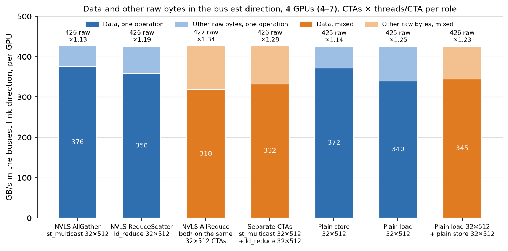
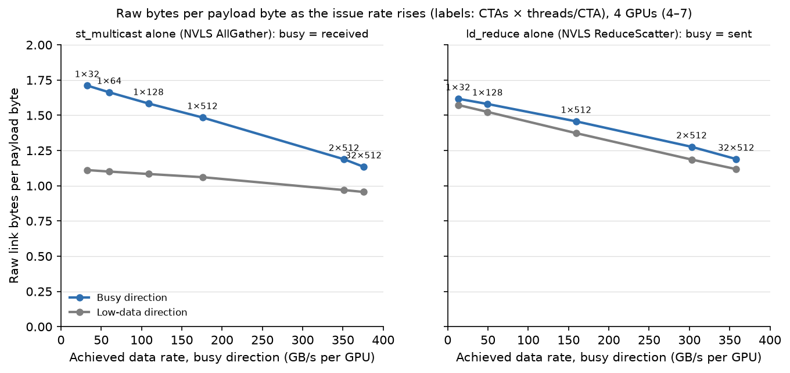
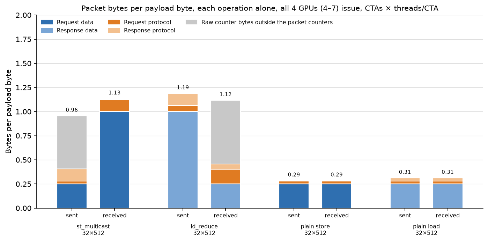
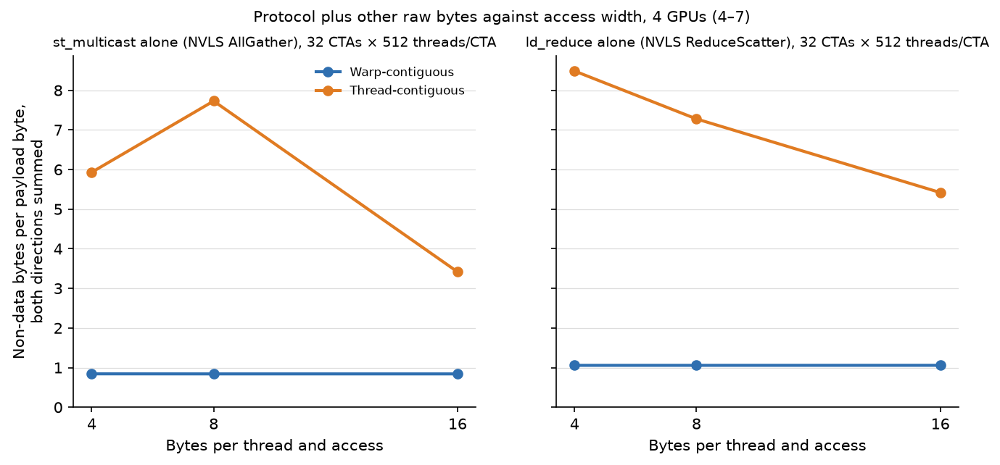
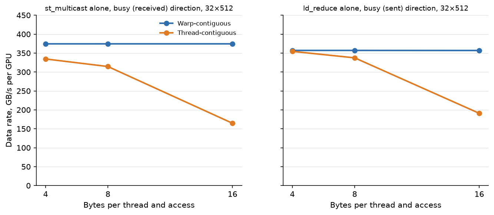
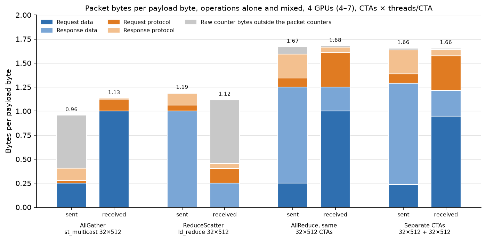
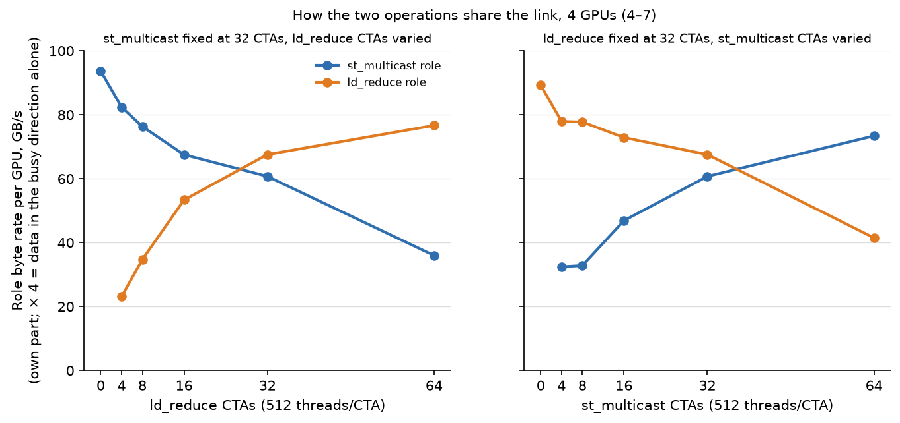
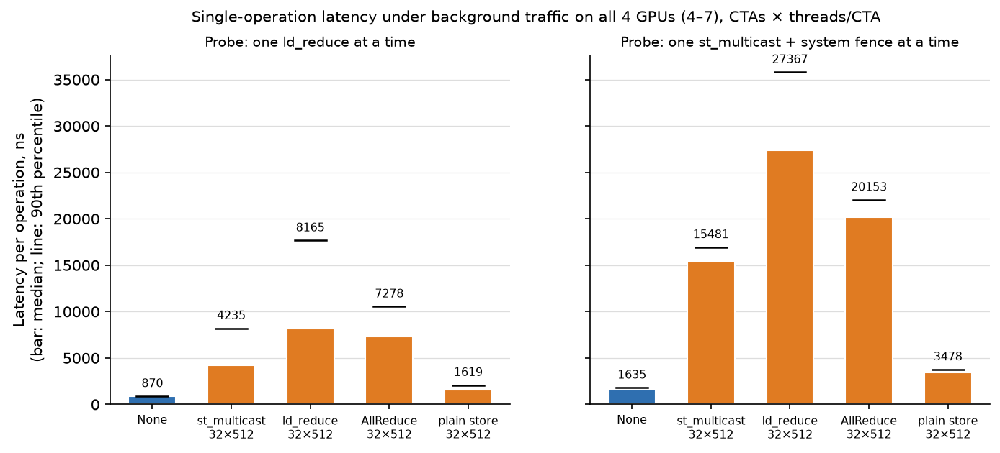

# Packets of mixed multimem traffic: report (plan 01)

**Status (2026-11-19): done. E1.1–E1.8 on GPUs 4–7 (276 runs); E1.9 on GPUs 0–7 with NCCL's kernels (13 runs, [8-GPU report](../../../../h100x8/nvls/rca/multimem_contention/README.md)); all runs valid.** Plan: [01_multimem_contention.md](01_multimem_contention.md). Series: [PLANS.md](../PLANS.md).

**Question:** which NVLink packets does each multimem operation produce per payload byte and per direction, and why does multicast AllReduce spend about 1.35 raw link bytes per data byte where every other pattern needs 1.13–1.19?

**Answer:** NVLS AllReduce keeps both link directions as busy as any other pattern (425–427 GB/s raw at 4 GPUs), but about a quarter of that link time carries packets that are not data. Each of its two directions carries, besides its data and data headers, the packets that the *other* operation used to put on the low-data direction: on the received side, the read requests that the switch sends to every GPU to serve `ld_reduce` (about 0.23 bytes per payload byte); on the sent side, one 16-byte write response for every 128-byte `multimem.st` packet (0.125). Ring AllReduce has neither: its plain stores get almost no responses (0.003) and it issues no remote reads. At the packet level the two operations add up when mixed (sent direction exactly; received direction 5% more read-request bytes). What does not add up is a different kind of traffic: raw-counter bytes outside every packet type, 0.55–0.66 per payload byte on a low-data direction, which almost vanish when the direction is busy. The data path of NCCL's kernel is already the best the hardware offers: whether each thread's memory instruction moves 4, 8 or 16 bytes, the GPU merges the instructions of a warp's 32 threads into the same 128-byte packets; only when the 32 threads touch scattered addresses does each instruction become its own packet. Neither operation has priority on the link: each one's share follows how many CTAs issue it. NCCL's own kernels on 8 GPUs show the same packets (E1.9), and the two packet kinds Ring does not send account for about half of the gap between the measured gain over Ring (1.33× at 8 GPUs) and the byte-count bound (1.56×); see [Summary and takeaways](#summary-and-takeaways). Expected against measured busBW and algBW, compared with AllGather, ReduceScatter and Ring: [NVLS AllReduce against AllGather, ReduceScatter and Ring](#nvls-allreduce-against-allgather-reducescatter-and-ring-expected-and-measured-rates).

## Words used in this report

| Word | Meaning | Id in [00_common_setup.md](../00_common_setup.md) |
|---|---|---|
| Payload byte | One byte of the collective's buffer (N = 4 parts of one GPU's role bytes), as in the 8-GPU nccl-tests tables | |
| Role byte rate | Bytes of its own part one GPU's role finished per second | N1 |
| Data counter, raw counter | Driver link byte counters: payload only (`nvidia-smi nvlink -gt d`), and everything on the wire (`-gt r`) | B3 |
| Data bytes per payload byte | Data counter bytes ÷ payload bytes, long run minus short run | R8 |
| Raw bytes per payload byte | Raw counter bytes ÷ payload bytes, long run minus short run | R9 |
| Raw link rate | Raw counter bytes ÷ window time, long minus short | R10 |
| Raw bytes per data byte | Raw ÷ data on one direction; 1.13 means 13% of the link time carries non-data bytes | R9 ÷ R8 |
| Request data, request protocol, response data, response protocol | Profiler (Nsight Systems) bytes per packet type and direction, per payload byte. "Data" is payload carried by the packet; "protocol" is headers and packets without payload | R1, R2, R3, R4 |
| Raw bytes outside the packet counters | Raw counter bytes minus the four profiler packet types, per payload byte | R9 − (R1 + R2 + R3 + R4) |
| Busy direction | For one operation alone on all 4 GPUs: the link direction of a GPU that carries 1 data byte per payload byte. `multimem.st`: received (the switch writes every GPU's stores into this GPU). `ld_reduce`: sent (this GPU answers the switch's reads for every GPU's sums) | |
| Low-data direction | For one operation alone: the other direction of the same GPU, which carries only 1/4 data byte per payload byte. `multimem.st`: sent (only this GPU's own stores). `ld_reduce`: received (only this GPU's own sums). It is not idle: besides that data it carries headers, the operation's small packets (write responses or read requests) and raw-counter bytes in no packet type; see [What the low-data direction carries](#what-the-low-data-direction-carries) | |
| Low-data-direction traffic | Everything the raw counter sees on the low-data direction: raw bytes per payload byte (R9), or raw link rate (R10), on that direction | R9, R10 |
| Probe latency | Time of one 16-byte operation with nothing else outstanding from the probe thread | R6 |
| Memory instruction, instruction width | One load or store instruction executed by one GPU thread, for example one thread's `multimem.st.global.v4.f32`. Its width is the bytes it moves: 16 (`.v4.f32`), 8 (`.v2.f32`) or 4 (`.f32`). Every thread issues 8 such instructions per loop step | |
| Warp-contiguous, thread-contiguous | Address patterns of the 32 threads of a warp. Warp-contiguous (NCCL's pattern, the default here): when the warp executes one instruction, its 32 threads touch 32 consecutive pieces of memory, for example 32 × 16 = 512 bytes in a row. Thread-contiguous (E1.5 only): each thread works on its own run of 8 consecutive pieces, so the 32 threads of one instruction touch addresses 8 × width apart | |
| NVLink packet | What actually crosses the link: a header plus a data part of up to 128 bytes, or a header-only packet (request or response). The GPU may merge several threads' instructions into one packet | |

Notes for every section: GPUs 4–7 (the harness accepts only these). Raw run records and profiler files exist only on this machine, or from a rerun; derived CSVs and figures are in [`results/2026-11-18/`](results/2026-11-18/). The spread between rounds and GPUs is below 1% for every value in E1.1–E1.7, so medians are given without effect sizes against a tiny spread; E1.8 gives ranges.

## NVLS AllReduce against AllGather, ReduceScatter and Ring: expected and measured rates

This section answers three questions with values already measured in this series: what busBW and algBW NVLS AllReduce should reach, what it reaches, and why.

### Three rates and one cost

All four quantities are per GPU. The first three are rates on the busier link direction of that GPU (sent = GPU → switch, received = switch → GPU; NVLink runs both at once).

| Quantity | Meaning in words | Formula | How it is measured |
|---|---|---|---|
| **algBW** | How fast the collective finishes its buffer | Buffer bytes ÷ time | Timed, not taken from link counters. Harness: in the kernel, 4 × the role byte rate (finished 1-MiB chunks of all the role's CTAs on one GPU × 1 MiB ÷ (latest CTA end − earliest CTA start)), mean over GPUs, median over windows and rounds; see [Role byte rate](#role-byte-rate-how-it-is-obtained-e17). nccl-tests: buffer size ÷ nccl-tests' own time per call |
| **busBW** (payload data rate) | Collective data the busier direction carries per second | algBW × data bytes per payload byte on that direction (table below) | Driver data counter (`nvidia-smi nvlink -gt d`). Harness: counter bytes of 8 windows (long − short) ÷ 2.4 s. nccl-tests at 8 GPUs: the counter covers the whole process, so data rate = algBW × data bytes per payload byte (counter bytes long − short ÷ payload bytes) |
| **Physical link rate** (the report's raw link rate) | Everything the busier direction carries per second: data, packet headers, requests, responses and any other wire traffic | All wire bytes ÷ time | Driver raw counter (`nvidia-smi nvlink -gt r`), the same way: harness ÷ 2.4 s; nccl-tests algBW × raw bytes per payload byte |
| **Raw bytes per data byte** | Wire bytes the link spends to deliver one data byte. 1.135 means 100 data bytes cost 113.5 bytes of wire time; the extra 13.5 are headers and small packets | Physical link rate ÷ busBW | Raw counter ÷ data counter, same direction, same time |

Data bytes per payload byte on the busier direction, fixed by the algorithm (N = number of GPUs):

| Collective | Factor | N = 4 | N = 8 |
|---|---|---|---|
| NVLS AllGather, NVLS ReduceScatter | 1 | 1 | 1 |
| NVLS AllReduce | 1 + 1/N | 1.25 | 1.125 |
| Ring AllReduce | 2(N − 1)/N | 1.5 | 1.75 |

Two lines connect everything, and they always hold:

- **busBW = physical link rate ÷ raw bytes per data byte**
- **algBW = busBW ÷ data bytes per payload byte** (in the harness to within 0.5%, because algBW and the data rate divide by different time spans; see below the measured-values table)

### Measured values of every collective

All metrics of the four collectives on both link directions, before any expectation is built from them. busBW is the data rate of the busier direction (in bold).

| GPUs, source | Collective (CTAs × threads/CTA) | Direction | Data bytes per payload byte | Raw bytes per payload byte | Profiler packet bytes per payload byte | Raw bytes per data byte | Data rate, GB/s | Physical link rate, GB/s | algBW, GB/s |
|---|---|---|---|---|---|---|---|---|---|
| 4, harness, GPUs 4–7 | NVLS AllGather (`multimem.st` 32 × 512) | Received | 1.000 | 1.135 | 1.134 | 1.135 | **375.6** | 426.2 | 374.5 |
| | | Sent | 0.250 | 0.956 | 0.406 | 3.83 | 93.9 | 359.1 | |
| | NVLS ReduceScatter (`ld_reduce` 32 × 512) | Sent | 1.000 | 1.189 | 1.187 | 1.189 | **358.1** | 425.9 | 357.0 |
| | | Received | 0.250 | 1.118 | 0.456 | 4.48 | 89.5 | 400.4 | |
| | **NVLS AllReduce (both on the same 32 × 512)** | Received | 1.250 | 1.679 | 1.667 | 1.343 | **317.9** | 426.9 | **253.1** |
| | | Sent | 1.250 | 1.670 | 1.594 | 1.336 | 317.9 | 424.6 | |
| 4, nccl-tests 2 GiB, GPUs 4–7 | Ring AllReduce (24 × 512) | Each | 1.500 | not run | not run | not run | **360.3** | not run | 240.2 |
| | NVLS AllReduce, symmetric kernel (4 × 512) | Each | 1.250 | not run | not run | not run | **313.1** | not run | 250.5 |
| 8, nccl-tests 2 GiB, GPUs 0–7 | NVLS AllGather (2 × 512) | Received | 1.000 | 1.133 | 1.132 | 1.133 | **373.6** | 423.2 | 373.6 |
| | | Sent | 0.125 | 0.887 | 0.266 | 7.10 | 46.7 | 331.5 | |
| | NVLS ReduceScatter (2 × 512) | Sent | 1.000 | 1.159 | 1.156 | 1.159 | **364.2** | 422.2 | 364.2 |
| | | Received | 0.125 | 1.044 | 0.311 | 8.35 | 45.5 | 380.2 | |
| | Ring AllReduce (24 × 512) | Received | 1.750 | 2.028 | 1.992 | 1.159 | **364.0** | 421.8 | 208.0 |
| | | Sent | 1.750 | 2.026 | 1.996 | 1.158 | 364.0 | 421.3 | |
| | **NVLS AllReduce, symmetric kernel (2 × 512)** | Received | 1.125 | 1.530 | 1.522 | 1.360 | **310.8** | 422.8 | **276.3** |
| | | Sent | 1.125 | 1.519 | 1.421 | 1.350 | 310.8 | 419.7 | |

How each column is obtained:

| Column | Source |
|---|---|
| Data bytes per payload byte | Driver data counter ÷ payload bytes; equals the algorithm's factor (1, 1/N, 1 + 1/N, 2(N − 1)/N) to 0.01% |
| Raw bytes per payload byte | Driver raw counter ÷ payload bytes |
| Profiler packet bytes per payload byte | Sum of the four Nsight Systems packet counters (request and response, data and protocol) ÷ payload bytes. 4 GPUs: packet anatomy runs (E1.4, E1.6); 8 GPUs: NCCL kernels (E1.9) |
| Raw bytes per data byte | Raw bytes per payload byte ÷ data bytes per payload byte |
| Data rate, physical link rate | Harness: data counter and raw counter bytes of 8 windows (long − short) ÷ 8 × 300 ms = 2.4 s. nccl-tests (8 GPUs): algBW × data or raw bytes per payload byte, because the counters also cover set-up and checks of the process |
| algBW | Timed, independent of the link counters. Harness: in the kernel, 4 × role byte rate (E1.1 long runs, median of 3 rounds). nccl-tests: buffer size ÷ its time per call |

Sources:

- **4 GPUs:** harness, E1.1 ([`e1_1/summary.csv`](results/2026-11-18/e1_1/summary.csv)) and the packet anatomy runs. nccl-tests algBW from the [payload sweep](../../../../h100-scale/allreduce/scalability/payload_size/README.md); its busBW is algBW × the factor. Ring's counters were not run at 4 GPUs.
- **8 GPUs:** counters and algBW from the [raw-counter run](../../../../h100-scale/allgather_reducescatter/scalability/busbw_comparison/README.md#raw-link-bytes); packets from [E1.9](../../../../h100x8/nvls/rca/multimem_contention/README.md).

In the harness, data rate ÷ algBW is 0.3–0.5% above the factor: AllGather 375.6 ÷ 374.5 = 1.003 against 1; ReduceScatter 358.1 ÷ 357.0 = 1.003; AllReduce 317.9 ÷ 253.1 = 1.256 against 1.25. The two divide the same work by different time spans. algBW divides by each role's own time, about 301.3 ms per window, because CTAs finish the chunk they are in after the stop flag. The data rate divides by the nominal 300 ms per window. Data bytes per payload byte, which does not use a time, equals the factor to 0.01%.

Measured gain of NVLS AllReduce over Ring in algBW: 250.5 ÷ 240.2 = 1.04 at 4 GPUs and 276.3 ÷ 208.0 = 1.33 at 8 GPUs.

### What can be expected

**Only the physical link rate has a firm expectation.** It is the hardware's limit, so NVLS AllReduce should run each busy direction at the same physical link rate as any other collective. busBW also depends on the raw bytes per data byte, and that depends on which packets the collective needs. That is the open question, so it cannot be assumed to be the same as in another collective.

So the expectation for busBW and algBW has three levels, built from the measured values above. All use the physical link rate of NVLS AllGather alone on its busy direction (426.2 GB/s at 4 GPUs, 423.2 at 8), measured independently of AllReduce:

| Level | Raw bytes per data byte, and where it comes from | busBW, 4 GPUs | algBW, 4 GPUs | busBW, 8 GPUs | algBW, 8 GPUs | algBW ÷ Ring, 8 GPUs |
|---|---|---|---|---|---|---|
| **Upper limit** | 1.125: data in 128-byte packets, each with a 16-byte header, and nothing else | 378.8 | 303.1 | 376.2 | 334.4 | 1.61 |
| **Prediction from the operations alone** | AllReduce carries, on each direction, exactly the profiler packets that AllGather alone and ReduceScatter alone carry on that direction (column "Profiler packet bytes per payload byte" above), added. 4 GPUs: received (1.134 + 0.456) ÷ 1.25 = 1.272, sent (0.406 + 1.187) ÷ 1.25 = 1.274. 8 GPUs: received 1.443 ÷ 1.125 = 1.283, sent 1.422 ÷ 1.125 = 1.264. The busier direction counts | 334.4 | 267.5 | 329.9 | 293.3 | 1.41 |
| **Measured** | 4 GPUs: 1.343 (received, raw counter). 8 GPUs: 1.360 (received, raw counter) | 317.9 | 253.1 | 310.8 | 276.3 | 1.33 |

busBW = physical link rate ÷ raw bytes per data byte; algBW = busBW ÷ (1 + 1/N); Ring's algBW at 8 GPUs is 208.0 GB/s. The prediction counts profiler packets only. Raw-counter bytes outside every packet type are not predictable from the operations alone, because on their busy direction they are almost zero (0.001) and on their low-data direction they are large (0.55–0.66) and do not carry over to the mix (E1.6).

For comparison, the operations alone on their busy direction: NVLS AllGather 1.135 (busBW 375.6 at 4 GPUs) and ReduceScatter 1.189 (358.1). Both are close to the upper limit, because their small packets travel on the other direction. The byte-count ratio of 1.56 used elsewhere in this report is the gain over Ring if both paid the same raw bytes per data byte. Ring pays 1.159, a little more than the upper limit's 1.125, so NVLS AllReduce at the upper limit would be 1.61 times Ring.

### Why: the same physical rate, a higher raw cost per data byte

What the tables show:

- **The physical link rate is as expected.** Every collective runs its busier direction at 421–427 GB/s, NVLS AllReduce included (426.9 and 422.8). The links are not idle, and NVLS AllReduce does not lose link time.
- **Upper limit → prediction: the small packets of the two operations.** From the upper limit to the prediction, busBW falls from 378.8 to 334.4 GB/s at 4 GPUs (−12%), and from 376.2 to 329.9 at 8 (−12%). The prediction adds the read requests of `ld_reduce` (received side) and the write responses of `multimem.st` plus the GPU's own read requests (sent side) to directions that are now full of data. With one operation alone these packets travel on the low-data direction, which has spare wire time, and cost nothing.
- **Prediction → measured: what does not add up.** busBW falls by another 5–6%: from 334.4 to 317.9 at 4 GPUs, and from 329.9 to 310.8 at 8. Two parts cause it:
  - extra read requests that appear only in the mix: 0.077 per payload byte at 4 GPUs, 0.079 at 8;
  - raw-counter bytes outside every packet type: 0.012 received and 0.076 sent at 4 GPUs.
- **Against Ring at 8 GPUs.** Ring pays 1.159 raw bytes per data byte and gets 364.0 GB/s busBW, so NVLS AllReduce's 1.56 byte-count advantage would give 1.56 × 1.159 ÷ 1.360 = 1.33 at its measured cost: the measured ratio (an identity, not a prediction). The packets of the operations alone would allow 1.41, and data with headers only 1.61.

### Diagnosis

**Root cause.** NVLS AllReduce puts the small control packets of its two instructions on link directions that are already full of data:

- on each GPU's received direction, the switch's **read requests** for `ld_reduce`;
- on its sent direction, the GPU's **write responses** for `multimem.st`.

A direction carries a fixed number of wire bytes per second (about 426 GB/s). Every wire byte these packets use is a byte of data that does not move.

How it happens:

1. **`ld_reduce` is a pull.** To compute a sum, the switch sends a read request into every GPU. The request arrives on the GPU's received direction; the value goes back on its sent direction.
2. **`multimem.st` writes are acknowledged.** For every 128-byte multicast write packet a GPU receives, it sends a 16-byte response on its sent direction. Plain stores, which Ring uses, get almost none (0.003 per payload byte).
3. **Alone, these packets cost nothing.** In ReduceScatter alone the received direction carries only 1/N of the data, so the read requests use spare wire time. In AllGather alone the same holds for the write responses on the sent direction. The busy direction of each carries only data and headers.
4. **In AllReduce both directions are full of data.** The read requests share the received direction with the multicast writes. The write responses share the sent direction with the read replies. The wire still runs at its limit (426.9 GB/s), but less of it is data.
5. **The mix adds a little more.** In AllReduce the switch sends 50% more read-request bytes than in ReduceScatter alone (0.231 instead of 0.154 per payload byte). Why is not known.

Wire bytes per data byte, 4 GPUs, 32 CTAs × 512 threads/CTA per operation (packet counters and raw counter, E1.4 and E1.6):

| Part | AllGather alone, received | AllReduce, received | ReduceScatter alone, sent | AllReduce, sent |
|---|---|---|---|---|
| Data | 1.000 | 1.000 | 1.000 | 1.000 |
| Headers of data packets (16 B per 128 B) | 0.125 | 0.125 | 0.125 | 0.125 |
| Read requests from the switch, as in ReduceScatter alone | — | **0.123** | — | — |
| Read requests from the switch, only in the mix | — | **0.062** | — | — |
| Write responses for `multimem.st` | — | — | — | **0.100** |
| The GPU's own read requests | — | — | 0.062 | 0.050 |
| Other (small responses; raw bytes in no packet type) | 0.010 | 0.034 | 0.002 | 0.061 |
| **Wire bytes per data byte** | **1.135** | **1.343** | **1.189** | **1.336** |
| **busBW = physical link rate ÷ wire bytes per data byte, GB/s** | 375.6 | 317.9 | 358.1 | 317.9 |

How the rows are obtained:

- **Read requests and write responses.** Split from the write headers by subtraction ([Where the wire bytes of AllReduce come from](#where-the-wire-bytes-of-allreduce-come-from)), assuming the headers are the same as when each operation runs alone; they are estimates.
- **Conversion to per data byte.** Per payload byte the read requests and write responses are 0.154 + 0.077 (received) and 0.125 (sent). AllReduce values are divided by 1.25 data bytes per payload byte.

What the table shows:

- **Received side.** The cost rises from 1.135 to 1.343. Read requests make 0.185 of the 0.208 rise (89%).
- **Sent side.** It rises to 1.336, mostly from write responses. The two sides are almost equal, so removing only one packet kind gains nothing: the other side then limits.
- **Ring.** It fills both directions too but sends neither packet kind: 1.16 wire bytes per data byte. That is the 15% of NVLS's byte-count advantage that is lost (1.33× instead of 1.56× at 8 GPUs).

What the measurements rule out:

| Not the cause | Evidence |
|---|---|
| Idle link time, a switch that stalls | Physical link rate 426.9 GB/s, the same as every other pattern (E1.1) |
| More data per direction | busBW already divides out the 1 + 1/N; with AllGather's cost per data byte AllReduce would also reach 375 GB/s |
| Too few CTAs, or how threads issue | Same busBW from 4 to 64 CTAs; instruction width and NCCL's address pattern do not change the packets (E1.5) |
| One operation having priority | The share follows how many CTAs issue each operation (E1.7) |
| The harness | NCCL's own kernels on 8 GPUs show the same packets (E1.9) |

What is still unknown:

- why the read requests grow 50% in the mix (0.062 of the received-side rise);
- what the raw bytes in no packet type on the sent side are (0.061);
- whether a different memory-ordering form of `multimem.st` avoids the write responses.

### What this means for the two problems

- **NVLS AllReduce below AllGather and ReduceScatter (problem 1)** is mostly what their packets predict: the prediction from those packets already gives 334 GB/s instead of 376 at 4 GPUs. The single collectives are not a reference AllReduce could reach with these packets, because their small packets cost nothing on a direction with spare room. The remaining 5–6% (the extra read requests and the raw bytes in no packet type) is not explained by the operations alone.
- **NVLS AllReduce gaining less over Ring than the byte counts allow (problem 2)** is the loss that matters for performance. Ring fills both directions too and pays 1.16; NVLS AllReduce pays 1.34–1.36. Removing the read requests and write responses would bring the 8-GPU gain to about 1.45× (see [How much could be gained, and where](#how-much-could-be-gained-and-where)).

## How each number is measured

Every table and figure below is built from the same few measurements. This section defines them, gives the formula of each metric, works through one real run, and says which metric each figure plots.

### What one run records

| Record | Where it comes from | What it holds |
|---|---|---|
| Role bytes per GPU | Harness JSON (`mm_mix`): every CTA counts the 1 MiB chunks it finished in each 300 ms window | Bytes of the GPU's **own part** that each role finished, summed over all windows, warm-up included. For `multimem.st`: bytes this GPU stored once through the switch. For `ld_reduce`: bytes of sums this GPU received |
| Data counter, before and after the run | `nvidia-smi nvlink -i 4,5,6,7 -gt d`, saved by the session runner | For each GPU, each of its 18 links and each direction: **payload bytes only** (the data the instructions moved) |
| Raw counter, before and after the run | `nvidia-smi nvlink -i 4,5,6,7 -gt r`, saved by the same runner | Same layout: **every byte on the wire**: payload, packet headers, requests and responses, and link-level bytes |
| Profiler samples (E1.3–E1.7 only) | Nsight Systems GPU metrics, 10 000 samples per second per GPU | Bytes per sample of four packet types per direction: request data, request protocol, response data, response protocol |
| Kernel intervals (E1.3–E1.7 only) | Nsight Systems CUDA trace | Start and end time of each harness kernel (one per window) on each GPU, on the same clock as the samples |

Directions are named from the GPU: **sent** is the driver's `Tx` (GPU → switch), **received** is `Rx` (switch → GPU). A GPU's value for a direction is the sum over its 18 links.

### Data bytes and raw bytes: the difference

Both counters count bytes on the same links and directions in the same run. The data counter counts only payload. The raw counter counts everything. So for any direction, raw − data = bytes that are not data: headers of data packets, packets without data (read requests, write responses), and anything else the link sends. The data counter is checked against the algorithm (byte model below) and always agrees to four digits; the raw counter has no such model, which is why it is the quantity under study.

### Removing set-up traffic: long minus short

Both counters run over the whole process, including start-up, buffer filling and the result check. So every setting of E1.1 and E1.2 is run twice, back to back in one round:

| Run | Windows |
|---|---|
| Long | 1 warm-up + 10 kept = 11 |
| Short | 1 warm-up + 2 kept = 3 |

Every counter and every role byte count is taken as **long − short**, which leaves exactly 8 windows of work (8 × 300 ms = 2.4 s) and cancels everything outside the windows. ([`raw_link_bytes.py`](../../common/scripts/raw_link_bytes.py), `pair_rows`.)

### Payload bytes

A **payload byte** is one byte of the collective's buffer, as nccl-tests counts it, so that 4-GPU and 8-GPU values compare directly. Each GPU owns 1/4 of the buffer, so:

| Arm | Payload bytes (long − short) |
|---|---|
| One operation (`multimem.st`, `ld_reduce`, AllReduce) | 4 × mean over the 4 GPUs of the role bytes |
| Two operations on separate CTAs | 4 × mean over GPUs of the mean of the two roles' bytes. The two roles run at different speeds, so this arm's per-payload values are not comparable with the others; compare its raw ÷ data and raw rate only |
| Plain load, plain store (ring) | Same conversion (4 × mean role bytes). Plain traffic moves 1 byte per role byte over one link, so its data per payload byte is 0.25; only its raw ÷ data and raw rate are compared |

### The metrics

For one GPU, one direction and one round, with all quantities long − short:

| Metric (id) | Formula | Unit | Meaning |
|---|---|---|---|
| Data bytes per payload byte (R8) | data-counter bytes ÷ payload bytes | bytes per payload byte | How much payload this direction carried for each byte of buffer |
| Raw bytes per payload byte (R9) | raw-counter bytes ÷ payload bytes | bytes per payload byte | How much wire traffic this direction carried for each byte of buffer |
| Raw bytes per data byte | raw-counter bytes ÷ data-counter bytes (= R9 ÷ R8) | ratio | 1.135 means 13.5% of the wire time carried something other than data. Independent of how payload is defined |
| Data rate | data-counter bytes ÷ 2.4 s | GB/s (10⁹ bytes/s) | Payload per second on this direction |
| Raw link rate (R10) | raw-counter bytes ÷ 2.4 s | GB/s | Wire traffic per second on this direction; about 425 GB/s is the most any direction reached |

Each value is computed per GPU and round, then the **median of the 12 values (4 GPUs × 3 rounds)** is reported. "Busiest direction" of an arm is the direction with the higher data rate.

**Byte model check.** For each GPU the data counter must equal what the instructions move, given the role bytes of all GPUs (m = `multimem.st` role bytes, r = `ld_reduce` role bytes, a = AllReduce role bytes; Σ = sum over the 4 GPUs):

| Direction | Expected data bytes |
|---|---|
| Sent | own m + Σ r + own a + Σ a + own plain-store bytes + plain-load bytes of the previous GPU |
| Received | Σ m + own r + own a + Σ a + plain-store bytes of the previous GPU + own plain-load bytes |

The measured data ÷ expected is 1.0000 for every arm and direction of E1.1 and E1.2.

### Worked example: NVLS AllGather, round 1, GPU 4

Run pair `e1_1_allgather_long_R1` / `e1_1_allgather_short_R1` (`multimem.st` alone, 32 CTAs × 512 threads/CTA on each GPU):

| Step | Sent (GPU 4 → switch) | Received (switch → GPU 4) |
|---|---|---|
| Data counter, long − short | 223 556 402 176 B | 901 502 728 192 B |
| Raw counter, long − short | 861 123 397 632 B | 1 022 782 104 576 B |
| Role bytes, long − short, GPUs 4 / 5 / 6 / 7 | 223 556 403 200 / 224 927 940 608 / 225 582 252 032 / 227 436 134 400 B | (same) |
| Payload bytes = 4 × mean | 901 502 730 240 B | 901 502 730 240 B |
| **Data bytes per payload byte** | 223 556 402 176 ÷ 901 502 730 240 = **0.248** (only GPU 4's own stores: its role bytes ÷ payload; it would be exactly 0.25 if all four GPUs ran at the same rate, and GPU 4 was 0.8% slower than the mean) | 901 502 728 192 ÷ 901 502 730 240 = **1.000** (every GPU's stores) |
| **Raw bytes per payload byte** | 861 123 397 632 ÷ 901 502 730 240 = **0.955** | 1 022 782 104 576 ÷ 901 502 730 240 = **1.135** |
| **Raw bytes per data byte** | 3.85 | **1.135** |
| **Data rate** (÷ 2.4 s) | 93.1 GB/s | **375.6 GB/s** |
| **Raw link rate** (÷ 2.4 s) | 358.8 GB/s | **426.2 GB/s** |

So on the received direction, 375.6 GB/s of payload rode on 426.2 GB/s of wire traffic. On the sent direction only 93.1 GB/s was payload, but the wire carried 358.8 GB/s: 0.955 − 0.248 = 0.707 bytes per payload byte that are not data.

### Packet counters: how packet anatomy is obtained (E1.3–E1.7)

The driver counters give one total per direction. To see *which kind* of bytes travel, the profiled runs read the GPU's NVLink packet counters with Nsight Systems. Scripts: runner [`run_session.py`](../../common/scripts/run_session.py) (`profiler_prefix`), metric set [`nvlink_packets.config`](../../common/nsys/nvlink_packets.config), parser [`nsys_link_bytes.py`](../../common/scripts/nsys_link_bytes.py).

**Step 1. Record.** The runner starts the harness under

```
nsys profile --trace=cuda --sample=none --cpuctxsw=none \
  --gpu-metrics-devices=4,5,6,7 --gpu-metrics-set=file:nvlink_packets.config \
  --gpu-metrics-frequency=10000 --export=sqlite -o <run>_nsys  bin/mm_mix <config> ...
```

Every 100 µs, for each GPU, the GPU's performance monitor reports how many bytes each of eight counters counted since the previous sample. The CUDA trace records the start and end of every harness kernel (one kernel per 300 ms window). Both go into the run's SQLite export, on one clock.

**Step 2. The eight counters.** They are NVIDIA's NVLink counters of the GH100 chip, read with the `.sum` suffix (bytes per sample); the built-in metric set reports them as whole percentages, which is too coarse.

| Counter id | Name in this report | What NVIDIA's description says | How the traffic of this study maps onto it |
|---|---|---|---|
| `nvltx__bytes_packet_request_data_user`, `nvlrx__…` | Request data (R1), sent / received | Bytes of request user data | Payload carried by write packets: `multimem.st` and plain-store data |
| `nvltx__bytes_packet_request_data_protocol`, `nvlrx__…` | Request protocol (R2) | Bytes of request protocol data | Headers of write packets, and read requests (which carry no payload) |
| `nvltx__bytes_packet_response_data_user`, `nvlrx__…` | Response data (R3) | Bytes of response user data | Payload carried by read replies: `ld_reduce` values and sums, plain-load data |
| `nvltx__bytes_packet_response_data_protocol`, `nvlrx__…` | Response protocol (R4) | Bytes of response protocol data | Headers of read replies, and write responses (acknowledgements, no payload) |

`nvltx` is the GPU's transmit side (sent), `nvlrx` its receive side (received). The counters count in 16-byte units. They count bytes, not packets: packet sizes below are inferred from byte ratios, as explained in step 6.

**Step 3. Map samples to GPUs and to the harness.** In the export, table `GPU_METRICS` holds (timestamp, typeId, metricId, value). `metricId` names the counter (`TARGET_INFO_GPU_METRICS`). The low 32 bits of `typeId` are the GPU's id in `TARGET_INFO_GPU`, whose `uuid` is matched with the uuid the harness writes for each rank. Kernel intervals come from `CUPTI_ACTIVITY_KIND_KERNEL` rows named `mmMix`, mapped to GPUs through the same uuid.

**Step 4. Keep only the work.** For each GPU and counter, sum the samples whose timestamp lies inside one of that GPU's 6 harness kernels (1 warm-up + 5 windows). Fill, set-up and result checks fall outside the kernels and are left out, so no long − short pair is needed.

**Step 5. Normalize.** Divide each sum by the payload bytes of all 6 windows (4 × mean role bytes per GPU, as above). Raw bytes outside the packet counters = (driver raw counter over the whole run − sum of the four packet counters) ÷ payload bytes; the whole-run counter includes set-up traffic, below 0.01% of the window traffic.

**Step 6. Read the anatomy from ratios.** Each conclusion of the packet sections rests on a ratio of two counters, not on a packet count:

| Conclusion | Ratio it rests on |
|---|---|
| Data packets carry 128 bytes with a 16-byte header | Request protocol ÷ request data = 0.125 = 16 ÷ 128 on directions where only writes travel (and the same for response protocol ÷ response data where only read replies travel) |
| One 16-byte response per multicast write packet | Response protocol on the sent direction (0.125 per payload byte) = request protocol of the received writes (0.125): equal bytes, so one 16-byte response per 16-byte write header |
| Read requests for `ld_reduce` | Request protocol on the direction that carries no write data (`ld_reduce` alone, received: 0.154), and its increase in the mix |
| Raw bytes in no packet type | Driver raw counter − the four packet counters |

**Checks.** (a) Request data + response data inside the kernels equals the driver data counter (1.000) and the byte model (1.000). (b) On busy directions the four counters add up to 99.4–99.9% of the driver raw counter. (c) Sampling does not change the rates (E1.3: at most 0.1 GB/s). (d) In 46 of 976 GPU-direction rows the profiler lost the counters of 1–4 of the GPU's 18 links (data came out at exactly 17/18, 16/18, …); rows more than 0.5% from the driver data counter are left out of the medians.

**Aggregation.** One value per GPU, direction and run; the tables show the median over the kept GPU-round values.

#### Worked example: `multimem.st` alone, run `e1_4_multicast_R1`, GPU 4

One 100 µs sample in the middle of a window (bytes):

| Counter | Received (`nvlrx`) | Sent (`nvltx`) |
|---|---|---|
| Request data | 37 476 416 (= 374.8 GB/s) | 10 007 712 |
| Request protocol | 4 684 576 (= request data ÷ 8.0) | 1 250 976 (= request data ÷ 8.0) |
| Response data | 0 | 0 |
| Response protocol | 338 256 | 4 684 560 (= received request protocol) |

Whole run: 6 kernels of 300.9–301.2 ms on GPU 4, 18 060 samples per counter inside them. Role bytes of the 4 GPUs: 167 373 701 120 / 168 542 863 360 / 169 191 931 904 / 171 007 016 960 B, so payload = 4 × mean = 676 115 513 344 B.

| Counter, sum inside the kernels | Received | per payload byte | Sent | per payload byte |
|---|---|---|---|---|
| Request data (R1) | 676 079 293 216 | 1.000 | 167 364 828 912 | 0.248 |
| Request protocol (R2) | 84 509 911 264 | 0.125 | 20 920 603 792 | 0.031 |
| Response data (R3) | 0 | 0 | 0 | 0 |
| Response protocol (R4) | 5 993 122 288 | 0.009 | 84 509 943 792 | 0.125 |
| Sum of the four | 766 582 326 768 | 1.134 | 272 795 376 496 | 0.403 |
| Driver raw counter, whole run | 767 045 371 904 | 1.135 | 645 700 758 528 | 0.955 |
| Raw bytes outside the packet counters | 463 045 136 | 0.001 | 372 905 382 032 | 0.552 |
| Driver data counter, whole run | 676 115 511 296 | (= R1 + R3 to 0.005%) | 167 373 703 168 | (= R1 + R3 to 0.005%) |

Reading: GPU 4 receives every GPU's multicast data (1.000) in packets with one 16-byte header per 128 bytes (0.125); it sends its own stores (0.248, also 1 header per 128 bytes), and one 16-byte response for every packet it received (0.125 = the received headers). More than half of what the raw counter sees on the sent direction (0.552 of 0.955) is in none of the four counters.

### Other metrics

| Metric (id) | Formula | Used in |
|---|---|---|
| Role byte rate (N1) | Per GPU and window: role bytes ÷ (last CTA end − first CTA start of that role); mean over the 4 GPUs per window; median over the kept windows of the run; median over rounds | E1.7 |
| Probe latency (R6) | Per operation: clock cycles between issue and completion × (global-timer ns ÷ cycles over the probe's whole loop); per GPU and window: median and 90th percentile; then median over windows, and median over GPUs and rounds | E1.8 |

### Role byte rate: how it is obtained (E1.7)

The role byte rate is measured inside the harness kernel, from finished work and the GPU clock. It does not use any link counter, so it is independent of the driver and profiler numbers above.

**What is counted.** The buffer has 4 parts of 2 GiB, one per GPU. Each operation works only on the issuing GPU's own part, so a byte is counted once even when it touches 4 GPUs:

| Operation | One role byte is | Data it causes when the operation runs alone |
|---|---|---|
| `multimem.st` | One byte of the GPU's own part written once; the switch copies it to all 4 GPUs | Every GPU receives the parts of all 4 GPUs, so 4 × role bytes on the received direction |
| `ld_reduce` | One byte of the GPU's own part returned once as the sum of the 4 GPUs' copies | Every GPU sends its copy of all 4 parts to the switch, so 4 × role bytes on the sent direction |

Each CTA of a role works through its own slice of the part in chunks of 1 MiB and counts the chunks it finished. Role bytes of a CTA = finished chunks × 1 MiB.

**How the time is taken** (GPU `globaltimer`, ns; [`mm_mix.cu`](../../common/src/mm_mix.cu)):

1. Every CTA waits for a common start flag, then records its start time.
2. One controller CTA per GPU waits 300 ms from its own start, then raises a stop flag.
3. Each working CTA reads the stop flag once per chunk and stops within two chunks of it.
4. Before recording its end time, each CTA runs `__threadfence_system()`, so stores still on their way are not counted as finished.

**Formula** ([`mm_summary.py`](../../common/scripts/mm_summary.py), [`share_rates.py`](../../common/scripts/share_rates.py)):

| Step | Computation |
|---|---|
| 1. One GPU, one role, one window | N1 = (sum over the role's CTAs of finished chunks × 1 MiB) ÷ (latest end − earliest start among those CTAs). Bytes per ns = GB/s |
| 2. One window | Mean of N1 over the 4 GPUs |
| 3. One run | Median over the 5 windows after the warm-up window |
| 4. One setting | Median over the 3 rounds |

**Worked example:** `e1_7_multicast_c32_reduce_c32_R1`, first window after the warm-up, 32 `multimem.st` CTAs and 32 `ld_reduce` CTAs per GPU.

| GPU | `multimem.st` chunks | Time, ns | N1, GB/s | `ld_reduce` chunks | Time, ns | N1, GB/s |
|---|---|---|---|---|---|---|
| 4 | 17 366 | 301 330 976 | 17 366 × 1 048 576 ÷ 301 330 976 = 60.43 | 19 862 | 301 317 696 | 69.12 |
| 5 | 17 534 | 301 387 456 | 61.00 | 19 666 | 301 385 280 | 68.42 |
| 6 | 17 506 | 301 335 872 | 60.92 | 18 374 | 301 347 488 | 63.93 |
| 7 | 17 368 | 301 313 152 | 60.44 | 19 753 | 301 315 040 | 68.74 |
| Mean (step 2) | | | 60.70 | | | 67.55 |

The 5 windows of this run give 60.70–60.73 (`multimem.st`) and 67.53–67.58 (`ld_reduce`), medians 60.71 and 67.56 (step 3). The median over the 3 rounds is 60.7 and 67.5 GB/s, the 32 + 32 row of the E1.7 table (step 4).

The time is about 301.3 ms rather than 300 ms because CTAs finish the chunk they are in after the stop flag. Single CTAs of one role finish different numbers of chunks (for `multimem.st` on GPU 4: 376 to 746). Only the sum over the role's CTAs enters N1.

**Reading the number.** When the operation runs alone, 4 × N1 is the data rate on its busy direction. For example, `multimem.st` alone at 93.6 GB/s gives 4 × 93.6 = 374 GB/s of data received per GPU. In the mix both operations share both directions. The data rate in each direction is then 4 × N1 of the operation whose data goes that way, plus 1 × N1 of the other: each GPU also sends its own part for `multimem.st` and receives its own sum for `ld_reduce`.

### What each figure plots

| Figure | x-axis | y-axis (metric, formula) | Aggregation |
|---|---|---|---|
| E1.1 bars | Arm | Busiest direction: data rate (dark part) and raw link rate − data rate (light part); bar top = raw link rate. Label below: raw bytes per data byte | Median of 12 (4 GPUs × 3 rounds) |
| E1.2 lines | Data rate on the busy direction, GB/s | Raw bytes per payload byte, on the busy direction (blue) and the low-data direction (grey) | Median of 12 per setting |
| E1.4 and E1.6 stacked bars | Arm and direction | Bytes per payload byte, stacked: R1, R3, R2, R4, raw bytes outside the packet counters; bar top = the whole-run raw bytes per payload byte | Median over GPUs and rounds |
| E1.5 lines, upper | Instruction width: bytes one thread moves per memory instruction | Non-data bytes per payload byte = R2 + R4 + raw bytes outside packets, summed over both directions | Median over GPUs and rounds, per direction, then summed |
| E1.5 lines, lower | Instruction width | Link data rate on the busy direction, GB/s | Same |
| E1.7 lines | CTAs of the varied operation (512 threads/CTA) | Role byte rate (N1) of each operation, GB/s of the GPU's own part | Median over 3 rounds |
| E1.8 bars | Background traffic | Probe latency (R6): median (bar) and 90th percentile (line), ns | Median over 4 GPUs × 3 rounds |

## Raw link bytes at 4 GPUs

### Motivation

At 8 GPUs every pattern ran its busiest direction at about 420 GB/s raw, and multicast AllReduce lost data rate only through more raw bytes per data byte. The 4-GPU mixing loss (0.865 of the mean of NVLS AllGather and ReduceScatter) was measured with the data counter only. The plan expected the same split at 4 GPUs: equal raw rate, more raw bytes per data byte in the mixed arms. A lower raw rate would instead mean idle link time.

### Setup

| Item | Value |
|---|---|
| **Controlled independent variable** | **Arm** |
| Arms (all 4 GPUs issue; CTAs × threads/CTA per role) | NVLS AllGather: `multimem.st` 32 × 512. NVLS ReduceScatter: `ld_reduce` 32 × 512. NVLS AllReduce: both on the same 32 × 512 CTAs. Separate CTAs: `multimem.st` 32 × 512 + `ld_reduce` 32 × 512. Plain store, plain load: 32 × 512 on a ring. Plain mix: plain load 32 × 512 + plain store 32 × 512 |
| Fixed | each thread moves 16 bytes per memory instruction, warp-contiguous addresses, 2 GiB part per GPU, 300 ms windows |
| Long and short run | 1 warm-up + 10 windows; 1 warm-up + 2 windows; long minus short = 8 windows |
| Rounds | 3 |
| Configs | [`configs/e1_1/`](configs/e1_1/), from [`configs/plans/e1_1.json`](configs/plans/e1_1.json) |

### Method

42 runs on 2026-11-18, 23:22–23:32 UTC, all valid, no wrong words. GPUs 0–7 idle before the session. [`raw_link_bytes.py`](../../common/scripts/raw_link_bytes.py) gives one value per GPU, direction and round; tables show the median of 12.

Check: data bytes per payload byte equal the byte model for every arm and direction (ratio 1.0000). The model sums the role bytes of the GPUs that send to or read from each GPU, because in the mixed arms the GPUs issue at slightly different rates. The operations alone reproduce the observation report: 375.6, 358.1 and 317.9 GB/s of data in the busiest direction for AllGather, ReduceScatter and AllReduce (report: 376, 358, 318).

How each column of the results table is obtained ([`raw_link_bytes.py`](../../common/scripts/raw_link_bytes.py)):

| Column | Instrument | Steps |
|---|---|---|
| Payload bytes (the denominator of every "per payload byte" column) | Harness CTA records | For each GPU: chunks finished by all its role CTAs × 1 MiB, over all windows of the run. Long run − short run. Payload = 4 × the mean over the 4 GPUs (for two roles, the mean of the two roles) |
| Data bytes per payload byte | Driver data counter, `nvidia-smi nvlink -gt d` | 1. Before and after every run, the runner saves the counter of each of the 18 links of each GPU, in KiB, for Tx (sent) and Rx (received). 2. Per GPU and direction: sum over the 18 links, after − before = bytes of that run. 3. Long run − short run = bytes of 8 windows. 4. ÷ payload bytes |
| Raw bytes per payload byte | Driver raw counter, `nvidia-smi nvlink -gt r` | The same four steps with the raw counter |
| Raw bytes per data byte | Both counters | Raw bytes (long − short) ÷ data bytes (long − short), same GPU and direction |
| Data rate, GB/s | Driver data counter | Data bytes (long − short) ÷ 2.4 s (8 windows × 300 ms) |
| Raw link rate, GB/s | Driver raw counter | Raw bytes (long − short) ÷ 2.4 s |
| Aggregation | | One value per GPU, direction and round; the table gives the median over 4 GPUs × 3 rounds |

The 2.4 s is the nominal window time. The real windows last about 301.3 ms because CTAs finish the chunk they are in after the stop flag, so both rates are about 0.4% above the bytes actually moved per second of real time. Ratios (per payload byte, raw ÷ data) do not use the time and are not affected. In the figure, the "busiest direction" of an arm is the direction with the larger data counter.

### Results



Figure: busiest direction of each arm. Dark part = data rate (data counter ÷ 2.4 s); light part = raw link rate − data rate; bar top = raw link rate (raw counter ÷ 2.4 s); label below = raw bytes per data byte. Long − short, median of 4 GPUs × 3 rounds.

| Arm (CTAs × threads/CTA per role) | Direction | Data bytes per payload byte | Raw bytes per payload byte | Raw bytes per data byte | Data rate, GB/s | Raw link rate, GB/s |
|---|---|---|---|---|---|---|
| NVLS AllGather (`multimem.st` 32 × 512) | Received | 1.000 | 1.135 | 1.135 | 375.6 | 426.2 |
| | Sent | 0.250 | 0.956 | 3.83 | 93.9 | 359.1 |
| NVLS ReduceScatter (`ld_reduce` 32 × 512) | Sent | 1.000 | 1.189 | 1.189 | 358.1 | 425.9 |
| | Received | 0.250 | 1.118 | 4.48 | 89.5 | 400.4 |
| **NVLS AllReduce (both, same 32 × 512 CTAs)** | Sent | 1.250 | 1.670 | **1.336** | 317.9 | **424.6** |
| | Received | 1.250 | 1.679 | **1.343** | 317.9 | **426.9** |
| Separate CTAs (`multimem.st` 32 × 512 + `ld_reduce` 32 × 512) | Sent | 1.290 | 1.654 | 1.282 | 332.4 | 426.3 |
| | Received | 1.214 | 1.656 | 1.363 | 313.0 | 426.7 |
| Plain store (32 × 512) | Each | 0.250 | 0.286 | 1.144 | 371.7 | 425.3 |
| Plain load (32 × 512) | Each | 0.250 | 0.313 | 1.251 | 339.9 | 425.3 |
| Plain mix (load 32 × 512 + store 32 × 512) | Sent / received | 0.497 / 0.500 | 0.616 / 0.617 | 1.239 / 1.233 | 343.0 / 345.0 | 425.1 / 425.5 |

Plain arms move 1 byte per role byte over one link, so in buffer bytes their data is 1/4 per payload byte; only their raw bytes per data byte and raw rate compare with the multimem arms. All values: [`e1_1/summary.csv`](results/2026-11-18/e1_1/summary.csv).

### Interpretation

- **The 4-GPU mixing loss is non-data traffic, not idle link time.** Every busy direction runs at 425–427 GB/s raw, NVLS AllReduce included. With that common raw rate, data per direction is the raw rate ÷ raw bytes per data byte: 426 ÷ 1.34 = 318 GB/s for AllReduce, against 426 ÷ 1.135 = 376 for AllGather (identities, not predictions). The same holds at 8 GPUs, so one quantity, raw bytes per data byte in the busy direction, explains the mixing loss at both GPU counts and, through it, the smaller-than-ideal gain over Ring.
- **The mix carries much less raw traffic than the two operations alone put on their low-data directions.** NVLS AllReduce has 1.67–1.68 raw bytes per payload byte per direction; the two operations alone put 0.96 and 1.12 on their low-data directions. Which part of that traffic disappears is answered by the profiler (packet anatomy of the mix, below): it is the raw-counter traffic outside the packet types, not the packets.
- **Plain loads cost more than plain stores** (1.251 against 1.144 raw bytes per data byte), and the plain mix sits between them (1.23–1.24).

## Raw bytes against issue rate

### Motivation

The low-data direction of each multimem operation alone carries 0.96–1.12 raw bytes per payload byte, nearly all of it non-data. If it were sent at a fixed rate whatever the traffic (for example link flow control), it would overstate the cost per request. Lowering the issue rate separates the two: per-request traffic keeps raw bytes per payload byte constant and its raw rate follows the data rate; time-based traffic keeps its raw rate and makes raw bytes per payload byte rise as the rate falls.

### Setup

| Item | Value |
|---|---|
| **Controlled independent variable** | **Issue rate**, set by CTAs × threads/CTA of one role; the achieved rate is measured |
| `multimem.st` alone (NVLS AllGather) | 1 × 32, 1 × 64, 1 × 128, 1 × 512, 2 × 512, 32 × 512 |
| `ld_reduce` alone (NVLS ReduceScatter) | 1 × 32, 1 × 128, 1 × 512, 2 × 512, 32 × 512 |
| Fixed | All 4 GPUs issue the role; each thread moves 16 bytes per memory instruction, warp-contiguous addresses; long and short runs as above; 3 rounds |
| Configs | [`configs/e1_2/`](configs/e1_2/), from [`configs/plans/e1_2.json`](configs/plans/e1_2.json) |

### Method

66 runs on 2026-11-18, 23:32–23:45 UTC, all valid, no wrong words. The lowest setting reached 9% (`multimem.st`) and 4% (`ld_reduce`) of the data rate at 32 × 512, so the range is wide enough.

What is measured on each direction:

1. **Counter:** the driver's raw counter (`nvidia-smi nvlink -gt r`), saved before and after every run, summed over the 18 links of each GPU, separately for sent and received.
2. **Set-up traffic removed:** long run (1 warm-up + 10 windows) minus short run (1 warm-up + 2 windows) leaves 8 windows of 300 ms.
3. **Raw bytes per payload byte** = raw bytes (long − short) ÷ payload bytes (long − short), where payload bytes = 4 × the bytes each GPU's role finished of its own part. **Raw link rate** = raw bytes (long − short) ÷ 2.4 s.
4. **Which direction:** the busy direction is received for `multimem.st` and sent for `ld_reduce`; the low-data direction is the other one. The data rate on the x-axis is the data counter on the busy direction over the same 8 windows.
5. Median over 4 GPUs × 3 rounds.

The raw counter gives one total per direction; it cannot say which kind of bytes grow with the issue rate. The profiler experiments below split it.

#### What the low-data direction carries

From the packet anatomy experiment (profiler, 32 × 512), per payload byte:

| | `multimem.st` alone, sent | `ld_reduce` alone, received |
|---|---|---|
| Own data (the GPU's 1/4 share) | 0.250 | 0.250 |
| Headers of that data | 0.031 | 0.052 |
| The operation's small packets | 0.125 write responses | 0.154 read requests |
| Raw counter bytes in no packet type | 0.550 | 0.662 |
| **Total, as the raw counter sees it** | **0.956** | **1.118** |

How each column of the results table is obtained: the same counters, long − short difference, payload and 2.4 s as in [Raw link bytes at 4 GPUs](#raw-link-bytes-at-4-gpus), per direction:

| Column | Steps |
|---|---|
| Busy direction: data rate, GB/s | Data counter of the busy direction (long − short) ÷ 2.4 s |
| Busy: raw bytes per payload byte | Raw counter of the busy direction (long − short) ÷ payload bytes |
| Busy: raw link rate, GB/s | Raw counter of the busy direction (long − short) ÷ 2.4 s |
| Low-data direction: data bytes per payload byte | Data counter of the low-data direction (long − short) ÷ payload bytes |
| Low-data: raw bytes per payload byte | Raw counter of the low-data direction (long − short) ÷ payload bytes |
| Low-data: non-data bytes per payload byte | The two columns before: raw − data |
| Low-data: raw link rate, GB/s | Raw counter of the low-data direction (long − short) ÷ 2.4 s |

### Results



Figure: x = data rate on the busy direction (data counter ÷ 2.4 s); y = raw bytes per payload byte (raw counter ÷ payload bytes) on the busy direction (blue) and the low-data direction (grey); one point per CTAs × threads/CTA setting. Long − short, median of 4 GPUs × 3 rounds.

| Role, CTAs × threads/CTA | Busy direction: data rate, GB/s | Busy: raw bytes per payload byte | Busy: raw link rate, GB/s | Low-data direction: data bytes per payload byte | Low-data: raw bytes per payload byte | Low-data: non-data bytes per payload byte (raw − data) | Low-data: raw link rate, GB/s |
|---|---|---|---|---|---|---|---|
| `multimem.st`, 1 × 32 | 32.6 | 1.711 | 55.7 | 0.250 | 1.111 | 0.861 | 36.2 |
| `multimem.st`, 1 × 64 | 60.0 | 1.663 | 99.8 | 0.250 | 1.101 | 0.851 | 66.1 |
| `multimem.st`, 1 × 128 | 108.7 | 1.584 | 172.1 | 0.250 | 1.083 | 0.833 | 117.8 |
| `multimem.st`, 1 × 512 | 175.7 | 1.484 | 260.9 | 0.250 | 1.061 | 0.811 | 186.5 |
| `multimem.st`, 2 × 512 | 351.5 | 1.188 | 417.5 | 0.250 | 0.969 | 0.719 | 340.7 |
| `multimem.st`, 32 × 512 | 375.6 | 1.135 | 426.2 | 0.250 | 0.956 | 0.706 | 359.1 |
| `ld_reduce`, 1 × 32 | 12.9 | 1.617 | 20.8 | 0.250 | 1.573 | 1.323 | 20.2 |
| `ld_reduce`, 1 × 128 | 49.5 | 1.580 | 78.1 | 0.250 | 1.524 | 1.274 | 75.4 |
| `ld_reduce`, 1 × 512 | 159.5 | 1.457 | 232.4 | 0.250 | 1.373 | 1.123 | 219.1 |
| `ld_reduce`, 2 × 512 | 302.9 | 1.276 | 386.7 | 0.250 | 1.186 | 0.935 | 359.3 |
| `ld_reduce`, 32 × 512 | 358.1 | 1.189 | 425.9 | 0.250 | 1.118 | 0.868 | 400.4 |

All values: [`e1_2/summary.csv`](results/2026-11-18/e1_2/summary.csv). Every value is per GPU and direction, divided by the bytes of the whole buffer, so it can be above or below 1. Its floor on the low-data direction is the 0.25 of data that direction carries; the column raw − data shows the non-data traffic alone. Raw link rates are measured (raw counter ÷ 2.4 s), not computed; they equal data rate × raw bytes per data byte on the same direction (on the busy direction, where data bytes per payload byte is 1.000, that is data rate × raw bytes per payload byte).

### Interpretation

- **The low-data-direction traffic is per request.** Over an 11-fold (`multimem.st`) and 28-fold (`ld_reduce`) range of data rate, the low-data direction's raw link rate follows the data rate (36 → 359 and 20 → 400 GB/s), and its raw bytes per payload byte stay within 0.96–1.11 and 1.12–1.57. A fixed-rate stream is rejected.
- **Contrary to the plan, the cost per byte is not constant: it falls as load rises, on both directions.** On the busy direction of `multimem.st`, raw bytes per payload byte fall from 1.71 to 1.135; on `ld_reduce` from 1.62 to 1.19. The plan expected the busy direction to stay constant. Something packs bytes more tightly when more traffic is waiting. The profiler shows at 32 × 512 that the extra raw bytes on a direction lie outside the packet types (packet anatomy below); the low-rate settings were not profiled, so which bytes shrink with load on the busy direction is not measured.
- **Most of the fall happens between 1 and 2 CTAs × 512 threads/CTA**, where the data rate doubles; from 2 to 32 CTAs the data rate rises 7% and the cost per byte falls 4–7%.

## Instrument check: Nsight Systems packet counters

### Motivation

The profiler's NVLink counters split each direction into request and response bytes, data and protocol. They had not been used on this machine; their sums must match the driver counters and sampling must not slow the kernels.

### Setup

| Item | Value |
|---|---|
| **Controlled independent variable** | **Profiler sampling on or off** |
| Arms (all 4 GPUs issue) | NVLS AllGather (`multimem.st` 32 × 512), NVLS ReduceScatter (`ld_reduce` 32 × 512), plain store (32 × 512) |
| Profiler | Nsight Systems 2026.4.1, CUDA trace, GPU metrics on GPUs 4–7 at 10 kHz, custom set [`nvlink_packets.config`](../../common/nsys/nvlink_packets.config) (byte sums; the built-in set exports whole percentages) |
| Run length, rounds | 1 warm-up + 10 windows; 3 rounds, sampled and unsampled back to back |
| Configs | [`configs/plans/e1_3.json`](configs/plans/e1_3.json) |

### Method

18 runs, 23:48–23:55 UTC, all valid. [`nsys_link_bytes.py`](../../common/scripts/nsys_link_bytes.py) keeps only samples inside the harness kernel intervals of each GPU (same clock as the samples) and compares them with the driver counters over the whole run, which include set-up traffic. A second set with the link busy-cycle counters ([`nvlink_cycles.config`](../../common/nsys/nvlink_cycles.config)) was tried once on 2026-11-19.

**Deviation found in the analysis:** in 46 of 976 GPU-direction rows of E1.3–E1.7, one GPU's profiler data bytes were 17/18, 16/18, 15/18 or 14/18 of the driver data counter, with no samples missing in time. An H100 has 18 NVLinks, so the profiler lost the counters of 1–4 links in those runs. Such rows (more than 0.5% from the driver data counter) are kept in the per-run CSVs and left out of all medians; the count is in each summary (`excluded_gpu_rows`).

How each column of the results table is obtained ([`nsys_link_bytes.py`](../../common/scripts/nsys_link_bytes.py)):

| Column | Instrument | Steps |
|---|---|---|
| Role byte rate per GPU, sampled / unsampled | Harness CTA records (in-kernel clock) | Role byte rate as defined in [Role byte rate](#role-byte-rate-how-it-is-obtained-e17), once in the run under Nsight Systems ("sampled") and once in the same arm without it ("unsampled") |
| Profiler data ÷ driver data counter | Nsight Systems packet counters; driver data counter | Numerator: per GPU and direction, the request-data and response-data samples whose timestamps fall inside the harness kernels (CUDA trace, same clock), summed. Denominator: the driver data counter of the same profiled run, after − before (whole run, no long − short) |
| Profiler packets ÷ driver raw counter | Nsight Systems packet counters; driver raw counter | Numerator: the four packet counters summed the same way. Denominator: the driver raw counter of the run, after − before |

The driver counters here cover the whole run, set-up included, and the profiler sums only the kernels. A data ratio of 1.000 therefore also shows that set-up and checking traffic is negligible against the 6 windows.

### Results

| Arm | Role byte rate per GPU, sampled / unsampled, GB/s | Direction | Profiler data ÷ driver data counter | Profiler packets ÷ driver raw counter |
|---|---|---|---|---|
| NVLS AllGather | 93.6 / 93.6 | Received (busy) | 1.000 | 0.999 |
| | | Sent (low-data) | 1.000 | 0.424 |
| NVLS ReduceScatter | 89.2 / 89.3 | Sent (busy) | 1.000 | 0.998 |
| | | Received (low-data) | 1.000 | 0.408 |
| Plain store | 371.5 / 371.4 | Each | 1.000 | 0.994–0.995 |

The busy-cycle counters were not recorded: the run succeeded, but the export holds only the eight packet counters. Link busy share (R5) is therefore not available.

### Interpretation

- **The profiler is usable and does not slow the kernels** (rates differ by at most 0.1 GB/s, 0.1%).
- **On directions that carry data, the four packet types are the whole raw counter** (99.4–99.9%). **On a low-data direction they are only 41–42% of it.** The rest is counted by the driver's raw counter but by no packet counter; it is named "raw bytes outside the packet counters" below. What it is (link-level acknowledgements, flow-control messages, partly filled transfer units) cannot be told from these counters.

## Packet anatomy of each operation alone

### Motivation

Before the mix, each operation's packets per payload byte must be known on both directions. The plan's hypothesis was that every 16-byte memory instruction of every thread leaves the GPU as its own NVLink packet (no merging of the 32 threads' instructions), from the 8-GPU raw bytes on the low-data directions.

### Setup

| Item | Value |
|---|---|
| **Controlled independent variable** | **Operation**: `multimem.st`, `ld_reduce`, plain store, plain load; each issued by all 4 GPUs |
| CTAs × threads/CTA | 32 × 512 |
| Fixed | each thread moves 16 bytes per memory instruction, warp-contiguous addresses; 1 warm-up + 5 windows; profiler as in the instrument check; 3 rounds |
| Configs | [`configs/plans/e1_4.json`](configs/plans/e1_4.json) |

### Method

12 runs, 23:55–00:01 UTC, all valid; 2 of 96 GPU-direction rows excluded (lost link counters).

Procedure (details and a worked example of this experiment's `multimem.st` run in [Packet counters: how packet anatomy is obtained](#packet-counters-how-packet-anatomy-is-obtained-e13e17)):

1. Each operation runs alone under Nsight Systems, which samples the eight NVLink packet counters of each GPU every 100 µs.
2. For each GPU and direction, the samples inside the 6 harness kernels are summed per counter and divided by the payload bytes of those windows.
3. The driver's whole-run raw counter minus the four packet sums gives the raw bytes outside the packet counters.
4. Packet sizes are read from ratios: header bytes ÷ data bytes, and response bytes on one direction ÷ header bytes of the writes received on the other.

How each column of the results table is obtained:

| Column | Instrument | Steps |
|---|---|---|
| Request data, request protocol, response data, response protocol | Nsight Systems GPU metrics with [`nvlink_packets.config`](../../common/nsys/nvlink_packets.config): the counters `nvlrx__bytes_packet_*` and `nvltx__bytes_packet_*` with the `.sum` suffix, so each 100-µs sample is the bytes of that interval; RX = received, TX = sent | Per GPU and direction: sum the samples whose timestamps fall inside the 6 harness kernels of that GPU (1 warm-up + 5 windows, from the CUDA trace on the same clock); ÷ payload bytes of those 6 windows (4 × mean role bytes of one GPU) |
| Outside the packet counters | Driver raw counter and the four packet sums | Driver raw counter of the profiled run (after − before) − the four packet sums, ÷ payload bytes |
| Raw counter (whole run) | Driver raw counter, `nvidia-smi nvlink -gt r` | After − before of the profiled run, ÷ payload bytes. It includes set-up traffic, but the values equal the long − short values of [Raw link bytes at 4 GPUs](#raw-link-bytes-at-4-gpus) to 0.001 (for example `multimem.st` received 1.135 in both), so set-up traffic is negligible |
| Aggregation | | One value per GPU, direction and round; median over the kept GPU-round values (rows with lost link counters left out) |

### Results



Figure: bytes per payload byte per direction, stacked from the profiler packet counters (R1, R3, R2, R4, inside the kernels) plus the raw-counter bytes in no packet type (grey); bar top = raw counter ÷ payload. Median over GPUs and rounds.

Bytes per payload byte, median of 11–12 GPU-round values:

| Operation (32 × 512) | Direction | Request data | Request protocol | Response data | Response protocol | Outside the packet counters | Raw counter (whole run) |
|---|---|---|---|---|---|---|---|
| `multimem.st` | Received (busy) | 1.000 | 0.125 | 0 | 0.009 | 0.001 | 1.135 |
| | Sent (low-data) | 0.250 | 0.031 | 0 | **0.125** | **0.550** | 0.956 |
| `ld_reduce` | Sent (busy) | 0 | 0.062 | 1.000 | 0.125 | 0.002 | 1.189 |
| | Received (low-data) | 0 | **0.154** | 0.250 | 0.052 | **0.662** | 1.118 |
| Plain store (ring) | Each | 0.250 | 0.031 | 0 | 0.003 | 0.001–0.002 | 0.286 |
| Plain load (ring) | Each | 0 | 0.031 | 0.250 | 0.031 | 0 | 0.313 |

All values: [`e1_4/nsys_summary.csv`](results/2026-11-18/e1_4/nsys_summary.csv).

### Interpretation

- **The 16-byte multimem instructions of a warp are merged into 128-byte packets; they are not sent as one packet per thread instruction** (contradicts the plan's hypothesis). Data packets carry 16 protocol bytes per 128 data bytes (0.125 per byte), for multicast writes, read replies and plain stores alike.
- **Every multicast write packet gets a 16-byte response (0.125 per payload byte); a plain store gets almost none (0.003).** Multicast writes are acknowledged per packet; plain stores are not.
- **`ld_reduce` needs read requests:** the switch sends each GPU 0.154 protocol bytes per payload byte to read the values it serves, and the issuer sends 0.062 to ask for its sums.
- **Most raw bytes on an low-data direction are outside the packet counters** (0.55 and 0.66 of 0.96 and 1.12).

## Instruction width and address pattern

### Motivation

Two outcomes are possible. (a) Each thread's memory instruction leaves the GPU as its own NVLink packet. Then 4-byte instructions would need four times as many packets, and headers, per byte as 16-byte ones. (b) The GPU merges the instructions of the 32 threads of a warp that hit consecutive addresses into larger packets. Then the instruction width does not matter, but the address pattern does: if the threads of one instruction touch scattered addresses, there is nothing to merge. NCCL's kernel uses 16-byte instructions with warp-contiguous addresses. Changing the width and the pattern separates (a) from (b) and tells whether a different kernel could produce fewer packets.

### Setup

| Item | Value |
|---|---|
| **Controlled independent variable** | **Instruction width (bytes one thread moves per memory instruction): 4, 8, 16 × address pattern: warp-contiguous (one instruction of a warp covers 32 × width contiguous bytes), thread-contiguous (each thread owns 8 × width contiguous bytes; lanes are 8 × width apart)** |
| Operations | `multimem.st` alone, `ld_reduce` alone; plain load and plain store at 16 B as controls; all 4 GPUs issue, 32 × 512 |
| Fixed | 8 memory instructions in flight per thread in every setting, so the bytes in flight scale with the width; 1 warm-up + 5 windows; 3 rounds |
| Configs | [`configs/plans/e1_5.json`](configs/plans/e1_5.json) |

### Method

48 runs, 00:01–00:25 UTC, all valid, no wrong words; 20 of 384 rows excluded (lost link counters). The 4- and 8-byte forms compile to the same strong system-scope multimem instruction as the 16-byte form (checked in the machine code).

How each column of the results table is obtained (same profiler counters and kernel-sample selection as in [Packet anatomy of each operation alone](#packet-anatomy-of-each-operation-alone)):

| Column | Steps |
|---|---|
| Request protocol, busy + low-data | Request-protocol samples inside the kernels, received + sent, ÷ payload bytes |
| Response protocol, busy + low-data | Response-protocol samples inside the kernels, received + sent, ÷ payload bytes |
| Outside the packet counters, both | (Driver raw counter − the four packet sums), received + sent, ÷ payload bytes |
| Data rate | On the busy direction: (request-data + response-data samples inside the kernels) ÷ total kernel time (sum of the durations of the 6 kernels, from the CUDA trace). For thread-contiguous `ld_reduce` the packets carry padding, so this "link data" rate is above the payload rate; the table gives both |

### Results





Figures: upper = non-data bytes per payload byte, both directions summed = R2 + R4 + raw-counter bytes in no packet type; lower = link data rate on the busy direction = (R1 + R3 bytes) ÷ kernel time. x = instruction width (bytes one thread moves per memory instruction); blue = warp-contiguous, orange = thread-contiguous. Median over GPUs and rounds.

Selected values (bytes per payload byte; data rate on the busy direction, GB/s per GPU):

| Operation, width, pattern | Request protocol, busy + low-data | Response protocol, busy + low-data | Outside the packet counters, both | Data rate |
|---|---|---|---|---|
| `multimem.st`, 4 / 8 / 16 B, warp-contiguous | 0.156 | 0.134 | 0.55 | 374.4 at every width |
| `multimem.st`, 16 B, thread-contiguous | 1.250 | 1.125 | 1.04 | 164.6 |
| `ld_reduce`, 4 / 8 / 16 B, warp-contiguous | 0.216–0.220 | 0.177 | 0.66 | 356.8–357.0 |
| `ld_reduce`, 16 B, thread-contiguous | 1.916 | 1.431 | 2.08 | 190.9 of link data, about 95 of payload |
| Plain store, 16 B, warp- / thread-contiguous | 0.062 / 0.499 | 0.006 / 0.242 | 0.003 / 0.32 | 371.3 / 131.5 |
| Plain load, 16 B, warp- / thread-contiguous | 0.062 / 0.250 | 0.062 / 0.250 | 0 / 0 | 339.5 / 211.9 |

With 4- and 8-byte instructions and thread-contiguous addresses, packets carry more data bytes than the payload (up to 5.9 request data bytes per payload byte for `multimem.st`, 8.0 response data bytes for `ld_reduce`): each small instruction's data occupies at least a 16-byte data unit, so these settings move padding, and their "data rate" is link data, not payload. All values: [`e1_5/nsys_summary.csv`](results/2026-11-18/e1_5/nsys_summary.csv).

### Interpretation

- **Instruction width does not matter with warp-contiguous addresses** (identical packets and rates at 4, 8 and 16 bytes): the GPU merges the instructions of a warp's 32 threads into 128-byte packets whatever their width (outcome b).
- **With thread-contiguous addresses each thread's instruction becomes its own packet** (16-byte thread-contiguous `multimem.st`: request protocol equals request data, one response per 16 bytes) and cuts the payload rate by 2.3× for `multimem.st` (374.4 → 164.6 GB/s) and about 3.7× for `ld_reduce` (its 190.9 GB/s of link data carries 2.0 response data bytes per payload byte, so about 95 GB/s of payload, against 356.8); plain stores lose 2.8×.
- **NCCL's instruction width and address pattern already give the fewest packets available.** No change of width or address pattern inside the kernel lowers the protocol bytes of multimem traffic.

## Packet anatomy of the mix

### Motivation

The core test. The 8-GPU and E1.1 raw counters showed that the mix carries far fewer non-data bytes than the two operations put on their low-data directions alone. The plan named three explanations: packets combined when a direction is busy, low-data-direction traffic that is not per request (rejected by E1.2), or smaller packets. The profiler counts each packet type in the mix itself.

### Setup

| Item | Value |
|---|---|
| **Controlled independent variable** | **Mix: NVLS AllReduce (both operations on the same 32 × 512 CTAs), separate CTAs (`multimem.st` 32 × 512 + `ld_reduce` 32 × 512)** |
| Reference, same session | NVLS AllGather (`multimem.st` 32 × 512), NVLS ReduceScatter (`ld_reduce` 32 × 512) |
| Fixed | each thread moves 16 bytes per memory instruction, warp-contiguous addresses; 1 warm-up + 5 windows; 5 rounds, arms rotated |
| Configs | [`configs/plans/e1_6.json`](configs/plans/e1_6.json) |

### Method

20 runs, 00:25–00:35 UTC, all valid, no wrong words; 12 of 160 rows excluded (lost link counters).

How each column of the results table is obtained: as in [Packet anatomy of each operation alone](#packet-anatomy-of-each-operation-alone). "Packets total" is the sum of the four packet columns; "Outside the packet counters" is the driver raw counter of the profiled run − that sum; all ÷ payload bytes. For the mixed arms the payload is 4 × the mean over GPUs of the mean of the two roles' bytes, so each operation's bytes are counted once per buffer byte. The split tables below divide these counters into parts by subtraction, as described there.

### Results



Figure: same metric and stacking as the packet-anatomy figure, for the operations alone and mixed. Median over GPUs and 5 rounds.

Bytes per payload byte, median of 17–20 GPU-round values:

| Arm | Direction | Request data | Request protocol | Response data | Response protocol | Packets total | Outside the packet counters | Raw counter |
|---|---|---|---|---|---|---|---|---|
| NVLS AllGather | Sent | 0.250 | 0.031 | 0 | 0.125 | 0.406 | 0.551 | 0.956 |
| | Received | 1.000 | 0.125 | 0 | 0.009 | 1.134 | 0.001 | 1.134 |
| NVLS ReduceScatter | Sent | 0 | 0.062 | 1.000 | 0.125 | 1.187 | 0.002 | 1.189 |
| | Received | 0 | 0.154 | 0.250 | 0.052 | 0.456 | 0.662 | 1.118 |
| **NVLS AllReduce (same CTAs)** | Sent | 0.250 | 0.094 | 1.000 | 0.250 | **1.594** | **0.076** | 1.670 |
| | Received | 1.000 | 0.356 | 0.250 | 0.061 | **1.667** | **0.012** | 1.679 |
| Separate CTAs | Sent | 0.238 | 0.096 | 1.053 | 0.250 | 1.637 | 0.019 | 1.654 |
| | Received | 0.947 | 0.361 | 0.267 | 0.065 | 1.639 | 0.017 | 1.656 |

Packets of the two operations alone, added, against NVLS AllReduce:

| Direction | AllGather + ReduceScatter alone | NVLS AllReduce | Difference |
|---|---|---|---|
| Sent: packets | 0.406 + 1.187 = 1.593 | 1.594 | +0.001 |
| Received: packets | 1.134 + 0.456 = 1.590 | 1.667 | +0.077 (all in request protocol: 0.356 against 0.125 + 0.154) |
| Sent: outside the packet counters | 0.551 + 0.002 = 0.553 | 0.076 | −0.48 |
| Received: outside the packet counters | 0.001 + 0.662 = 0.663 | 0.012 | −0.65 |

#### Where the wire bytes of AllReduce come from

AllReduce uses both link directions equally: each carries 1.250 data bytes per payload byte. So neither direction is a "low-data" direction here.

The profiler gives four numbers per direction: request data, request protocol, response data and response protocol. Each number mixes traffic from both operations. To split it, we use the same number measured when each operation runs alone in the same session:

- AllGather = `multimem.st` alone
- ReduceScatter = `ld_reduce` alone

For example, AllReduce's received request protocol is 0.356. With `multimem.st` alone, the same counter is 0.125: the headers of the incoming write packets. We assume those headers are the same in AllReduce. The rest, 0.231, is then the read requests of `ld_reduce`.

This is an estimate, not a separate measurement. The counters cannot tell write headers from read requests inside one number. The tables show each split and where its parts come from.

How to read the tables: "Part found by subtraction" is the part of a counter that no single-operation run measures directly. It is the counter minus the parts that are known. It is not, by itself, unexpected traffic. The last column compares it with the same part when its operation runs alone; only a difference there is unexpected.

Received direction (switch → GPU), bytes per payload byte:

| AllReduce counter (measured) | Value | Parts known from the operations alone | Source of each known part | Part found by subtraction (value − known parts) | The same part when its operation runs alone |
|---|---|---|---|---|---|
| Request data (R1) | 1.000 | Multicast writes from all 4 GPUs: 1.000 | AllGather alone, received R1 = 1.000 | 0 | — |
| Response data (R3) | 0.250 | This GPU's own sums: 0.250 | ReduceScatter alone, received R3 = 0.250 | 0 | — |
| Request protocol (R2) | 0.356 | Headers of the incoming write packets: 0.125 | AllGather alone, received R2 = 0.125 (16 B per 128 B of the 1.000 written) | Read requests from the switch: 0.356 − 0.125 = 0.231 | 0.154 (ReduceScatter alone, received R2). AllReduce has 0.077 more: the only part larger than with the operations alone |
| Response protocol (R4) | 0.061 | Response protocol of this GPU's sums: 0.052; small responses also seen with `multimem.st` alone: 0.009 | ReduceScatter alone, received R4 = 0.052 (of which 0.031 = 0.25 ÷ 8 would be the headers of the sums; the rest is not identified); AllGather alone, received R4 = 0.009 | 0 | — |
| Raw bytes outside the packet counters | 0.012 | | Driver raw counter − the four counters | | |
| **Total (driver raw counter)** | **1.679** | | Raw ÷ data = 1.679 ÷ 1.250 = **1.343** | | |

Sent direction (GPU → switch), bytes per payload byte:

| AllReduce counter (measured) | Value | Parts known from the operations alone | Source of each known part | Part found by subtraction (value − known parts) | The same part when its operation runs alone |
|---|---|---|---|---|---|
| Request data (R1) | 0.250 | This GPU's own multicast stores: 0.250 | AllGather alone, sent R1 = 0.250 | 0 | — |
| Response data (R3) | 1.000 | Read replies for the sums of all 4 GPUs: 1.000 | ReduceScatter alone, sent R3 = 1.000 | 0 | — |
| Request protocol (R2) | 0.094 | Headers of the own stores: 0.031; this GPU's own `ld_reduce` requests: 0.062 | AllGather alone, sent R2 = 0.031; ReduceScatter alone, sent R2 = 0.062 | 0.000 | — |
| Response protocol (R4) | 0.250 | Headers of the read replies: 0.125 | ReduceScatter alone, sent R4 = 0.125 (16 B per 128 B of the 1.000 replied) | Write responses for the incoming multicast writes: 0.250 − 0.125 = 0.125 | 0.125 (AllGather alone, sent R4). Same as alone |
| Raw bytes outside the packet counters | 0.076 | | Driver raw counter − the four counters | | |
| **Total (driver raw counter)** | **1.670** | | Raw ÷ data = 1.670 ÷ 1.250 = **1.336** | | |

#### What AllReduce carries beyond its data

**In short:** each direction of AllReduce **carries about 0.27 bytes per payload byte more than a plain data stream would**. On the received side this extra is almost all read requests. On the sent side about half is write responses; the rest is the GPU's own read requests and bytes that no packet counter sees.

**How we measure "extra".** Take a plain stream of data packets as the baseline. It carries the data (1.250 bytes per payload byte on each direction of AllReduce) plus one 16-byte header for each 128-byte packet (1.250 ÷ 8 = 0.156). That is 1.406 bytes per payload byte. Everything the raw counter sees above this baseline is the extra.

Bytes per payload byte, 4 GPUs, AllReduce in the same 32 CTAs × 512 threads/CTA:

| | Received (switch → GPU) | Sent (GPU → switch) |
|---|---|---|
| Data | 1.250 | 1.250 |
| Headers of the data packets (16 bytes per 128) | 0.156 | 0.156 |
| **Baseline: data stream with headers** | **1.406** | **1.406** |
| Measured, raw counter | 1.679 | 1.670 |
| **Extra above the baseline** | **0.272** | **0.264** |

What the extra is made of:

| Part of the extra | Which counter holds it | Received | Sent |
|---|---|---|---|
| Read requests the switch sends to this GPU, to collect values for the other GPUs' `ld_reduce` | Request protocol | **0.231 (85%)** | — |
| Read requests this GPU sends for its own `ld_reduce` | Request protocol | — | 0.063 (24%) |
| Responses this GPU sends back for the multicast writes it receives | Response protocol | — | **0.125 (47%)** |
| Response protocol of this GPU's own sums, beyond their headers | Response protocol | 0.030 (11%) | — |
| Bytes the raw counter sees but no packet counter does | None | 0.012 (4%) | 0.076 (29%) |

Parts are taken from the two tables above. They add up to the extra within 0.001.

What this means:

- **Received side:** the extra is almost all read requests. They are counted as request protocol.
- **Sent side:** the biggest single part is write responses, counted as response protocol. But the GPU's own read requests (request protocol) and the bytes no packet counter sees add up to slightly more.
- **Ring AllReduce has none of these parts.** Its plain stores get almost no responses (0.024–0.028 per payload byte at 8 GPUs), and it never reads from other GPUs. So it stays at 1.14 raw bytes per data byte, close to the 1.125 of headers alone.

All values: [`e1_6/nsys_summary.csv`](results/2026-11-18/e1_6/nsys_summary.csv).

### Interpretation

- **At the packet level the mix adds up.** On the sent direction the AllReduce packets equal the sum of the two operations alone to 0.001; on the received direction they are 0.077 more, all in request protocol (the read requests that serve `ld_reduce` cost 0.231 per payload byte in the mix against 0.154 alone; why is not known).
- **What vanishes in the mix is the traffic outside the packet counters**: 0.55–0.66 per payload byte on an low-data direction alone, 0.01–0.08 when the direction is busy. This corrects the series index: "protocol traffic does not add up" was true of the raw counter, not of the packets.
- **The cause of the AllReduce shortfall: each direction carries packets that Ring never sends.** On the received side, the switch's read requests for `ld_reduce` (0.231 per payload byte, 14% of that direction's raw bytes); on the sent side, the responses to multicast writes (0.125, 7.5%) and the GPU's own read requests (0.062). With the data headers they make raw ÷ data 1.34, against 1.135 for `multimem.st` alone and 1.144 for plain stores. Ring AllReduce, also full in both directions, uses plain stores (responses 0.003 per payload byte) and no remote reads, hence 1.16 at 8 GPUs.
- **Same and separate CTAs have the same packets** (1.64–1.67 per direction), consistent with the earlier finding that the CTA arrangement does not matter.

## How the two operations share the link

### Motivation

The split mix of the observation report suggested that read replies keep their rate and multicast stores take what is left (priority for replies). Varying the CTAs of each operation shows the rule.

### Setup

| Item | Value |
|---|---|
| **Controlled independent variable** | **`ld_reduce` CTAs 0, 4, 8, 16, 32, 64 with `multimem.st` fixed at 32 CTAs; `multimem.st` CTAs 0, 4, 8, 16, 32, 64 with `ld_reduce` fixed at 32 CTAs** |
| Fixed | 512 threads/CTA for both roles, separate CTAs, all 4 GPUs issue both; each thread moves 16 bytes per memory instruction, warp-contiguous addresses; 1 warm-up + 5 windows; 3 rounds |
| Configs | [`configs/plans/e1_7.json`](configs/plans/e1_7.json) |

### Method

33 runs, 00:35–00:52 UTC, all valid, no wrong words. The quantity is the role byte rate (N1) of each operation. It is measured in the kernel, from the 1-MiB chunks each operation's CTAs finish in a 300-ms window and the GPU clock, not from link counters. Formula, steps and a worked example: [Role byte rate: how it is obtained](#role-byte-rate-how-it-is-obtained-e17). In short: N1 = chunks finished by all CTAs of the operation on one GPU × 1 MiB ÷ (latest CTA end − earliest CTA start). Then the mean over the 4 GPUs, the median over 5 windows and the median over 3 rounds, computed by [`share_rates.py`](../../common/scripts/share_rates.py). One role byte is one byte of the GPU's own part; when an operation runs alone, 4 × N1 is its data rate in its busy direction.

### Results



Figure: y = role byte rate (N1) of each operation, bytes of the GPU's own part per second; x = CTAs of the varied operation, 512 threads/CTA. Median over 3 rounds.

| `multimem.st` CTAs × 512 | `ld_reduce` CTAs × 512 | `multimem.st` rate, GB/s | `ld_reduce` rate, GB/s |
|---|---|---|---|
| 32 | 0 | 93.6 | — |
| 32 | 4 | 82.4 | 23.1 |
| 32 | 8 | 76.3 | 34.8 |
| 32 | 16 | 67.5 | 53.4 |
| 32 | 32 | 60.7 | 67.5 |
| 32 | 64 | 36.0 | 76.7 |
| 0 | 32 | — | 89.2 |
| 4 | 32 | 32.4 | 77.9 |
| 8 | 32 | 32.8 | 77.7 |
| 16 | 32 | 46.9 | 72.9 |
| 64 | 32 | 73.4 | 41.5 |

Spread over 3 rounds is at most 0.1 GB/s. All values: [`e1_7/role_rates.csv`](results/2026-11-18/e1_7/role_rates.csv).

### Interpretation

- **Neither operation has priority; each one's share follows how many CTAs issue it.** With 64 CTAs, `multimem.st` takes 73.4 GB/s against 41.5 for `ld_reduce`; with 64 `ld_reduce` CTAs it is 36.0 against 76.7. The observation's split-mix result (replies kept their rate) is therefore not a priority rule.
- **4 and 8 `multimem.st` CTAs give the same rate** (32.4, 32.8 GB/s), while 4 → 8 `ld_reduce` CTAs raise `ld_reduce` from 23.1 to 34.8. Not explained.

## Latency of single operations under load

### Motivation

The peer report proposed a shared limit on outstanding multimem requests. Latency of one operation under different background traffic shows where requests wait. If a fixed pool limits outstanding requests, background rate × latency stays constant.

### Setup

| Item | Value |
|---|---|
| **Controlled independent variable** | **Background traffic on all 4 GPUs: none, `multimem.st` 32 × 512, `ld_reduce` 32 × 512, NVLS AllReduce 32 × 512, plain store 32 × 512** |
| Probe | One thread on one otherwise unused SM per GPU, one 16-byte operation at a time on its own 4 KiB slot: `ld_reduce` followed by a use of the value, or `multimem.st` followed by `fence.acq_rel.sys`; timed with `clock64`, converted with the global timer over the loop |
| Fixed | 1 warm-up + 5 windows; 3 rounds; no profiler |
| Configs | [`configs/plans/e1_8.json`](configs/plans/e1_8.json) |

### Method

30 runs, 00:52–00:58 UTC, all valid, no wrong words. [`probe_latency.py`](../../common/scripts/probe_latency.py): per GPU, the median over windows of each window's percentiles; table: median over 4 GPUs × 3 rounds. The background role rates equal those without the probe (for example 93.6 GB/s for `multimem.st`).

How each column of the results table is obtained ([`mm_mix.cu`](../../common/src/mm_mix.cu) `runProbe`, [`probe_latency.py`](../../common/scripts/probe_latency.py)):

| Column | Steps |
|---|---|
| Probe latency of one operation | One probe CTA per GPU; its thread 0 issues one 16-byte operation at a time on its own slot and reads `clock64()` before and after. For `ld_reduce`, an add on the loaded value makes the second clock read wait for the reply. For `multimem.st`, a `fence.acq_rel.sys` after the store makes it wait until the store is acknowledged. Cycles are converted to ns with the ratio of global-timer ns to clock cycles over the probe's whole loop |
| Median, 90th percentile | Per GPU and window: the median and 90th percentile of all probe operations of that window. Per GPU: the median over the 5 kept windows. Table: the median over 4 GPUs × 3 rounds |
| Range of medians | Smallest and largest of the 12 per-GPU-and-round medians |
| Background rate (text) | Role byte rate of the background CTAs in the same windows, as in [Role byte rate](#role-byte-rate-how-it-is-obtained-e17) |

### Results



Figure: probe latency (R6) of one 16-byte operation; bar = median, line = 90th percentile, ns; median over 4 GPUs × 3 rounds.

| Probe | Background (32 × 512) | Median, ns | 90th percentile, ns | Range of medians over GPUs and rounds, ns |
|---|---|---|---|---|
| `ld_reduce` | None | 870 | 877 | 819–913 |
| | Plain store | 1619 | 2071 | 1563–1691 |
| | `multimem.st` | 4235 | 8199 | 2446–8948 |
| | NVLS AllReduce | 7278 | 10538 | 2214–11650 |
| | `ld_reduce` | 8165 | 17665 | 4295–23636 |
| `multimem.st` + fence | None | 1635 | 1793 | 1605–1788 |
| | Plain store | 3478 | 3755 | 3407–3609 |
| | `multimem.st` | 15481 | 16928 | 14838–16002 |
| | NVLS AllReduce | 20153 | 22032 | 19335–21209 |
| | `ld_reduce` | 27367 | 35796 | 27181–27569 |

All values: [`e1_8/probe_latency.csv`](results/2026-11-18/e1_8/probe_latency.csv).

### Interpretation

- **Multimem background traffic delays single operations far more than plain stores do, at the same full link.** Over idle links, a plain-store background adds 0.75 µs to an `ld_reduce` and 1.8 µs to a `multimem.st` with fence; multimem backgrounds add 3.4–7.3 µs and 13.8–25.7 µs, 4.5–14 times as much. Requests wait much longer behind multimem traffic than behind plain stores, which need almost no responses.
- **`ld_reduce` probes vary strongly between GPUs** under multimem backgrounds (for example 2.4–8.9 µs median under `multimem.st`); `multimem.st` probes do not.
- **The data do not decide the in-flight-pool question.** Background rate × probe latency gives 0.4–2.4 MiB per GPU depending on which probe is paired with which background, and the probe's latency is not the background operations' latency. This experiment shows queueing; it neither shows nor excludes a fixed pool.

## Summary across GPU counts

Multicast AllReduce against the operations alone and Ring, packet bytes per payload byte on each busy direction (4 GPUs: harness, 32 CTAs × 512 threads/CTA per role, GPUs 4–7; 8 GPUs: NCCL kernels at NCCL's CTA choice, GPUs 0–7, [8-GPU report](../../../../h100x8/nvls/rca/multimem_contention/README.md)):

| Quantity | 4 GPUs | 8 GPUs |
|---|---|---|
| `multimem.st` alone, received: packets ÷ data | 1.134 | 1.132 |
| `ld_reduce` alone, sent: packets ÷ data | 1.187 | 1.156 |
| Multicast AllReduce, received: packets ÷ data | 1.334 | 1.353 |
| Multicast AllReduce, sent: packets ÷ data | 1.275 | 1.263 |
| Read requests for `ld_reduce` arriving at each GPU, alone / in AllReduce | 0.154 / 0.231 | 0.160 / 0.239 |
| Responses to multicast writes, per payload byte | 0.125 | 0.125 |
| Packets of AllReduce minus packets of the operations alone, sent / received | +0.001 / +0.077 | −0.001 / +0.079 |
| Ring AllReduce: packets ÷ data | not run | 1.14 (responses 0.024–0.028) |

## Summary and takeaways

### What goes wrong, in one paragraph

Each multimem operation needs small packets besides its data: `ld_reduce` needs read requests, and every `multimem.st` packet gets a write response. When one operation runs alone, these small packets travel on the direction its data does not fill, so they cost no data rate. AllReduce runs both operations at once, so both directions are full of data. The same small packets, plus some extra read requests, now take wire time from the data. The wire still runs at its usual limit of about 425 GB/s, but a smaller share of it carries data: about 318 instead of 375 GB/s per direction at 4 GPUs. Ring AllReduce also fills both directions, but its plain stores get almost no responses and it never reads from another GPU, so it does not pay this cost. This explains both problems: the AllReduce data rate is below that of AllGather and ReduceScatter, and NVLS keeps only about 85% of its byte-count advantage over Ring.

### Takeaways

1. **The links are never idle.** Every busy direction of every pattern, alone or mixed, 4 or 8 GPUs, runs at about 420–427 GB/s on the raw counter. NVLS AllReduce loses data rate because more of that wire time is not data: 1.34 raw bytes per data byte, against 1.135 for `multimem.st` alone and about 1.14–1.16 for Ring.
2. **Compared with the two operations run alone, AllReduce adds almost no new packets.** The packets add up exactly on the sent direction. On the received direction the only increase is +0.077 bytes of read requests per payload byte (0.231 instead of 0.154); why is not known. What changes is where the packets travel: onto directions full of data.
3. **The raw-counter bytes that are in no packet type are large only on a direction with little data** (0.55–0.66 per payload byte with one operation alone). They mostly vanish in AllReduce (0.012 received, 0.076 sent), so they are not the cost of the mix.
4. **Fewer CTAs do not help.** The cost is per data byte, not a result of the link being full. With fewer CTAs the GPUs simply ask for less, and less data moves: AllReduce is flat from 4 to 64 CTAs × 512 threads/CTA (316.5–316.7 GB/s), and with single operations the cost per data byte is even higher at low load (1.71 raw bytes per data byte for `multimem.st` at 1 × 32, against 1.135 at 32 × 512).
5. **The kernel is not the lever.** The bytes each thread moves per instruction (4, 8 or 16) do not change the packets; NCCL's address pattern already gives the fewest packets; moving CTAs between the two operations only changes how they share the link.
6. **Both directions must improve together to gain anything.** The two directions of AllReduce are almost equally loaded, and their extra traffic is different (read requests on the received side; write responses, the GPU's own read requests and unexplained raw bytes on the sent side). Removing the extra traffic of one side leaves the other side as the limit (table below).
7. **The 8-GPU gain over Ring that these two packet kinds cost is about half of the gap, not nearly all of it** (corrected 2026-11-21; see the note below the gain table).

### How much could be gained, and where

algBW = raw limit of a direction ÷ raw bytes per payload byte on the busier direction. The raw limit is the hardware's and has not changed in any pattern, so a gain must come from fewer raw bytes per payload byte. The smallest possible value is the data plus one 16-byte header per 128-byte packet (1.125 × data).

| Raw bytes per payload byte, busier direction | 4 GPUs (E1.6) | 8 GPUs (raw-counter run of the busBW comparison) |
|---|---|---|
| NVLS AllReduce now | 1.679 | 1.530 |
| Data + headers only (smallest possible) | 1.406 | 1.266 |
| Largest possible algBW gain | +19% | +21% |

What removing each kind of extra traffic would give, if the raw limit stays the same (accounting with the measured values, not a prediction):

| If we could remove… | 4 GPUs: received / sent / busier | 4 GPUs: algBW gain | 8 GPUs: received / sent / busier | 8 GPUs: algBW gain | 8 GPUs: gain over Ring |
|---|---|---|---|---|---|
| Nothing (today) | 1.679 / 1.670 / 1.679 | — | 1.530 / 1.519 / 1.530 | — | 1.33× |
| Write responses only | 1.679 / 1.545 / 1.679 | 0% | 1.530 / 1.394 / 1.530 | 0% | 1.33× |
| Mix-only read requests only (0.077) | 1.602 / 1.670 / 1.670 | +0.5% | — | — | — |
| All read requests only | — | — | 1.291 / 1.519 / 1.519 | +0.7% | 1.34× |
| Both mix-only read requests and write responses | 1.602 / 1.545 / 1.602 | +5% | — | — | — |
| All read requests and write responses | 1.448 / 1.545 / 1.545 | +9% | 1.291 / 1.394 / 1.394 | +10% | 1.45× |

Byte-count bound of the gain over Ring at 8 GPUs: 1.56×. Ring's busier direction carries 2.028 raw bytes per payload byte.

**Correction (2026-11-21).** The 8-GPU report and the series index said that without the read requests and write responses the gain over Ring would be 1.54×, "close to the 1.56× bound". That used the profiler's packet counters only and left out about 0.1 raw bytes per payload byte on the sent side that are in no packet type. With the driver's raw counter, the gain would be 1.45×. So these two packet kinds explain about half of the gap between the measured 1.33× and the 1.56× bound; the rest is the unexplained raw bytes on the sent side, the GPU's own read requests and the headers.

### Approaches to improve algBW

| Approach | What it would change | Best case | Status | Cost to test |
|---|---|---|---|---|
| Other memory-ordering forms of `multimem.st` (PTX `.relaxed`, `.release`, …) | Write responses, if they depend on the ordering the instruction asks for | 0% on its own; up to +9–10% together with fewer read requests | Not tested | Small: one harness change, about 10 min on GPUs 4–7 |
| Other ways of forming `ld_reduce` reads (alignment, bytes per warp instruction, data type) | Read requests. 0.154 per payload byte alone is more than one 16-byte request per 128 bytes, so some reads may be smaller | Up to +5–10%, only if write responses also go | Not tested (the bytes per thread per instruction did not matter) | Small |
| Keep the two operations slightly apart in time, without separating them fully | The 0.077 of read requests that appear only in the mix | Under 1% on its own | Not tested; fully separate calls are 1.38–1.53× slower | Medium |
| Push-based reduction instead of `ld_reduce` (plain stores, `multimem.red`) | No read requests | Negative: more data. Plain-store ReduceScatter + multicast AllGather moves 1.75 data bytes per payload byte on the received side at 4 GPUs, against 1.25 now | Rejected by byte count | — |
| Split the buffer between NVLS and Ring | Nothing per byte: the cost becomes an average of the two | None: NVLS already needs fewer raw bytes per payload byte than Ring (4 GPUs: 1.68 against 1.5 × 1.16 = 1.74) | Rejected by accounting | — |
| Fewer bytes per element (bf16, fp8) | All bytes, not the ratio | ×2 or ×4 elements per second; not specific to this problem | Known | — |
| Hardware or firmware: unacknowledged multicast writes, larger read requests | Both kinds of extra traffic | Up to +19–21% | Outside software control | Ask NVIDIA |

Two unknowns limit every software approach: the raw bytes in no packet type on the sent side (0.076 at 4 GPUs, about 0.1 at 8 GPUs) and how B300 (NVLink 5) behaves.

**Recommended next step:** test the first two rows together in the existing harness. They are the only kernel-level changes that could matter, and even if both work the gain is at most about 9–10%, because of the unexplained sent-side bytes. If neither changes the packet counts, the remaining levers belong to the hardware.

## What this report does not establish

| Open point | Why | What would settle it |
|---|---|---|
| What the raw-counter bytes outside the packet counters are | No counter separates them | NVIDIA documentation of the raw counter, or link-level counters if exposed |
| Why read requests cost more in the mix (0.231 against 0.154) | Packet sizes are not counted | Request counts (not bytes), if a profiler counter exists |
| Whether the busy direction's cost per byte at low load (E1.2) is packet or non-packet bytes | Low-rate settings were not profiled | Profile the E1.2 settings |
| Whether a different AllReduce structure avoids the read requests or write responses | Not tested; the switch reads values for `ld_reduce` by design, and multicast writes are acknowledged by the hardware | A design study outside this plan |

## Session log

| Date (UTC) | GPUs | What | Notes | Raw results |
|---|---|---|---|---|
| 2026-11-18, 23:18 | none | Harness rebuilt | The committed source did not compile (`startNsctasInRole` in `runRole`); the restored name gave GPU code identical to the 2026-11-01 binary | |
| 2026-11-18, 23:22–23:45 | 4–7 | E1.1 (42 runs), E1.2 (66 runs) | All valid; GPUs 0–7 idle before | `results/2026-11-18/e1_1/raw/`, `e1_2/raw/` |
| 2026-11-18, 23:45–23:48 | 4–7 | Harness with instruction width, address pattern and probe installed; recheck (6 runs); one profiled test run | Rates 374.4 / 357.2 / 316.5 GB/s busBW for AllGather / ReduceScatter / AllReduce against the recorded 374.5 / 357.0 / 316.5 | `recheck/raw/`, `nsys_test/raw/` |
| 2026-11-18, 23:48 – 2026-11-19, 00:58 | 4–7 | E1.3 (18), E1.4 (12), E1.5 (48), E1.6 (20), E1.7 (33), E1.8 (30) | All valid. Profiled runs open a 4 MiB context on GPUs 0–3, with no work there; gone when idle. 46 of 976 profiler rows lost 1–4 link counters and are excluded from medians | `e1_3/raw/` … `e1_8/raw/` |
| 2026-11-19, about 01:15 | 4–7 | Busy-cycle counter test (1 run) | Counters silently left out; R5 not available | `e1_3_cycles/raw/` |
| 2026-11-19, 03:23–03:37 | 0–7 | E1.9: NCCL kernels under the profiler (1 test + 12 runs) | All valid; see the [8-GPU report](../../../../h100x8/nvls/rca/multimem_contention/README.md) | `h100x8/nvls/rca/multimem_contention/results/2026-11-19/` |
