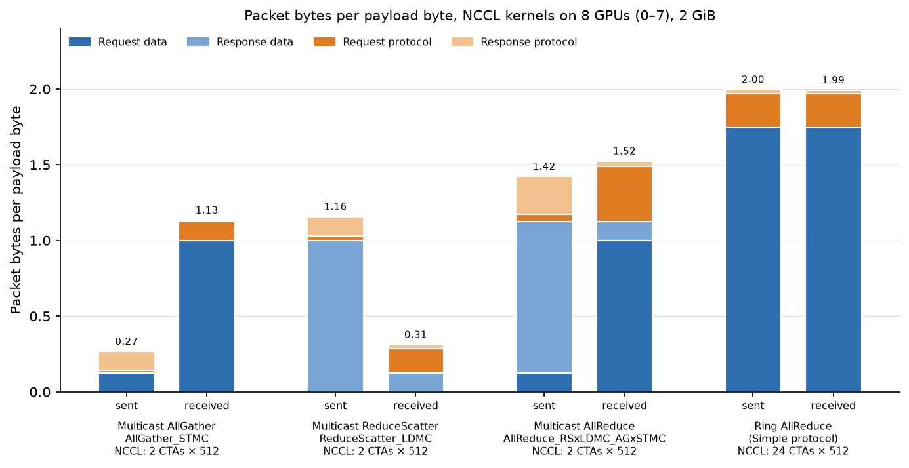

# Packets of NCCL's multimem and Ring kernels on 8 GPUs: report (plan 01, E1.9)

**Status (2026-11-19): done.** This tree holds only the 8-GPU part of RCA plan 01. Plan, words, method and the 4-GPU results: [main report](../../../../h100x4/nvls/rca/multimem_contention/README.md) and [plan](../../../../h100x4/nvls/rca/multimem_contention/01_multimem_contention.md). Harness and scripts: [`../../common/`](../../common/) (a link to the 4-GPU tree).

**Question:** do NCCL's own kernels on 8 GPUs put the same packets on the links as the 4-GPU harness, and how do they compare with Ring AllReduce?

**Answer:** yes. Multicast AllReduce (`AllReduce_RSxLDMC_AGxSTMC`) carries, on its received side, the switch's read requests for `ld_reduce` (0.239 bytes per payload byte) and, on its sent side, one 16-byte response per 128-byte multicast write packet (0.125), as in the harness at 4 GPUs. Its busy directions need 1.35 (received) and 1.26 (sent) packet bytes per data byte; Ring AllReduce needs 1.14, because its plain stores get almost no responses (0.024–0.028 per payload byte) and it issues no remote reads. As at 4 GPUs, the packets of AllGather and ReduceScatter add up in AllReduce (sent side exactly; received side +0.079, again in read requests).

## Setup

| Item | Value |
|---|---|
| **Controlled independent variable** | **Kernel: `AllGather_STMC`, `ReduceScatter_LDMC`, `AllReduce_RSxLDMC_AGxSTMC`, Ring AllReduce (Simple protocol)** |
| GPUs | 8 = {0–7}, all free before the session |
| Program | nccl-tests 2 GiB, float, `-t 1 -g 8`, 5 warm-up and 200 timed calls (out-of-place and in-place), 1 check; symmetric kernels with `-R 2` |
| CTAs × threads/CTA | NCCL's choice: multicast kernels 2 × 512; Ring 24 × 512 |
| NCCL | In-tree 2.32.3, `build/lib` of 2026-10-05, the same library as every earlier 8-GPU result; the uncommitted source changes of 2026-11-16 and 2026-11-18 are not in it |
| Profiler | Nsight Systems 2026.4.1, CUDA trace, GPU metrics at 10 kHz on GPUs 0–7, set [`nvlink_packets.config`](../../common/nsys/nvlink_packets.config) |
| Rounds | 3, kernels rotated |
| Config | [`configs/e1_9.json`](configs/e1_9.json); runner [`run_allreduce.py`](../../../../h100-scale/allreduce/common/scripts/run_allreduce.py) with its optional `nsys` wrapper (added 2026-11-19) |

## Method

12 runs on 2026-11-19, 03:25–03:37 UTC, all valid (NCCL logs name only the intended kernel). One profiled test run before (03:24). [`nsys_nccl_link_bytes.py`](../../common/scripts/nsys_nccl_link_bytes.py) keeps the samples inside each GPU's collective kernels; payload = number of collective kernels × 2 GiB (every call moves one buffer). Profiled algBW equals the earlier unprofiled values: 373.6 / 364.1 / 276.3 / 208.1 GB/s against 373.6 / 364.2 / 276.3 / 208.0 ([busBW comparison](../../../../h100-scale/allgather_reducescatter/scalability/busbw_comparison/README.md#raw-link-bytes)). Profiler data bytes ÷ byte model = 0.9996–0.9997 for every kept row; 7 of 184 GPU-direction rows lost link counters (17/18 and similar) and are left out of the medians, as in the 4-GPU runs. Raw-counter bytes outside the packet counters are not given: the driver counters cover the whole nccl-tests process, including input preparation and checks. Raw records exist only on this machine or from a rerun.

## How each number is measured

Same definitions as the [main report](../../../../h100x4/nvls/rca/multimem_contention/README.md#how-each-number-is-measured), adapted to nccl-tests ([`nsys_nccl_link_bytes.py`](../../common/scripts/nsys_nccl_link_bytes.py)):

| Quantity | How it is obtained |
|---|---|
| Collective kernels of a GPU | Kernels named `ncclSymkDevKernel_*` (multicast) or `ncclDevKernel_*` (Ring) in the CUDA trace of that GPU; each is one NCCL call (warm-up, timed, in-place and check calls alike) |
| Payload bytes of a GPU | Number of its collective kernels × 2 GiB (every call processes one 2 GiB buffer: AllGather output, ReduceScatter input, AllReduce buffer) |
| Request data (R1), request protocol (R2), response data (R3), response protocol (R4) per payload byte | Sum of that packet type's profiler samples inside the GPU's collective kernels, per direction, ÷ payload bytes |
| Packets per payload byte | R1 + R2 + R3 + R4 |
| Packets ÷ data | (R1 + R2 + R3 + R4) ÷ (R1 + R3): wire bytes the profiler sees per data byte |
| Packet rate | Packet bytes inside the kernels ÷ total kernel time, GB/s |
| Check | (R1 + R3) ÷ byte model = 0.9996–0.9997; byte model per payload byte (sent, received): multicast AllGather (1/8, 1), ReduceScatter (1, 1/8), AllReduce (1.125, 1.125), Ring AllReduce (1.75, 1.75) |
| Aggregation | Median over 8 GPUs × 3 rounds; rows with lost link counters (data ÷ model off by more than 0.5%) left out |

The driver's raw counter is not used here: it covers the whole nccl-tests process, including input preparation and result checks.

## Results

Figure: bytes per payload byte per direction, stacked from the profiler packet counters inside NCCL's kernels (R1, R3, R2, R4); bar top = packets per payload byte. Median over 8 GPUs × 3 rounds.

Bytes per payload byte, median of 21–24 GPU-round values (spread between rounds below 0.5%):

| Kernel (CTAs × threads/CTA) | Direction | Request data | Request protocol | Response data | Response protocol | Packets | Packets ÷ data | Packet rate, GB/s |
|---|---|---|---|---|---|---|---|---|
| Multicast AllGather (2 × 512) | Sent | 0.125 | 0.016 | 0 | **0.125** | 0.266 | 2.13 | 99.2 |
| | Received | 1.000 | 0.125 | 0 | 0.007 | 1.132 | 1.132 | 422.9 |
| Multicast ReduceScatter (2 × 512) | Sent | 0 | 0.031 | 1.000 | 0.125 | 1.156 | 1.156 | 420.8 |
| | Received | 0 | **0.160** | 0.125 | 0.026 | 0.311 | 2.49 | 113.1 |
| **Multicast AllReduce (2 × 512)** | Sent | 0.125 | 0.047 | 1.000 | 0.250 | 1.421 | **1.263** | 392.7 |
| | Received | 1.000 | 0.364 | 0.125 | 0.033 | 1.522 | **1.353** | 420.6 |
| Ring AllReduce (24 × 512) | Sent | 1.750 | 0.219 | 0 | 0.028 | 1.996 | **1.141** | 412.8 |
| | Received | 1.750 | 0.219 | 0 | 0.024 | 1.992 | **1.138** | 412.0 |

Packets of the operations alone, added, against multicast AllReduce:

| Direction | AllGather + ReduceScatter | AllReduce | Difference |
|---|---|---|---|
| Sent | 0.266 + 1.156 = 1.422 | 1.421 | −0.001 |
| Received | 1.132 + 0.311 = 1.443 | 1.522 | +0.079 (read requests 0.239 against 0.160) |

All values: [`e1_9/nccl_summary.csv`](results/2026-11-19/e1_9/nccl_summary.csv); per GPU and round: [`e1_9/nccl_rows.csv`](results/2026-11-19/e1_9/nccl_rows.csv).

## Interpretation

- **The harness is not an artefact.** NCCL's kernels on 8 GPUs have the same packet types and sizes as the harness on 4: 16-byte headers per 128 data bytes, one 16-byte response per multicast write packet, read requests for `ld_reduce`, and the same extra read-request bytes in the mix.
- **Ring's protocol share is the data headers and almost nothing else** (0.219 = 1.75 ÷ 8 per payload byte, plus 0.024–0.028 of responses), so 1.14 packet bytes per data byte on both directions. Multicast AllReduce needs 1.35 on its received side, where the read requests (0.239) travel, and 1.26 on its sent side, where the write responses (0.125) travel.
- **These two packet kinds account for about half of the gap between the measured and the byte-count gain over Ring** (accounting with these measurements, not a prediction). The speed-up follows raw bytes per payload byte on the busier direction. Ring needs 2.028; multicast AllReduce 1.530 (raw-counter run of the busBW comparison), a ratio of 1.33. Without the read requests (0.239) and write responses (0.125), multicast AllReduce would need 1.291 received and 1.394 sent, so 1.394 on its busier side: a ratio of 1.45, against the byte-count bound of 1.56.
- **Correction (2026-11-21).** An earlier version of the bullet above said "nearly all" and gave 1.54. That used the profiler's packet counters only (1.421 sent − 0.125 = 1.296) and left out about 0.1 raw bytes per payload byte on the sent side that are in no packet type. The driver's raw counter includes them.
- **On the sent side of multicast AllReduce the packets run at 392.7 GB/s, below the 420 of the other busy directions.** The 8-GPU raw counter of the busBW comparison shows 1.519 raw bytes per payload byte there against 1.421 here: about 0.1 per payload byte is raw-counter traffic outside the packet types (0.076 at 4 GPUs).

## Session log

| Date (UTC) | GPUs | What | Notes | Raw results |
|---|---|---|---|---|
| 2026-11-19, 03:23–03:25 | 0–7 | One profiled test run (AllReduce, 5 calls) | Valid; profiled algBW 274.7 GB/s | `results/2026-11-19/test/raw/` |
| 2026-11-19, 03:25–03:37 | 0–7 | E1.9, 12 runs | All valid; 7 of 184 profiler rows excluded (lost link counters) | `results/2026-11-19/e1_9/raw/` |
